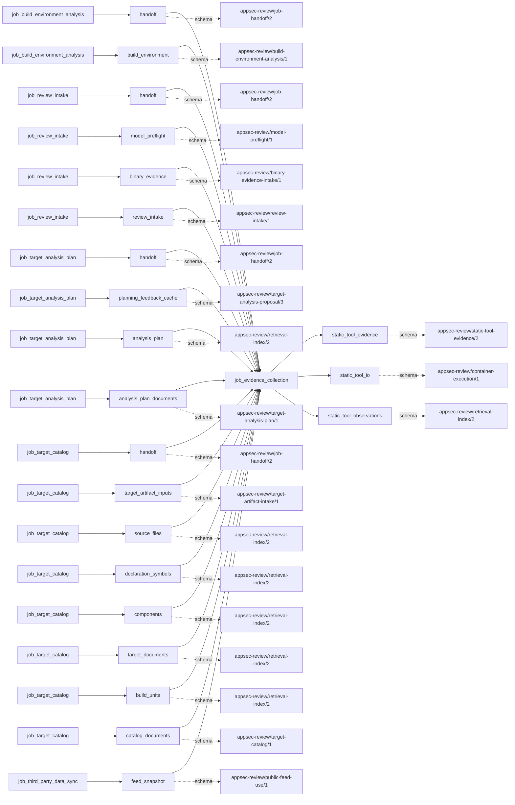
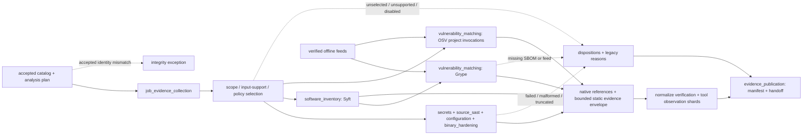

# evidence_collection

## Purpose

Execute the accepted analysis plan's applicable static scanners and retain bounded, native-result
provenance for their observations. This job supplies source/configuration judgments, package
inventory, advisory matches and binary checks for later review. It does not adjudicate
vulnerabilities, install target dependencies, execute target tests or treat an unselected,
unsupported, disabled or failed scanner as evidence that the target is clean.

<!-- generated:begin job=job_evidence_collection -->
<!-- generated from: appsec-review.toml, containers/catalog.toml, pipeline/guidance/registry.json, tests/job-test-map.json, src/appsec_review/runtime/registry.py, src/appsec_review/runtime/contracts.py, src/appsec_review/runtime/datasets.py, src/appsec_review/guidance/workers.py, src/appsec_review/mcp/schema.py, src/appsec_review/orchestration/topology.py, src/appsec_review/orchestration/dagster/adapter.py by scripts/generate-docs.py; do not edit -->
## Declared job contract

evidence_collection

Job: `job_evidence_collection`. Enabled in the dev recipe: **true**.
Declarations describe possible work, not successful execution or consumed evidence.

### Steps and tasks

| Step | Task | Workers | Pool | Bound tool or gap | Handler |
| --- | --- | --- | --- | --- | --- |
| `binary_hardening` | `binary_hardening.blint_index` | 1 | `index` | Undeclared ([T-147](../TODO.md)) | [source](../../src/appsec_review/jobs/job_evidence_collection/job.py#L1337) |
| `binary_hardening` | `binary_hardening.blint_normalize` | 1 | `application` | Undeclared ([T-147](../TODO.md)) | [source](../../src/appsec_review/jobs/job_evidence_collection/job.py#L1335) |
| `binary_hardening` | `binary_hardening.blint_scan` | 1 | `scanner` | `tool-blint` | [source](../../src/appsec_review/jobs/job_evidence_collection/job.py#L1313) |
| `configuration` | `configuration.checkov_index` | 1 | `index` | Undeclared ([T-147](../TODO.md)) | [source](../../src/appsec_review/jobs/job_evidence_collection/job.py#L1337) |
| `configuration` | `configuration.checkov_normalize` | 1 | `application` | Undeclared ([T-147](../TODO.md)) | [source](../../src/appsec_review/jobs/job_evidence_collection/job.py#L1335) |
| `configuration` | `configuration.checkov_scan` | 1 | `scanner` | `tool-checkov` | [source](../../src/appsec_review/jobs/job_evidence_collection/job.py#L1313) |
| `configuration` | `configuration.hadolint_index` | 1 | `index` | Undeclared ([T-147](../TODO.md)) | [source](../../src/appsec_review/jobs/job_evidence_collection/job.py#L1337) |
| `configuration` | `configuration.hadolint_normalize` | 1 | `application` | Undeclared ([T-147](../TODO.md)) | [source](../../src/appsec_review/jobs/job_evidence_collection/job.py#L1335) |
| `configuration` | `configuration.hadolint_scan` | 1 | `scanner` | `tool-hadolint` | [source](../../src/appsec_review/jobs/job_evidence_collection/job.py#L1313) |
| `configuration` | `configuration.trivy_index` | 1 | `index` | Undeclared ([T-147](../TODO.md)) | [source](../../src/appsec_review/jobs/job_evidence_collection/job.py#L1337) |
| `configuration` | `configuration.trivy_normalize` | 1 | `application` | Undeclared ([T-147](../TODO.md)) | [source](../../src/appsec_review/jobs/job_evidence_collection/job.py#L1335) |
| `configuration` | `configuration.trivy_scan` | 1 | `scanner` | `tool-trivy` | [source](../../src/appsec_review/jobs/job_evidence_collection/job.py#L1313) |
| `configuration` | `configuration.zizmor_index` | 1 | `index` | Undeclared ([T-147](../TODO.md)) | [source](../../src/appsec_review/jobs/job_evidence_collection/job.py#L1337) |
| `configuration` | `configuration.zizmor_normalize` | 1 | `application` | Undeclared ([T-147](../TODO.md)) | [source](../../src/appsec_review/jobs/job_evidence_collection/job.py#L1335) |
| `configuration` | `configuration.zizmor_scan` | 1 | `scanner` | `tool-zizmor` | [source](../../src/appsec_review/jobs/job_evidence_collection/job.py#L1313) |
| `evidence_publication` | `evidence_publication.assemble_manifest` | 1 | `application` | Undeclared ([T-147](../TODO.md)) | [source](../../src/appsec_review/jobs/job_evidence_collection/job.py#L1343) |
| `evidence_publication` | `evidence_publication.publish_handoff` | 1 | `application` | Undeclared ([T-147](../TODO.md)) | [source](../../src/appsec_review/jobs/job_evidence_collection/job.py#L1345) |
| `secrets` | `secrets.gitleaks_index` | 1 | `index` | Undeclared ([T-147](../TODO.md)) | [source](../../src/appsec_review/jobs/job_evidence_collection/job.py#L1337) |
| `secrets` | `secrets.gitleaks_normalize` | 1 | `application` | Undeclared ([T-147](../TODO.md)) | [source](../../src/appsec_review/jobs/job_evidence_collection/job.py#L1335) |
| `secrets` | `secrets.gitleaks_scan` | 1 | `scanner` | `tool-gitleaks` | [source](../../src/appsec_review/jobs/job_evidence_collection/job.py#L1313) |
| `software_inventory` | `software_inventory.syft_index` | 1 | `index` | Undeclared ([T-147](../TODO.md)) | [source](../../src/appsec_review/jobs/job_evidence_collection/job.py#L1337) |
| `software_inventory` | `software_inventory.syft_normalize` | 1 | `application` | Undeclared ([T-147](../TODO.md)) | [source](../../src/appsec_review/jobs/job_evidence_collection/job.py#L1335) |
| `software_inventory` | `software_inventory.syft_scan` | 1 | `scanner` | `tool-syft` | [source](../../src/appsec_review/jobs/job_evidence_collection/job.py#L1313) |
| `source_sast` | `source_sast.cppcheck_index` | 1 | `index` | Undeclared ([T-147](../TODO.md)) | [source](../../src/appsec_review/jobs/job_evidence_collection/job.py#L1337) |
| `source_sast` | `source_sast.cppcheck_normalize` | 1 | `application` | Undeclared ([T-147](../TODO.md)) | [source](../../src/appsec_review/jobs/job_evidence_collection/job.py#L1335) |
| `source_sast` | `source_sast.cppcheck_scan` | 1 | `scanner` | `tool-cppcheck` | [source](../../src/appsec_review/jobs/job_evidence_collection/job.py#L1313) |
| `source_sast` | `source_sast.gosec_index` | 1 | `index` | Undeclared ([T-147](../TODO.md)) | [source](../../src/appsec_review/jobs/job_evidence_collection/job.py#L1337) |
| `source_sast` | `source_sast.gosec_normalize` | 1 | `application` | Undeclared ([T-147](../TODO.md)) | [source](../../src/appsec_review/jobs/job_evidence_collection/job.py#L1335) |
| `source_sast` | `source_sast.gosec_scan` | 1 | `scanner` | `tool-gosec` | [source](../../src/appsec_review/jobs/job_evidence_collection/job.py#L1313) |
| `source_sast` | `source_sast.mobsfscan_index` | 1 | `index` | Undeclared ([T-147](../TODO.md)) | [source](../../src/appsec_review/jobs/job_evidence_collection/job.py#L1337) |
| `source_sast` | `source_sast.mobsfscan_normalize` | 1 | `application` | Undeclared ([T-147](../TODO.md)) | [source](../../src/appsec_review/jobs/job_evidence_collection/job.py#L1335) |
| `source_sast` | `source_sast.mobsfscan_scan` | 1 | `scanner` | `tool-mobsfscan` | [source](../../src/appsec_review/jobs/job_evidence_collection/job.py#L1313) |
| `source_sast` | `source_sast.opengrep_index` | 1 | `index` | Undeclared ([T-147](../TODO.md)) | [source](../../src/appsec_review/jobs/job_evidence_collection/job.py#L1337) |
| `source_sast` | `source_sast.opengrep_normalize` | 1 | `application` | Undeclared ([T-147](../TODO.md)) | [source](../../src/appsec_review/jobs/job_evidence_collection/job.py#L1335) |
| `source_sast` | `source_sast.opengrep_scan` | 1 | `scanner` | `tool-opengrep` | [source](../../src/appsec_review/jobs/job_evidence_collection/job.py#L1313) |
| `source_sast` | `source_sast.phpcs_index` | 1 | `index` | Undeclared ([T-147](../TODO.md)) | [source](../../src/appsec_review/jobs/job_evidence_collection/job.py#L1337) |
| `source_sast` | `source_sast.phpcs_normalize` | 1 | `application` | Undeclared ([T-147](../TODO.md)) | [source](../../src/appsec_review/jobs/job_evidence_collection/job.py#L1335) |
| `source_sast` | `source_sast.phpcs_scan` | 1 | `scanner` | `tool-phpcs` | [source](../../src/appsec_review/jobs/job_evidence_collection/job.py#L1313) |
| `source_sast` | `source_sast.phpstan_index` | 1 | `index` | Undeclared ([T-147](../TODO.md)) | [source](../../src/appsec_review/jobs/job_evidence_collection/job.py#L1337) |
| `source_sast` | `source_sast.phpstan_normalize` | 1 | `application` | Undeclared ([T-147](../TODO.md)) | [source](../../src/appsec_review/jobs/job_evidence_collection/job.py#L1335) |
| `source_sast` | `source_sast.phpstan_scan` | 1 | `scanner` | `tool-phpstan` | [source](../../src/appsec_review/jobs/job_evidence_collection/job.py#L1313) |
| `source_sast` | `source_sast.pmd_index` | 1 | `index` | Undeclared ([T-147](../TODO.md)) | [source](../../src/appsec_review/jobs/job_evidence_collection/job.py#L1337) |
| `source_sast` | `source_sast.pmd_normalize` | 1 | `application` | Undeclared ([T-147](../TODO.md)) | [source](../../src/appsec_review/jobs/job_evidence_collection/job.py#L1335) |
| `source_sast` | `source_sast.pmd_scan` | 1 | `scanner` | `tool-pmd` | [source](../../src/appsec_review/jobs/job_evidence_collection/job.py#L1313) |
| `source_sast` | `source_sast.psalm_index` | 1 | `index` | Undeclared ([T-147](../TODO.md)) | [source](../../src/appsec_review/jobs/job_evidence_collection/job.py#L1337) |
| `source_sast` | `source_sast.psalm_normalize` | 1 | `application` | Undeclared ([T-147](../TODO.md)) | [source](../../src/appsec_review/jobs/job_evidence_collection/job.py#L1335) |
| `source_sast` | `source_sast.psalm_scan` | 1 | `scanner` | `tool-psalm` | [source](../../src/appsec_review/jobs/job_evidence_collection/job.py#L1313) |
| `source_sast` | `source_sast.semgrep_index` | 1 | `index` | Undeclared ([T-147](../TODO.md)) | [source](../../src/appsec_review/jobs/job_evidence_collection/job.py#L1337) |
| `source_sast` | `source_sast.semgrep_normalize` | 1 | `application` | Undeclared ([T-147](../TODO.md)) | [source](../../src/appsec_review/jobs/job_evidence_collection/job.py#L1335) |
| `source_sast` | `source_sast.semgrep_scan` | 1 | `scanner` | `tool-semgrep` | [source](../../src/appsec_review/jobs/job_evidence_collection/job.py#L1313) |
| `source_sast` | `source_sast.shellcheck_index` | 1 | `index` | Undeclared ([T-147](../TODO.md)) | [source](../../src/appsec_review/jobs/job_evidence_collection/job.py#L1337) |
| `source_sast` | `source_sast.shellcheck_normalize` | 1 | `application` | Undeclared ([T-147](../TODO.md)) | [source](../../src/appsec_review/jobs/job_evidence_collection/job.py#L1335) |
| `source_sast` | `source_sast.shellcheck_scan` | 1 | `scanner` | `tool-shellcheck` | [source](../../src/appsec_review/jobs/job_evidence_collection/job.py#L1313) |
| `source_sast` | `source_sast.spotbugs_index` | 1 | `index` | Undeclared ([T-147](../TODO.md)) | [source](../../src/appsec_review/jobs/job_evidence_collection/job.py#L1337) |
| `source_sast` | `source_sast.spotbugs_normalize` | 1 | `application` | Undeclared ([T-147](../TODO.md)) | [source](../../src/appsec_review/jobs/job_evidence_collection/job.py#L1335) |
| `source_sast` | `source_sast.spotbugs_scan` | 1 | `scanner` | `tool-spotbugs` | [source](../../src/appsec_review/jobs/job_evidence_collection/job.py#L1313) |
| `vulnerability_matching` | `vulnerability_matching.grype_index` | 1 | `index` | Undeclared ([T-147](../TODO.md)) | [source](../../src/appsec_review/jobs/job_evidence_collection/job.py#L1337) |
| `vulnerability_matching` | `vulnerability_matching.grype_normalize` | 1 | `application` | Undeclared ([T-147](../TODO.md)) | [source](../../src/appsec_review/jobs/job_evidence_collection/job.py#L1335) |
| `vulnerability_matching` | `vulnerability_matching.grype_scan` | 1 | `scanner` | `tool-grype` | [source](../../src/appsec_review/jobs/job_evidence_collection/job.py#L1313) |
| `vulnerability_matching` | `vulnerability_matching.osv_scanner_index` | 1 | `index` | Undeclared ([T-147](../TODO.md)) | [source](../../src/appsec_review/jobs/job_evidence_collection/job.py#L1337) |
| `vulnerability_matching` | `vulnerability_matching.osv_scanner_normalize` | 1 | `application` | Undeclared ([T-147](../TODO.md)) | [source](../../src/appsec_review/jobs/job_evidence_collection/job.py#L1335) |
| `vulnerability_matching` | `vulnerability_matching.osv_scanner_scan` | 1 | `scanner` | `tool-osv-scanner` | [source](../../src/appsec_review/jobs/job_evidence_collection/job.py#L1313) |

### Accepted input declarations

| Producer | Dataset | Schema | Channel | Availability | Missing policy |
| --- | --- | --- | --- | --- | --- |
| `job_build_environment_analysis` | `handoff` | `appsec-review/job-handoff/2` | handoff | optional | gap |
| `job_build_environment_analysis` | `build_environment` | `appsec-review/build-environment-analysis/1` | handoff | optional | gap |
| `job_review_intake` | `handoff` | `appsec-review/job-handoff/2` | handoff | optional | gap |
| `job_review_intake` | `model_preflight` | `appsec-review/model-preflight/1` | handoff | optional | gap |
| `job_review_intake` | `binary_evidence` | `appsec-review/binary-evidence-intake/1` | handoff | optional | gap |
| `job_review_intake` | `review_intake` | `appsec-review/review-intake/1` | handoff | optional | gap |
| `job_target_analysis_plan` | `handoff` | `appsec-review/job-handoff/2` | handoff | optional | gap |
| `job_target_analysis_plan` | `planning_feedback_cache` | `appsec-review/target-analysis-proposal/3` | handoff | optional | gap |
| `job_target_analysis_plan` | `analysis_plan` | `appsec-review/retrieval-index/2` | handoff | optional | gap |
| `job_target_analysis_plan` | `analysis_plan_documents` | `appsec-review/target-analysis-plan/1` | handoff | optional | gap |
| `job_target_catalog` | `handoff` | `appsec-review/job-handoff/2` | handoff | optional | gap |
| `job_target_catalog` | `target_artifact_inputs` | `appsec-review/target-artifact-intake/1` | handoff | optional | gap |
| `job_target_catalog` | `source_files` | `appsec-review/retrieval-index/2` | handoff | optional | gap |
| `job_target_catalog` | `declaration_symbols` | `appsec-review/retrieval-index/2` | handoff | optional | gap |
| `job_target_catalog` | `components` | `appsec-review/retrieval-index/2` | handoff | optional | gap |
| `job_target_catalog` | `target_documents` | `appsec-review/retrieval-index/2` | handoff | optional | gap |
| `job_target_catalog` | `build_units` | `appsec-review/retrieval-index/2` | handoff | optional | gap |
| `job_target_catalog` | `catalog_documents` | `appsec-review/target-catalog/1` | handoff | optional | gap |
| `job_third_party_data_sync` | `feed_snapshot` | `appsec-review/public-feed-use/1` | external | optional | gap |

### Published dataset declarations

| Dataset | Step | Schema | Stage | Indexes | MCP route |
| --- | --- | --- | --- | --- | --- |
| `static_tool_evidence` | `evidence_publication` | `appsec-review/static-tool-evidence/2` | artifact_only | Not indexed | `coverage`, `query_dataset_inventory` |
| `static_tool_io` | `source_sast` | `appsec-review/container-execution/1` | protected | Not indexed | `coverage`, `query_dataset_inventory` |
| `static_tool_observations` | `evidence_publication` | `appsec-review/retrieval-index/2` | indexed | `observations` | `find`, `query_precomputed`, `search` |

Protected and artifact-only routes expose sanitized metadata, not payload access.

### Model and guidance declarations

No job-level model declaration; absence of a task binding remains [T-147](../TODO.md), not a nonexecution claim.

### Test selection

| Tier | Files or selectors |
| --- | --- |
| acceptance | None declared |
| integration | `tests/integration/test_signal_job_acceptance.py` |
| live | None declared |
| unit | `tests/test_evidence_collection_job.py` |

### Dagster placement

Dispatch: `review_graph`. Review graph member: **true**. Enabled graph member: **true**.

Declared predecessors: `job_target_analysis_plan`.

### Declared dataflow

<!-- generated:end -->

## Process

Source: [handler graph](../../src/appsec_review/jobs/job_evidence_collection/job.py),
[adapter registry](../../src/appsec_review/jobs/job_evidence_collection/adapters.py) and
[evidence normalization](../../src/appsec_review/jobs/job_evidence_collection/evidence.py).
Every configured scanner has scan, normalize and index tasks. The shared in-job sequence is:

1. Verify accepted catalog and analysis-plan snapshots; select only the plan's scanner scope,
   apply Swift policy, then partition declared input support. Unselected/absent scope retains its
   reason; unsupported-only input yields a skip decision without a launch.
2. Verify required supplied rules, sanitized metadata and offline feeds. Missing prerequisites
   produce blocked evidence. Resolve the pinned image and any feed/tool compatibility before
   checking the scanner checkpoint.
3. Execute bounded invocations with configured retry policy; active execution-safety restricts
   retries and can stop at failure. Preserve receipts and diagnostic streams. Timeout, OOM, wrong
   exit, missing/oversized report or incompatible parsing never becomes a clean zero-result scan.
4. Retain the exact native report and selector for each observation; incomplete failed output is
   retained as incomplete evidence, not successful findings. Separate parser diagnostics and
   declared skips from observations, then normalize/redact with field, record and total-byte bounds.
5. The normalize task verifies the already-normalized envelope and scan status; it does not run
   another parser pass. The index task verifies accepted source hashes and writes a tool shard
   with evidence/observation entities, source-location links and coverage.

Shared admission and provenance rules live in
[job input contracts](../architecture/job-input-contracts.md#admission-and-read-receipts) and
[native-result interchange](../architecture/job-interchange.md#native-result-and-common-observation).

### `secrets`

1. Select the accepted Gitleaks scope and require the supplied generic secret rules.
2. Run Gitleaks directory mode with redaction and JSON reporting; retain worktree-only coverage.
   Git history is not scanned by this adapter.
3. Normalize redacted secret observations with native selectors and catalog-bound locations.
   Missing rules, execution/report failures and envelope limits retain the reasons described above;
   never publish raw secret values as searchable context.

### `source_sast`

1. Route accepted supported paths to each configured source adapter. Semgrep uses its security
   baseline plus review-signal, banned-function and SEI CERT rules; Opengrep omits the
   Semgrep-specific security baseline. Require supplied rule bundles and retain their identities.
2. Run gosec with offline-context limitations, MobSFScan on declared mobile source support,
   ShellCheck on shell inputs, and the PHP adapters under their own exit/report conventions.
   PHPCS uses the supplied standard rather than inferring a project standard; PHPStan does not
   install Composer dependencies, and Psalm may lack required configuration/stubs.
3. For Cppcheck, sanitize an accepted compile database down to cataloged units and harmless
   source-analysis arguments, or use its selected source mode. Missing/unreadable/empty usable
   compile metadata blocks that path; captured commands are not executed.
4. For PMD, use the security-focused rules and bounded supplied file list. For SpotBugs, require
   accepted catalog bytecode inputs rather than assuming Java source was compiled here.
5. Parse reports with native selectors; retain SEI CERT errors/unscanned inputs and exact skip
   decisions. Unsupported source languages remain coverage gaps at final assembly, not merely
   zero observations in the supported-language tools.

### `software_inventory`

1. Run Syft directory inventory over the selected target context. Directory coverage is distinct
   from built-artifact, archive or OCI inventory.
2. Retain the successful native Syft document and normalized package observations with inventory
   semantics. The raw scanner output is the explicit prerequisite of Grype's scan task.
3. Keep unavailable/malformed/over-bound inventory as a failed or partial producer result, not an
   empty authoritative package list.

### `vulnerability_matching`

1. For OSV, verify the immutable snapshot and partition selected lockfiles by available ecosystem;
   missing ecosystem data remains a coverage reason. Group bounded invocations by project and
   ecosystem needs, mounting only required offline databases.
2. Retain successful siblings when one invocation fails; all failed invocations mean failure.
   Merge bounded outputs with their individual receipts. A documented no-packages result means
   scanned empty package input, not a vulnerability assessment of other files.
3. For Grype, honor configured disablement before reuse. Otherwise require a successful/partial
   Syft SBOM and verified compatible Grype database, then scan that SBOM rather than the target
   directory again.
4. Preserve reported advisory matches as scanner records with native selectors; do not turn
   package presence or an empty match list into an independently verified vulnerability verdict.

### `configuration`

1. Route accepted Dockerfiles to Hadolint, supported configuration frameworks to Checkov,
   configuration inputs to Trivy and GitHub workflows to offline zizmor.
2. Stage only selected Trivy inputs and use embedded checks without update downloads. Retain
   embedded-rule and stderr limitations.
3. Parse native configuration diagnostics; preserve Checkov parsing errors and explicit
   unreported/unsupported-input decisions separately from successful checks.
4. Normalize/hash-bind locations and publish tool shards; no configuration content executes as
   workflow code.

### `binary_hardening`

1. Select accepted catalog binary inputs for blint. This is not the post-build artifact-scanning
   lane and does not infer a binary from source-only availability.
2. Run blint, assemble its bounded report and retain supported native `findings.json` selectors.
   Missing report, assembly failure, byte limits and truncation prevent complete evidence.
3. Normalize reported checks and publish their scanner provenance, not a source-level or
   exploitability claim.

### `evidence_publication`

1. Collect each tool shard and exact scan disposition, reuse status, record count, reasons and
   skipped-input accounting.
2. Independently compare catalog languages with declared source-analyzer support; publish bounded
   unsupported-path detail and full unsupported counts.
3. Replace this producer's previous shards in the verified upstream manifest. Publish
   `evidence-<attempt>.json` and `handoff.json` with tool dispositions, reasons and an empty
   security-findings list. Item count is normalized records across tools, not confirmed findings.

## Dataflow

## Gaps

Source reasons are legacy text. [Interchange](../architecture/job-interchange.md#the-control-layer-beneath-the-envelope)
wraps them as `producer_reported_gap`, normally non-retryable, and can add control outcomes for
failed/blocked units. Default retryability is not advisory classification.

- Input absent/not applicable: absent catalog input or unselected planned scanner retains its
  reason. Declared unsupported-only inputs and documented tool-reported empty/unsupported inputs
  have skip decisions, not invented successful scans.
- Input/tooling prerequisites: unavailable supplied Semgrep/Opengrep/Gitleaks/SEI CERT/PMD rules,
  unreadable or unusable sanitized Cppcheck database, unavailable OSV/Grype snapshot or ecosystem,
  feed/tool incompatibility and absent successful Syft SBOM.
- Tooling failure: image resolution, timeout/OOM, wrong exit, missing or over-bound native report,
  report assembly and parser incompatibility; failed project invocations retain their own receipts.
- Coverage missing: disabled Grype or Swift, unsupported-language coverage, stdout/stderr/report
  truncation, absent native provenance, unresolved catalog location, normalized field/record/byte
  bounds, native parser diagnostics and unscanned accepted files.
- Adapter limits: worktree-only secrets, offline Go context, SEI CERT rule-pack limits
  ([T-008](../TODO.md)), Cppcheck source rather than compiler semantics, PMD's security subset,
  PHP standard/dependency/config limits, directory-only Syft and embedded-only Trivy checks.

Changed accepted source hashes, evidence envelope schema/status or native-result references can
raise before publication. Execution-safety can stop a failed invocation before its fallback result.
Neither is an accepted gap document. The shard's simple complete/partial coverage mapping does not
replace its scan disposition, skip decisions or canonical outcomes. No reason is automatically on
a particular walk's user-approved expected list.

## Acceptance

1. **A. Inputs:** Match catalog/plan pins, selected paths/hashes, supported-input decisions, mounted
   rule/feed identities and executed image receipts. Reconcile Grype's exact Syft input and OSV's
   project/ecosystem partition with admitted artifacts.
2. **B. Independent comparison:** Count native results per tool/invocation and compare accepted,
   skipped, diagnostic-only and bounded-away records. Resolve sampled native selectors and source
   spans independently; verify secret redaction, Syft package count, OSV project totals and the
   unsupported-language count from the catalog.
3. **C. Gaps:** Group verified outcomes, reconcile scanner dispositions and all native/envelope
   limits with receipts and raw reports, then compare causes and costs with the expected list.
   A partial sibling cannot disappear when another invocation succeeds.
4. **D. Baseline:** On authorized acceptance save `stepwise.py accept`, corpus namespace and baseline
   with per-tool scope/image/feed identities, record counts and coverage. No scanner, model or live
   acceptance ran to write this page.

## Resume and invalidation

Tool checkpoint identity binds target/catalog/scope, image, adapter/parser/normalizer/validator,
mounted input/rule identities, declared component releases and job/task settings. Only successful
or partial results are saved; failures set a retry-required marker. Reuse verifies retained
artifacts/native references and required releases; disabled Grype bypasses it. OSV grouping and
feed identities therefore affect the tool result, not an unbound external cache.

Index reuse is separately keyed by normalized evidence, snapshot and mapping/normalizer identities
and verifies the indexed file hash. Changed normalization can re-index retained evidence without
claiming a new scan. See [runtime receipts](../architecture/jobs-and-runtime.md#wave-1-resumability),
[image pins](image-pin-verification.md), [signing](signing.md) and
[accepted index sets](../architecture/python-and-retrieval.md#accepted-index-sets).
Generated task and language/applicability declarations remain incomplete under
[T-147](../TODO.md) and [T-157](../TODO.md); absence of those bindings is not proof of nonexecution.
