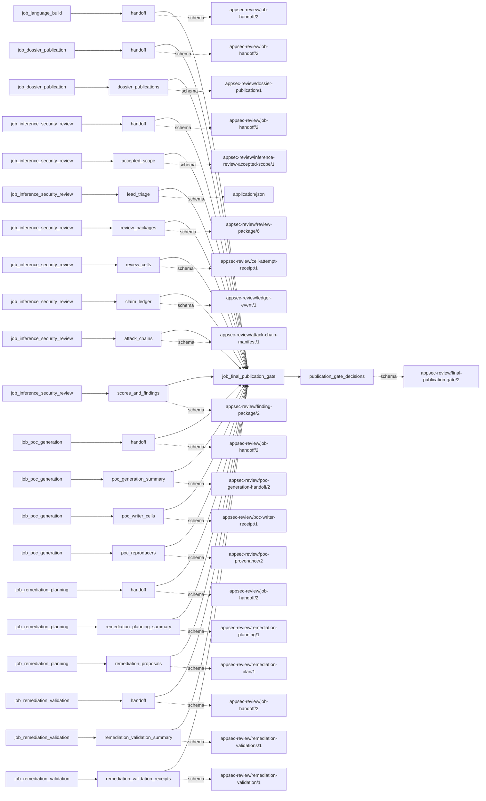

# final_publication_gate

This page contains the generated contract; the authored process and acceptance description are tracked by [T-130](../TODO.md).

<!-- generated:begin job=job_final_publication_gate -->
<!-- generated from: appsec-review.toml, containers/catalog.toml, pipeline/guidance/registry.json, tests/job-test-map.json, src/appsec_review/runtime/registry.py, src/appsec_review/runtime/contracts.py, src/appsec_review/runtime/datasets.py, src/appsec_review/guidance/workers.py, src/appsec_review/mcp/schema.py, src/appsec_review/orchestration/topology.py, src/appsec_review/orchestration/dagster/adapter.py by scripts/generate-docs.py; do not edit -->
## Declared job contract

final_publication_gate

Job: `job_final_publication_gate`. Enabled in the dev recipe: **true**.
Declarations describe possible work, not successful execution or consumed evidence.

### Steps and tasks

| Step | Task | Workers | Pool | Bound tool or gap | Handler |
| --- | --- | --- | --- | --- | --- |
| `acceptance` | `acceptance.publish_handoff` | 1 | `application` | Undeclared ([T-147](../TODO.md)) | [source](../../src/appsec_review/jobs/job_final_publication_gate/job.py#L123) |
| `gate` | `gate.classify` | 1 | `application` | Undeclared ([T-147](../TODO.md)) | [source](../../src/appsec_review/jobs/job_final_publication_gate/job.py#L116) |
| `load` | `load.verify_review` | 1 | `application` | Undeclared ([T-147](../TODO.md)) | [source](../../src/appsec_review/jobs/job_final_publication_gate/job.py#L64) |

### Accepted input declarations

| Producer | Dataset | Schema | Channel | Availability | Missing policy |
| --- | --- | --- | --- | --- | --- |
| `job_language_build` | `handoff` | `appsec-review/job-handoff/2` | handoff | optional | gap |
| `job_dossier_publication` | `handoff` | `appsec-review/job-handoff/2` | handoff | when_producer_enabled | reject |
| `job_dossier_publication` | `dossier_publications` | `appsec-review/dossier-publication/1` | handoff | optional | gap |
| `job_inference_security_review` | `handoff` | `appsec-review/job-handoff/2` | handoff | required | reject |
| `job_inference_security_review` | `accepted_scope` | `appsec-review/inference-review-accepted-scope/1` | handoff | optional | gap |
| `job_inference_security_review` | `lead_triage` | `application/json` | handoff | optional | gap |
| `job_inference_security_review` | `review_packages` | `appsec-review/review-package/6` | handoff | optional | gap |
| `job_inference_security_review` | `review_cells` | `appsec-review/cell-attempt-receipt/1` | handoff | optional | gap |
| `job_inference_security_review` | `claim_ledger` | `appsec-review/ledger-event/1` | handoff | optional | gap |
| `job_inference_security_review` | `attack_chains` | `appsec-review/attack-chain-manifest/1` | handoff | optional | gap |
| `job_inference_security_review` | `scores_and_findings` | `appsec-review/finding-package/2` | handoff | optional | gap |
| `job_poc_generation` | `handoff` | `appsec-review/job-handoff/2` | handoff | when_producer_enabled | reject |
| `job_poc_generation` | `poc_generation_summary` | `appsec-review/poc-generation-handoff/2` | handoff | optional | gap |
| `job_poc_generation` | `poc_writer_cells` | `appsec-review/poc-writer-receipt/1` | handoff | optional | gap |
| `job_poc_generation` | `poc_reproducers` | `appsec-review/poc-provenance/2` | handoff | optional | gap |
| `job_remediation_planning` | `handoff` | `appsec-review/job-handoff/2` | handoff | when_producer_enabled | reject |
| `job_remediation_planning` | `remediation_planning_summary` | `appsec-review/remediation-planning/1` | handoff | optional | gap |
| `job_remediation_planning` | `remediation_proposals` | `appsec-review/remediation-plan/1` | handoff | optional | gap |
| `job_remediation_validation` | `handoff` | `appsec-review/job-handoff/2` | handoff | when_producer_enabled | reject |
| `job_remediation_validation` | `remediation_validation_summary` | `appsec-review/remediation-validations/1` | handoff | optional | gap |
| `job_remediation_validation` | `remediation_validation_receipts` | `appsec-review/remediation-validation/1` | handoff | optional | gap |

### Published dataset declarations

| Dataset | Step | Schema | Stage | Indexes | MCP route |
| --- | --- | --- | --- | --- | --- |
| `publication_gate_decisions` | `acceptance` | `appsec-review/final-publication-gate/2` | artifact_only | Not indexed | `coverage`, `query_dataset_inventory` |

Protected and artifact-only routes expose sanitized metadata, not payload access.

### Model and guidance declarations

No job-level model declaration; absence of a task binding remains [T-147](../TODO.md), not a nonexecution claim.

### Test selection

| Tier | Files or selectors |
| --- | --- |
| acceptance | `tests/test_final_report.py::test_gate_accounts_for_every_package_in_exactly_one_bucket` |
| integration | None declared |
| live | None declared |
| unit | `tests/test_final_report.py::test_a_clean_review_is_publishable_and_not_run_stages_never_change_that` `tests/test_final_report.py::test_package_counts_reject_a_package_in_no_bucket` `tests/test_final_report.py::test_unrated_unscored_and_empty_reviews_are_named_gaps` |

### Dagster placement

Dispatch: `review_graph`. Review graph member: **true**. Enabled graph member: **true**.

Declared predecessors: `job_dossier_publication`.

### Declared dataflow

<!-- generated:end -->
