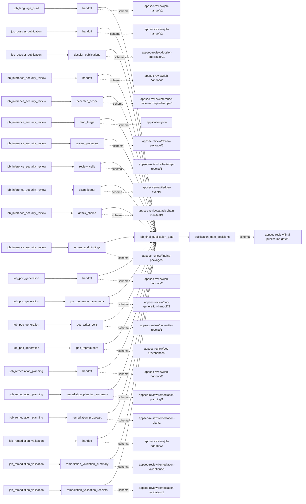
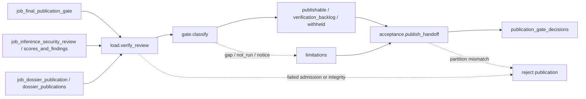

# final_publication_gate

## Purpose

Certify a publication partition over the accepted inference review and commissioned completion
artifacts. Confirmed findings may be publishable, supported findings remain an unconfirmed
verification backlog, and unverifiable referenced outcome classes are withheld. The gate does
not re-adjudicate claims, recompute scores, change shipment decisions or certify runtime proof.

<!-- generated:begin job=job_final_publication_gate -->
<!-- generated from: appsec-review.toml, containers/catalog.toml, pipeline/guidance/registry.json, tests/job-test-map.json, src/appsec_review/runtime/registry.py, src/appsec_review/runtime/contracts.py, src/appsec_review/runtime/datasets.py, src/appsec_review/guidance/workers.py, src/appsec_review/mcp/schema.py, src/appsec_review/orchestration/topology.py, src/appsec_review/orchestration/dagster/adapter.py by scripts/generate-docs.py; do not edit -->
## Declared job contract

final_publication_gate

Job: `job_final_publication_gate`. Enabled in the dev recipe: **true**.
Declarations describe possible work, not successful execution or consumed evidence.

### Steps and tasks

| Step | Task | Workers | Pool | Bound tool or gap | Handler |
| --- | --- | --- | --- | --- | --- |
| `acceptance` | `acceptance.publish_handoff` | 1 | `application` | Undeclared ([T-147](../TODO.md)) | [source](../../src/appsec_review/jobs/job_final_publication_gate/job.py#L123) |
| `gate` | `gate.classify` | 1 | `application` | Undeclared ([T-147](../TODO.md)) | [source](../../src/appsec_review/jobs/job_final_publication_gate/job.py#L116) |
| `load` | `load.verify_review` | 1 | `application` | Undeclared ([T-147](../TODO.md)) | [source](../../src/appsec_review/jobs/job_final_publication_gate/job.py#L64) |

### Accepted input declarations

| Producer | Dataset | Schema | Channel | Availability | Missing policy |
| --- | --- | --- | --- | --- | --- |
| `job_language_build` | `handoff` | `appsec-review/job-handoff/2` | handoff | optional | gap |
| `job_dossier_publication` | `handoff` | `appsec-review/job-handoff/2` | handoff | when_producer_enabled | reject |
| `job_dossier_publication` | `dossier_publications` | `appsec-review/dossier-publication/1` | handoff | optional | gap |
| `job_inference_security_review` | `handoff` | `appsec-review/job-handoff/2` | handoff | required | reject |
| `job_inference_security_review` | `accepted_scope` | `appsec-review/inference-review-accepted-scope/1` | handoff | optional | gap |
| `job_inference_security_review` | `lead_triage` | `application/json` | handoff | optional | gap |
| `job_inference_security_review` | `review_packages` | `appsec-review/review-package/6` | handoff | optional | gap |
| `job_inference_security_review` | `review_cells` | `appsec-review/cell-attempt-receipt/1` | handoff | optional | gap |
| `job_inference_security_review` | `claim_ledger` | `appsec-review/ledger-event/1` | handoff | optional | gap |
| `job_inference_security_review` | `attack_chains` | `appsec-review/attack-chain-manifest/1` | handoff | optional | gap |
| `job_inference_security_review` | `scores_and_findings` | `appsec-review/finding-package/2` | handoff | optional | gap |
| `job_poc_generation` | `handoff` | `appsec-review/job-handoff/2` | handoff | when_producer_enabled | reject |
| `job_poc_generation` | `poc_generation_summary` | `appsec-review/poc-generation-handoff/2` | handoff | optional | gap |
| `job_poc_generation` | `poc_writer_cells` | `appsec-review/poc-writer-receipt/1` | handoff | optional | gap |
| `job_poc_generation` | `poc_reproducers` | `appsec-review/poc-provenance/2` | handoff | optional | gap |
| `job_remediation_planning` | `handoff` | `appsec-review/job-handoff/2` | handoff | when_producer_enabled | reject |
| `job_remediation_planning` | `remediation_planning_summary` | `appsec-review/remediation-planning/1` | handoff | optional | gap |
| `job_remediation_planning` | `remediation_proposals` | `appsec-review/remediation-plan/1` | handoff | optional | gap |
| `job_remediation_validation` | `handoff` | `appsec-review/job-handoff/2` | handoff | when_producer_enabled | reject |
| `job_remediation_validation` | `remediation_validation_summary` | `appsec-review/remediation-validations/1` | handoff | optional | gap |
| `job_remediation_validation` | `remediation_validation_receipts` | `appsec-review/remediation-validation/1` | handoff | optional | gap |

### Published dataset declarations

| Dataset | Step | Schema | Stage | Indexes | MCP route |
| --- | --- | --- | --- | --- | --- |
| `publication_gate_decisions` | `acceptance` | `appsec-review/final-publication-gate/2` | artifact_only | Not indexed | `coverage`, `query_dataset_inventory` |

Protected and artifact-only routes expose sanitized metadata, not payload access.

### Model and guidance declarations

No job-level model declaration; absence of a task binding remains [T-147](../TODO.md), not a nonexecution claim.

### Test selection

| Tier | Files or selectors |
| --- | --- |
| acceptance | `tests/test_final_report.py::test_gate_accounts_for_every_package_in_exactly_one_bucket` |
| integration | None declared |
| live | None declared |
| unit | `tests/test_final_report.py::test_a_clean_review_is_publishable_and_not_run_stages_never_change_that` `tests/test_final_report.py::test_package_counts_reject_a_package_in_no_bucket` `tests/test_final_report.py::test_unrated_unscored_and_empty_reviews_are_named_gaps` |

### Dagster placement

Dispatch: `review_graph`. Review graph member: **true**. Enabled graph member: **true**.

Declared predecessors: `job_dossier_publication`.

### Declared dataflow

<!-- generated:end -->

## Process

See the [handler](../../src/appsec_review/jobs/job_final_publication_gate/job.py),
[attachment verifier](../../src/appsec_review/jobs/job_final_publication_gate/attachments.py) and
[classifier](../../src/appsec_review/jobs/job_final_publication_gate/classify.py).

### `load`

1. In `load.verify_review`, reverify the accepted review from bound bytes, including ledger,
   projection, packages, scores, evidence and coverage; enforce the package bound.
2. Read and bind the frozen configuration. Determine enabled completion producers from it;
   attack-chain work is always part of the accepted review. An explicit PoC upstream pin also
   commissions that otherwise optional producer.
3. Verify attachments and their exact review/finding identities. Reject missing enabled producer
   handoffs under the typed contract and reject corrupt, mismatched or unbound attachments.
   Disabled producers are not silently discovered as evidence.
4. Write the verified snapshot with capabilities, attachments and every binding.

### `gate`

1. In `gate.classify`, preserve each accepted claim state and ship-block result.
2. Withhold a package if its referenced PoC outcome or attack-chain identity is unavailable.
   Otherwise place confirmed intake in `publishable` and supported intake in
   `verification_backlog`. Reject a package outside its accepted partition.
3. Count exact, disjoint buckets. Derive ordered limitations from review/lane completeness,
   ledger gaps, coverage, scores, independence, duplicate pairs and completion capability status.
   Keep `gap`, `not_run` and `notice` distinct.

### `acceptance`

1. In `acceptance.publish_handoff`, rebuild the gate document and reverify the loaded snapshot.
2. Validate its schema and require bucket totals to equal the package count.
3. Publish the immutable `publication_gate_decisions` artifact. Only limitations of kind `gap`
   enter the handler's gap list; notices do not turn into execution claims or clean-target proof.

## Dataflow

The generated contract lists all possible completion inputs; the
[accepted-input boundary](../architecture/job-input-contracts.md#admission-and-read-receipts)
decides which bytes this attempt may use. Verified bindings are not new retrieval grants.

## Gaps

The classifier emits limitation IDs, not new `producer-gap/1` codes. Handler gap strings have
no source-supplied retryability classification. See
[interchange outcomes](../architecture/job-interchange.md#the-control-layer-beneath-the-envelope).

| Limitation IDs or reason | Scope and walk meaning |
| --- | --- |
| `review_degraded`, `review_empty`, `review_incomplete`, `lane_degraded` | Review/lane completion; emptiness or failed coverage is never clean. |
| `gaps_recorded`, `coverage_incomplete` | Ledger gap classes and nonreviewed hunt-coverage rows. |
| `pending_distinct_verification` | Finding cannot receive the stronger shipment disposition without required independent verification. |
| `technical_severity_unrated`, `decision_pending`, `findings_without_scores` | Missing scoring or decision evidence, not low severity. |
| `withheld_packages`, `possible_duplicates` | Referenced outcome class unavailable, or unresolved duplicate pair. |
| `poc_generation_gap`, `attack_chains_gap`, `remediation_planning_gap`, `remediation_validation_gap`, `dossiers_gap` | Accepted completion capability has gaps/omissions. |
| `poc_lane_not_run`, `attack_chain_composition_not_run`, `remediation_planning_not_run`, `remediation_validation_not_run`, `dossiers_not_run` | `not_run` limitations when the capability is policy-skipped; not converted to handler gaps. |
| `compile_only_nonexecution` | Notice: generated PoCs, controls and remediation regressions were not executed. |

Withheld reasons are `poc_outcome_unavailable` and `attack_chain_unavailable`. Corrupt referenced
bytes or failed enabled-input admission are errors, not withheld-success substitutes.

## Acceptance

1. **A. Inputs:** Compare the claim's review and commissioned-producer pins with verified handoffs;
   verify frozen configuration, explicit PoC admission and the complete attachment binding set.
2. **B. Independent comparison:** Independently enumerate the accepted review's confirmed and
   supported partitions. Reconcile every finding-package ID into exactly one gate bucket, compare
   hashes and unchanged state/score/ship-block values, and resolve each withheld reason against the
   accepted PoC/chain manifests.
3. **C. Gaps:** Group verified canonical outcomes and compare limitation IDs/counts with ledger
   gaps, coverage rows, score absence and completion omissions. Record `not_run` and notices
   separately; stop for unconfirmed expected causes.
4. **D. Baseline:** Save an authorized `stepwise.py accept` baseline with corpus namespace, gate
   hash, input hashes, bucket memberships and limitation counts. A later partition diff must
   identify the changed accepted evidence, not merely a different display status.

## Resume and invalidation

There is no model or gate-specific semantic cache. Exact accepted handoffs, frozen configuration,
component identities and bindings govern [runtime reuse](../architecture/jobs-and-runtime.md#wave-1-resumability).
Changing review evidence, commissioned producer identity or enablement requires recertification;
unchanged upstream computation need not be rerun just to rebuild this projection. The publication
unit rechecks the snapshot rather than trusting its earlier classification. Artifact-bearing
results are not portable failed-attempt checkpoints.
