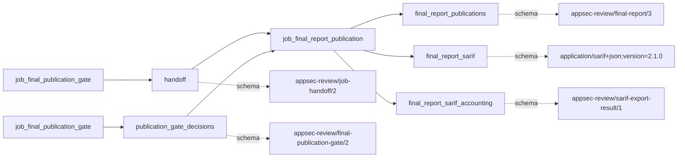
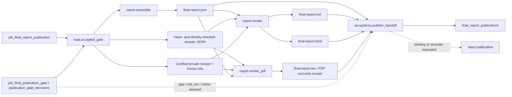

# final_report_publication

## Purpose

Publish deterministic JSON, Markdown, HTML and executive PDF projections of the accepted final gate. The report
separates publishable confirmed findings, verification backlog, withheld packages, coverage and
completion limitations. It does not reassess vulnerabilities, upgrade assurance, resolve findings
from build checks or turn a publication status into permission to ship.

<!-- generated:begin job=job_final_report_publication -->
<!-- generated from: appsec-review.toml, containers/catalog.toml, pipeline/guidance/registry.json, tests/job-test-map.json, src/appsec_review/runtime/registry.py, src/appsec_review/runtime/contracts.py, src/appsec_review/runtime/datasets.py, src/appsec_review/guidance/workers.py, src/appsec_review/mcp/schema.py, src/appsec_review/orchestration/topology.py, src/appsec_review/orchestration/dagster/adapter.py by scripts/generate-docs.py; do not edit -->
## Declared job contract

final_report_publication

Job: `job_final_report_publication`. Enabled in the dev recipe: **true**.
Declarations describe possible work, not successful execution or consumed evidence.

### Steps and tasks

| Step | Task | Workers | Pool | Bound tool or gap | Handler |
| --- | --- | --- | --- | --- | --- |
| `acceptance` | `acceptance.publish_handoff` | 1 | `application` | Undeclared ([T-147](../TODO.md)) | [source](../../src/appsec_review/jobs/job_final_report_publication/job.py#L211) |
| `load` | `load.accepted_gate` | 1 | `application` | Undeclared ([T-147](../TODO.md)) | [source](../../src/appsec_review/jobs/job_final_report_publication/job.py#L102) |
| `report` | `report.assemble` | 1 | `application` | Undeclared ([T-147](../TODO.md)) | [source](../../src/appsec_review/jobs/job_final_report_publication/job.py#L116) |
| `report` | `report.render` | 1 | `application` | Undeclared ([T-147](../TODO.md)) | [source](../../src/appsec_review/jobs/job_final_report_publication/job.py#L167) |
| `report` | `report.render_pdf` | 1 | `application` | Undeclared ([T-147](../TODO.md)) | [source](../../src/appsec_review/jobs/job_final_report_publication/job.py#L191) |

### Accepted input declarations

| Producer | Dataset | Schema | Channel | Availability | Missing policy |
| --- | --- | --- | --- | --- | --- |
| `job_final_publication_gate` | `handoff` | `appsec-review/job-handoff/2` | handoff | required | reject |
| `job_final_publication_gate` | `publication_gate_decisions` | `appsec-review/final-publication-gate/2` | handoff | optional | gap |

### Published dataset declarations

| Dataset | Step | Schema | Stage | Indexes | MCP route |
| --- | --- | --- | --- | --- | --- |
| `final_report_publications` | `acceptance` | `appsec-review/final-report/3` | artifact_only | Not indexed | `coverage`, `query_dataset_inventory` |
| `final_report_sarif` | `report` | `application/sarif+json;version=2.1.0` | protected | Not indexed | `coverage`, `query_dataset_inventory` |
| `final_report_sarif_accounting` | `report` | `appsec-review/sarif-export-result/1` | artifact_only | Not indexed | `coverage`, `query_dataset_inventory` |

Protected and artifact-only routes expose sanitized metadata, not payload access.

### Model and guidance declarations

No job-level model declaration; absence of a task binding remains [T-147](../TODO.md), not a nonexecution claim.

### Test selection

| Tier | Files or selectors |
| --- | --- |
| acceptance | `tests/test_final_report.py::test_report_json_is_schema_valid_and_contains_the_required_sections` |
| integration | None declared |
| live | None declared |
| unit | `tests/unit/job_final_report_publication/test_contract_and_settings.py` `tests/unit/job_final_report_publication/test_job_units.py` `tests/unit/job_final_report_publication/test_report_and_render.py` `tests/unit/job_final_report_publication/test_report_custody.py` |

### Dagster placement

Dispatch: `review_graph`. Review graph member: **true**. Enabled graph member: **true**.

Declared predecessors: `job_final_publication_gate`.

### Declared dataflow

<!-- generated:end -->

## Process

The [handler](../../src/appsec_review/jobs/job_final_report_publication/job.py) uses the certified
[gate reader](../../src/appsec_review/jobs/job_final_publication_gate/verify.py),
[report projection](../../src/appsec_review/jobs/job_final_report_publication/report.py) and
[Markdown renderer](../../src/appsec_review/jobs/job_final_report_publication/render.py).

### `load`

1. In `load.accepted_gate`, require the accepted gate handoff to match the attempt's upstream pin.
2. Verify its document and all certified bindings against the gate/review schemas. Retain gate
   handoff/document references, review status, package counts and binding count.
3. Fail on missing or changed accepted material; do not discover substitute attachments.

### `report`

1. In `report.assemble`, read the bound gate and verified configuration-profile identity.
   Build report sections from certified gate data without changing package state, scoring,
   independence, shipment or nonexecution assurance.
2. Validate the report schema and write attempt-owned `final-report.json`. Keep publishable
   findings, verification backlog and withheld records in separate sections.
3. In `report.render`, render Markdown from that JSON and the gate-certified private format
   references using configured evidence/gap display bounds. Load only the gate-certified dossier JSON for executive HTML's bounded narratives,
   using the same projection as executive LaTeX. Require repeat rendering to produce identical text.
4. In `report.render_pdf`, render the executive LaTeX source with gate-bound dossiers and, when
   configured, invoke the pinned PDF tool. Unknown metrics remain N/A in the source; the receipt
   distinguishes rendered, disabled and failed outcomes.

The current report is `final-report/3` with `security-radar-tracker/2` (T-5088). Unknown
exposure/inspection/corroboration and undefined derived metrics are `null` with named reasons, displayed
as **N/A** across formats and omitted from chart geometry. Measured zero remains numeric.
The gate supplies no per-domain exposure/inspection telemetry; package density and lane-B
coverage-cell counts cannot substitute for it, and report assembly gains no new upstream read.
Accepted package counts likewise cannot establish scanner-lead corroboration. Missing corroboration
is a metric-local `corroborated_leads_unknown` reason, not a change to independently measured
coverage or an inferred zero. The known package bucket counts remain separate.
Unconfirmed backlog and withheld packages remain gaps even when an explicit population is
fully inspected. Active chains use certified `component_claim_ids` and count each publishable
member once without changing standalone severity. See
[domain coverage and legacy reads](final-report.md#domain-coverage-and-unknown-measurements-t-5088).

All formats retain the report's certified `attack_chain_cards`, including composed severity and
gap counts. They never substitute member severity. Historical absence of cards uses an unrated
fallback; an explicit empty card list stays empty. HTML and PDF-source rendering fail on
changed, missing, malformed or identity-mismatched claimed dossiers. A pure render without loaded
dossiers retains the certified reference count and names the not-loaded narrative gap.
This does not expose protected source excerpts, patch text or generated payloads.

Private rendering receipt `/2` adds exact Markdown/HTML references without expanding the public
four-key dossier map. Both the receipt and every additional reference must belong to the
accepted gate binding set. Legacy `/1` is read without certifying absent formats or guessing
sidecar paths. JSON keeps the receipt link; Markdown/HTML/LaTeX list only verified references.
See [private format custody](dossier-publication.md#private-format-custody).

### `acceptance`

1. In `acceptance.publish_handoff`, reverify the gate snapshot and report schema.
2. Re-render Markdown from JSON plus its certified format references and HTML/LaTeX from JSON plus the same bound dossier projection;
   require byte equality and require report provenance to name the loaded accepted gate handoff.
3. Publish hash-bound references with unchanged statuses, counts and limitations. The handoff
   item count is publishable plus backlog, not the total including withheld.

## Dataflow

The [input contract](../architecture/job-input-contracts.md#admission-and-read-receipts) confines
this job to certified artifacts. Rendering does not grant payload retrieval access or bypass
[signing enforcement](signing.md).

## Gaps

The projection carries the gate's limitation IDs and
statements of kind `gap` into legacy handler strings; the producer supplies no retryability
classification. The [gate gap table](job_final_publication_gate.md#gaps) names those causes.
`not_run` and `notice` remain separate report limitations. In particular,
`compile_only_nonexecution` is not a claim that runtime checks passed.

Radar gap reasons describe unavailable domain measurements separately from the gate's
canonical producer limitations. `surface_exposure_unknown`, `inspected_units_unknown`,
`no_domain_coverage_bound`, `uninspected_exposed_units`, `verification_backlog_unconfirmed`
and `withheld_packages` prevent unavailable or unresolved scope from becoming verified-no-findings.
An aggregate confidence value without all domain percentages is N/A with
`domain_coverage_unknown`. Historical report `/2` and radar `/1` remain readable under their
original schemas and are labelled legacy estimates; no accepted artifact is rewritten.

Gate/reference corruption, schema mismatch and Markdown unequal to a fresh rendering raise
integrity errors and prevent publication. Use the handoff's verified
[canonical outcomes](../architecture/job-interchange.md#the-control-layer-beneath-the-envelope)
for walk counts, not repeated Markdown gap labels. The accepted handoff's `pdf` field carries
the renderer receipt's actual outcome, not the pre-render declaration in `final-report.json`.

## Acceptance

1. **A. Inputs:** Compare the accepted gate handoff/document hash with the claim and report
   provenance. Verify the bound configuration profile and every certified attachment reference.
2. **B. Independent comparison:** Independently count gate bucket memberships and compare with
   report findings, backlog and withheld IDs. Compare state, score, ship-block and limitation
   fields with the gate. Re-render Markdown with the frozen settings and compare exact bytes;
   verify handoff item count excludes withheld.
3. **C. Gaps:** Reconcile canonical outcomes with the gate's gap limitations and ledger/coverage
   counts. Record presentation truncation and `not_run`/notice limitations separately.
   Publication with limitations is not a clean review.
4. **D. Baseline:** Save an authorized `stepwise.py accept` baseline and corpus namespace, with
   gate, JSON and Markdown hashes, bucket counts and display settings. Distinguish presentation
   changes from accepted-evidence changes on the next comparison.

## Resume and invalidation

The job has no model or independent result cache. [Runtime reuse](../architecture/jobs-and-runtime.md#wave-1-resumability)
binds the gate pin, configuration, target/input and component identities; changed gate bytes or
display settings invalidate the report without re-adjudicating the review. Before publication
the handler revalidates bindings and rerenders, rather than trusting stale Markdown.
Artifact-bearing unit results are not portable failed-attempt checkpoints.
