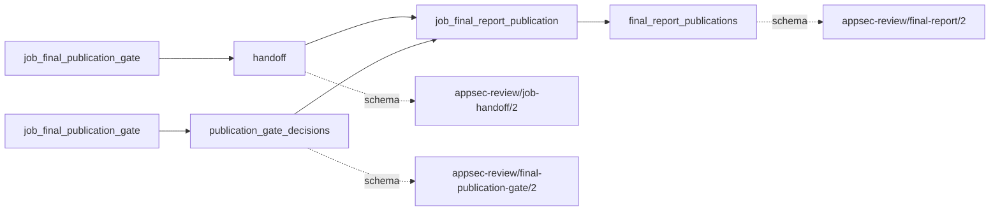
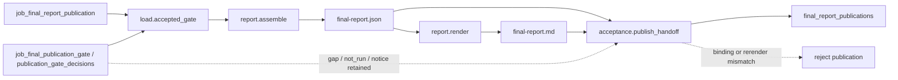

# final_report_publication

## Purpose

Publish deterministic JSON and Markdown projections of the accepted final gate. The report
separates publishable confirmed findings, verification backlog, withheld packages, coverage and
completion limitations. It does not reassess vulnerabilities, upgrade assurance, resolve findings
from build checks or turn a publication status into permission to ship.

<!-- generated:begin job=job_final_report_publication -->
<!-- generated from: appsec-review.toml, containers/catalog.toml, pipeline/guidance/registry.json, tests/job-test-map.json, src/appsec_review/runtime/registry.py, src/appsec_review/runtime/contracts.py, src/appsec_review/runtime/datasets.py, src/appsec_review/guidance/workers.py, src/appsec_review/mcp/schema.py, src/appsec_review/orchestration/topology.py, src/appsec_review/orchestration/dagster/adapter.py by scripts/generate-docs.py; do not edit -->
## Declared job contract

final_report_publication

Job: `job_final_report_publication`. Enabled in the dev recipe: **true**.
Declarations describe possible work, not successful execution or consumed evidence.

### Steps and tasks

| Step | Task | Workers | Pool | Bound tool or gap | Handler |
| --- | --- | --- | --- | --- | --- |
| `acceptance` | `acceptance.publish_handoff` | 1 | `application` | Undeclared ([T-147](../TODO.md)) | [source](../../src/appsec_review/jobs/job_final_report_publication/job.py#L128) |
| `load` | `load.accepted_gate` | 1 | `application` | Undeclared ([T-147](../TODO.md)) | [source](../../src/appsec_review/jobs/job_final_report_publication/job.py#L80) |
| `report` | `report.assemble` | 1 | `application` | Undeclared ([T-147](../TODO.md)) | [source](../../src/appsec_review/jobs/job_final_report_publication/job.py#L94) |
| `report` | `report.render` | 1 | `application` | Undeclared ([T-147](../TODO.md)) | [source](../../src/appsec_review/jobs/job_final_report_publication/job.py#L117) |

### Accepted input declarations

| Producer | Dataset | Schema | Channel | Availability | Missing policy |
| --- | --- | --- | --- | --- | --- |
| `job_final_publication_gate` | `handoff` | `appsec-review/job-handoff/2` | handoff | required | reject |
| `job_final_publication_gate` | `publication_gate_decisions` | `appsec-review/final-publication-gate/2` | handoff | optional | gap |

### Published dataset declarations

| Dataset | Step | Schema | Stage | Indexes | MCP route |
| --- | --- | --- | --- | --- | --- |
| `final_report_publications` | `acceptance` | `appsec-review/final-report/2` | artifact_only | Not indexed | `coverage`, `query_dataset_inventory` |

Protected and artifact-only routes expose sanitized metadata, not payload access.

### Model and guidance declarations

No job-level model declaration; absence of a task binding remains [T-147](../TODO.md), not a nonexecution claim.

### Test selection

| Tier | Files or selectors |
| --- | --- |
| acceptance | `tests/test_final_report.py::test_report_json_is_schema_valid_and_contains_the_required_sections` |
| integration | None declared |
| live | None declared |
| unit | `tests/test_final_report.py::test_decision_pending_is_a_named_gap_projected_verbatim_and_never_hidden` `tests/test_final_report.py::test_decision_pending_without_bounds_names_the_unrated_severity_itself` |

### Dagster placement

Dispatch: `review_graph`. Review graph member: **true**. Enabled graph member: **true**.

Declared predecessors: `job_final_publication_gate`.

### Declared dataflow

<!-- generated:end -->

## Process

The [handler](../../src/appsec_review/jobs/job_final_report_publication/job.py) uses the certified
[gate reader](../../src/appsec_review/jobs/job_final_publication_gate/verify.py),
[report projection](../../src/appsec_review/jobs/job_final_report_publication/report.py) and
[Markdown renderer](../../src/appsec_review/jobs/job_final_report_publication/render.py).

### `load`

1. In `load.accepted_gate`, require the accepted gate handoff to match the attempt's upstream pin.
2. Verify its document and all certified bindings against the gate/review schemas. Retain gate
   handoff/document references, review status, package counts and binding count.
3. Fail on missing or changed accepted material; do not discover substitute attachments.

### `report`

1. In `report.assemble`, read the bound gate and verified configuration-profile identity.
   Build report sections from certified gate data without changing package state, scoring,
   independence, shipment or nonexecution assurance.
2. Validate the report schema and write attempt-owned `final-report.json`. Keep publishable
   findings, verification backlog and withheld records in separate sections.
3. In `report.render`, render `final-report.md` from that JSON using configured evidence/gap display
   bounds. Require repeat rendering to produce identical text and retain rendering settings.

### `acceptance`

1. In `acceptance.publish_handoff`, reverify the gate snapshot and report schema.
2. Re-render Markdown from JSON and require byte equality; require report provenance to name the
   loaded accepted gate handoff.
3. Publish both hash-bound references with unchanged statuses, counts and limitations. The handoff
   item count is publishable plus backlog, not the total including withheld.

## Dataflow

The [input contract](../architecture/job-input-contracts.md#admission-and-read-receipts) confines
this job to certified artifacts. Rendering does not grant payload retrieval access or bypass
[signing enforcement](signing.md).

## Gaps

There are no new domain gap causes in this projection. It carries the gate's limitation IDs and
statements of kind `gap` into legacy handler strings; the producer supplies no retryability
classification. The [gate gap table](job_final_publication_gate.md#gaps) names those causes.
`not_run` and `notice` remain separate report limitations. In particular,
`compile_only_nonexecution` is not a claim that runtime checks passed.

Gate/reference corruption, schema mismatch and Markdown unequal to a fresh rendering raise
integrity errors and prevent publication. Use the handoff's verified
[canonical outcomes](../architecture/job-interchange.md#the-control-layer-beneath-the-envelope)
for walk counts, not repeated Markdown gap labels. PDF status is projected from the report's
renderer declaration; this handler does not invoke a PDF renderer.

## Acceptance

1. **A. Inputs:** Compare the accepted gate handoff/document hash with the claim and report
   provenance. Verify the bound configuration profile and every certified attachment reference.
2. **B. Independent comparison:** Independently count gate bucket memberships and compare with
   report findings, backlog and withheld IDs. Compare state, score, ship-block and limitation
   fields with the gate. Re-render Markdown with the frozen settings and compare exact bytes;
   verify handoff item count excludes withheld.
3. **C. Gaps:** Reconcile canonical outcomes with the gate's gap limitations and ledger/coverage
   counts. Record presentation truncation and `not_run`/notice limitations separately.
   Publication with limitations is not a clean review.
4. **D. Baseline:** Save an authorized `stepwise.py accept` baseline and corpus namespace, with
   gate, JSON and Markdown hashes, bucket counts and display settings. Distinguish presentation
   changes from accepted-evidence changes on the next comparison.

## Resume and invalidation

The job has no model or independent result cache. [Runtime reuse](../architecture/jobs-and-runtime.md#wave-1-resumability)
binds the gate pin, configuration, target/input and component identities; changed gate bytes or
display settings invalidate the report without re-adjudicating the review. Before publication
the handler revalidates bindings and rerenders, rather than trusting stale Markdown.
Artifact-bearing unit results are not portable failed-attempt checkpoints.
