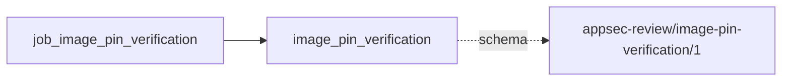

# image_pin_verification

This page contains the generated contract; the authored process and acceptance description are tracked by [T-130](../TODO.md).

<!-- generated:begin job=job_image_pin_verification -->
<!-- generated from: appsec-review.toml, containers/catalog.toml, pipeline/guidance/registry.json, tests/job-test-map.json, src/appsec_review/runtime/registry.py, src/appsec_review/runtime/contracts.py, src/appsec_review/runtime/datasets.py, src/appsec_review/guidance/workers.py, src/appsec_review/mcp/schema.py, src/appsec_review/orchestration/topology.py, src/appsec_review/orchestration/dagster/adapter.py by scripts/generate-docs.py; do not edit -->
## Declared job contract

image_pin_verification

Job: `job_image_pin_verification`. Enabled in the dev recipe: **true**.
Declarations describe possible work, not successful execution or consumed evidence.

### Steps and tasks

| Step | Task | Workers | Pool | Bound tool or gap | Handler |
| --- | --- | --- | --- | --- | --- |
| `publication` | `publication.publish_handoff` | 1 | `application` | Undeclared ([T-147](../TODO.md)) | [source](../../src/appsec_review/jobs/job_image_pin_verification/job.py#L137) |
| `selection` | `selection.resolve_pins` | 1 | `application` | Undeclared ([T-147](../TODO.md)) | [source](../../src/appsec_review/jobs/job_image_pin_verification/job.py#L74) |
| `verification` | `verification.inspect_images` | 1 | `owasp_verification` | Undeclared ([T-147](../TODO.md)) | [source](../../src/appsec_review/jobs/job_image_pin_verification/job.py#L106) |

### Accepted input declarations

| Producer | Dataset | Schema | Channel | Availability | Missing policy |
| --- | --- | --- | --- | --- | --- |

### Published dataset declarations

| Dataset | Step | Schema | Stage | Indexes | MCP route |
| --- | --- | --- | --- | --- | --- |
| `image_pin_verification` | `publication` | `appsec-review/image-pin-verification/1` | artifact_only | Not indexed | `coverage`, `query_dataset_inventory` |

Protected and artifact-only routes expose sanitized metadata, not payload access.

### Model and guidance declarations

No job-level model declaration; absence of a task binding remains [T-147](../TODO.md), not a nonexecution claim.

### Test selection

| Tier | Files or selectors |
| --- | --- |
| acceptance | None declared |
| integration | `tests/integration/job_image_pin_verification/test_host_pins.py` `tests/integration/job_image_pin_verification/test_image_pin_verification.py` |
| live | None declared |
| unit | `tests/unit/job_image_pin_verification/test_configuration.py` `tests/unit/job_image_pin_verification/test_contract.py` `tests/unit/job_image_pin_verification/test_host_pins.py` `tests/unit/job_image_pin_verification/test_image_pin_update.py` `tests/unit/job_image_pin_verification/test_job_graph.py` `tests/unit/job_image_pin_verification/test_pins.py` `tests/unit/job_image_pin_verification/test_update_boundaries.py` |

### Dagster placement

Dispatch: `review_graph`. Review graph member: **true**. Enabled graph member: **true**.

Declared predecessors: `job_model_connectivity`.

### Declared dataflow

<!-- generated:end -->
