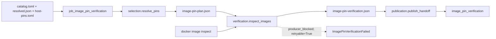

# image_pin_verification

## Purpose

Do the images selected by the frozen review configuration resolve on this daemon to their
expected identities? This pre-intake gate publishes expected/observed image bindings and stops
on missing, moved or uninspectable images. It does not build, pull or re-pin images, prove tool
behavior, or substitute an image-ID comparison for signature verification.

<!-- generated:begin job=job_image_pin_verification -->
<!-- generated from: appsec-review.toml, containers/catalog.toml, pipeline/guidance/registry.json, tests/job-test-map.json, src/appsec_review/runtime/registry.py, src/appsec_review/runtime/contracts.py, src/appsec_review/runtime/datasets.py, src/appsec_review/guidance/workers.py, src/appsec_review/mcp/schema.py, src/appsec_review/orchestration/topology.py, src/appsec_review/orchestration/dagster/adapter.py by scripts/generate-docs.py; do not edit -->
## Declared job contract

image_pin_verification

Job: `job_image_pin_verification`. Enabled in the dev recipe: **true**.
Declarations describe possible work, not successful execution or consumed evidence.

### Steps and tasks

| Step | Task | Workers | Pool | Bound tool or gap | Handler |
| --- | --- | --- | --- | --- | --- |
| `publication` | `publication.publish_handoff` | 1 | `application` | Undeclared ([T-147](../TODO.md)) | [source](../../src/appsec_review/jobs/job_image_pin_verification/job.py#L137) |
| `selection` | `selection.resolve_pins` | 1 | `application` | Undeclared ([T-147](../TODO.md)) | [source](../../src/appsec_review/jobs/job_image_pin_verification/job.py#L74) |
| `verification` | `verification.inspect_images` | 1 | `owasp_verification` | Undeclared ([T-147](../TODO.md)) | [source](../../src/appsec_review/jobs/job_image_pin_verification/job.py#L106) |

### Accepted input declarations

| Producer | Dataset | Schema | Channel | Availability | Missing policy |
| --- | --- | --- | --- | --- | --- |

### Published dataset declarations

| Dataset | Step | Schema | Stage | Indexes | MCP route |
| --- | --- | --- | --- | --- | --- |
| `image_pin_verification` | `publication` | `appsec-review/image-pin-verification/1` | artifact_only | Not indexed | `coverage`, `query_dataset_inventory` |

Protected and artifact-only routes expose sanitized metadata, not payload access.

### Model and guidance declarations

No job-level model declaration; absence of a task binding remains [T-147](../TODO.md), not a nonexecution claim.

### Test selection

| Tier | Files or selectors |
| --- | --- |
| acceptance | None declared |
| integration | `tests/integration/job_image_pin_verification/test_host_pins.py` `tests/integration/job_image_pin_verification/test_image_pin_verification.py` |
| live | None declared |
| unit | `tests/unit/job_image_pin_verification/test_configuration.py` `tests/unit/job_image_pin_verification/test_contract.py` `tests/unit/job_image_pin_verification/test_host_pins.py` `tests/unit/job_image_pin_verification/test_image_pin_update.py` `tests/unit/job_image_pin_verification/test_job_graph.py` `tests/unit/job_image_pin_verification/test_pins.py` `tests/unit/job_image_pin_verification/test_update_boundaries.py` |

### Dagster placement

Dispatch: `review_graph`. Review graph member: **true**. Enabled graph member: **true**.

Declared predecessors: `job_model_connectivity`.

### Declared dataflow

<!-- generated:end -->

## Process

Source: [job handlers](../../src/appsec_review/jobs/job_image_pin_verification/job.py) and
[pin selection and inspection](../../src/appsec_review/jobs/job_image_pin_verification/pins.py).
The operator-owned [host binding procedure](image-pin-verification.md) and
[signing policy](signing.md) remain separate.

### `selection`

1. Validate task order, typed settings and the presence of the inspection runner.
2. Read `containers/catalog.toml`, frozen `resolved.json` and frozen `host-pins.toml`.
   Verify the host-file hash and parsed document against `configuration_host_pins`; reject
   mismatches or an empty pin selection.
3. Select enabled non-manual catalog images, image references in enabled jobs and enabled
   telemetry PDF rendering. A manual image can still be selected through a job reference.
4. Write `image-pin-plan.json` with catalog, configuration and host-binding hashes plus each
   reference's source, tag and expected ID.

### `verification`

1. Inspect each distinct tag once through `inspect_image`, using its fixed command timeout.
   Preserve separate results for references sharing a tag but expecting different IDs.
2. Classify valid daemon output as `matched`, `mismatched`, or `present` when the selected
   catalog row has no expected ID. Classify missing images separately from timeout, malformed
   output, command failure and operating-system inspection errors.
3. Write `image-pin-verification.json`. For every nonpassing reference, retain
   `producer_blocked`, `retryable=True`, scoped to its configuration/catalog source.
4. If any reference is nonpassing, emit failure diagnostics and raise
   `ImagePinVerificationFailed`; do not reach accepted publication.

### `publication`

1. Require successful `verification.inspect_images`.
2. Write `image-pin-verification-handoff.json` with the verification reference and selected
   expected/observed IDs; publish dataset `image_pin_verification` as operational metadata.
3. Return `SUCCEEDED` with no gaps. Framework or publication failure is not a successful gate.

## Dataflow

## Gaps

The explicit diagnostic cause is `producer_blocked` for `missing`, `mismatched` and
`inspect_failed` pin results, with `retryable=True`. These records live in the failed
verification artifact; they are not permission to publish an accepted handoff with missing
tooling. The runtime can separately account for the failed task in rejected diagnostics.
Input identity and configuration errors raise before verification; no invented pin result
stands in for an unreadable input. `present` is a passing unpinned-row status in `verify_pins`,
not evidence of an exact pin match. A walk must investigate that distinction rather than
asserting all passing rows were pinned. Any failure requires an operator decision under the
walk's terms; image repair and re-pinning are not actions performed by this job.

## Acceptance

1. **A. Inputs:** Compare the selected reference set against the enabled catalog/job/report
   references and verify the frozen host-pins hash. Confirm there is no target or upstream
   payload consumption; connectivity is a scheduling predecessor.
2. **B. Independent comparison:** Compare each expected ID with a separately recorded daemon
   inspection, including distinct tag count versus reference count. Identify any `present`
   row without an expected ID explicitly.
3. **C. Gaps:** Reconcile canonical outcomes and retained failed-pin diagnostics by reference.
   Missing, moved and uninspectable images are tooling failures, not clean coverage or
   advisory absences; a rejected attempt cannot satisfy this check.
4. **D. Baseline:** Once the gate passes and the comparisons are recorded, use
   `stepwise.py accept`; record corpus namespace and saved baseline of selected references,
   observed IDs and statuses.

## Resume and invalidation

The gate always executes, is target-independent (`none`), and does not propagate its handoff
into downstream semantic identity. Per-call tag deduplication is not a persistent image cache.
A resumed dispatch re-inspects the daemon; changed host bindings do not rewrite the frozen
run configuration. Follow [host bindings](image-pin-verification.md#frozen-configuration) for
configuration changes and [Wave 1 resumability](../architecture/jobs-and-runtime.md#wave-1-resumability)
for accepted-job identity. Signing and launch enforcement are unchanged.
