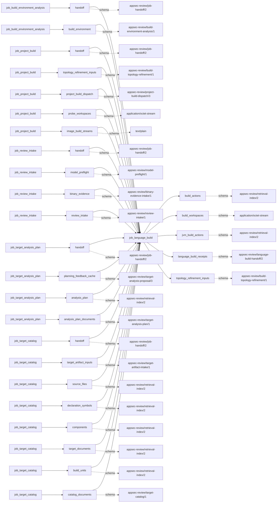

# language_build

This page contains the generated contract; the authored process and acceptance description are tracked by [T-130](../TODO.md).

<!-- generated:begin job=job_language_build -->
<!-- generated from: appsec-review.toml, containers/catalog.toml, pipeline/guidance/registry.json, tests/job-test-map.json, src/appsec_review/runtime/registry.py, src/appsec_review/runtime/contracts.py, src/appsec_review/runtime/datasets.py, src/appsec_review/guidance/workers.py, src/appsec_review/mcp/schema.py, src/appsec_review/orchestration/topology.py, src/appsec_review/orchestration/dagster/adapter.py by scripts/generate-docs.py; do not edit -->
## Declared job contract

language_build

Job: `job_language_build`. Enabled in the dev recipe: **true**.
Declarations describe possible work, not successful execution or consumed evidence.

### Steps and tasks

| Step | Task | Workers | Pool | Bound tool or gap | Handler |
| --- | --- | --- | --- | --- | --- |
| `acceptance` | `acceptance.publish_handoff` | 1 | `application` | Undeclared ([T-147](../TODO.md)) | [source](../../src/appsec_review/jobs/job_language_build/job.py#L2051) |
| `execute` | `execute.dotnet` | 1 | `cpp_build` | Undeclared ([T-147](../TODO.md)) | [source](../../src/appsec_review/jobs/job_language_build/job.py#L1951) |
| `execute` | `execute.go` | 1 | `cpp_build` | Undeclared ([T-147](../TODO.md)) | [source](../../src/appsec_review/jobs/job_language_build/job.py#L1951) |
| `execute` | `execute.java` | 1 | `cpp_build` | Undeclared ([T-147](../TODO.md)) | [source](../../src/appsec_review/jobs/job_language_build/job.py#L1951) |
| `execute` | `execute.native` | 1 | `cpp_build` | Undeclared ([T-147](../TODO.md)) | [source](../../src/appsec_review/jobs/job_language_build/job.py#L1951) |
| `execute` | `execute.node` | 1 | `cpp_build` | Undeclared ([T-147](../TODO.md)) | [source](../../src/appsec_review/jobs/job_language_build/job.py#L1951) |
| `execute` | `execute.php` | 1 | `cpp_build` | Undeclared ([T-147](../TODO.md)) | [source](../../src/appsec_review/jobs/job_language_build/job.py#L1951) |
| `execute` | `execute.python` | 1 | `cpp_build` | Undeclared ([T-147](../TODO.md)) | [source](../../src/appsec_review/jobs/job_language_build/job.py#L1951) |
| `execute` | `execute.rust` | 1 | `cpp_build` | Undeclared ([T-147](../TODO.md)) | [source](../../src/appsec_review/jobs/job_language_build/job.py#L1951) |
| `execute` | `execute.wasm` | 1 | `cpp_build` | Undeclared ([T-147](../TODO.md)) | [source](../../src/appsec_review/jobs/job_language_build/job.py#L1951) |
| `iterations` | `iterations.dispatch` | 1 | `application` | Undeclared ([T-147](../TODO.md)) | [source](../../src/appsec_review/jobs/job_language_build/job.py#L1849) |
| `load` | `load.dotnet` | 1 | `application` | Undeclared ([T-147](../TODO.md)) | [source](../../src/appsec_review/jobs/job_language_build/job.py#L1861) |
| `load` | `load.go` | 1 | `application` | Undeclared ([T-147](../TODO.md)) | [source](../../src/appsec_review/jobs/job_language_build/job.py#L1861) |
| `load` | `load.java` | 1 | `application` | Undeclared ([T-147](../TODO.md)) | [source](../../src/appsec_review/jobs/job_language_build/job.py#L1861) |
| `load` | `load.native` | 1 | `application` | Undeclared ([T-147](../TODO.md)) | [source](../../src/appsec_review/jobs/job_language_build/job.py#L1861) |
| `load` | `load.node` | 1 | `application` | Undeclared ([T-147](../TODO.md)) | [source](../../src/appsec_review/jobs/job_language_build/job.py#L1861) |
| `load` | `load.php` | 1 | `application` | Undeclared ([T-147](../TODO.md)) | [source](../../src/appsec_review/jobs/job_language_build/job.py#L1861) |
| `load` | `load.python` | 1 | `application` | Undeclared ([T-147](../TODO.md)) | [source](../../src/appsec_review/jobs/job_language_build/job.py#L1861) |
| `load` | `load.rust` | 1 | `application` | Undeclared ([T-147](../TODO.md)) | [source](../../src/appsec_review/jobs/job_language_build/job.py#L1861) |
| `load` | `load.wasm` | 1 | `application` | Undeclared ([T-147](../TODO.md)) | [source](../../src/appsec_review/jobs/job_language_build/job.py#L1861) |

### Accepted input declarations

| Producer | Dataset | Schema | Channel | Availability | Missing policy |
| --- | --- | --- | --- | --- | --- |
| `job_build_environment_analysis` | `handoff` | `appsec-review/job-handoff/2` | handoff | optional | gap |
| `job_build_environment_analysis` | `build_environment` | `appsec-review/build-environment-analysis/1` | handoff | optional | gap |
| `job_project_build` | `handoff` | `appsec-review/job-handoff/2` | handoff | required | reject |
| `job_project_build` | `topology_refinement_inputs` | `appsec-review/build-topology-refinement/1` | handoff | optional | gap |
| `job_project_build` | `project_build_dispatch` | `appsec-review/project-build-dispatch/3` | handoff | optional | gap |
| `job_project_build` | `probe_workspaces` | `application/octet-stream` | handoff | optional | gap |
| `job_project_build` | `image_build_streams` | `text/plain` | handoff | optional | gap |
| `job_review_intake` | `handoff` | `appsec-review/job-handoff/2` | handoff | optional | gap |
| `job_review_intake` | `model_preflight` | `appsec-review/model-preflight/1` | handoff | optional | gap |
| `job_review_intake` | `binary_evidence` | `appsec-review/binary-evidence-intake/1` | handoff | optional | gap |
| `job_review_intake` | `review_intake` | `appsec-review/review-intake/1` | handoff | optional | gap |
| `job_target_analysis_plan` | `handoff` | `appsec-review/job-handoff/2` | handoff | optional | gap |
| `job_target_analysis_plan` | `planning_feedback_cache` | `appsec-review/target-analysis-proposal/3` | handoff | optional | gap |
| `job_target_analysis_plan` | `analysis_plan` | `appsec-review/retrieval-index/2` | handoff | optional | gap |
| `job_target_analysis_plan` | `analysis_plan_documents` | `appsec-review/target-analysis-plan/1` | handoff | optional | gap |
| `job_target_catalog` | `handoff` | `appsec-review/job-handoff/2` | handoff | optional | gap |
| `job_target_catalog` | `target_artifact_inputs` | `appsec-review/target-artifact-intake/1` | handoff | optional | gap |
| `job_target_catalog` | `source_files` | `appsec-review/retrieval-index/2` | handoff | optional | gap |
| `job_target_catalog` | `declaration_symbols` | `appsec-review/retrieval-index/2` | handoff | optional | gap |
| `job_target_catalog` | `components` | `appsec-review/retrieval-index/2` | handoff | optional | gap |
| `job_target_catalog` | `target_documents` | `appsec-review/retrieval-index/2` | handoff | optional | gap |
| `job_target_catalog` | `build_units` | `appsec-review/retrieval-index/2` | handoff | optional | gap |
| `job_target_catalog` | `catalog_documents` | `appsec-review/target-catalog/1` | handoff | optional | gap |

### Published dataset declarations

| Dataset | Step | Schema | Stage | Indexes | MCP route |
| --- | --- | --- | --- | --- | --- |
| `build_actions` | `acceptance` | `appsec-review/retrieval-index/2` | indexed | `build` | `find`, `query_precomputed`, `trace` |
| `build_workspaces` | `execute` | `application/octet-stream` | protected | Not indexed | `coverage`, `query_dataset_inventory` |
| `jvm_build_actions` | `execute` | `appsec-review/retrieval-index/2` | indexed | `build` | `find`, `trace` |
| `language_build_receipts` | `acceptance` | `appsec-review/language-build-handoff/2` | artifact_only | Not indexed | `coverage`, `query_dataset_inventory` |
| `topology_refinement_inputs` | `execute` | `appsec-review/build-topology-refinement/1` | protected | Not indexed | `coverage`, `query_dataset_inventory` |

Protected and artifact-only routes expose sanitized metadata, not payload access.

### Model and guidance declarations

No job-level model declaration; absence of a task binding remains [T-147](../TODO.md), not a nonexecution claim.

### Test selection

| Tier | Files or selectors |
| --- | --- |
| acceptance | `tests/acceptance/job_project_build/test_family_project_builds.py` |
| integration | `tests/integration/job_language_build/test_language_build_graph.py` `tests/integration/job_language_build/test_native_outputs_graph.py` `tests/integration/job_language_build/test_go_graph.py` `tests/integration/job_language_build/test_jvm_graph.py` `tests/integration/job_language_build/test_node_graph.py` `tests/integration/job_language_build/test_php_graph.py` `tests/integration/job_language_build/test_python_graph.py` `tests/integration/job_language_build/test_rust_graph.py` `tests/integration/job_language_build/test_wasm_graph.py` |
| live | `tests/acceptance/job_language_build/test_live_build_toolchains.py` `tests/acceptance/job_language_build/test_live_gradle_provenance.py` |
| unit | `tests/unit/job_language_build/test_contract.py` `tests/unit/job_language_build/test_job_graph.py` `tests/unit/job_language_build/test_job_helpers.py` `tests/unit/job_language_build/test_receipts_and_paths.py` `tests/unit/job_language_build/test_build_output_mapping.py` `tests/unit/job_language_build/test_build_output_scope.py` `tests/unit/job_language_build/test_captured_build_reconciliation.py` `tests/unit/job_language_build/test_elf.py` `tests/unit/job_language_build/test_go.py` `tests/unit/job_language_build/test_go_build_facts.py` `tests/unit/job_language_build/test_go_dependency_output_filtering.py` `tests/unit/job_language_build/test_go_vendored.py` `tests/unit/job_language_build/test_gradle_provenance.py` `tests/unit/job_language_build/test_jvm.py` `tests/unit/job_language_build/test_native_layout.py` `tests/unit/job_language_build/test_native_outputs.py` `tests/unit/job_language_build/test_node.py` `tests/unit/job_language_build/test_node_dependency_output_filtering.py` `tests/unit/job_language_build/test_node_installed.py` `tests/unit/job_language_build/test_node_scripts.py` `tests/unit/job_language_build/test_output_attribution.py` `tests/unit/job_language_build/test_php.py` `tests/unit/job_language_build/test_php_dependency_output_filtering.py` `tests/unit/job_language_build/test_php_installed.py` `tests/unit/job_language_build/test_python.py` `tests/unit/job_language_build/test_rust.py` `tests/unit/job_language_build/test_wasm.py` |

### Dagster placement

Dispatch: `review_graph`. Review graph member: **true**. Enabled graph member: **true**.

Declared predecessors: `job_project_build`.

### Declared dataflow

<!-- generated:end -->
