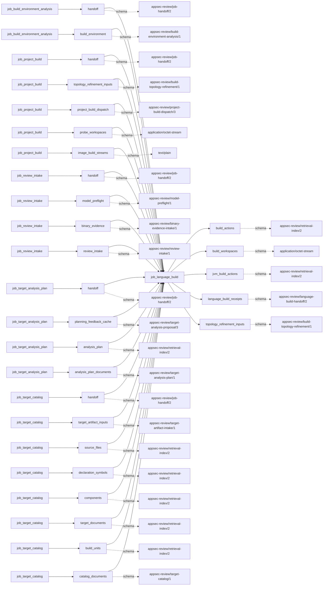
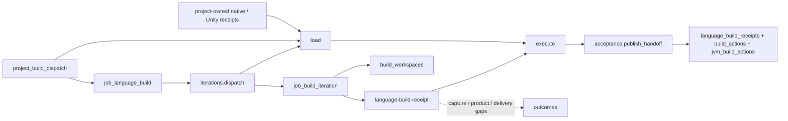

# language_build

## Purpose

What did the admitted build units actually execute and produce, with what source, toolchain,
capture and product dependencies? Language-build publishes verified receipts and build indices,
reusing project-owned native/Unity executions where appropriate. It refuses to call a successful
driver exit complete compiler capture, an existing file a newly built output, or a compiled
artifact proof of runtime shipment, reachability or security.

<!-- generated:begin job=job_language_build -->
<!-- generated from: appsec-review.toml, containers/catalog.toml, pipeline/guidance/registry.json, tests/job-test-map.json, src/appsec_review/runtime/registry.py, src/appsec_review/runtime/contracts.py, src/appsec_review/runtime/datasets.py, src/appsec_review/guidance/workers.py, src/appsec_review/mcp/schema.py, src/appsec_review/orchestration/topology.py, src/appsec_review/orchestration/dagster/adapter.py by scripts/generate-docs.py; do not edit -->
## Declared job contract

language_build

Job: `job_language_build`. Enabled in the dev recipe: **true**.
Declarations describe possible work, not successful execution or consumed evidence.

### Steps and tasks

| Step | Task | Workers | Pool | Bound tool or gap | Handler |
| --- | --- | --- | --- | --- | --- |
| `acceptance` | `acceptance.publish_handoff` | 1 | `application` | Undeclared ([T-147](../TODO.md)) | [source](../../src/appsec_review/jobs/job_language_build/job.py#L2084) |
| `execute` | `execute.dotnet` | 1 | `cpp_build` | Undeclared ([T-147](../TODO.md)) | [source](../../src/appsec_review/jobs/job_language_build/job.py#L1980) |
| `execute` | `execute.go` | 1 | `cpp_build` | Undeclared ([T-147](../TODO.md)) | [source](../../src/appsec_review/jobs/job_language_build/job.py#L1980) |
| `execute` | `execute.java` | 1 | `cpp_build` | Undeclared ([T-147](../TODO.md)) | [source](../../src/appsec_review/jobs/job_language_build/job.py#L1980) |
| `execute` | `execute.native` | 1 | `cpp_build` | Undeclared ([T-147](../TODO.md)) | [source](../../src/appsec_review/jobs/job_language_build/job.py#L1980) |
| `execute` | `execute.node` | 1 | `cpp_build` | Undeclared ([T-147](../TODO.md)) | [source](../../src/appsec_review/jobs/job_language_build/job.py#L1980) |
| `execute` | `execute.php` | 1 | `cpp_build` | Undeclared ([T-147](../TODO.md)) | [source](../../src/appsec_review/jobs/job_language_build/job.py#L1980) |
| `execute` | `execute.python` | 1 | `cpp_build` | Undeclared ([T-147](../TODO.md)) | [source](../../src/appsec_review/jobs/job_language_build/job.py#L1980) |
| `execute` | `execute.rust` | 1 | `cpp_build` | Undeclared ([T-147](../TODO.md)) | [source](../../src/appsec_review/jobs/job_language_build/job.py#L1980) |
| `execute` | `execute.wasm` | 1 | `cpp_build` | Undeclared ([T-147](../TODO.md)) | [source](../../src/appsec_review/jobs/job_language_build/job.py#L1980) |
| `iterations` | `iterations.dispatch` | 1 | `application` | Undeclared ([T-147](../TODO.md)) | [source](../../src/appsec_review/jobs/job_language_build/job.py#L1876) |
| `load` | `load.dotnet` | 1 | `application` | Undeclared ([T-147](../TODO.md)) | [source](../../src/appsec_review/jobs/job_language_build/job.py#L1888) |
| `load` | `load.go` | 1 | `application` | Undeclared ([T-147](../TODO.md)) | [source](../../src/appsec_review/jobs/job_language_build/job.py#L1888) |
| `load` | `load.java` | 1 | `application` | Undeclared ([T-147](../TODO.md)) | [source](../../src/appsec_review/jobs/job_language_build/job.py#L1888) |
| `load` | `load.native` | 1 | `application` | Undeclared ([T-147](../TODO.md)) | [source](../../src/appsec_review/jobs/job_language_build/job.py#L1888) |
| `load` | `load.node` | 1 | `application` | Undeclared ([T-147](../TODO.md)) | [source](../../src/appsec_review/jobs/job_language_build/job.py#L1888) |
| `load` | `load.php` | 1 | `application` | Undeclared ([T-147](../TODO.md)) | [source](../../src/appsec_review/jobs/job_language_build/job.py#L1888) |
| `load` | `load.python` | 1 | `application` | Undeclared ([T-147](../TODO.md)) | [source](../../src/appsec_review/jobs/job_language_build/job.py#L1888) |
| `load` | `load.rust` | 1 | `application` | Undeclared ([T-147](../TODO.md)) | [source](../../src/appsec_review/jobs/job_language_build/job.py#L1888) |
| `load` | `load.wasm` | 1 | `application` | Undeclared ([T-147](../TODO.md)) | [source](../../src/appsec_review/jobs/job_language_build/job.py#L1888) |

### Accepted input declarations

| Producer | Dataset | Schema | Channel | Availability | Missing policy |
| --- | --- | --- | --- | --- | --- |
| `job_build_environment_analysis` | `handoff` | `appsec-review/job-handoff/2` | handoff | optional | gap |
| `job_build_environment_analysis` | `build_environment` | `appsec-review/build-environment-analysis/1` | handoff | optional | gap |
| `job_project_build` | `handoff` | `appsec-review/job-handoff/2` | handoff | required | reject |
| `job_project_build` | `topology_refinement_inputs` | `appsec-review/build-topology-refinement/1` | handoff | optional | gap |
| `job_project_build` | `project_build_dispatch` | `appsec-review/project-build-dispatch/3` | handoff | optional | gap |
| `job_project_build` | `probe_workspaces` | `application/octet-stream` | handoff | optional | gap |
| `job_project_build` | `image_build_streams` | `text/plain` | handoff | optional | gap |
| `job_review_intake` | `handoff` | `appsec-review/job-handoff/2` | handoff | optional | gap |
| `job_review_intake` | `model_preflight` | `appsec-review/model-preflight/1` | handoff | optional | gap |
| `job_review_intake` | `binary_evidence` | `appsec-review/binary-evidence-intake/1` | handoff | optional | gap |
| `job_review_intake` | `review_intake` | `appsec-review/review-intake/1` | handoff | optional | gap |
| `job_target_analysis_plan` | `handoff` | `appsec-review/job-handoff/2` | handoff | optional | gap |
| `job_target_analysis_plan` | `planning_feedback_cache` | `appsec-review/target-analysis-proposal/3` | handoff | optional | gap |
| `job_target_analysis_plan` | `analysis_plan` | `appsec-review/retrieval-index/2` | handoff | optional | gap |
| `job_target_analysis_plan` | `analysis_plan_documents` | `appsec-review/target-analysis-plan/1` | handoff | optional | gap |
| `job_target_catalog` | `handoff` | `appsec-review/job-handoff/2` | handoff | optional | gap |
| `job_target_catalog` | `target_artifact_inputs` | `appsec-review/target-artifact-intake/1` | handoff | optional | gap |
| `job_target_catalog` | `source_files` | `appsec-review/retrieval-index/2` | handoff | optional | gap |
| `job_target_catalog` | `declaration_symbols` | `appsec-review/retrieval-index/2` | handoff | optional | gap |
| `job_target_catalog` | `components` | `appsec-review/retrieval-index/2` | handoff | optional | gap |
| `job_target_catalog` | `target_documents` | `appsec-review/retrieval-index/2` | handoff | optional | gap |
| `job_target_catalog` | `build_units` | `appsec-review/retrieval-index/2` | handoff | optional | gap |
| `job_target_catalog` | `catalog_documents` | `appsec-review/target-catalog/1` | handoff | optional | gap |

### Published dataset declarations

| Dataset | Step | Schema | Stage | Indexes | MCP route |
| --- | --- | --- | --- | --- | --- |
| `build_actions` | `acceptance` | `appsec-review/retrieval-index/2` | indexed | `build` | `find`, `query_precomputed`, `trace` |
| `build_workspaces` | `execute` | `application/octet-stream` | protected | Not indexed | `coverage`, `query_dataset_inventory` |
| `jvm_build_actions` | `execute` | `appsec-review/retrieval-index/2` | indexed | `build` | `find`, `trace` |
| `language_build_receipts` | `acceptance` | `appsec-review/language-build-handoff/2` | artifact_only | Not indexed | `coverage`, `query_dataset_inventory` |
| `topology_refinement_inputs` | `execute` | `appsec-review/build-topology-refinement/1` | protected | Not indexed | `coverage`, `query_dataset_inventory` |

Protected and artifact-only routes expose sanitized metadata, not payload access.

### Model and guidance declarations

No job-level model declaration; absence of a task binding remains [T-147](../TODO.md), not a nonexecution claim.

### Test selection

| Tier | Files or selectors |
| --- | --- |
| acceptance | `tests/acceptance/job_project_build/test_family_project_builds.py` |
| integration | `tests/integration/job_language_build/test_language_build_graph.py` `tests/integration/job_language_build/test_native_outputs_graph.py` `tests/integration/job_language_build/test_go_graph.py` `tests/integration/job_language_build/test_jvm_graph.py` `tests/integration/job_language_build/test_node_graph.py` `tests/integration/job_language_build/test_php_graph.py` `tests/integration/job_language_build/test_python_graph.py` `tests/integration/job_language_build/test_rust_graph.py` `tests/integration/job_language_build/test_wasm_graph.py` `tests/integration/job_language_build/test_elf_host.py` |
| live | `tests/acceptance/job_language_build/test_live_build_toolchains.py` `tests/acceptance/job_language_build/test_live_gradle_provenance.py` |
| unit | `tests/unit/job_language_build/test_contract.py` `tests/unit/job_language_build/test_job_graph.py` `tests/unit/job_language_build/test_job_helpers.py` `tests/unit/job_language_build/test_receipts_and_paths.py` `tests/unit/job_language_build/test_build_output_mapping.py` `tests/unit/job_language_build/test_build_output_scope.py` `tests/unit/job_language_build/test_captured_build_reconciliation.py` `tests/unit/job_language_build/test_elf.py` `tests/unit/job_language_build/test_go.py` `tests/unit/job_language_build/test_go_build_facts.py` `tests/unit/job_language_build/test_go_dependency_output_filtering.py` `tests/unit/job_language_build/test_go_vendored.py` `tests/unit/job_language_build/test_gradle_provenance.py` `tests/unit/job_language_build/test_jvm.py` `tests/unit/job_language_build/test_native_layout.py` `tests/unit/job_language_build/test_native_outputs.py` `tests/unit/job_language_build/test_node.py` `tests/unit/job_language_build/test_node_dependency_output_filtering.py` `tests/unit/job_language_build/test_node_installed.py` `tests/unit/job_language_build/test_node_scripts.py` `tests/unit/job_language_build/test_output_attribution.py` `tests/unit/job_language_build/test_php.py` `tests/unit/job_language_build/test_php_dependency_output_filtering.py` `tests/unit/job_language_build/test_php_installed.py` `tests/unit/job_language_build/test_python.py` `tests/unit/job_language_build/test_rust.py` `tests/unit/job_language_build/test_wasm.py` `tests/unit/job_language_build/test_upstream_gap_contract.py` |

### Dagster placement

Dispatch: `review_graph`. Review graph member: **true**. Enabled graph member: **true**.

Declared predecessors: `job_project_build`.

### Declared dataflow

<!-- generated:end -->

## Process

Source: [handlers and generic executor](../../src/appsec_review/jobs/job_language_build/job.py),
[capture reconciliation](../../src/appsec_review/jobs/job_language_build/capture.py),
[JVM](../../src/appsec_review/jobs/job_language_build/jvm.py) and
[Wasm](../../src/appsec_review/jobs/job_language_build/wasm.py) adapters.
[Language-build operations](language-build.md) owns family details; shared
[topology/iterations](../architecture/build-topology-and-iterations.md) and
[capture semantics](../architecture/build-environments-and-execution-capture.md) are linked rather
than redefined here.

### `iterations`

1. Read accepted project-build dispatches and revalidate source, workflow, unique unit IDs,
   recipe/profile/dependency identities, preparation references and topology refinement.
   Refuse graphless/legacy execution modes and changed source bytes.
2. Select explicit recipe revisions and processing decisions. Retain upstream image failures
   and platform/policy exclusions as receipts. Consume project-owned native receipts without
   scheduling a second execution.
3. Construct `BuildIterations` from the admitted graph, selected dispatches, configuration,
   releases and output policy. Schedule serial dependency-ready nodes in the shared complete
   target/install workspace; verify product interfaces, not just predecessor statuses.
4. Invoke each production transaction through `job_build_iteration`. Generic, JVM or Wasm
   execution uses the same admitted workspace/interfaces. Configure/build commands are bounded
   by time, streams, artifact counts and family policy; no model supplies new commands here.
5. Capture applicable native/Rust/.NET/Go/Node/Python/PHP process execution. Reconcile only successful
   `process_exec` events as compiler authority; preserve incomplete capture, redaction and
   missing tool execution. Use family parsers for package, generated-source and output facts.
6. Recheck target identity, classify output trees and bookkeeping, validate native/Go target
   evidence, retain protected argv/streams and immutable artifact bytes. Failed build outputs
   are not accepted products. Commit only successful product transactions with confirmed cleanup;
   preserve diagnostics. Sibling continuation after failure requires a prepared receipt and
   confirmed cleanup; pre-receipt refusals can stop the controller even after rollback, and
   uncertain cleanup prevents safe workspace progress.

### `load`

1. Re-read accepted dispatch authority for each configured family and enforce its typed
   settings. Shared envelope/identity errors are hard failures, not missing family coverage.
2. Select Wasm output producers from configured rules rather than equating output format with
   source language. Other family selections exclude those Wasm-routed dispatches.
3. Retain native/project-owned and Unity engine receipts, unavailable upstream units and
   explicit platform/policy dispositions. Validate accepted Go/Rust and other family-specific
   recipe requirements; do not silently omit a planned unit whose preparation failed.
4. Record processing applicability and any unmatched configured Wasm producer reason.

### `execute`

1. In the admitted iterative path, collect the controller's receipts by output family and add
   the one-time Unity receipts. Do not rebuild after `iterations.dispatch`.
2. Carry both receipt gaps and delivery gaps into the family result. A family with no receipts
   is `NOT_APPLICABLE`; a failed planned unit remains a named receipt, not an absent lane.
3. Return per-family counts and statuses. The retained non-iterative implementation is not
   authority to bypass the earlier iterative-mode admission.

### `acceptance`

1. Join family receipts, controller graph and processing decisions. Name dispatch families
   outside the supported executor set rather than silently dropping them.
2. Write `accepted-language-builds.json` with the exact upstream project handoff hash.
3. Build the aggregate `build` shard from actual commands, invocations and artifact references;
   compose it with JVM and upstream shards under a verified manifest.
4. Publish receipt and index datasets only after framework validation. Keep workspaces and
   exact command material protected, distinct from sanitized queryable build actions.

## Dataflow

## Gaps

This job mixes preserved typed records with legacy strings. Legacy values become canonical
`producer_reported_gap`, `retryable=False`; native enforcement records also use that code and
default false. Nested failed/blocked receipt status alone does not set canonical retryability.
The framework reads the unit's own status and explicit dispositions, including processing `GAP`
dispositions, for status-derived retry accounting. Inspect canonical outcomes rather than
labeling all build gaps either retryable or advisory.

Canonical upstream causes retain their identity, code, unit/scope, retryability and evidence
references through receipt and control propagation. Cause groups are validated before merging;
identical records are deduplicated without discarding distinct or conflicting causes. The first
readable reason is presentation only, not a replacement for the retained causes. Malformed
records and foreign-unit re-declarations remain accounting failures. Legacy text keeps its
registered representation until the normal publication boundary.

| Boundary | Source-derived omissions or failures |
| --- | --- |
| Dispatch/controller | Missing immutable image/release/refinement/product evidence; unsupported/unresolved topology; unavailable dependency; selected policy/capability gaps; retained upstream preparation failure. |
| Command execution | Nonzero exit, timeout, command failure and unconfirmed cleanup. Failed command artifacts are withheld; unconfirmed cleanup stops workspace progress. |
| Capture/reconciliation | Missing or truncated capture, disabled environment capture, secret-redacted records, failed/unmatched execution, missing required compiler/linker evidence and incomplete wrapper/provenance joins. |
| Family interpretation | Invalid/unsupported .NET platform or recipe; Go catalog/metadata/target mismatch; Rust metadata or linker evidence missing; Node dependency/lifecycle or invocation/output gaps; Python package/frontend or archive mapping gaps; PHP Composer/autoload/native-tool gaps; JVM provenance and Wasm producer/output gaps. |
| Output/enforcement | Artifact bounds, unresolved source/output/delivery mapping, missing expected outputs, invalid native target proof or compiler profile, unsupported native product closure, and processing artifact-validation/evidence gaps. |

These are reason families emitted by the linked adapters, not invented producer-gap codes.
The `appsec-review/elf-loader-dependencies/3` reader accepts string tables across adjacent
loadable mappings only when their virtual coverage and file bytes are contiguous. Gaps,
BSS-only tails, overlapping mappings, overflow and unbacked bytes remain unparseable coverage,
not resolved dependency evidence.
Absent supported work may be `NOT_APPLICABLE`; a Windows-only or otherwise unsupported planned
unit can still carry named coverage loss. Accepted input bytes are not new compiler outputs.
Source drift, corrupt retained captures/manifests, recipe identity mismatches and invalid shared
authority fail closed; they are not successful publication with a warning.
See [job interchange](../architecture/job-interchange.md). A walk must separately approve every
actual cause and its cost, including deterministic capability limitations.

## Acceptance

1. **A. Inputs:** Match project/plan/catalog/environment handoff reads, selected recipe revision,
   image preparation and product-interface pins to the claim. Verify project-owned receipt
   hashes instead of treating reused execution as newly observed work.
2. **B. Independent comparison:** Account for every selected unit once as executed, reused,
   blocked, failed or not applicable. Compare command exits and successful exec-event counts
   with raw captures; compare retained output hashes/sizes, machine/format and source mappings
   against independent byte inspection. Compare workspace and installed-product counts.
3. **C. Gaps:** Group verified outcomes by unit, family and cause; reconcile output/delivery and
   capture omissions with receipts. Check rejected/failed products did not enter accepted
   artifacts. Stop on any cause outside the walk's expected-gaps list.
4. **D. Baseline:** After comparison, use `stepwise.py accept`; record corpus namespace and saved
   baseline of selected units, command/capture/output counts, reused products and coverage.

## Resume and invalidation

The global controller binds source/topology, selected recipe, image, configuration, releases,
execution/output policy and upstream product hashes. It verifies committed products and
receipt artifacts before reuse; changing a producer invalidates dependent nodes while retaining
admissible unrelated checkpoints.

The generic private build fingerprint additionally includes dependency files, preparation,
project handoff, capture/executor identity, processing facts/decisions/modes, family options and
execution bounds; exact interfaces are added to the key. This generic private cache is used only
outside the shared-workspace path and requires success, complete capture and verified artifacts.
Project-owned native execution disables that private cache. JVM/Wasm fingerprints also bind
their specialized toolchain/provenance/layout or producer selections and upstream dependencies.
That generic cache's completeness rule is not a blanket claim about every family adapter or
controller product checkpoint. Whole-job admission rechecks
topology and immutable artifacts under
[Wave 1 resumability](../architecture/jobs-and-runtime.md#wave-1-resumability).

The ELF parser identity labels freshly interpreted facts; it does not itself invalidate the
generic private receipt cache, whose key does not include that label. Reused receipts may retain
older loader facts. This repair neither reparses nor purges stored receipts, and unit validation
does not establish that reuse across a parser change is appropriate.
