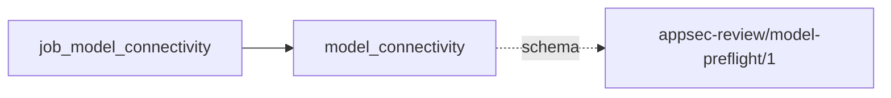
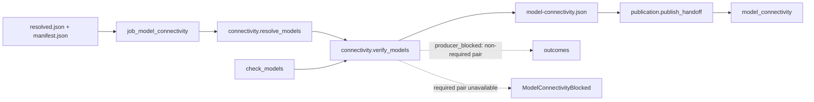

# model_connectivity

## Purpose

Can the providers answer for the models this frozen review configuration can use? This gate
publishes fresh availability evidence, including models referenced only by disabled settings,
before target access. It refuses to equate a successful connectivity request with usable review
results, adequate context capacity, or successful execution of any downstream model task.

<!-- generated:begin job=job_model_connectivity -->
<!-- generated from: appsec-review.toml, containers/catalog.toml, pipeline/guidance/registry.json, tests/job-test-map.json, src/appsec_review/runtime/registry.py, src/appsec_review/runtime/contracts.py, src/appsec_review/runtime/datasets.py, src/appsec_review/guidance/workers.py, src/appsec_review/mcp/schema.py, src/appsec_review/orchestration/topology.py, src/appsec_review/orchestration/dagster/adapter.py by scripts/generate-docs.py; do not edit -->
## Declared job contract

model_connectivity

Job: `job_model_connectivity`. Enabled in the dev recipe: **true**.
Declarations describe possible work, not successful execution or consumed evidence.

### Steps and tasks

| Step | Task | Workers | Pool | Bound tool or gap | Handler |
| --- | --- | --- | --- | --- | --- |
| `connectivity` | `connectivity.resolve_models` | 1 | `application` | Undeclared ([T-147](../TODO.md)) | [source](../../src/appsec_review/jobs/job_model_connectivity/job.py#L53) |
| `connectivity` | `connectivity.verify_models` | 1 | `application` | Undeclared ([T-147](../TODO.md)) | [source](../../src/appsec_review/jobs/job_model_connectivity/job.py#L59) |
| `publication` | `publication.publish_handoff` | 1 | `application` | Undeclared ([T-147](../TODO.md)) | [source](../../src/appsec_review/jobs/job_model_connectivity/job.py#L89) |

### Accepted input declarations

| Producer | Dataset | Schema | Channel | Availability | Missing policy |
| --- | --- | --- | --- | --- | --- |

### Published dataset declarations

| Dataset | Step | Schema | Stage | Indexes | MCP route |
| --- | --- | --- | --- | --- | --- |
| `model_connectivity` | `publication` | `appsec-review/model-preflight/1` | artifact_only | Not indexed | `coverage`, `query_dataset_inventory` |

Protected and artifact-only routes expose sanitized metadata, not payload access.

### Model and guidance declarations

No job-level model declaration; absence of a task binding remains [T-147](../TODO.md), not a nonexecution claim.

### Test selection

| Tier | Files or selectors |
| --- | --- |
| acceptance | None declared |
| integration | `tests/integration/job_model_connectivity/test_dispatch.py` `tests/integration/job_model_connectivity/test_model_connectivity.py` |
| live | None declared |
| unit | `tests/unit/job_model_connectivity/test_contract.py` `tests/unit/job_model_connectivity/test_job_graph.py` `tests/unit/job_model_connectivity/test_steps.py` |

### Dagster placement

Dispatch: `review_graph`. Review graph member: **true**. Enabled graph member: **true**.

Declared predecessors: None.

### Declared dataflow

<!-- generated:end -->

## Process

The [handlers](../../src/appsec_review/jobs/job_model_connectivity/job.py) share model selection
and response classification with [intake](../../src/appsec_review/jobs/job_review_intake/job.py).

### `connectivity`

1. Validate the exact configured task order and bounded timeout; reject the claim if the
   availability callback is not wired.
2. Read and hash-verify the frozen resolved configuration. Traverse registered jobs' nested
   settings for provider/model pairs; omit pending jobs. Mark a pair required when an enabled
   job has an enabled setting. A pair shared with a disabled setting remains required.
3. Group all pairs by provider and call the availability callback once per provider with sorted,
   distinct model names and the configured timeout.
4. Write `model-connectivity.json` and completion counts. Missing or non-true availability is
   unavailable, not an implicit success. Emit `producer_blocked`, `retryable=True`, for each
   unavailable non-required pair.
5. If any required pair is unavailable, raise `ModelConnectivityBlocked` after retaining the
   diagnostic record; otherwise return verified pairs and the observed gaps. Unexpected callback
   errors propagate rather than inventing a provider answer.

### `publication`

1. Require `connectivity.verify_models` to finish successfully.
2. Write `model-connectivity-handoff.json` with the verified and non-required summaries and the
   original report reference. Do not copy the same gaps into this unit again: the runtime
   aggregates the observing unit's outcomes.
3. Publish dataset `model_connectivity` as operational, artifact-only evidence after framework
   validation; no target evidence or retrieval index is produced.

## Dataflow

## Gaps

`connectivity.verify_models` emits `producer_blocked` with `retryable=True` and provider/model
scope only for unavailable **non-required** pairs. This does not block the review gate, but is
still a gap requiring a walk decision, not an automatically authorized expected gap.
Required-model failure raises `ModelConnectivityBlocked`; its retained report is a rejected
attempt diagnostic, not an accepted partial publication. An unwired callback, configuration hash
mismatch, callback exception or write failure also prevents acceptance. Framework failure
accounting is separate from the provider's report; see [job interchange](../architecture/job-interchange.md).

## Acceptance

1. **A. Inputs:** Verify the claim's frozen configuration hash and enumerate required versus
   non-required pairs independently from enabled job/settings selections. This job has no
   semantic upstream input or target checkout permission.
2. **B. Independent comparison:** Compare the distinct pair count and each required pair's
   response with the provider availability responses retained by this attempt; compare the
   published verified list with those responses, not merely the job's terminal status.
3. **C. Gaps:** Group verified outcomes by cause and provider/model scope. Check every
   non-required failure against the walk's expected-gaps list; stop for an unlisted cause.
   Never accept a required-model rejection as connectivity coverage.
4. **D. Baseline:** After all checks, use `stepwise.py accept` and record the corpus namespace
   and saved baseline containing the pair inventory, response dispositions and gap counts.

## Resume and invalidation

`always_execute=True` makes this a fresh gate on every graph dispatch, including resume.
Its target-independent fingerprint is `none`; it does not cache yesterday's provider
availability. `propagate_handoff=False` prevents a new gate report alone from invalidating
target-analysis jobs. Frozen configuration and normal implementation/validator checks still
apply under [Wave 1 resumability](../architecture/jobs-and-runtime.md#wave-1-resumability).

## Model usage

This job does call providers: the injected availability checker issues tool-disabled
connectivity requests. It does not choose a review role, persona or security-review task.
Model pairs come from the frozen configuration, not from the absence of a job-level model
declaration in the generated block. The [inference entry point](../architecture/jobs-and-runtime.md#inference-entry-point-and-model-preflight)
describes the provider boundary; availability is not authorization for downstream tools.
