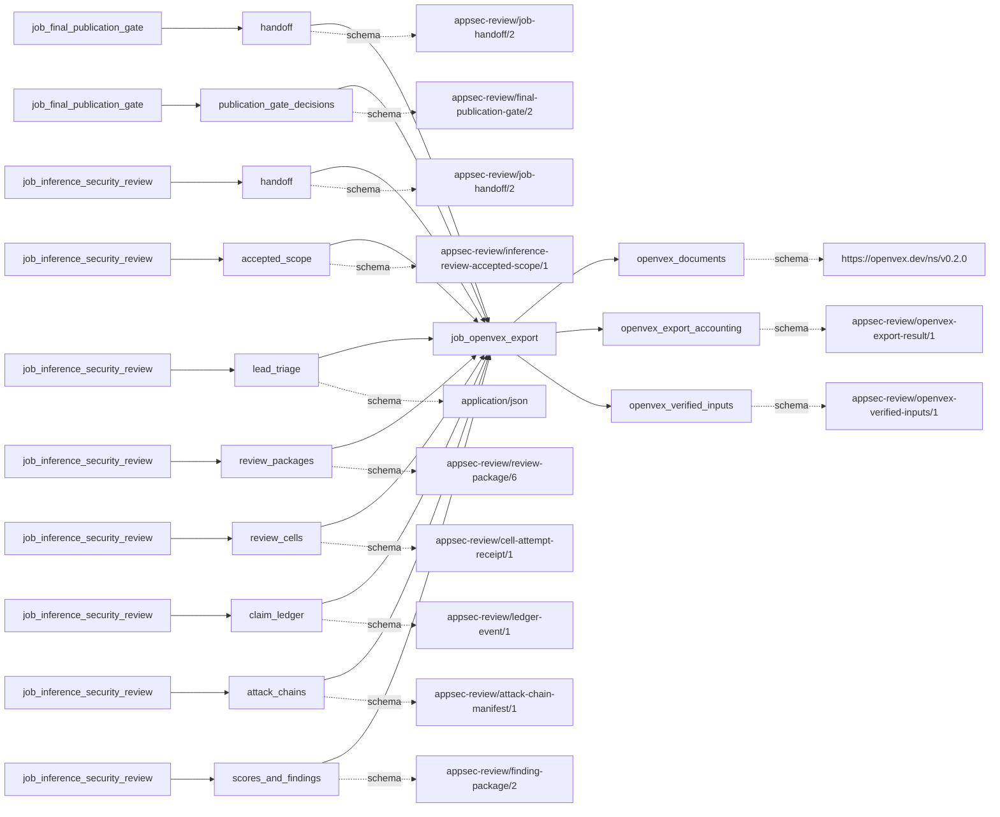

# openvex_export

This page contains the generated contract; the authored process and acceptance description are tracked by [T-130](../TODO.md).

<!-- generated:begin job=job_openvex_export -->
<!-- generated from: appsec-review.toml, containers/catalog.toml, pipeline/guidance/registry.json, tests/job-test-map.json, src/appsec_review/runtime/registry.py, src/appsec_review/runtime/contracts.py, src/appsec_review/runtime/datasets.py, src/appsec_review/guidance/workers.py, src/appsec_review/mcp/schema.py, src/appsec_review/orchestration/topology.py, src/appsec_review/orchestration/dagster/adapter.py by scripts/generate-docs.py; do not edit -->
## Declared job contract

openvex_export

Job: `job_openvex_export`. Enabled in the dev recipe: **true**.
Declarations describe possible work, not successful execution or consumed evidence.

### Steps and tasks

| Step | Task | Workers | Pool | Bound tool or gap | Handler |
| --- | --- | --- | --- | --- | --- |
| `acceptance` | `acceptance.publish_handoff` | 1 | `application` | Undeclared ([T-147](../TODO.md)) | [source](../../src/appsec_review/jobs/job_openvex_export/job.py#L190) |
| `export` | `export.assemble` | 1 | `application` | Undeclared ([T-147](../TODO.md)) | [source](../../src/appsec_review/jobs/job_openvex_export/job.py#L190) |
| `load` | `load.verify_inputs` | 1 | `application` | Undeclared ([T-147](../TODO.md)) | [source](../../src/appsec_review/jobs/job_openvex_export/job.py#L190) |

### Accepted input declarations

| Producer | Dataset | Schema | Channel | Availability | Missing policy |
| --- | --- | --- | --- | --- | --- |
| `job_final_publication_gate` | `handoff` | `appsec-review/job-handoff/2` | handoff | required | reject |
| `job_final_publication_gate` | `publication_gate_decisions` | `appsec-review/final-publication-gate/2` | handoff | optional | gap |
| `job_inference_security_review` | `handoff` | `appsec-review/job-handoff/2` | handoff | required | reject |
| `job_inference_security_review` | `accepted_scope` | `appsec-review/inference-review-accepted-scope/1` | handoff | optional | gap |
| `job_inference_security_review` | `lead_triage` | `application/json` | handoff | optional | gap |
| `job_inference_security_review` | `review_packages` | `appsec-review/review-package/6` | handoff | optional | gap |
| `job_inference_security_review` | `review_cells` | `appsec-review/cell-attempt-receipt/1` | handoff | optional | gap |
| `job_inference_security_review` | `claim_ledger` | `appsec-review/ledger-event/1` | handoff | optional | gap |
| `job_inference_security_review` | `attack_chains` | `appsec-review/attack-chain-manifest/1` | handoff | optional | gap |
| `job_inference_security_review` | `scores_and_findings` | `appsec-review/finding-package/2` | handoff | optional | gap |

### Published dataset declarations

| Dataset | Step | Schema | Stage | Indexes | MCP route |
| --- | --- | --- | --- | --- | --- |
| `openvex_documents` | `export` | `https://openvex.dev/ns/v0.2.0` | protected | Not indexed | `coverage`, `query_dataset_inventory` |
| `openvex_export_accounting` | `acceptance` | `appsec-review/openvex-export-result/1` | protected | Not indexed | `coverage`, `query_dataset_inventory` |
| `openvex_verified_inputs` | `load` | `appsec-review/openvex-verified-inputs/1` | protected | Not indexed | `coverage`, `query_dataset_inventory` |

Protected and artifact-only routes expose sanitized metadata, not payload access.

### Model and guidance declarations

No job-level model declaration; absence of a task binding remains [T-147](../TODO.md), not a nonexecution claim.

### Test selection

| Tier | Files or selectors |
| --- | --- |
| acceptance | None declared |
| integration | None declared |
| live | None declared |
| unit | `tests/test_openvex_job_units.py` |

### Dagster placement

Dispatch: `review_graph`. Review graph member: **true**. Enabled graph member: **true**.

Declared predecessors: `job_final_publication_gate`.

### Declared dataflow

<!-- generated:end -->
