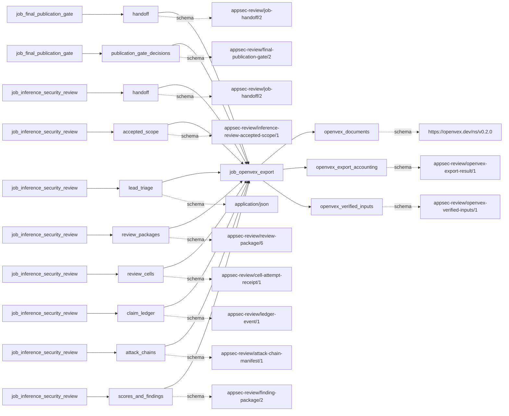
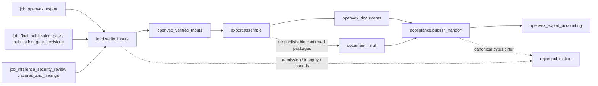

# openvex_export

## Purpose

Export all and only the accepted gate's publishable confirmed packages as OpenVEX `affected`
statements, one per package. A protected companion accounts for backlog and withheld packages,
evidence, scoring, shipment decisions and coverage. The exporter cannot infer `fixed`,
`not_affected` or runtime exploitation; automatic tool authorship is not vendor attestation.

<!-- generated:begin job=job_openvex_export -->
<!-- generated from: appsec-review.toml, containers/catalog.toml, pipeline/guidance/registry.json, tests/job-test-map.json, src/appsec_review/runtime/registry.py, src/appsec_review/runtime/contracts.py, src/appsec_review/runtime/datasets.py, src/appsec_review/guidance/workers.py, src/appsec_review/mcp/schema.py, src/appsec_review/orchestration/topology.py, src/appsec_review/orchestration/dagster/adapter.py by scripts/generate-docs.py; do not edit -->
## Declared job contract

openvex_export

Job: `job_openvex_export`. Enabled in the dev recipe: **true**.
Declarations describe possible work, not successful execution or consumed evidence.

### Steps and tasks

| Step | Task | Workers | Pool | Bound tool or gap | Handler |
| --- | --- | --- | --- | --- | --- |
| `acceptance` | `acceptance.publish_handoff` | 1 | `application` | Undeclared ([T-147](../TODO.md)) | [source](../../src/appsec_review/jobs/job_openvex_export/job.py#L190) |
| `export` | `export.assemble` | 1 | `application` | Undeclared ([T-147](../TODO.md)) | [source](../../src/appsec_review/jobs/job_openvex_export/job.py#L190) |
| `load` | `load.verify_inputs` | 1 | `application` | Undeclared ([T-147](../TODO.md)) | [source](../../src/appsec_review/jobs/job_openvex_export/job.py#L190) |

### Accepted input declarations

| Producer | Dataset | Schema | Channel | Availability | Missing policy |
| --- | --- | --- | --- | --- | --- |
| `job_final_publication_gate` | `handoff` | `appsec-review/job-handoff/2` | handoff | required | reject |
| `job_final_publication_gate` | `publication_gate_decisions` | `appsec-review/final-publication-gate/2` | handoff | optional | gap |
| `job_inference_security_review` | `handoff` | `appsec-review/job-handoff/2` | handoff | required | reject |
| `job_inference_security_review` | `accepted_scope` | `appsec-review/inference-review-accepted-scope/1` | handoff | optional | gap |
| `job_inference_security_review` | `lead_triage` | `application/json` | handoff | optional | gap |
| `job_inference_security_review` | `review_packages` | `appsec-review/review-package/6` | handoff | optional | gap |
| `job_inference_security_review` | `review_cells` | `appsec-review/cell-attempt-receipt/1` | handoff | optional | gap |
| `job_inference_security_review` | `claim_ledger` | `appsec-review/ledger-event/1` | handoff | optional | gap |
| `job_inference_security_review` | `attack_chains` | `appsec-review/attack-chain-manifest/1` | handoff | optional | gap |
| `job_inference_security_review` | `scores_and_findings` | `appsec-review/finding-package/2` | handoff | optional | gap |

### Published dataset declarations

| Dataset | Step | Schema | Stage | Indexes | MCP route |
| --- | --- | --- | --- | --- | --- |
| `openvex_documents` | `export` | `https://openvex.dev/ns/v0.2.0` | protected | Not indexed | `coverage`, `query_dataset_inventory` |
| `openvex_export_accounting` | `acceptance` | `appsec-review/openvex-export-result/1` | protected | Not indexed | `coverage`, `query_dataset_inventory` |
| `openvex_verified_inputs` | `load` | `appsec-review/openvex-verified-inputs/1` | protected | Not indexed | `coverage`, `query_dataset_inventory` |

Protected and artifact-only routes expose sanitized metadata, not payload access.

### Model and guidance declarations

No job-level model declaration; absence of a task binding remains [T-147](../TODO.md), not a nonexecution claim.

### Test selection

| Tier | Files or selectors |
| --- | --- |
| acceptance | None declared |
| integration | None declared |
| live | None declared |
| unit | `tests/test_openvex_job_units.py` |

### Dagster placement

Dispatch: `review_graph`. Review graph member: **true**. Enabled graph member: **true**.

Declared predecessors: `job_final_publication_gate`.

### Declared dataflow

<!-- generated:end -->

## Process

See the [handler](../../src/appsec_review/jobs/job_openvex_export/job.py),
[bounded verifier](../../src/appsec_review/jobs/job_openvex_export/inputs.py) and
[pure projector](../../src/appsec_review/jobs/job_openvex_export/projection.py).

### `load`

1. In `load.verify_inputs`, require enabled typed settings and a valid attempt deadline.
   Verify accepted gate/review identities, source scope, frozen configuration, finding partitions
   and every certified binding through the bounded input reader.
2. Measure the input inventory and reprove it. Missing, stale, tampered, escaping or oversized
   inputs fail closed; no package is skipped to make the export fit.
3. Verify and copy the pinned offline schema resources, upstream lock and license into this
   attempt. Write immutable `openvex_verified_inputs`; no network schema lookup occurs.

### `export`

1. In `export.assemble`, reprove the loaded inventory and schema copies. Check source/configuration
   identities and exact gate counts/bucket membership.
2. Derive product identity from reviewed repository identity, target snapshot and resolved
   configuration. Use the gate completion timestamp, not the current export clock.
3. Emit an `affected` statement for each `publishable` package. Retain all other packages as
   exclusions with `gate_verification_backlog` or `gate_withheld`, not alternate VEX statuses.
4. If no statements exist, emit result and companion only, with `document = null`.
   Otherwise emit canonical document bytes. Validate schema and semantic accounting, then write
   exclusive immutable outputs with byte/size/hash verification.

### `acceptance`

1. In `acceptance.publish_handoff`, reprove inputs and reassemble the expected export from
   the same frozen settings and exporter release.
2. Compare result identity and every emitted file byte for byte with the canonical assembly.
   For an empty export, reject even an unexpected document file or symlink.
3. Reprove inputs again and enforce the deadline. Publish the hash-bound accounting reference
   with inherited gate gaps and the no-statements reason where applicable.

## Dataflow

This is a deterministic artifact projection: no model, scanner, subprocess or container is
dispatched. See [input admission](../architecture/job-input-contracts.md#admission-and-read-receipts),
[signing versus byte binding](signing.md#mechanism) and the existing
[specification qualification](../architecture/openvex-export.md#3-verified-upstream-specification-and-validation-pin).

## Gaps

Successful result gaps are legacy IDs without a source-supplied retryability classification:
the gate's limitation IDs of kind `gap`, and
`openvex_no_publishable_confirmed_findings` when the document is absent. `no_statements` is
accounted absence, not a clean-product declaration. `not_run` limitations and the compile-only
notice stay in companion context, not the export gap set.

`configuration_invalid`, `input_missing`, `input_stale`, `input_tampered`, `identity_conflict`,
`schema_invalid`, `semantic_invalid`, `bound_exceeded`, `timed_out`, `io_error` and
`internal_error` are failure-event reason values from `ExportFailureReason`, **not**
source-emitted producer-gap codes. They fail the attempt; there is no success-shaped partial
export for corrupted inputs. Interpret canonical
[outcomes](../architecture/job-interchange.md#the-control-layer-beneath-the-envelope) separately.

## Acceptance

1. **A. Inputs:** Compare gate/review handoff pins, accepted manifest, source snapshot, full resolved
   configuration hash, semantic review settings and schema resource hashes with the verified
   inventory. Confirm author/action/source identity come from the frozen policy.
2. **B. Independent comparison:** Independently enumerate gate publishable IDs and require an
   exact one-to-one statement mapping. Check backlog/withheld exclusion totals and all package
   evidence/score references. Recompute product, timestamp and canonical document identities;
   zero eligible packages must mean no document, not an empty document called success.
3. **C. Gaps:** Compare canonical outcomes and companion gap IDs with gate gap limitations.
   Account for no-statements explicitly; do not count `not_run` or nonexecution notices as new
   vulnerability evidence. Any failed verification stops the walk.
4. **D. Baseline:** Save an authorized `stepwise.py accept` baseline with corpus namespace,
   gate/export hashes, source/configuration identity, included/excluded IDs and statement counts.
   Retain historical immutable output when a newer gate makes current export status stale.

## Resume and invalidation

There is no exporter-specific semantic cache. [Runtime admission](../architecture/jobs-and-runtime.md#wave-1-resumability)
and repeated input reproof bind accepted gate/review, source/configuration, settings, schema pins
and exporter release. A new accepted pointer invalidates current reuse without changing historical
immutable evidence. Exclusive writes allow identical existing bytes, never replacement with
different content. Artifact-bearing outputs are not portable failed-attempt checkpoints.
