# owasp_control_assessment

## Purpose

Assess selected OWASP control/component proof obligations against bounded, accepted evidence and
publish exactly-once scoped results. Source-subject conclusions are not whole-component safety,
runtime/manual evidence or compliance certification. Qualification fixtures remain explicitly
synthetic and cannot produce lead-eligible customer findings; assessment uses independent review
and preserves dissent.

Accepted evidence can include `job_code_graph_index/alternate_cpg_index`
(`appsec-review/alternate-cpg/1`), explicitly declared as optional producer evidence (T-5080).
Its `analysis/alternate-cpg` shard is readable only through the admitted producer handoff and
verified bytes. This permission does not establish a satisfied control, complete graph coverage
or a model citation; unavailable evidence remains a named gap.

<!-- generated:begin job=job_owasp_control_assessment -->
<!-- generated from: appsec-review.toml, containers/catalog.toml, pipeline/guidance/registry.json, tests/job-test-map.json, src/appsec_review/runtime/registry.py, src/appsec_review/runtime/contracts.py, src/appsec_review/runtime/datasets.py, src/appsec_review/guidance/workers.py, src/appsec_review/mcp/schema.py, src/appsec_review/orchestration/topology.py, src/appsec_review/orchestration/dagster/adapter.py by scripts/generate-docs.py; do not edit -->
## Declared job contract

owasp_control_assessment

Job: `job_owasp_control_assessment`. Enabled in the dev recipe: **true**.
Declarations describe possible work, not successful execution or consumed evidence.

### Steps and tasks

| Step | Task | Workers | Pool | Bound tool or gap | Handler |
| --- | --- | --- | --- | --- | --- |
| `applicability` | `applicability.build_matrix` | 1 | `application` | Undeclared ([T-147](../TODO.md)) | [source](../../src/appsec_review/jobs/job_owasp_control_assessment/job.py#L199) |
| `batching` | `batching.build_packages` | 1 | `application` | Undeclared ([T-147](../TODO.md)) | [source](../../src/appsec_review/jobs/job_owasp_control_assessment/job.py#L222) |
| `batching` | `batching.partition_work` | 1 | `application` | Undeclared ([T-147](../TODO.md)) | [source](../../src/appsec_review/jobs/job_owasp_control_assessment/job.py#L214) |
| `characterization` | `characterization.classify_components` | 1 | `application` | Undeclared ([T-147](../TODO.md)) | [source](../../src/appsec_review/jobs/job_owasp_control_assessment/job.py#L186) |
| `characterization` | `characterization.load_inputs` | 1 | `application` | Undeclared ([T-147](../TODO.md)) | [source](../../src/appsec_review/jobs/job_owasp_control_assessment/job.py#L179) |
| `join` | `join.deterministic_join` | 1 | `owasp_verification` | Undeclared ([T-147](../TODO.md)) | [source](../../src/appsec_review/jobs/job_owasp_control_assessment/job.py#L365) |
| `publication` | `publication.publish_handoff` | 1 | `application` | Undeclared ([T-147](../TODO.md)) | [source](../../src/appsec_review/jobs/job_owasp_control_assessment/job.py#L436) |
| `publication` | `publication.publish_indexes` | 1 | `application` | Undeclared ([T-147](../TODO.md)) | [source](../../src/appsec_review/jobs/job_owasp_control_assessment/job.py#L377) |
| `standards_selection` | `standards_selection.ingest_catalogs` | 1 | `application` | Undeclared ([T-147](../TODO.md)) | [source](../../src/appsec_review/jobs/job_owasp_control_assessment/job.py#L167) |
| `standards_selection` | `standards_selection.select_profiles` | 1 | `application` | Undeclared ([T-147](../TODO.md)) | [source](../../src/appsec_review/jobs/job_owasp_control_assessment/job.py#L173) |
| `validation` | `validation.cell_01` | 1 | `owasp_validator` | Undeclared ([T-147](../TODO.md)) | [source](../../src/appsec_review/jobs/job_owasp_control_assessment/job.py#L258) |
| `validation` | `validation.cell_02` | 1 | `owasp_validator` | Undeclared ([T-147](../TODO.md)) | [source](../../src/appsec_review/jobs/job_owasp_control_assessment/job.py#L258) |
| `validation` | `validation.cell_03` | 1 | `owasp_validator` | Undeclared ([T-147](../TODO.md)) | [source](../../src/appsec_review/jobs/job_owasp_control_assessment/job.py#L258) |
| `validation` | `validation.cell_04` | 1 | `owasp_validator` | Undeclared ([T-147](../TODO.md)) | [source](../../src/appsec_review/jobs/job_owasp_control_assessment/job.py#L258) |
| `verification` | `verification.independent_review` | 1 | `owasp_verification` | Undeclared ([T-147](../TODO.md)) | [source](../../src/appsec_review/jobs/job_owasp_control_assessment/job.py#L320) |

### Accepted input declarations

| Producer | Dataset | Schema | Channel | Availability | Missing policy |
| --- | --- | --- | --- | --- | --- |
| `job_artifact_indexing` | `handoff` | `appsec-review/job-handoff/2` | handoff | optional | gap |
| `job_artifact_security_analysis` | `handoff` | `appsec-review/job-handoff/2` | handoff | optional | gap |
| `job_binary_evidence_indexing` | `handoff` | `appsec-review/job-handoff/2` | handoff | optional | gap |
| `job_ci_configuration_analysis` | `handoff` | `appsec-review/job-handoff/2` | handoff | optional | gap |
| `job_clang_static_analysis` | `handoff` | `appsec-review/job-handoff/2` | handoff | optional | gap |
| `job_code_graph_index` | `handoff` | `appsec-review/job-handoff/2` | handoff | optional | gap |
| `job_codeql_analysis` | `handoff` | `appsec-review/job-handoff/2` | handoff | optional | gap |
| `job_cpg_analysis` | `handoff` | `appsec-review/job-handoff/2` | handoff | optional | gap |
| `job_cpp_compiled_analysis` | `handoff` | `appsec-review/job-handoff/2` | handoff | optional | gap |
| `job_cpp_symbol_index` | `handoff` | `appsec-review/job-handoff/2` | handoff | optional | gap |
| `job_dependency_intelligence` | `handoff` | `appsec-review/job-handoff/2` | handoff | optional | gap |
| `job_evidence_collection` | `handoff` | `appsec-review/job-handoff/2` | handoff | optional | gap |
| `job_language_build` | `handoff` | `appsec-review/job-handoff/2` | handoff | optional | gap |
| `job_post_build_security_assessment` | `handoff` | `appsec-review/job-handoff/2` | handoff | optional | gap |
| `job_profile_data` | `handoff` | `appsec-review/job-handoff/2` | handoff | optional | gap |
| `job_review_prioritization` | `handoff` | `appsec-review/job-handoff/2` | handoff | optional | gap |
| `job_security_tagging` | `handoff` | `appsec-review/job-handoff/2` | handoff | optional | gap |
| `job_svf_alias_analysis` | `handoff` | `appsec-review/job-handoff/2` | handoff | optional | gap |
| `job_target_analysis_plan` | `handoff` | `appsec-review/job-handoff/2` | handoff | optional | gap |
| `job_target_catalog` | `handoff` | `appsec-review/job-handoff/2` | handoff | optional | gap |
| `job_test_coverage` | `handoff` | `appsec-review/job-handoff/2` | handoff | optional | gap |
| `job_tree_sitter_ast` | `handoff` | `appsec-review/job-handoff/2` | handoff | optional | gap |
| `job_artifact_indexing` | `artifact_catalog` | `appsec-review/retrieval-index/2` | handoff | optional | gap |
| `job_artifact_indexing` | `archive_members` | `appsec-review/retrieval-index/2` | handoff | optional | gap |
| `job_artifact_indexing` | `artifact_relationships` | `appsec-review/retrieval-index/2` | handoff | optional | gap |
| `job_artifact_security_analysis` | `artifact_security_observations` | `appsec-review/retrieval-index/2` | handoff | optional | gap |
| `job_ci_configuration_analysis` | `ci_observations` | `appsec-review/retrieval-index/2` | handoff | optional | gap |
| `job_ci_configuration_analysis` | `ci_findings` | `appsec-review/retrieval-index/2` | handoff | optional | gap |
| `job_clang_static_analysis` | `clang_static_observations` | `appsec-review/retrieval-index/2` | handoff | optional | gap |
| `job_clang_static_analysis` | `clang_static_scope_coverage` | `appsec-review/cpp-index-coverage/1` | handoff | optional | gap |
| `job_code_graph_index` | `code_graph_facts` | `appsec-review/graph-fact/1` | handoff | optional | gap |
| `job_code_graph_index` | `alternate_cpg_index` | `appsec-review/alternate-cpg/1` | handoff | optional | gap |
| `job_codeql_analysis` | `codeql_observations` | `appsec-review/codeql-sarif-normalizer/3` | handoff | optional | gap |
| `job_cpg_analysis` | `cpg_graph_coverage` | `appsec-review/retrieval-index/2` | handoff | optional | gap |
| `job_cpg_analysis` | `cpg_scope_coverage` | `appsec-review/cpp-index-coverage/1` | handoff | optional | gap |
| `job_cpp_compiled_analysis` | `cpp_build_graph` | `appsec-review/retrieval-index/2` | handoff | optional | gap |
| `job_cpp_compiled_analysis` | `clang_ast` | `appsec-review/retrieval-index/2` | handoff | optional | gap |
| `job_cpp_compiled_analysis` | `llvm_ir` | `appsec-review/retrieval-index/2` | handoff | optional | gap |
| `job_cpp_compiled_analysis` | `infer_observations` | `appsec-review/retrieval-index/2` | handoff | optional | gap |
| `job_cpp_compiled_analysis` | `binary_symbols` | `appsec-review/retrieval-index/2` | handoff | optional | gap |
| `job_cpp_compiled_analysis` | `cpp_blocked_branches` | `appsec-review/retrieval-index/2` | handoff | optional | gap |
| `job_cpp_symbol_index` | `clangd_symbols` | `appsec-review/retrieval-index/2` | handoff | optional | gap |
| `job_cpp_symbol_index` | `clangd_coverage` | `appsec-review/cpp-index-coverage/1` | handoff | optional | gap |
| `job_dependency_intelligence` | `native_advisory_observations` | `appsec-review/retrieval-index/2` | handoff | optional | gap |
| `job_dependency_intelligence` | `dependency_context` | `appsec-review/retrieval-index/2` | handoff | optional | gap |
| `job_evidence_collection` | `static_tool_observations` | `appsec-review/retrieval-index/2` | handoff | optional | gap |
| `job_language_build` | `build_actions` | `appsec-review/retrieval-index/2` | handoff | optional | gap |
| `job_language_build` | `jvm_build_actions` | `appsec-review/retrieval-index/2` | handoff | optional | gap |
| `job_post_build_security_assessment` | `build_security` | `appsec-review/retrieval-index/2` | handoff | optional | gap |
| `job_profile_data` | `profile_data` | `appsec-review/retrieval-index/2` | handoff | optional | gap |
| `job_review_prioritization` | `priority_items` | `appsec-review/retrieval-index/2` | handoff | optional | gap |
| `job_security_tagging` | `tag_assignments` | `appsec-review/tag-assignment/1` | handoff | optional | gap |
| `job_svf_alias_analysis` | `svf_alias_sets` | `appsec-review/retrieval-index/2` | handoff | optional | gap |
| `job_svf_alias_analysis` | `svf_alias_scope_coverage` | `appsec-review/cpp-index-coverage/1` | handoff | optional | gap |
| `job_target_analysis_plan` | `analysis_plan` | `appsec-review/retrieval-index/2` | handoff | optional | gap |
| `job_target_catalog` | `source_files` | `appsec-review/retrieval-index/2` | handoff | optional | gap |
| `job_target_catalog` | `declaration_symbols` | `appsec-review/retrieval-index/2` | handoff | optional | gap |
| `job_target_catalog` | `components` | `appsec-review/retrieval-index/2` | handoff | optional | gap |
| `job_target_catalog` | `target_documents` | `appsec-review/retrieval-index/2` | handoff | optional | gap |
| `job_target_catalog` | `build_units` | `appsec-review/retrieval-index/2` | handoff | optional | gap |
| `job_test_coverage` | `test_coverage` | `appsec-review/retrieval-index/2` | handoff | optional | gap |
| `job_tree_sitter_ast` | `tree_sitter_ast` | `appsec-review/tree-sitter-normalizer/1` | handoff | optional | gap |
| `job_tree_sitter_ast` | `tree_sitter_coverage` | `appsec-review/tree-sitter-ast/1` | handoff | optional | gap |
| `job_binary_evidence_indexing` | `binary_pseudo_c` | `appsec-review/binary-source-backing/1` | handoff | optional | gap |
| `job_tree_sitter_ast` | `generated_source_backing` | `appsec-review/generated-source-backing/1` | handoff | optional | gap |
| `job_third_party_data_sync` | `feed_snapshot` | `appsec-review/public-feed-use/1` | external | optional | gap |

### Published dataset declarations

| Dataset | Step | Schema | Stage | Indexes | MCP route |
| --- | --- | --- | --- | --- | --- |
| `owasp_control_gaps` | `publication` | `appsec-review/owasp-control-gap/1` | artifact_only | Not indexed | `coverage`, `query_dataset_inventory` |
| `owasp_documents` | `publication` | `appsec-review/owasp-workbench-result/1` | artifact_only | Not indexed | `coverage`, `query_dataset_inventory` |
| `owasp_model_receipts` | `verification` | `appsec-review/owasp-model-receipt/1` | protected | Not indexed | `coverage`, `query_dataset_inventory` |
| `owasp_workbench` | `publication` | `appsec-review/owasp-index-shard/1` | indexed | `standards`, `component-classification`, `applicability`, `validation-work`, `control-result`, `finding-package` | `query_owasp_workbench`, `query_precomputed` |

Protected and artifact-only routes expose sanitized metadata, not payload access.

### Model and guidance declarations

These are job-level declarations; exact per-task selection is not declared ([T-147](../TODO.md)).

```json
{
  "model": {
    "enabled": true,
    "max_input_tokens": 24000,
    "max_output_tokens": 6000,
    "model": "claude-haiku-5-5",
    "provider": "claude-cli",
    "reasoning": "medium",
    "retries": 1,
    "timeout_seconds": 120
  },
  "models": {
    "reviewer": {
      "enabled": true,
      "max_input_tokens": 24000,
      "max_output_tokens": 6000,
      "model": "claude-haiku-5-5",
      "provider": "claude-cli",
      "reasoning": "medium",
      "retries": 1,
      "timeout_seconds": 120
    }
  }
}
```


### Test selection

| Tier | Files or selectors |
| --- | --- |
| acceptance | `tests/acceptance/job_owasp_control_assessment/test_subject_selection.py` |
| integration | `tests/integration/job_owasp_control_assessment/test_subject_selection.py`<br>`tests/integration/job_owasp_control_assessment/test_dagster_owasp_workbench.py` |
| live | None declared |
| unit | `tests/unit/job_owasp_control_assessment/test_audit_assessment.py`<br>`tests/unit/job_owasp_control_assessment/test_audit_publication.py`<br>`tests/unit/job_owasp_control_assessment/test_c_subjects.py`<br>`tests/unit/job_owasp_control_assessment/test_closure.py`<br>`tests/unit/job_owasp_control_assessment/test_control_roles.py`<br>`tests/unit/job_owasp_control_assessment/test_network_service_class.py`<br>`tests/unit/job_owasp_control_assessment/test_tag_discovery.py`<br>`tests/unit/job_owasp_control_assessment/test_parser_versions.py`<br>`tests/unit/job_owasp_control_assessment/test_request_batching.py`<br>`tests/unit/job_owasp_control_assessment/test_contract.py`<br>`tests/unit/job_owasp_control_assessment/test_discovery_boundaries.py`<br>`tests/unit/job_owasp_control_assessment/test_package_projection.py`<br>`tests/unit/job_owasp_control_assessment/test_subject_acceptance.py`<br>`tests/unit/job_owasp_control_assessment/test_subject_selection.py`<br>`tests/unit/job_owasp_control_assessment/test_subject_settings.py`<br>`tests/unit/job_owasp_control_assessment/test_target_class.py`<br>`tests/unit/job_owasp_control_assessment/test_target_class_job.py`<br>`tests/test_owasp_assessment_job.py`<br>`tests/test_owasp_catalog_integrity.py`<br>`tests/test_owasp_downstream.py`<br>`tests/test_owasp_evidence_binding.py`<br>`tests/test_owasp_indexes.py`<br>`tests/test_owasp_proof_procedures.py`<br>`tests/test_owasp_telemetry.py`<br>`tests/test_owasp_workbench.py`<br>`tests/orchestration/dagster/test_owasp_workbench.py` |

### Dagster placement

Dispatch: `review_graph`. Review graph member: **true**. Enabled graph member: **true**.

Declared predecessors: `job_security_tagging`.

### Declared dataflow

```mermaid
flowchart LR
  job["job_owasp_control_assessment"]
  producer0["job_artifact_indexing"]
  input0["handoff"]
  input_schema0["appsec-review/job-handoff/2"]
  producer0 --> input0 --> job
  input0 -. schema .-> input_schema0
  producer1["job_artifact_security_analysis"]
  input1["handoff"]
  input_schema1["appsec-review/job-handoff/2"]
  producer1 --> input1 --> job
  input1 -. schema .-> input_schema1
  producer2["job_binary_evidence_indexing"]
  input2["handoff"]
  input_schema2["appsec-review/job-handoff/2"]
  producer2 --> input2 --> job
  input2 -. schema .-> input_schema2
  producer3["job_ci_configuration_analysis"]
  input3["handoff"]
  input_schema3["appsec-review/job-handoff/2"]
  producer3 --> input3 --> job
  input3 -. schema .-> input_schema3
  producer4["job_clang_static_analysis"]
  input4["handoff"]
  input_schema4["appsec-review/job-handoff/2"]
  producer4 --> input4 --> job
  input4 -. schema .-> input_schema4
  producer5["job_code_graph_index"]
  input5["handoff"]
  input_schema5["appsec-review/job-handoff/2"]
  producer5 --> input5 --> job
  input5 -. schema .-> input_schema5
  producer6["job_codeql_analysis"]
  input6["handoff"]
  input_schema6["appsec-review/job-handoff/2"]
  producer6 --> input6 --> job
  input6 -. schema .-> input_schema6
  producer7["job_cpg_analysis"]
  input7["handoff"]
  input_schema7["appsec-review/job-handoff/2"]
  producer7 --> input7 --> job
  input7 -. schema .-> input_schema7
  producer8["job_cpp_compiled_analysis"]
  input8["handoff"]
  input_schema8["appsec-review/job-handoff/2"]
  producer8 --> input8 --> job
  input8 -. schema .-> input_schema8
  producer9["job_cpp_symbol_index"]
  input9["handoff"]
  input_schema9["appsec-review/job-handoff/2"]
  producer9 --> input9 --> job
  input9 -. schema .-> input_schema9
  producer10["job_dependency_intelligence"]
  input10["handoff"]
  input_schema10["appsec-review/job-handoff/2"]
  producer10 --> input10 --> job
  input10 -. schema .-> input_schema10
  producer11["job_evidence_collection"]
  input11["handoff"]
  input_schema11["appsec-review/job-handoff/2"]
  producer11 --> input11 --> job
  input11 -. schema .-> input_schema11
  producer12["job_language_build"]
  input12["handoff"]
  input_schema12["appsec-review/job-handoff/2"]
  producer12 --> input12 --> job
  input12 -. schema .-> input_schema12
  producer13["job_post_build_security_assessment"]
  input13["handoff"]
  input_schema13["appsec-review/job-handoff/2"]
  producer13 --> input13 --> job
  input13 -. schema .-> input_schema13
  producer14["job_profile_data"]
  input14["handoff"]
  input_schema14["appsec-review/job-handoff/2"]
  producer14 --> input14 --> job
  input14 -. schema .-> input_schema14
  producer15["job_review_prioritization"]
  input15["handoff"]
  input_schema15["appsec-review/job-handoff/2"]
  producer15 --> input15 --> job
  input15 -. schema .-> input_schema15
  producer16["job_security_tagging"]
  input16["handoff"]
  input_schema16["appsec-review/job-handoff/2"]
  producer16 --> input16 --> job
  input16 -. schema .-> input_schema16
  producer17["job_svf_alias_analysis"]
  input17["handoff"]
  input_schema17["appsec-review/job-handoff/2"]
  producer17 --> input17 --> job
  input17 -. schema .-> input_schema17
  producer18["job_target_analysis_plan"]
  input18["handoff"]
  input_schema18["appsec-review/job-handoff/2"]
  producer18 --> input18 --> job
  input18 -. schema .-> input_schema18
  producer19["job_target_catalog"]
  input19["handoff"]
  input_schema19["appsec-review/job-handoff/2"]
  producer19 --> input19 --> job
  input19 -. schema .-> input_schema19
  producer20["job_test_coverage"]
  input20["handoff"]
  input_schema20["appsec-review/job-handoff/2"]
  producer20 --> input20 --> job
  input20 -. schema .-> input_schema20
  producer21["job_tree_sitter_ast"]
  input21["handoff"]
  input_schema21["appsec-review/job-handoff/2"]
  producer21 --> input21 --> job
  input21 -. schema .-> input_schema21
  producer22["job_artifact_indexing"]
  input22["artifact_catalog"]
  input_schema22["appsec-review/retrieval-index/2"]
  producer22 --> input22 --> job
  input22 -. schema .-> input_schema22
  producer23["job_artifact_indexing"]
  input23["archive_members"]
  input_schema23["appsec-review/retrieval-index/2"]
  producer23 --> input23 --> job
  input23 -. schema .-> input_schema23
  producer24["job_artifact_indexing"]
  input24["artifact_relationships"]
  input_schema24["appsec-review/retrieval-index/2"]
  producer24 --> input24 --> job
  input24 -. schema .-> input_schema24
  producer25["job_artifact_security_analysis"]
  input25["artifact_security_observations"]
  input_schema25["appsec-review/retrieval-index/2"]
  producer25 --> input25 --> job
  input25 -. schema .-> input_schema25
  producer26["job_ci_configuration_analysis"]
  input26["ci_observations"]
  input_schema26["appsec-review/retrieval-index/2"]
  producer26 --> input26 --> job
  input26 -. schema .-> input_schema26
  producer27["job_ci_configuration_analysis"]
  input27["ci_findings"]
  input_schema27["appsec-review/retrieval-index/2"]
  producer27 --> input27 --> job
  input27 -. schema .-> input_schema27
  producer28["job_clang_static_analysis"]
  input28["clang_static_observations"]
  input_schema28["appsec-review/retrieval-index/2"]
  producer28 --> input28 --> job
  input28 -. schema .-> input_schema28
  producer29["job_clang_static_analysis"]
  input29["clang_static_scope_coverage"]
  input_schema29["appsec-review/cpp-index-coverage/1"]
  producer29 --> input29 --> job
  input29 -. schema .-> input_schema29
  producer30["job_code_graph_index"]
  input30["code_graph_facts"]
  input_schema30["appsec-review/graph-fact/1"]
  producer30 --> input30 --> job
  input30 -. schema .-> input_schema30
  producer31["job_code_graph_index"]
  input31["alternate_cpg_index"]
  input_schema31["appsec-review/alternate-cpg/1"]
  producer31 --> input31 --> job
  input31 -. schema .-> input_schema31
  producer32["job_codeql_analysis"]
  input32["codeql_observations"]
  input_schema32["appsec-review/codeql-sarif-normalizer/3"]
  producer32 --> input32 --> job
  input32 -. schema .-> input_schema32
  producer33["job_cpg_analysis"]
  input33["cpg_graph_coverage"]
  input_schema33["appsec-review/retrieval-index/2"]
  producer33 --> input33 --> job
  input33 -. schema .-> input_schema33
  producer34["job_cpg_analysis"]
  input34["cpg_scope_coverage"]
  input_schema34["appsec-review/cpp-index-coverage/1"]
  producer34 --> input34 --> job
  input34 -. schema .-> input_schema34
  producer35["job_cpp_compiled_analysis"]
  input35["cpp_build_graph"]
  input_schema35["appsec-review/retrieval-index/2"]
  producer35 --> input35 --> job
  input35 -. schema .-> input_schema35
  producer36["job_cpp_compiled_analysis"]
  input36["clang_ast"]
  input_schema36["appsec-review/retrieval-index/2"]
  producer36 --> input36 --> job
  input36 -. schema .-> input_schema36
  producer37["job_cpp_compiled_analysis"]
  input37["llvm_ir"]
  input_schema37["appsec-review/retrieval-index/2"]
  producer37 --> input37 --> job
  input37 -. schema .-> input_schema37
  producer38["job_cpp_compiled_analysis"]
  input38["infer_observations"]
  input_schema38["appsec-review/retrieval-index/2"]
  producer38 --> input38 --> job
  input38 -. schema .-> input_schema38
  producer39["job_cpp_compiled_analysis"]
  input39["binary_symbols"]
  input_schema39["appsec-review/retrieval-index/2"]
  producer39 --> input39 --> job
  input39 -. schema .-> input_schema39
  producer40["job_cpp_compiled_analysis"]
  input40["cpp_blocked_branches"]
  input_schema40["appsec-review/retrieval-index/2"]
  producer40 --> input40 --> job
  input40 -. schema .-> input_schema40
  producer41["job_cpp_symbol_index"]
  input41["clangd_symbols"]
  input_schema41["appsec-review/retrieval-index/2"]
  producer41 --> input41 --> job
  input41 -. schema .-> input_schema41
  producer42["job_cpp_symbol_index"]
  input42["clangd_coverage"]
  input_schema42["appsec-review/cpp-index-coverage/1"]
  producer42 --> input42 --> job
  input42 -. schema .-> input_schema42
  producer43["job_dependency_intelligence"]
  input43["native_advisory_observations"]
  input_schema43["appsec-review/retrieval-index/2"]
  producer43 --> input43 --> job
  input43 -. schema .-> input_schema43
  producer44["job_dependency_intelligence"]
  input44["dependency_context"]
  input_schema44["appsec-review/retrieval-index/2"]
  producer44 --> input44 --> job
  input44 -. schema .-> input_schema44
  producer45["job_evidence_collection"]
  input45["static_tool_observations"]
  input_schema45["appsec-review/retrieval-index/2"]
  producer45 --> input45 --> job
  input45 -. schema .-> input_schema45
  producer46["job_language_build"]
  input46["build_actions"]
  input_schema46["appsec-review/retrieval-index/2"]
  producer46 --> input46 --> job
  input46 -. schema .-> input_schema46
  producer47["job_language_build"]
  input47["jvm_build_actions"]
  input_schema47["appsec-review/retrieval-index/2"]
  producer47 --> input47 --> job
  input47 -. schema .-> input_schema47
  producer48["job_post_build_security_assessment"]
  input48["build_security"]
  input_schema48["appsec-review/retrieval-index/2"]
  producer48 --> input48 --> job
  input48 -. schema .-> input_schema48
  producer49["job_profile_data"]
  input49["profile_data"]
  input_schema49["appsec-review/retrieval-index/2"]
  producer49 --> input49 --> job
  input49 -. schema .-> input_schema49
  producer50["job_review_prioritization"]
  input50["priority_items"]
  input_schema50["appsec-review/retrieval-index/2"]
  producer50 --> input50 --> job
  input50 -. schema .-> input_schema50
  producer51["job_security_tagging"]
  input51["tag_assignments"]
  input_schema51["appsec-review/tag-assignment/1"]
  producer51 --> input51 --> job
  input51 -. schema .-> input_schema51
  producer52["job_svf_alias_analysis"]
  input52["svf_alias_sets"]
  input_schema52["appsec-review/retrieval-index/2"]
  producer52 --> input52 --> job
  input52 -. schema .-> input_schema52
  producer53["job_svf_alias_analysis"]
  input53["svf_alias_scope_coverage"]
  input_schema53["appsec-review/cpp-index-coverage/1"]
  producer53 --> input53 --> job
  input53 -. schema .-> input_schema53
  producer54["job_target_analysis_plan"]
  input54["analysis_plan"]
  input_schema54["appsec-review/retrieval-index/2"]
  producer54 --> input54 --> job
  input54 -. schema .-> input_schema54
  producer55["job_target_catalog"]
  input55["source_files"]
  input_schema55["appsec-review/retrieval-index/2"]
  producer55 --> input55 --> job
  input55 -. schema .-> input_schema55
  producer56["job_target_catalog"]
  input56["declaration_symbols"]
  input_schema56["appsec-review/retrieval-index/2"]
  producer56 --> input56 --> job
  input56 -. schema .-> input_schema56
  producer57["job_target_catalog"]
  input57["components"]
  input_schema57["appsec-review/retrieval-index/2"]
  producer57 --> input57 --> job
  input57 -. schema .-> input_schema57
  producer58["job_target_catalog"]
  input58["target_documents"]
  input_schema58["appsec-review/retrieval-index/2"]
  producer58 --> input58 --> job
  input58 -. schema .-> input_schema58
  producer59["job_target_catalog"]
  input59["build_units"]
  input_schema59["appsec-review/retrieval-index/2"]
  producer59 --> input59 --> job
  input59 -. schema .-> input_schema59
  producer60["job_test_coverage"]
  input60["test_coverage"]
  input_schema60["appsec-review/retrieval-index/2"]
  producer60 --> input60 --> job
  input60 -. schema .-> input_schema60
  producer61["job_tree_sitter_ast"]
  input61["tree_sitter_ast"]
  input_schema61["appsec-review/tree-sitter-normalizer/1"]
  producer61 --> input61 --> job
  input61 -. schema .-> input_schema61
  producer62["job_tree_sitter_ast"]
  input62["tree_sitter_coverage"]
  input_schema62["appsec-review/tree-sitter-ast/1"]
  producer62 --> input62 --> job
  input62 -. schema .-> input_schema62
  producer63["job_binary_evidence_indexing"]
  input63["binary_pseudo_c"]
  input_schema63["appsec-review/binary-source-backing/1"]
  producer63 --> input63 --> job
  input63 -. schema .-> input_schema63
  producer64["job_tree_sitter_ast"]
  input64["generated_source_backing"]
  input_schema64["appsec-review/generated-source-backing/1"]
  producer64 --> input64 --> job
  input64 -. schema .-> input_schema64
  producer65["job_third_party_data_sync"]
  input65["feed_snapshot"]
  input_schema65["appsec-review/public-feed-use/1"]
  producer65 --> input65 --> job
  input65 -. schema .-> input_schema65
  output0["owasp_control_gaps"]
  output_schema0["appsec-review/owasp-control-gap/1"]
  job --> output0
  output0 -. schema .-> output_schema0
  output1["owasp_documents"]
  output_schema1["appsec-review/owasp-workbench-result/1"]
  job --> output1
  output1 -. schema .-> output_schema1
  output2["owasp_model_receipts"]
  output_schema2["appsec-review/owasp-model-receipt/1"]
  job --> output2
  output2 -. schema .-> output_schema2
  output3["owasp_workbench"]
  output_schema3["appsec-review/owasp-index-shard/1"]
  job --> output3
  output3 -. schema .-> output_schema3
```



<!-- generated:end -->

## Process

The [handler](../../src/appsec_review/jobs/job_owasp_control_assessment/job.py) composes the
[workbench engine](../../src/appsec_review/owasp_workbench/engine.py),
[assessment validator](../../src/appsec_review/owasp_workbench/assessment.py) and
[evidence resolver](../../src/appsec_review/owasp_workbench/evidence.py).

### `standards_selection`

1. In `standards_selection.ingest_catalogs`, load pinned standards and retain source identity,
   version and fixture limitations. Assessment mode refuses abridged qualification catalogs.
2. In `standards_selection.select_profiles`, select ASVS/MASVS controls under the frozen profile
   policy and retain the selection fingerprint; taxonomy/reference catalogs are not target proof.

### `characterization`

1. In `characterization.load_inputs`, require explicit run-owned fixture inputs only in
   qualification mode. Assessment rejects that fixture and requires the attempt's explicit
   admitted manifest path/hash. Its `SOURCE_SELECTION` confines reads to the declared source
   view: carrying an unrelated shard in the manifest does not grant payload access. Selected
   artifact/schema/custody verification and actual read receipts remain mandatory.
2. Select bounded accepted components, source subjects and evidence. Record discovery, ownership,
   language, byte, subject and excerpt omissions without converting missing evidence into N/A.
3. In `characterization.classify_components`, derive roles from accepted metadata and eligible
   routing tags. Retain ambiguity when unresolved. The handler does not pass the helper's optional
   inference callback; component classification is deterministic here.

### `applicability`

1. In `applicability.build_matrix`, create selected control/component rows with explicit reasons
   and citations. Positive N/A needs evidence; uncertain routing alone is not N/A.
2. In assessment mode require a reviewed versioned proof procedure and usable source subjects.
   Missing procedures and unavailable environment-bound runtime/manual adapters become
   `unsupported_missing_evidence`; source-supported routing uncertainty can remain conditional.
3. Retain the applicability fingerprint and outcome partition.

### `batching`

1. In `batching.partition_work`, group dispatchable rows by compatible control/domain/evidence
   and deterministic role/persona assignment under batch/component bounds.
2. In `batching.build_packages`, assemble subject-bound obligations, original evidence and
   prohibited conclusions. Retain subject/evidence omissions and pin the selected guidance bundle.
   Subjects come only from first-party sources (the T-165 `source_dispositions` table the loader
   copies into this job's settings, `config/first_party.py`); excluded vendored, SDK, generated and
   test files are a counted gap on the component.
3. At the inference seam (`owasp_workbench/batching.py`, run 2026-11-17-0003), the worker's request
   carries each evidence record, component context block and proof procedure once per batch, and rows
   reference them by `evidence_ids` and `procedure`. A request whose estimate exceeds the profile's
   `max_input_tokens` is split in halves down to one row; a lone row that still does not fit is trimmed
   tier by tier (`graph_context`, non-classifying `routing_context`, component limitations, uncited
   evidence, excerpts) with a row gap that names the estimate and the limit. Trimmed material stays
   reachable only through the existing bounded expansion by identity; a row that cannot fit after every
   tier is not dispatched and says so (`input_budget`, estimate, limit).

### `validation`

1. Assign batches deterministically by position modulo four to `validation.cell_01`,
   `validation.cell_02`, `validation.cell_03` and `validation.cell_04`.
2. Commission only the bounded admitted batch prefix. Every unlaunched batch still returns
   accounted unresolved rows with the explicit batch-cap reason.
   Subjectless batches do not consume the ready-batch budget or launch assessors/reviewers.
   Their `not_dispatched` outcomes are coverage dispositions, not worker failures; invocation
   guidance fingerprints include only actual dispatches or reused role-specific calls.
3. In assessment mode run the control assessor over supported obligations with bounded in-process
   evidence retrieval. Validate citations, subject scope and closed proposals. Missing evidence,
   failed worker or assumed prerequisites cannot yield a satisfied control.
4. In qualification mode use the synthetic path, retaining qualification-only status; it is not
   an alternate way to obtain assessed target evidence.

### `verification`

1. In `verification.independent_review`, start a fresh reviewer context with original evidence
   and obligations, not the worker's answer or transcript.
2. Resolve and validate both sets of proof obligations. A satisfied proposal requires agreeing
   independent assessment; otherwise downgrade it to `cannot_verify`.
3. Preserve disagreements and adverse hypotheses separately. Observation state is provisional/
   awaiting verification, not an inference-review confirmed finding. Retain worker/reviewer
   attempt and reuse counts, citations and unresolved obligations.

### `join`

1. In `join.deterministic_join`, require one terminal result per dispatchable applicability row,
   no duplicate/out-of-selection results, and none for nondispatchable rows.
2. Preserve applicability, execution, control status, verification, coverage, observations and
   limitations as separate fields. Do not equate completion with satisfaction.

### `publication`

1. In `publication.publish_indexes`, bind standards, selection, classifications, applicability,
   batches, retrieval/configuration, guidance, model and parser identities.
2. Publish immutable standards, component, applicability, validation-work, finding-package and
   control-result shards, with a manifest binding accepted upstream evidence.
3. In `publication.publish_handoff`, write `owasp_documents` with exact selected/joined accounting,
   catalog/selected/dispatched/assessed/reviewed/unresolved coverage counts and model telemetry.
   Model investigations retain their protected receipts separately. Preserve the source-scope
   and runtime/manual limitations, even if all launched workers returned answers.
   `owasp_control_gaps` retains the bounded control-gap projection separately. Typed
   `coverage_disposition` is partial for unresolved applicability/coverage, `cannot_verify`,
   declared gaps or failed cells. The configured `parser_versions` must exactly equal the
   implemented rule versions; a stale declaration fails before assessment.

## Dataflow

```mermaid
flowchart LR
  job["job_owasp_control_assessment"] --> standards["standards_selection"]
  job --> inputs["characterization.load_inputs"]
  inputs --> classify["characterization.classify_components"]
  standards --> app["applicability.build_matrix"]
  classify --> app
  app --> partition["batching.partition_work"]
  partition --> packages["batching.build_packages"]
  packages --> cells["validation.cell_01 / validation.cell_02 / validation.cell_03 / validation.cell_04"]
  cells --> verify["verification.independent_review"]
  verify --> join["join.deterministic_join"]
  join --> indexes["publication.publish_indexes"]
  indexes --> pub["publication.publish_handoff"]
  pub --> data["owasp_workbench / owasp_documents / owasp_model_receipts"]
  app -. "unsupported / unresolved" .-> gaps["row gaps"]
  cells -. "failed / capped" .-> gaps
  gaps --> join
  join -. "duplicate / missing / foreign row" .-> reject["reject publication"]
```



`standards_selection` contains the two units described above. All evidence access remains within
[accepted input admission](../architecture/job-input-contracts.md#admission-and-read-receipts)
and [bounded retrieval](../architecture/python-and-retrieval.md#query-boundary).

## Gaps

This workbench retains domain strings in row results, evidence, limitations and the result artifact.
At the job boundary `_control_gaps` emits scoped `producer-gap/1` records with
`producer_reported_gap` and default nonretryable metadata; nonretryable is not advisory.
Do not equate handler `gap_count` with the canonical outcome count: inspect both
the [verified outcomes](../architecture/job-interchange.md#the-control-layer-beneath-the-envelope)
and bound workbench result.

| Actual reason family | Scope and cost |
| --- | --- |
| Pinned abridged fixture; synthetic qualification input | Standards/input mode cannot establish customer target safety. Assessment rejects fixtures. |
| Unresolved component purpose/trust role or applicability | Component/control routing remains uncertain. |
| No reviewed versioned proof procedure; dynamic/runtime/manual evidence not authorized or no accepted environment-bound adapter | Control dimension unsupported, not satisfied or N/A by absence. |
| Discovery scan/file/byte caps; ambiguous/conflicting/unresolved ownership or location; unsupported language; Python parse failure; subject/evidence bounds | Named component/file/subject population omitted, with known or explicitly unknown counts. |
| Source lines outside the subject, excerpt/character caps, structured metadata and routing-only evidence notices | The evidence establishes only its stated scope; tags/priority/graph context are not control proof. |
| Worker failed; `batch not launched: max_batches cap; row remains accounted and unresolved` | Failed/capped batch still needs terminal rows. |
| `worker: <status>`, `reviewer: <status>` | Missing evidence, transport, timeout, invalid answer or bounded protocol failure; inspect the retained model receipt. |
| `model did not return this obligation` or the unsupported obligation's own reason | Exact obligation remains unassessed. |
| Authentic evidence does not concern the named subject; incomplete/redacted/ambiguous evidence; complete function does not resolve external authorization policy/middleware/identity/guard prerequisites | Citation-check reasons are retained with their exception type. A genuine location does not establish a different subject or a missing control prerequisite. |
| Material prerequisites assumed/requested; satisfied proposal has unresolved proof requirements; adverse proposal lacks subject-bound contradiction evidence | Proposition is downgraded to `cannot_verify`. |
| Material obligations unresolved; admissible evidence conflict; elevated observation lacks independent verification | No safe/unsafe conclusion; dissent and provisional observations remain visible. |
| Source procedures establish only named subjects; runtime/manual ingestion and live-model efficacy are separate unpassed gates | Standing result limitations, not claims that those checks ran. |

Duplicate/missing join rows, bad accepted hashes, incompatible modes and schema violations fail
the job; they are not successful coverage. Check the real target and the walk's expected cause
list before accepting any coverage cost. [T-001](../TODO.md) names the remaining language/control,
environment-bound runtime/manual and live-model efficacy acceptance work; catalog completeness
does not close it.

## Acceptance

1. **A. Inputs:** Compare pinned standards/profile selection, accepted manifest/target, component
   citations and mode with the claim and result. Record all discovery/subject/batch bounds and
   confirm qualification inputs were not admitted to assessment.
2. **B. Independent comparison:** Independently count selected catalog controls and component/
   control row identities. Reconcile dispatchable, nondispatchable, capped and joined rows exactly
   once; compare subject spans and evidence hashes with accepted sources. Separately count
   worker attempts, independent-review attempts, satisfied/adverse/unresolved obligations and
   lead-eligible provisional observations.
3. **C. Gaps:** Group canonical outcomes and reconcile the bound result's row/evidence/standing
   limitations without double counting. Record unknown omitted-subject counts honestly, distinguish
   routing N/A from unsupported evidence, and stop on unexpected causes.
4. **D. Baseline:** Save an authorized `stepwise.py accept` baseline and corpus namespace with
   catalog/selection, row IDs, subject fingerprints, model receipts and coverage partitions.
   Qualification and assessment baselines are not interchangeable.

## Resume and invalidation

Job is the atomic recovery boundary: accepted upstream handoffs and external feed identities allow
reusing the entire accepted job when configuration (up to compatible `[operational.*]` tuning),
dataset contract, and implementation/schema/validation identities match, whereas any failed,
invalidated, or forced job re-executes all component classification, package batching, worker/
reviewer turns, and indexing inside attempt-scoped `attempts/<attempt_id>/` receipts and shards
without salvaging partial batches or unit checkpoints from prior attempts. Within-attempt receipts
bind mode, per-component semantic packages, guidance hash, model policy, result-rule/parser
versions (`"2"`/`"5"`) and typed limits, revalidating every cited reference. See
[Wave 1 resumability](../architecture/jobs-and-runtime.md#wave-1-resumability),
[job-local operational tuning](job-tuning.md) and [owasp-control-assessment](owasp-control-assessment.md#tuning-and-whole-job-recovery-job_owasp_control_assessment).
## Model usage

Only [control_assessor](../generated/guidance.md#roles-control_assessor) and
[independent_reviewer](../generated/guidance.md#roles-independent_reviewer) are model-dispatched
here. The deterministic domain mapping selects from
[authentication_session](../generated/guidance.md#personas-authentication_session),
[authorization_access_control](../generated/guidance.md#personas-authorization_access_control),
[cryptography_data_protection](../generated/guidance.md#personas-cryptography_data_protection),
[api_web](../generated/guidance.md#personas-api_web), [mobile_platform](../generated/guidance.md#personas-mobile_platform),
[build_supply_chain](../generated/guidance.md#personas-build_supply_chain) and
[deployment_operations](../generated/guidance.md#personas-deployment_operations), or no mapped
persona. These viewpoints focus the supplied obligation, not the evidence grant. Classification,
applicability, evidence validation and final joining remain deterministic. See
[worker contracts](../architecture/worker-prompt-contracts.md#dispatch-inventory) and
[guidance provenance](../architecture/guidance-procedures.md#selection-and-provenance).
