# owasp_control_assessment

## Purpose

Assess selected OWASP control/component proof obligations against bounded, accepted evidence and
publish exactly-once scoped results. Source-subject conclusions are not whole-component safety,
runtime/manual evidence or compliance certification. Qualification fixtures remain explicitly
synthetic and cannot produce lead-eligible customer findings; assessment uses independent review
and preserves dissent.

<!-- generated:begin job=job_owasp_control_assessment -->
<!-- generated from: appsec-review.toml, containers/catalog.toml, pipeline/guidance/registry.json, tests/job-test-map.json, src/appsec_review/runtime/registry.py, src/appsec_review/runtime/contracts.py, src/appsec_review/runtime/datasets.py, src/appsec_review/guidance/workers.py, src/appsec_review/mcp/schema.py, src/appsec_review/orchestration/topology.py, src/appsec_review/orchestration/dagster/adapter.py by scripts/generate-docs.py; do not edit -->
## Declared job contract

owasp_control_assessment

Job: `job_owasp_control_assessment`. Enabled in the dev recipe: **true**.
Declarations describe possible work, not successful execution or consumed evidence.

### Steps and tasks

| Step | Task | Workers | Pool | Bound tool or gap | Handler |
| --- | --- | --- | --- | --- | --- |
| `applicability` | `applicability.build_matrix` | 1 | `application` | Undeclared ([T-147](../TODO.md)) | [source](../../src/appsec_review/jobs/job_owasp_control_assessment/job.py#L148) |
| `batching` | `batching.build_packages` | 1 | `application` | Undeclared ([T-147](../TODO.md)) | [source](../../src/appsec_review/jobs/job_owasp_control_assessment/job.py#L168) |
| `batching` | `batching.partition_work` | 1 | `application` | Undeclared ([T-147](../TODO.md)) | [source](../../src/appsec_review/jobs/job_owasp_control_assessment/job.py#L160) |
| `characterization` | `characterization.classify_components` | 1 | `application` | Undeclared ([T-147](../TODO.md)) | [source](../../src/appsec_review/jobs/job_owasp_control_assessment/job.py#L138) |
| `characterization` | `characterization.load_inputs` | 1 | `application` | Undeclared ([T-147](../TODO.md)) | [source](../../src/appsec_review/jobs/job_owasp_control_assessment/job.py#L133) |
| `join` | `join.deterministic_join` | 1 | `owasp_verification` | Undeclared ([T-147](../TODO.md)) | [source](../../src/appsec_review/jobs/job_owasp_control_assessment/job.py#L287) |
| `publication` | `publication.publish_handoff` | 1 | `application` | Undeclared ([T-147](../TODO.md)) | [source](../../src/appsec_review/jobs/job_owasp_control_assessment/job.py#L341) |
| `publication` | `publication.publish_indexes` | 1 | `application` | Undeclared ([T-147](../TODO.md)) | [source](../../src/appsec_review/jobs/job_owasp_control_assessment/job.py#L294) |
| `standards_selection` | `standards_selection.ingest_catalogs` | 1 | `application` | Undeclared ([T-147](../TODO.md)) | [source](../../src/appsec_review/jobs/job_owasp_control_assessment/job.py#L121) |
| `standards_selection` | `standards_selection.select_profiles` | 1 | `application` | Undeclared ([T-147](../TODO.md)) | [source](../../src/appsec_review/jobs/job_owasp_control_assessment/job.py#L127) |
| `validation` | `validation.cell_01` | 1 | `owasp_validator` | Undeclared ([T-147](../TODO.md)) | [source](../../src/appsec_review/jobs/job_owasp_control_assessment/job.py#L198) |
| `validation` | `validation.cell_02` | 1 | `owasp_validator` | Undeclared ([T-147](../TODO.md)) | [source](../../src/appsec_review/jobs/job_owasp_control_assessment/job.py#L198) |
| `validation` | `validation.cell_03` | 1 | `owasp_validator` | Undeclared ([T-147](../TODO.md)) | [source](../../src/appsec_review/jobs/job_owasp_control_assessment/job.py#L198) |
| `validation` | `validation.cell_04` | 1 | `owasp_validator` | Undeclared ([T-147](../TODO.md)) | [source](../../src/appsec_review/jobs/job_owasp_control_assessment/job.py#L198) |
| `verification` | `verification.independent_review` | 1 | `owasp_verification` | Undeclared ([T-147](../TODO.md)) | [source](../../src/appsec_review/jobs/job_owasp_control_assessment/job.py#L247) |

### Accepted input declarations

| Producer | Dataset | Schema | Channel | Availability | Missing policy |
| --- | --- | --- | --- | --- | --- |
| `job_artifact_indexing` | `handoff` | `appsec-review/job-handoff/2` | handoff | optional | gap |
| `job_artifact_indexing` | `artifact_catalog` | `appsec-review/retrieval-index/2` | handoff | optional | gap |
| `job_artifact_indexing` | `archive_members` | `appsec-review/retrieval-index/2` | handoff | optional | gap |
| `job_artifact_indexing` | `artifact_relationships` | `appsec-review/retrieval-index/2` | handoff | optional | gap |
| `job_artifact_indexing` | `artifact_index_summary` | `appsec-review/artifact-indexing/1` | handoff | optional | gap |
| `job_artifact_security_analysis` | `handoff` | `appsec-review/job-handoff/2` | handoff | optional | gap |
| `job_artifact_security_analysis` | `artifact_security_observations` | `appsec-review/retrieval-index/2` | handoff | optional | gap |
| `job_artifact_security_analysis` | `artifact_security_results` | `appsec-review/artifact-security-observation/1` | handoff | optional | gap |
| `job_artifact_security_analysis` | `artifact_scanner_io` | `appsec-review/container-execution/1` | handoff | optional | gap |
| `job_binary_evidence_indexing` | `handoff` | `appsec-review/job-handoff/2` | handoff | optional | gap |
| `job_binary_evidence_indexing` | `binary_functions` | `appsec-review/retrieval-index/2` | handoff | optional | gap |
| `job_binary_evidence_indexing` | `binary_pseudo_c` | `appsec-review/binary-source-backing/1` | handoff | optional | gap |
| `job_binary_evidence_indexing` | `binary_evidence_summary` | `appsec-review/binary-evidence-index/1` | handoff | optional | gap |
| `job_build_environment_analysis` | `handoff` | `appsec-review/job-handoff/2` | handoff | optional | gap |
| `job_build_environment_analysis` | `build_environment` | `appsec-review/build-environment-analysis/1` | handoff | optional | gap |
| `job_ci_configuration_analysis` | `handoff` | `appsec-review/job-handoff/2` | handoff | optional | gap |
| `job_ci_configuration_analysis` | `ci_observations` | `appsec-review/retrieval-index/2` | handoff | optional | gap |
| `job_ci_configuration_analysis` | `ci_findings` | `appsec-review/retrieval-index/2` | handoff | optional | gap |
| `job_ci_configuration_analysis` | `ci_documents` | `appsec-review/ci-configuration-analysis-handoff/1` | handoff | optional | gap |
| `job_ci_configuration_analysis` | `ci_tool_io` | `appsec-review/container-execution/1` | handoff | optional | gap |
| `job_change_context_analysis` | `handoff` | `appsec-review/job-handoff/2` | handoff | optional | gap |
| `job_change_context_analysis` | `change_context` | `appsec-review/retrieval-index/2` | handoff | optional | gap |
| `job_change_context_analysis` | `change_context_documents` | `appsec-review/change-context-analysis/1` | handoff | optional | gap |
| `job_change_context_analysis` | `operator_exports` | `application/json` | handoff | optional | gap |
| `job_change_context_analysis` | `change_context_tool_io` | `appsec-review/container-execution/1` | handoff | optional | gap |
| `job_clang_static_analysis` | `handoff` | `appsec-review/job-handoff/2` | handoff | optional | gap |
| `job_clang_static_analysis` | `clang_static_observations` | `appsec-review/retrieval-index/2` | handoff | optional | gap |
| `job_clang_static_analysis` | `clang_static_scope_coverage` | `appsec-review/cpp-index-coverage/1` | handoff | optional | gap |
| `job_clang_static_analysis` | `clang_static_summary` | `appsec-review/clang-static-analysis-handoff/1` | handoff | optional | gap |
| `job_clang_static_analysis` | `clang_static_raw` | `application/json` | handoff | optional | gap |
| `job_code_graph_index` | `handoff` | `appsec-review/job-handoff/2` | handoff | optional | gap |
| `job_code_graph_index` | `code_graph_facts` | `appsec-review/graph-fact/1` | handoff | optional | gap |
| `job_code_graph_index` | `code_graph_stages` | `appsec-review/code-graph-stage/1` | handoff | optional | gap |
| `job_code_graph_index` | `code_graph_checkpoints` | `appsec-review/code-graph-checkpoint/1` | handoff | optional | gap |
| `job_code_graph_index` | `code_graph_summary` | `appsec-review/code-graph-index/1` | handoff | optional | gap |
| `job_codeql_analysis` | `handoff` | `appsec-review/job-handoff/2` | handoff | optional | gap |
| `job_codeql_analysis` | `codeql_predecessor_import` | `appsec-review/codeql-predecessor-import/1` | handoff | optional | gap |
| `job_codeql_analysis` | `codeql_graph_export` | `appsec-review/codeql-graph-export/1` | handoff | optional | gap |
| `job_codeql_analysis` | `codeql_observations` | `appsec-review/codeql-sarif-normalizer/3` | handoff | optional | gap |
| `job_codeql_analysis` | `codeql_plan_and_summary` | `appsec-review/codeql-analysis-handoff/1` | handoff | optional | gap |
| `job_codeql_analysis` | `codeql_scope_material` | `application/octet-stream` | handoff | optional | gap |
| `job_cpg_analysis` | `handoff` | `appsec-review/job-handoff/2` | handoff | optional | gap |
| `job_cpg_analysis` | `cpg_graph_coverage` | `appsec-review/retrieval-index/2` | handoff | optional | gap |
| `job_cpg_analysis` | `cpg_scope_coverage` | `appsec-review/cpp-index-coverage/1` | handoff | optional | gap |
| `job_cpg_analysis` | `cpg_summary` | `appsec-review/cpg-analysis/1` | handoff | optional | gap |
| `job_cpg_analysis` | `cpg_binary` | `application/octet-stream` | handoff | optional | gap |
| `job_cpp_compiled_analysis` | `handoff` | `appsec-review/job-handoff/2` | handoff | optional | gap |
| `job_cpp_compiled_analysis` | `cpp_build_graph` | `appsec-review/retrieval-index/2` | handoff | optional | gap |
| `job_cpp_compiled_analysis` | `clang_ast` | `appsec-review/retrieval-index/2` | handoff | optional | gap |
| `job_cpp_compiled_analysis` | `llvm_ir` | `appsec-review/retrieval-index/2` | handoff | optional | gap |
| `job_cpp_compiled_analysis` | `infer_observations` | `appsec-review/retrieval-index/2` | handoff | optional | gap |
| `job_cpp_compiled_analysis` | `binary_symbols` | `appsec-review/retrieval-index/2` | handoff | optional | gap |
| `job_cpp_compiled_analysis` | `cpp_blocked_branches` | `appsec-review/retrieval-index/2` | handoff | optional | gap |
| `job_cpp_compiled_analysis` | `cpp_plan_and_summary` | `appsec-review/cpp-compiled-analysis/2` | handoff | optional | gap |
| `job_cpp_compiled_analysis` | `cpp_case_material` | `application/octet-stream` | handoff | optional | gap |
| `job_cpp_symbol_index` | `handoff` | `appsec-review/job-handoff/2` | handoff | optional | gap |
| `job_cpp_symbol_index` | `clangd_symbols` | `appsec-review/retrieval-index/2` | handoff | optional | gap |
| `job_cpp_symbol_index` | `clangd_coverage` | `appsec-review/cpp-index-coverage/1` | handoff | optional | gap |
| `job_cpp_symbol_index` | `clangd_summary` | `appsec-review/cpp-symbol-index/1` | handoff | optional | gap |
| `job_cpp_symbol_index` | `clangd_tool_io` | `appsec-review/container-execution/1` | handoff | optional | gap |
| `job_debug_symbol_indexing` | `handoff` | `appsec-review/job-handoff/2` | handoff | optional | gap |
| `job_debug_symbol_indexing` | `normalized_symbols` | `appsec-review/retrieval-index/2` | handoff | optional | gap |
| `job_debug_symbol_indexing` | `symbol_coverage` | `appsec-review/debug-symbol-coverage/1` | handoff | optional | gap |
| `job_debug_symbol_indexing` | `target_decision` | `appsec-review/debug-symbol-decision/1` | handoff | optional | gap |
| `job_debug_symbol_indexing` | `raw_artifact_refs` | `appsec-review/debug-symbol-inputs/1` | handoff | optional | gap |
| `job_debug_symbol_indexing` | `reader_executions` | `appsec-review/container-execution/1` | handoff | optional | gap |
| `job_debug_symbol_indexing` | `debug_symbol_summary` | `appsec-review/debug-symbol-indexing/1` | handoff | optional | gap |
| `job_dependency_intelligence` | `handoff` | `appsec-review/job-handoff/2` | handoff | optional | gap |
| `job_dependency_intelligence` | `native_discovery` | `appsec-review/native-discovery/1` | handoff | optional | gap |
| `job_dependency_intelligence` | `native_component_curation` | `appsec-review/native-component-curation/1` | handoff | optional | gap |
| `job_dependency_intelligence` | `native_metadata_investigation` | `appsec-review/native-metadata-investigation/1` | handoff | optional | gap |
| `job_dependency_intelligence` | `native_inference_metrics` | `appsec-review/native-inference-metrics/1` | handoff | optional | gap |
| `job_dependency_intelligence` | `native_spdx` | `SPDX-2.3` | handoff | optional | gap |
| `job_dependency_intelligence` | `native_sbom_provenance` | `appsec-review/native-sbom-provenance/1` | handoff | optional | gap |
| `job_dependency_intelligence` | `native_sbom_metrics` | `appsec-review/native-sbom-metrics/1` | handoff | optional | gap |
| `job_dependency_intelligence` | `dependency_context` | `appsec-review/retrieval-index/2` | handoff | optional | gap |
| `job_dependency_intelligence` | `scorecard_responses` | `application/json` | handoff | optional | gap |
| `job_dependency_intelligence` | `dependency_intelligence_handoff` | `appsec-review/dependency-intelligence-handoff/1` | handoff | optional | gap |
| `job_evidence_collection` | `handoff` | `appsec-review/job-handoff/2` | handoff | optional | gap |
| `job_evidence_collection` | `static_tool_observations` | `appsec-review/retrieval-index/2` | handoff | optional | gap |
| `job_evidence_collection` | `static_tool_evidence` | `appsec-review/static-tool-evidence/2` | handoff | optional | gap |
| `job_evidence_collection` | `static_tool_io` | `appsec-review/container-execution/1` | handoff | optional | gap |
| `job_language_build` | `handoff` | `appsec-review/job-handoff/2` | handoff | optional | gap |
| `job_language_build` | `topology_refinement_inputs` | `appsec-review/build-topology-refinement/1` | handoff | optional | gap |
| `job_language_build` | `build_actions` | `appsec-review/retrieval-index/2` | handoff | optional | gap |
| `job_language_build` | `jvm_build_actions` | `appsec-review/retrieval-index/2` | handoff | optional | gap |
| `job_language_build` | `language_build_receipts` | `appsec-review/language-build-handoff/2` | handoff | optional | gap |
| `job_language_build` | `build_workspaces` | `application/octet-stream` | handoff | optional | gap |
| `job_post_build_security_assessment` | `handoff` | `appsec-review/job-handoff/2` | handoff | optional | gap |
| `job_post_build_security_assessment` | `build_security` | `appsec-review/retrieval-index/2` | handoff | optional | gap |
| `job_post_build_security_assessment` | `build_security_documents` | `appsec-review/post-build-security-assessment/1` | handoff | optional | gap |
| `job_profile_data` | `handoff` | `appsec-review/job-handoff/2` | handoff | optional | gap |
| `job_profile_data` | `profile_data` | `appsec-review/retrieval-index/2` | handoff | optional | gap |
| `job_profile_data` | `profile_data_handoff` | `appsec-review/profile-data-handoff/1` | handoff | optional | gap |
| `job_project_build` | `handoff` | `appsec-review/job-handoff/2` | handoff | optional | gap |
| `job_project_build` | `topology_refinement_inputs` | `appsec-review/build-topology-refinement/1` | handoff | optional | gap |
| `job_project_build` | `project_build_dispatch` | `appsec-review/project-build-dispatch/3` | handoff | optional | gap |
| `job_project_build` | `probe_workspaces` | `application/octet-stream` | handoff | optional | gap |
| `job_project_build` | `image_build_streams` | `text/plain` | handoff | optional | gap |
| `job_review_intake` | `handoff` | `appsec-review/job-handoff/2` | handoff | optional | gap |
| `job_review_intake` | `model_preflight` | `appsec-review/model-preflight/1` | handoff | optional | gap |
| `job_review_intake` | `binary_evidence` | `appsec-review/binary-evidence-intake/1` | handoff | optional | gap |
| `job_review_intake` | `review_intake` | `appsec-review/review-intake/1` | handoff | optional | gap |
| `job_review_prioritization` | `handoff` | `appsec-review/job-handoff/2` | handoff | optional | gap |
| `job_review_prioritization` | `priority_items` | `appsec-review/retrieval-index/2` | handoff | optional | gap |
| `job_review_prioritization` | `prioritization_documents` | `appsec-review/review-prioritization/1` | handoff | optional | gap |
| `job_security_tagging` | `handoff` | `appsec-review/job-handoff/2` | handoff | optional | gap |
| `job_security_tagging` | `tag_assignments` | `appsec-review/tag-assignment/1` | handoff | optional | gap |
| `job_security_tagging` | `tagging_documents` | `appsec-review/security-tagging-handoff/1` | handoff | optional | gap |
| `job_source_history_analysis` | `handoff` | `appsec-review/job-handoff/2` | handoff | optional | gap |
| `job_source_history_analysis` | `history_signals` | `appsec-review/retrieval-index/2` | handoff | optional | gap |
| `job_source_history_analysis` | `history_documents` | `appsec-review/source-history-analysis/2` | handoff | optional | gap |
| `job_source_history_analysis` | `raw_git_history` | `application/octet-stream` | handoff | optional | gap |
| `job_source_history_analysis` | `history_tool_io` | `appsec-review/container-execution/1` | handoff | optional | gap |
| `job_svf_alias_analysis` | `handoff` | `appsec-review/job-handoff/2` | handoff | optional | gap |
| `job_svf_alias_analysis` | `svf_alias_sets` | `appsec-review/retrieval-index/2` | handoff | optional | gap |
| `job_svf_alias_analysis` | `svf_alias_scope_coverage` | `appsec-review/cpp-index-coverage/1` | handoff | optional | gap |
| `job_svf_alias_analysis` | `svf_alias_summary` | `appsec-review/svf-alias-analysis-handoff/1` | handoff | optional | gap |
| `job_svf_alias_analysis` | `svf_alias_raw` | `application/json` | handoff | optional | gap |
| `job_target_analysis_plan` | `handoff` | `appsec-review/job-handoff/2` | handoff | optional | gap |
| `job_target_analysis_plan` | `planning_feedback_cache` | `appsec-review/target-analysis-proposal/3` | handoff | optional | gap |
| `job_target_analysis_plan` | `analysis_plan` | `appsec-review/retrieval-index/2` | handoff | optional | gap |
| `job_target_analysis_plan` | `analysis_plan_documents` | `appsec-review/target-analysis-plan/1` | handoff | optional | gap |
| `job_target_catalog` | `handoff` | `appsec-review/job-handoff/2` | handoff | optional | gap |
| `job_target_catalog` | `target_artifact_inputs` | `appsec-review/target-artifact-intake/1` | handoff | optional | gap |
| `job_target_catalog` | `source_files` | `appsec-review/retrieval-index/2` | handoff | optional | gap |
| `job_target_catalog` | `declaration_symbols` | `appsec-review/retrieval-index/2` | handoff | optional | gap |
| `job_target_catalog` | `components` | `appsec-review/retrieval-index/2` | handoff | optional | gap |
| `job_target_catalog` | `target_documents` | `appsec-review/retrieval-index/2` | handoff | optional | gap |
| `job_target_catalog` | `build_units` | `appsec-review/retrieval-index/2` | handoff | optional | gap |
| `job_target_catalog` | `catalog_documents` | `appsec-review/target-catalog/1` | handoff | optional | gap |
| `job_test_coverage` | `handoff` | `appsec-review/job-handoff/2` | handoff | optional | gap |
| `job_test_coverage` | `test_coverage` | `appsec-review/retrieval-index/2` | handoff | optional | gap |
| `job_test_coverage` | `test_coverage_handoff` | `appsec-review/test-coverage-handoff/1` | handoff | optional | gap |
| `job_tree_sitter_ast` | `handoff` | `appsec-review/job-handoff/2` | handoff | optional | gap |
| `job_tree_sitter_ast` | `tree_sitter_ast` | `appsec-review/tree-sitter-normalizer/1` | handoff | optional | gap |
| `job_tree_sitter_ast` | `tree_sitter_coverage` | `appsec-review/tree-sitter-ast/1` | handoff | optional | gap |
| `job_tree_sitter_ast` | `tree_sitter_node_shards` | `appsec-review/tree-sitter-ast/1` | handoff | optional | gap |
| `job_tree_sitter_ast` | `generated_source_backing` | `appsec-review/generated-source-backing/1` | handoff | optional | gap |
| `job_tree_sitter_ast` | `tree_sitter_tool_io` | `appsec-review/container-execution/1` | handoff | optional | gap |
| `job_third_party_data_sync` | `feed_snapshot` | `appsec-review/public-feed-use/1` | external | optional | gap |

### Published dataset declarations

| Dataset | Step | Schema | Stage | Indexes | MCP route |
| --- | --- | --- | --- | --- | --- |
| `owasp_documents` | `publication` | `appsec-review/owasp-workbench-result/1` | artifact_only | Not indexed | `coverage`, `query_dataset_inventory` |
| `owasp_model_receipts` | `verification` | `appsec-review/owasp-model-receipt/1` | protected | Not indexed | `coverage`, `query_dataset_inventory` |
| `owasp_workbench` | `publication` | `appsec-review/owasp-index-shard/1` | indexed | `standards`, `component-classification`, `applicability`, `validation-work`, `control-result`, `finding-package` | `query_owasp_workbench`, `query_precomputed` |

Protected and artifact-only routes expose sanitized metadata, not payload access.

### Model and guidance declarations

These are job-level declarations; exact per-task selection is not declared ([T-147](../TODO.md)).

```json
{
  "model": {
    "enabled": true,
    "max_input_tokens": 24000,
    "max_output_tokens": 6000,
    "model": "claude-haiku-5-5",
    "provider": "claude-cli",
    "reasoning": "medium",
    "retries": 1,
    "timeout_seconds": 120
  },
  "models": {
    "reviewer": {
      "enabled": true,
      "max_input_tokens": 24000,
      "max_output_tokens": 6000,
      "model": "claude-haiku-5-5",
      "provider": "claude-cli",
      "reasoning": "medium",
      "retries": 1,
      "timeout_seconds": 120
    }
  }
}
```


### Test selection

| Tier | Files or selectors |
| --- | --- |
| acceptance | `tests/acceptance/job_owasp_control_assessment/test_subject_selection.py` |
| integration | `tests/integration/job_owasp_control_assessment/test_subject_selection.py` |
| live | None declared |
| unit | `tests/test_owasp_assessment_job.py`<br>`tests/unit/job_owasp_control_assessment/test_subject_selection.py`<br>`tests/unit/job_owasp_control_assessment/test_subject_acceptance.py`<br>`tests/unit/job_owasp_control_assessment/test_discovery_boundaries.py`<br>`tests/unit/job_owasp_control_assessment/test_subject_settings.py`<br>`tests/unit/job_owasp_control_assessment/test_package_projection.py` |

### Dagster placement

Dispatch: `review_graph`. Review graph member: **true**. Enabled graph member: **true**.

Declared predecessors: `job_security_tagging`.

### Declared dataflow

```mermaid
flowchart LR
  job["job_owasp_control_assessment"]
  producer0["job_artifact_indexing"]
  input0["handoff"]
  input_schema0["appsec-review/job-handoff/2"]
  producer0 --> input0 --> job
  input0 -. schema .-> input_schema0
  producer1["job_artifact_indexing"]
  input1["artifact_catalog"]
  input_schema1["appsec-review/retrieval-index/2"]
  producer1 --> input1 --> job
  input1 -. schema .-> input_schema1
  producer2["job_artifact_indexing"]
  input2["archive_members"]
  input_schema2["appsec-review/retrieval-index/2"]
  producer2 --> input2 --> job
  input2 -. schema .-> input_schema2
  producer3["job_artifact_indexing"]
  input3["artifact_relationships"]
  input_schema3["appsec-review/retrieval-index/2"]
  producer3 --> input3 --> job
  input3 -. schema .-> input_schema3
  producer4["job_artifact_indexing"]
  input4["artifact_index_summary"]
  input_schema4["appsec-review/artifact-indexing/1"]
  producer4 --> input4 --> job
  input4 -. schema .-> input_schema4
  producer5["job_artifact_security_analysis"]
  input5["handoff"]
  input_schema5["appsec-review/job-handoff/2"]
  producer5 --> input5 --> job
  input5 -. schema .-> input_schema5
  producer6["job_artifact_security_analysis"]
  input6["artifact_security_observations"]
  input_schema6["appsec-review/retrieval-index/2"]
  producer6 --> input6 --> job
  input6 -. schema .-> input_schema6
  producer7["job_artifact_security_analysis"]
  input7["artifact_security_results"]
  input_schema7["appsec-review/artifact-security-observation/1"]
  producer7 --> input7 --> job
  input7 -. schema .-> input_schema7
  producer8["job_artifact_security_analysis"]
  input8["artifact_scanner_io"]
  input_schema8["appsec-review/container-execution/1"]
  producer8 --> input8 --> job
  input8 -. schema .-> input_schema8
  producer9["job_binary_evidence_indexing"]
  input9["handoff"]
  input_schema9["appsec-review/job-handoff/2"]
  producer9 --> input9 --> job
  input9 -. schema .-> input_schema9
  producer10["job_binary_evidence_indexing"]
  input10["binary_functions"]
  input_schema10["appsec-review/retrieval-index/2"]
  producer10 --> input10 --> job
  input10 -. schema .-> input_schema10
  producer11["job_binary_evidence_indexing"]
  input11["binary_pseudo_c"]
  input_schema11["appsec-review/binary-source-backing/1"]
  producer11 --> input11 --> job
  input11 -. schema .-> input_schema11
  producer12["job_binary_evidence_indexing"]
  input12["binary_evidence_summary"]
  input_schema12["appsec-review/binary-evidence-index/1"]
  producer12 --> input12 --> job
  input12 -. schema .-> input_schema12
  producer13["job_build_environment_analysis"]
  input13["handoff"]
  input_schema13["appsec-review/job-handoff/2"]
  producer13 --> input13 --> job
  input13 -. schema .-> input_schema13
  producer14["job_build_environment_analysis"]
  input14["build_environment"]
  input_schema14["appsec-review/build-environment-analysis/1"]
  producer14 --> input14 --> job
  input14 -. schema .-> input_schema14
  producer15["job_ci_configuration_analysis"]
  input15["handoff"]
  input_schema15["appsec-review/job-handoff/2"]
  producer15 --> input15 --> job
  input15 -. schema .-> input_schema15
  producer16["job_ci_configuration_analysis"]
  input16["ci_observations"]
  input_schema16["appsec-review/retrieval-index/2"]
  producer16 --> input16 --> job
  input16 -. schema .-> input_schema16
  producer17["job_ci_configuration_analysis"]
  input17["ci_findings"]
  input_schema17["appsec-review/retrieval-index/2"]
  producer17 --> input17 --> job
  input17 -. schema .-> input_schema17
  producer18["job_ci_configuration_analysis"]
  input18["ci_documents"]
  input_schema18["appsec-review/ci-configuration-analysis-handoff/1"]
  producer18 --> input18 --> job
  input18 -. schema .-> input_schema18
  producer19["job_ci_configuration_analysis"]
  input19["ci_tool_io"]
  input_schema19["appsec-review/container-execution/1"]
  producer19 --> input19 --> job
  input19 -. schema .-> input_schema19
  producer20["job_change_context_analysis"]
  input20["handoff"]
  input_schema20["appsec-review/job-handoff/2"]
  producer20 --> input20 --> job
  input20 -. schema .-> input_schema20
  producer21["job_change_context_analysis"]
  input21["change_context"]
  input_schema21["appsec-review/retrieval-index/2"]
  producer21 --> input21 --> job
  input21 -. schema .-> input_schema21
  producer22["job_change_context_analysis"]
  input22["change_context_documents"]
  input_schema22["appsec-review/change-context-analysis/1"]
  producer22 --> input22 --> job
  input22 -. schema .-> input_schema22
  producer23["job_change_context_analysis"]
  input23["operator_exports"]
  input_schema23["application/json"]
  producer23 --> input23 --> job
  input23 -. schema .-> input_schema23
  producer24["job_change_context_analysis"]
  input24["change_context_tool_io"]
  input_schema24["appsec-review/container-execution/1"]
  producer24 --> input24 --> job
  input24 -. schema .-> input_schema24
  producer25["job_clang_static_analysis"]
  input25["handoff"]
  input_schema25["appsec-review/job-handoff/2"]
  producer25 --> input25 --> job
  input25 -. schema .-> input_schema25
  producer26["job_clang_static_analysis"]
  input26["clang_static_observations"]
  input_schema26["appsec-review/retrieval-index/2"]
  producer26 --> input26 --> job
  input26 -. schema .-> input_schema26
  producer27["job_clang_static_analysis"]
  input27["clang_static_scope_coverage"]
  input_schema27["appsec-review/cpp-index-coverage/1"]
  producer27 --> input27 --> job
  input27 -. schema .-> input_schema27
  producer28["job_clang_static_analysis"]
  input28["clang_static_summary"]
  input_schema28["appsec-review/clang-static-analysis-handoff/1"]
  producer28 --> input28 --> job
  input28 -. schema .-> input_schema28
  producer29["job_clang_static_analysis"]
  input29["clang_static_raw"]
  input_schema29["application/json"]
  producer29 --> input29 --> job
  input29 -. schema .-> input_schema29
  producer30["job_code_graph_index"]
  input30["handoff"]
  input_schema30["appsec-review/job-handoff/2"]
  producer30 --> input30 --> job
  input30 -. schema .-> input_schema30
  producer31["job_code_graph_index"]
  input31["code_graph_facts"]
  input_schema31["appsec-review/graph-fact/1"]
  producer31 --> input31 --> job
  input31 -. schema .-> input_schema31
  producer32["job_code_graph_index"]
  input32["code_graph_stages"]
  input_schema32["appsec-review/code-graph-stage/1"]
  producer32 --> input32 --> job
  input32 -. schema .-> input_schema32
  producer33["job_code_graph_index"]
  input33["code_graph_checkpoints"]
  input_schema33["appsec-review/code-graph-checkpoint/1"]
  producer33 --> input33 --> job
  input33 -. schema .-> input_schema33
  producer34["job_code_graph_index"]
  input34["code_graph_summary"]
  input_schema34["appsec-review/code-graph-index/1"]
  producer34 --> input34 --> job
  input34 -. schema .-> input_schema34
  producer35["job_codeql_analysis"]
  input35["handoff"]
  input_schema35["appsec-review/job-handoff/2"]
  producer35 --> input35 --> job
  input35 -. schema .-> input_schema35
  producer36["job_codeql_analysis"]
  input36["codeql_predecessor_import"]
  input_schema36["appsec-review/codeql-predecessor-import/1"]
  producer36 --> input36 --> job
  input36 -. schema .-> input_schema36
  producer37["job_codeql_analysis"]
  input37["codeql_graph_export"]
  input_schema37["appsec-review/codeql-graph-export/1"]
  producer37 --> input37 --> job
  input37 -. schema .-> input_schema37
  producer38["job_codeql_analysis"]
  input38["codeql_observations"]
  input_schema38["appsec-review/codeql-sarif-normalizer/3"]
  producer38 --> input38 --> job
  input38 -. schema .-> input_schema38
  producer39["job_codeql_analysis"]
  input39["codeql_plan_and_summary"]
  input_schema39["appsec-review/codeql-analysis-handoff/1"]
  producer39 --> input39 --> job
  input39 -. schema .-> input_schema39
  producer40["job_codeql_analysis"]
  input40["codeql_scope_material"]
  input_schema40["application/octet-stream"]
  producer40 --> input40 --> job
  input40 -. schema .-> input_schema40
  producer41["job_cpg_analysis"]
  input41["handoff"]
  input_schema41["appsec-review/job-handoff/2"]
  producer41 --> input41 --> job
  input41 -. schema .-> input_schema41
  producer42["job_cpg_analysis"]
  input42["cpg_graph_coverage"]
  input_schema42["appsec-review/retrieval-index/2"]
  producer42 --> input42 --> job
  input42 -. schema .-> input_schema42
  producer43["job_cpg_analysis"]
  input43["cpg_scope_coverage"]
  input_schema43["appsec-review/cpp-index-coverage/1"]
  producer43 --> input43 --> job
  input43 -. schema .-> input_schema43
  producer44["job_cpg_analysis"]
  input44["cpg_summary"]
  input_schema44["appsec-review/cpg-analysis/1"]
  producer44 --> input44 --> job
  input44 -. schema .-> input_schema44
  producer45["job_cpg_analysis"]
  input45["cpg_binary"]
  input_schema45["application/octet-stream"]
  producer45 --> input45 --> job
  input45 -. schema .-> input_schema45
  producer46["job_cpp_compiled_analysis"]
  input46["handoff"]
  input_schema46["appsec-review/job-handoff/2"]
  producer46 --> input46 --> job
  input46 -. schema .-> input_schema46
  producer47["job_cpp_compiled_analysis"]
  input47["cpp_build_graph"]
  input_schema47["appsec-review/retrieval-index/2"]
  producer47 --> input47 --> job
  input47 -. schema .-> input_schema47
  producer48["job_cpp_compiled_analysis"]
  input48["clang_ast"]
  input_schema48["appsec-review/retrieval-index/2"]
  producer48 --> input48 --> job
  input48 -. schema .-> input_schema48
  producer49["job_cpp_compiled_analysis"]
  input49["llvm_ir"]
  input_schema49["appsec-review/retrieval-index/2"]
  producer49 --> input49 --> job
  input49 -. schema .-> input_schema49
  producer50["job_cpp_compiled_analysis"]
  input50["infer_observations"]
  input_schema50["appsec-review/retrieval-index/2"]
  producer50 --> input50 --> job
  input50 -. schema .-> input_schema50
  producer51["job_cpp_compiled_analysis"]
  input51["binary_symbols"]
  input_schema51["appsec-review/retrieval-index/2"]
  producer51 --> input51 --> job
  input51 -. schema .-> input_schema51
  producer52["job_cpp_compiled_analysis"]
  input52["cpp_blocked_branches"]
  input_schema52["appsec-review/retrieval-index/2"]
  producer52 --> input52 --> job
  input52 -. schema .-> input_schema52
  producer53["job_cpp_compiled_analysis"]
  input53["cpp_plan_and_summary"]
  input_schema53["appsec-review/cpp-compiled-analysis/2"]
  producer53 --> input53 --> job
  input53 -. schema .-> input_schema53
  producer54["job_cpp_compiled_analysis"]
  input54["cpp_case_material"]
  input_schema54["application/octet-stream"]
  producer54 --> input54 --> job
  input54 -. schema .-> input_schema54
  producer55["job_cpp_symbol_index"]
  input55["handoff"]
  input_schema55["appsec-review/job-handoff/2"]
  producer55 --> input55 --> job
  input55 -. schema .-> input_schema55
  producer56["job_cpp_symbol_index"]
  input56["clangd_symbols"]
  input_schema56["appsec-review/retrieval-index/2"]
  producer56 --> input56 --> job
  input56 -. schema .-> input_schema56
  producer57["job_cpp_symbol_index"]
  input57["clangd_coverage"]
  input_schema57["appsec-review/cpp-index-coverage/1"]
  producer57 --> input57 --> job
  input57 -. schema .-> input_schema57
  producer58["job_cpp_symbol_index"]
  input58["clangd_summary"]
  input_schema58["appsec-review/cpp-symbol-index/1"]
  producer58 --> input58 --> job
  input58 -. schema .-> input_schema58
  producer59["job_cpp_symbol_index"]
  input59["clangd_tool_io"]
  input_schema59["appsec-review/container-execution/1"]
  producer59 --> input59 --> job
  input59 -. schema .-> input_schema59
  producer60["job_debug_symbol_indexing"]
  input60["handoff"]
  input_schema60["appsec-review/job-handoff/2"]
  producer60 --> input60 --> job
  input60 -. schema .-> input_schema60
  producer61["job_debug_symbol_indexing"]
  input61["normalized_symbols"]
  input_schema61["appsec-review/retrieval-index/2"]
  producer61 --> input61 --> job
  input61 -. schema .-> input_schema61
  producer62["job_debug_symbol_indexing"]
  input62["symbol_coverage"]
  input_schema62["appsec-review/debug-symbol-coverage/1"]
  producer62 --> input62 --> job
  input62 -. schema .-> input_schema62
  producer63["job_debug_symbol_indexing"]
  input63["target_decision"]
  input_schema63["appsec-review/debug-symbol-decision/1"]
  producer63 --> input63 --> job
  input63 -. schema .-> input_schema63
  producer64["job_debug_symbol_indexing"]
  input64["raw_artifact_refs"]
  input_schema64["appsec-review/debug-symbol-inputs/1"]
  producer64 --> input64 --> job
  input64 -. schema .-> input_schema64
  producer65["job_debug_symbol_indexing"]
  input65["reader_executions"]
  input_schema65["appsec-review/container-execution/1"]
  producer65 --> input65 --> job
  input65 -. schema .-> input_schema65
  producer66["job_debug_symbol_indexing"]
  input66["debug_symbol_summary"]
  input_schema66["appsec-review/debug-symbol-indexing/1"]
  producer66 --> input66 --> job
  input66 -. schema .-> input_schema66
  producer67["job_dependency_intelligence"]
  input67["handoff"]
  input_schema67["appsec-review/job-handoff/2"]
  producer67 --> input67 --> job
  input67 -. schema .-> input_schema67
  producer68["job_dependency_intelligence"]
  input68["native_discovery"]
  input_schema68["appsec-review/native-discovery/1"]
  producer68 --> input68 --> job
  input68 -. schema .-> input_schema68
  producer69["job_dependency_intelligence"]
  input69["native_component_curation"]
  input_schema69["appsec-review/native-component-curation/1"]
  producer69 --> input69 --> job
  input69 -. schema .-> input_schema69
  producer70["job_dependency_intelligence"]
  input70["native_metadata_investigation"]
  input_schema70["appsec-review/native-metadata-investigation/1"]
  producer70 --> input70 --> job
  input70 -. schema .-> input_schema70
  producer71["job_dependency_intelligence"]
  input71["native_inference_metrics"]
  input_schema71["appsec-review/native-inference-metrics/1"]
  producer71 --> input71 --> job
  input71 -. schema .-> input_schema71
  producer72["job_dependency_intelligence"]
  input72["native_spdx"]
  input_schema72["SPDX-2.3"]
  producer72 --> input72 --> job
  input72 -. schema .-> input_schema72
  producer73["job_dependency_intelligence"]
  input73["native_sbom_provenance"]
  input_schema73["appsec-review/native-sbom-provenance/1"]
  producer73 --> input73 --> job
  input73 -. schema .-> input_schema73
  producer74["job_dependency_intelligence"]
  input74["native_sbom_metrics"]
  input_schema74["appsec-review/native-sbom-metrics/1"]
  producer74 --> input74 --> job
  input74 -. schema .-> input_schema74
  producer75["job_dependency_intelligence"]
  input75["dependency_context"]
  input_schema75["appsec-review/retrieval-index/2"]
  producer75 --> input75 --> job
  input75 -. schema .-> input_schema75
  producer76["job_dependency_intelligence"]
  input76["scorecard_responses"]
  input_schema76["application/json"]
  producer76 --> input76 --> job
  input76 -. schema .-> input_schema76
  producer77["job_dependency_intelligence"]
  input77["dependency_intelligence_handoff"]
  input_schema77["appsec-review/dependency-intelligence-handoff/1"]
  producer77 --> input77 --> job
  input77 -. schema .-> input_schema77
  producer78["job_evidence_collection"]
  input78["handoff"]
  input_schema78["appsec-review/job-handoff/2"]
  producer78 --> input78 --> job
  input78 -. schema .-> input_schema78
  producer79["job_evidence_collection"]
  input79["static_tool_observations"]
  input_schema79["appsec-review/retrieval-index/2"]
  producer79 --> input79 --> job
  input79 -. schema .-> input_schema79
  producer80["job_evidence_collection"]
  input80["static_tool_evidence"]
  input_schema80["appsec-review/static-tool-evidence/2"]
  producer80 --> input80 --> job
  input80 -. schema .-> input_schema80
  producer81["job_evidence_collection"]
  input81["static_tool_io"]
  input_schema81["appsec-review/container-execution/1"]
  producer81 --> input81 --> job
  input81 -. schema .-> input_schema81
  producer82["job_language_build"]
  input82["handoff"]
  input_schema82["appsec-review/job-handoff/2"]
  producer82 --> input82 --> job
  input82 -. schema .-> input_schema82
  producer83["job_language_build"]
  input83["topology_refinement_inputs"]
  input_schema83["appsec-review/build-topology-refinement/1"]
  producer83 --> input83 --> job
  input83 -. schema .-> input_schema83
  producer84["job_language_build"]
  input84["build_actions"]
  input_schema84["appsec-review/retrieval-index/2"]
  producer84 --> input84 --> job
  input84 -. schema .-> input_schema84
  producer85["job_language_build"]
  input85["jvm_build_actions"]
  input_schema85["appsec-review/retrieval-index/2"]
  producer85 --> input85 --> job
  input85 -. schema .-> input_schema85
  producer86["job_language_build"]
  input86["language_build_receipts"]
  input_schema86["appsec-review/language-build-handoff/2"]
  producer86 --> input86 --> job
  input86 -. schema .-> input_schema86
  producer87["job_language_build"]
  input87["build_workspaces"]
  input_schema87["application/octet-stream"]
  producer87 --> input87 --> job
  input87 -. schema .-> input_schema87
  producer88["job_post_build_security_assessment"]
  input88["handoff"]
  input_schema88["appsec-review/job-handoff/2"]
  producer88 --> input88 --> job
  input88 -. schema .-> input_schema88
  producer89["job_post_build_security_assessment"]
  input89["build_security"]
  input_schema89["appsec-review/retrieval-index/2"]
  producer89 --> input89 --> job
  input89 -. schema .-> input_schema89
  producer90["job_post_build_security_assessment"]
  input90["build_security_documents"]
  input_schema90["appsec-review/post-build-security-assessment/1"]
  producer90 --> input90 --> job
  input90 -. schema .-> input_schema90
  producer91["job_profile_data"]
  input91["handoff"]
  input_schema91["appsec-review/job-handoff/2"]
  producer91 --> input91 --> job
  input91 -. schema .-> input_schema91
  producer92["job_profile_data"]
  input92["profile_data"]
  input_schema92["appsec-review/retrieval-index/2"]
  producer92 --> input92 --> job
  input92 -. schema .-> input_schema92
  producer93["job_profile_data"]
  input93["profile_data_handoff"]
  input_schema93["appsec-review/profile-data-handoff/1"]
  producer93 --> input93 --> job
  input93 -. schema .-> input_schema93
  producer94["job_project_build"]
  input94["handoff"]
  input_schema94["appsec-review/job-handoff/2"]
  producer94 --> input94 --> job
  input94 -. schema .-> input_schema94
  producer95["job_project_build"]
  input95["topology_refinement_inputs"]
  input_schema95["appsec-review/build-topology-refinement/1"]
  producer95 --> input95 --> job
  input95 -. schema .-> input_schema95
  producer96["job_project_build"]
  input96["project_build_dispatch"]
  input_schema96["appsec-review/project-build-dispatch/3"]
  producer96 --> input96 --> job
  input96 -. schema .-> input_schema96
  producer97["job_project_build"]
  input97["probe_workspaces"]
  input_schema97["application/octet-stream"]
  producer97 --> input97 --> job
  input97 -. schema .-> input_schema97
  producer98["job_project_build"]
  input98["image_build_streams"]
  input_schema98["text/plain"]
  producer98 --> input98 --> job
  input98 -. schema .-> input_schema98
  producer99["job_review_intake"]
  input99["handoff"]
  input_schema99["appsec-review/job-handoff/2"]
  producer99 --> input99 --> job
  input99 -. schema .-> input_schema99
  producer100["job_review_intake"]
  input100["model_preflight"]
  input_schema100["appsec-review/model-preflight/1"]
  producer100 --> input100 --> job
  input100 -. schema .-> input_schema100
  producer101["job_review_intake"]
  input101["binary_evidence"]
  input_schema101["appsec-review/binary-evidence-intake/1"]
  producer101 --> input101 --> job
  input101 -. schema .-> input_schema101
  producer102["job_review_intake"]
  input102["review_intake"]
  input_schema102["appsec-review/review-intake/1"]
  producer102 --> input102 --> job
  input102 -. schema .-> input_schema102
  producer103["job_review_prioritization"]
  input103["handoff"]
  input_schema103["appsec-review/job-handoff/2"]
  producer103 --> input103 --> job
  input103 -. schema .-> input_schema103
  producer104["job_review_prioritization"]
  input104["priority_items"]
  input_schema104["appsec-review/retrieval-index/2"]
  producer104 --> input104 --> job
  input104 -. schema .-> input_schema104
  producer105["job_review_prioritization"]
  input105["prioritization_documents"]
  input_schema105["appsec-review/review-prioritization/1"]
  producer105 --> input105 --> job
  input105 -. schema .-> input_schema105
  producer106["job_security_tagging"]
  input106["handoff"]
  input_schema106["appsec-review/job-handoff/2"]
  producer106 --> input106 --> job
  input106 -. schema .-> input_schema106
  producer107["job_security_tagging"]
  input107["tag_assignments"]
  input_schema107["appsec-review/tag-assignment/1"]
  producer107 --> input107 --> job
  input107 -. schema .-> input_schema107
  producer108["job_security_tagging"]
  input108["tagging_documents"]
  input_schema108["appsec-review/security-tagging-handoff/1"]
  producer108 --> input108 --> job
  input108 -. schema .-> input_schema108
  producer109["job_source_history_analysis"]
  input109["handoff"]
  input_schema109["appsec-review/job-handoff/2"]
  producer109 --> input109 --> job
  input109 -. schema .-> input_schema109
  producer110["job_source_history_analysis"]
  input110["history_signals"]
  input_schema110["appsec-review/retrieval-index/2"]
  producer110 --> input110 --> job
  input110 -. schema .-> input_schema110
  producer111["job_source_history_analysis"]
  input111["history_documents"]
  input_schema111["appsec-review/source-history-analysis/2"]
  producer111 --> input111 --> job
  input111 -. schema .-> input_schema111
  producer112["job_source_history_analysis"]
  input112["raw_git_history"]
  input_schema112["application/octet-stream"]
  producer112 --> input112 --> job
  input112 -. schema .-> input_schema112
  producer113["job_source_history_analysis"]
  input113["history_tool_io"]
  input_schema113["appsec-review/container-execution/1"]
  producer113 --> input113 --> job
  input113 -. schema .-> input_schema113
  producer114["job_svf_alias_analysis"]
  input114["handoff"]
  input_schema114["appsec-review/job-handoff/2"]
  producer114 --> input114 --> job
  input114 -. schema .-> input_schema114
  producer115["job_svf_alias_analysis"]
  input115["svf_alias_sets"]
  input_schema115["appsec-review/retrieval-index/2"]
  producer115 --> input115 --> job
  input115 -. schema .-> input_schema115
  producer116["job_svf_alias_analysis"]
  input116["svf_alias_scope_coverage"]
  input_schema116["appsec-review/cpp-index-coverage/1"]
  producer116 --> input116 --> job
  input116 -. schema .-> input_schema116
  producer117["job_svf_alias_analysis"]
  input117["svf_alias_summary"]
  input_schema117["appsec-review/svf-alias-analysis-handoff/1"]
  producer117 --> input117 --> job
  input117 -. schema .-> input_schema117
  producer118["job_svf_alias_analysis"]
  input118["svf_alias_raw"]
  input_schema118["application/json"]
  producer118 --> input118 --> job
  input118 -. schema .-> input_schema118
  producer119["job_target_analysis_plan"]
  input119["handoff"]
  input_schema119["appsec-review/job-handoff/2"]
  producer119 --> input119 --> job
  input119 -. schema .-> input_schema119
  producer120["job_target_analysis_plan"]
  input120["planning_feedback_cache"]
  input_schema120["appsec-review/target-analysis-proposal/3"]
  producer120 --> input120 --> job
  input120 -. schema .-> input_schema120
  producer121["job_target_analysis_plan"]
  input121["analysis_plan"]
  input_schema121["appsec-review/retrieval-index/2"]
  producer121 --> input121 --> job
  input121 -. schema .-> input_schema121
  producer122["job_target_analysis_plan"]
  input122["analysis_plan_documents"]
  input_schema122["appsec-review/target-analysis-plan/1"]
  producer122 --> input122 --> job
  input122 -. schema .-> input_schema122
  producer123["job_target_catalog"]
  input123["handoff"]
  input_schema123["appsec-review/job-handoff/2"]
  producer123 --> input123 --> job
  input123 -. schema .-> input_schema123
  producer124["job_target_catalog"]
  input124["target_artifact_inputs"]
  input_schema124["appsec-review/target-artifact-intake/1"]
  producer124 --> input124 --> job
  input124 -. schema .-> input_schema124
  producer125["job_target_catalog"]
  input125["source_files"]
  input_schema125["appsec-review/retrieval-index/2"]
  producer125 --> input125 --> job
  input125 -. schema .-> input_schema125
  producer126["job_target_catalog"]
  input126["declaration_symbols"]
  input_schema126["appsec-review/retrieval-index/2"]
  producer126 --> input126 --> job
  input126 -. schema .-> input_schema126
  producer127["job_target_catalog"]
  input127["components"]
  input_schema127["appsec-review/retrieval-index/2"]
  producer127 --> input127 --> job
  input127 -. schema .-> input_schema127
  producer128["job_target_catalog"]
  input128["target_documents"]
  input_schema128["appsec-review/retrieval-index/2"]
  producer128 --> input128 --> job
  input128 -. schema .-> input_schema128
  producer129["job_target_catalog"]
  input129["build_units"]
  input_schema129["appsec-review/retrieval-index/2"]
  producer129 --> input129 --> job
  input129 -. schema .-> input_schema129
  producer130["job_target_catalog"]
  input130["catalog_documents"]
  input_schema130["appsec-review/target-catalog/1"]
  producer130 --> input130 --> job
  input130 -. schema .-> input_schema130
  producer131["job_test_coverage"]
  input131["handoff"]
  input_schema131["appsec-review/job-handoff/2"]
  producer131 --> input131 --> job
  input131 -. schema .-> input_schema131
  producer132["job_test_coverage"]
  input132["test_coverage"]
  input_schema132["appsec-review/retrieval-index/2"]
  producer132 --> input132 --> job
  input132 -. schema .-> input_schema132
  producer133["job_test_coverage"]
  input133["test_coverage_handoff"]
  input_schema133["appsec-review/test-coverage-handoff/1"]
  producer133 --> input133 --> job
  input133 -. schema .-> input_schema133
  producer134["job_tree_sitter_ast"]
  input134["handoff"]
  input_schema134["appsec-review/job-handoff/2"]
  producer134 --> input134 --> job
  input134 -. schema .-> input_schema134
  producer135["job_tree_sitter_ast"]
  input135["tree_sitter_ast"]
  input_schema135["appsec-review/tree-sitter-normalizer/1"]
  producer135 --> input135 --> job
  input135 -. schema .-> input_schema135
  producer136["job_tree_sitter_ast"]
  input136["tree_sitter_coverage"]
  input_schema136["appsec-review/tree-sitter-ast/1"]
  producer136 --> input136 --> job
  input136 -. schema .-> input_schema136
  producer137["job_tree_sitter_ast"]
  input137["tree_sitter_node_shards"]
  input_schema137["appsec-review/tree-sitter-ast/1"]
  producer137 --> input137 --> job
  input137 -. schema .-> input_schema137
  producer138["job_tree_sitter_ast"]
  input138["generated_source_backing"]
  input_schema138["appsec-review/generated-source-backing/1"]
  producer138 --> input138 --> job
  input138 -. schema .-> input_schema138
  producer139["job_tree_sitter_ast"]
  input139["tree_sitter_tool_io"]
  input_schema139["appsec-review/container-execution/1"]
  producer139 --> input139 --> job
  input139 -. schema .-> input_schema139
  producer140["job_third_party_data_sync"]
  input140["feed_snapshot"]
  input_schema140["appsec-review/public-feed-use/1"]
  producer140 --> input140 --> job
  input140 -. schema .-> input_schema140
  output0["owasp_documents"]
  output_schema0["appsec-review/owasp-workbench-result/1"]
  job --> output0
  output0 -. schema .-> output_schema0
  output1["owasp_model_receipts"]
  output_schema1["appsec-review/owasp-model-receipt/1"]
  job --> output1
  output1 -. schema .-> output_schema1
  output2["owasp_workbench"]
  output_schema2["appsec-review/owasp-index-shard/1"]
  job --> output2
  output2 -. schema .-> output_schema2
```

<!-- generated:end -->

## Process

The [handler](../../src/appsec_review/jobs/job_owasp_control_assessment/job.py) composes the
[workbench engine](../../src/appsec_review/owasp_workbench/engine.py),
[assessment validator](../../src/appsec_review/owasp_workbench/assessment.py) and
[evidence resolver](../../src/appsec_review/owasp_workbench/evidence.py).

### `standards_selection`

1. In `standards_selection.ingest_catalogs`, load pinned standards and retain source identity,
   version and fixture limitations. Assessment mode refuses abridged qualification catalogs.
2. In `standards_selection.select_profiles`, select ASVS/MASVS controls under the frozen profile
   policy and retain the selection fingerprint; taxonomy/reference catalogs are not target proof.

### `characterization`

1. In `characterization.load_inputs`, require explicit run-owned fixture inputs only in
   qualification mode. Assessment rejects that fixture and verifies accepted manifest/target
   identity across the job's declared upstream contract (including optional binary-evidence,
   CI-configuration, change-context, debug-symbol, profile-data and test-coverage producers so
   every embedded manifest shard has an admitted producer declaration, [T-162](../TODO.md)).
2. Select bounded accepted components, source subjects and evidence. Record discovery, ownership,
   language, byte, subject and excerpt omissions without converting missing evidence into N/A.
3. In `characterization.classify_components`, derive roles from accepted metadata and eligible
   routing tags. Retain ambiguity when unresolved. The handler does not pass the helper's optional
   inference callback; component classification is deterministic here.

### `applicability`

1. In `applicability.build_matrix`, create selected control/component rows with explicit reasons
   and citations. Positive N/A needs evidence; uncertain routing alone is not N/A.
2. In assessment mode require a reviewed versioned proof procedure and usable source subjects.
   Missing procedures and unavailable environment-bound runtime/manual adapters become
   `unsupported_missing_evidence`; source-supported routing uncertainty can remain conditional.
3. Retain the applicability fingerprint and outcome partition.

### `batching`

1. In `batching.partition_work`, group dispatchable rows by compatible control/domain/evidence
   and deterministic role/persona assignment under batch/component bounds.
2. In `batching.build_packages`, assemble subject-bound obligations, original evidence and
   prohibited conclusions. Retain subject/evidence omissions and pin the selected guidance bundle.

### `validation`

1. Assign batches deterministically by position modulo four to `validation.cell_01`,
   `validation.cell_02`, `validation.cell_03` and `validation.cell_04`.
2. Commission only the bounded admitted batch prefix. Every unlaunched batch still returns
   accounted unresolved rows with the explicit batch-cap reason.
3. In assessment mode run the control assessor over supported obligations with bounded in-process
   evidence retrieval. Validate citations, subject scope and closed proposals. Missing evidence,
   failed worker or assumed prerequisites cannot yield a satisfied control.
4. In qualification mode use the synthetic path, retaining qualification-only status; it is not
   an alternate way to obtain assessed target evidence.

### `verification`

1. In `verification.independent_review`, start a fresh reviewer context with original evidence
   and obligations, not the worker's answer or transcript.
2. Resolve and validate both sets of proof obligations. A satisfied proposal requires agreeing
   independent assessment; otherwise downgrade it to `cannot_verify`.
3. Preserve disagreements and adverse hypotheses separately. Observation state is provisional/
   awaiting verification, not an inference-review confirmed finding. Retain worker/reviewer
   attempt and reuse counts, citations and unresolved obligations.

### `join`

1. In `join.deterministic_join`, require one terminal result per dispatchable applicability row,
   no duplicate/out-of-selection results, and none for nondispatchable rows.
2. Preserve applicability, execution, control status, verification, coverage, observations and
   limitations as separate fields. Do not equate completion with satisfaction.

### `publication`

1. In `publication.publish_indexes`, bind standards, selection, classifications, applicability,
   batches, retrieval/configuration, guidance, model and parser identities.
2. Publish immutable standards, component, applicability, validation-work, finding-package and
   control-result shards, with a manifest binding accepted upstream evidence.
3. In `publication.publish_handoff`, write `owasp_documents` with exact selected/joined accounting,
   catalog/selected/dispatched/assessed/reviewed/unresolved coverage counts and model telemetry.
   Model investigations retain their protected receipts separately. Preserve the source-scope
   and runtime/manual limitations, even if all launched workers returned answers.

## Dataflow

```mermaid
flowchart LR
  job["job_owasp_control_assessment"] --> standards["standards_selection"]
  job --> inputs["characterization.load_inputs"]
  inputs --> classify["characterization.classify_components"]
  standards --> app["applicability.build_matrix"]
  classify --> app
  app --> partition["batching.partition_work"]
  partition --> packages["batching.build_packages"]
  packages --> cells["validation.cell_01 / validation.cell_02 / validation.cell_03 / validation.cell_04"]
  cells --> verify["verification.independent_review"]
  verify --> join["join.deterministic_join"]
  join --> indexes["publication.publish_indexes"]
  indexes --> pub["publication.publish_handoff"]
  pub --> data["owasp_workbench / owasp_documents / owasp_model_receipts"]
  app -. "unsupported / unresolved" .-> gaps["row gaps"]
  cells -. "failed / capped" .-> gaps
  gaps --> join
  join -. "duplicate / missing / foreign row" .-> reject["reject publication"]
```



`standards_selection` contains the two units described above. All evidence access remains within
[accepted input admission](../architecture/job-input-contracts.md#admission-and-read-receipts)
and [bounded retrieval](../architecture/python-and-retrieval.md#query-boundary).

## Gaps

This workbench emits domain strings in row results, evidence, limitations and the result artifact,
not custom producer-gap codes. It does not assign retryability. Some unit returns expose only
status/counts, so do not equate handler `gap_count` with the canonical outcome count: inspect both
the [verified outcomes](../architecture/job-interchange.md#the-control-layer-beneath-the-envelope)
and bound workbench result.

| Actual reason family | Scope and cost |
| --- | --- |
| Pinned abridged fixture; synthetic qualification input | Standards/input mode cannot establish customer target safety. Assessment rejects fixtures. |
| Unresolved component purpose/trust role or applicability | Component/control routing remains uncertain. |
| No reviewed versioned proof procedure; dynamic/runtime/manual evidence not authorized or no accepted environment-bound adapter | Control dimension unsupported, not satisfied or N/A by absence. |
| Discovery scan/file/byte caps; ambiguous/conflicting/unresolved ownership or location; unsupported language; Python parse failure; subject/evidence bounds | Named component/file/subject population omitted, with known or explicitly unknown counts. |
| Source lines outside the subject, excerpt/character caps, structured metadata and routing-only evidence notices | The evidence establishes only its stated scope; tags/priority/graph context are not control proof. |
| Worker failed; `batch not launched: max_batches cap; row remains accounted and unresolved` | Failed/capped batch still needs terminal rows. |
| `worker: <status>`, `reviewer: <status>` | Missing evidence, transport, timeout, invalid answer or bounded protocol failure; inspect the retained model receipt. |
| `model did not return this obligation` or the unsupported obligation's own reason | Exact obligation remains unassessed. |
| Authentic evidence does not concern the named subject; incomplete/redacted/ambiguous evidence; complete function does not resolve external authorization policy/middleware/identity/guard prerequisites | Citation-check reasons are retained with their exception type. A genuine location does not establish a different subject or a missing control prerequisite. |
| Material prerequisites assumed/requested; satisfied proposal has unresolved proof requirements; adverse proposal lacks subject-bound contradiction evidence | Proposition is downgraded to `cannot_verify`. |
| Material obligations unresolved; admissible evidence conflict; elevated observation lacks independent verification | No safe/unsafe conclusion; dissent and provisional observations remain visible. |
| Source procedures establish only named subjects; runtime/manual ingestion and live-model efficacy are separate unpassed gates | Standing result limitations, not claims that those checks ran. |

Duplicate/missing join rows, bad accepted hashes, incompatible modes and schema violations fail
the job; they are not successful coverage. Check the real target and the walk's expected cause
list before accepting any coverage cost. [T-001](../TODO.md) names the remaining language/control,
environment-bound runtime/manual and live-model efficacy acceptance work; catalog completeness
does not close it.

## Acceptance

1. **A. Inputs:** Compare pinned standards/profile selection, accepted manifest/target, component
   citations and mode with the claim and result. Record all discovery/subject/batch bounds and
   confirm qualification inputs were not admitted to assessment.
2. **B. Independent comparison:** Independently count selected catalog controls and component/
   control row identities. Reconcile dispatchable, nondispatchable, capped and joined rows exactly
   once; compare subject spans and evidence hashes with accepted sources. Separately count
   worker attempts, independent-review attempts, satisfied/adverse/unresolved obligations and
   lead-eligible provisional observations.
3. **C. Gaps:** Group canonical outcomes and reconcile the bound result's row/evidence/standing
   limitations without double counting. Record unknown omitted-subject counts honestly, distinguish
   routing N/A from unsupported evidence, and stop on unexpected causes.
4. **D. Baseline:** Save an authorized `stepwise.py accept` baseline and corpus namespace with
   catalog/selection, row IDs, subject fingerprints, model receipts and coverage partitions.
   Qualification and assessment baselines are not interchangeable.

## Resume and invalidation

The assessment receipt key binds mode, semantic packages, guidance hash, model policy,
result-rule version and typed limits. Reuse rebinds every cited reference and revalidates the
proposal; changed scope/content denies reuse. Worker and reviewer roles have distinct guidance
and receipt identities. Component classification, applicability and validation-work fingerprints
support scoped shard reuse; global inputs bind standards, retrieval/configuration and parsers.
Changed controls, subjects or evidence invalidate their dependent batches, not unrelated results.
[Runtime admission](../architecture/jobs-and-runtime.md#wave-1-resumability) and external feed
identity still apply; artifact-bearing unit checkpoints are not generally portable.

## Model usage

Only [control_assessor](../generated/guidance.md#roles-control_assessor) and
[independent_reviewer](../generated/guidance.md#roles-independent_reviewer) are model-dispatched
here. The deterministic domain mapping selects from
[authentication_session](../generated/guidance.md#personas-authentication_session),
[authorization_access_control](../generated/guidance.md#personas-authorization_access_control),
[cryptography_data_protection](../generated/guidance.md#personas-cryptography_data_protection),
[api_web](../generated/guidance.md#personas-api_web), [mobile_platform](../generated/guidance.md#personas-mobile_platform),
[build_supply_chain](../generated/guidance.md#personas-build_supply_chain) and
[deployment_operations](../generated/guidance.md#personas-deployment_operations), or no mapped
persona. These viewpoints focus the supplied obligation, not the evidence grant. Classification,
applicability, evidence validation and final joining remain deterministic. See
[worker contracts](../architecture/worker-prompt-contracts.md#dispatch-inventory) and
[guidance provenance](../architecture/guidance-procedures.md#selection-and-provenance).
