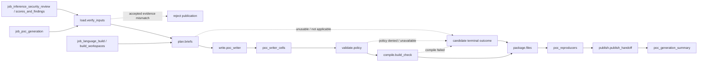

# poc_generation

## Purpose

Generate bounded PoC and negative-control functions for explicitly admitted judge-qualified review
candidates, then validate policy and compile them against an accepted native build workspace.
Nothing is linked into an executable or run. `compile_verified` means compile checks passed,
not exploit reproduction; compile failure neither refutes the finding nor changes its state.

<!-- generated:begin job=job_poc_generation -->
<!-- generated from: appsec-review.toml, containers/catalog.toml, pipeline/guidance/registry.json, tests/job-test-map.json, src/appsec_review/runtime/registry.py, src/appsec_review/runtime/contracts.py, src/appsec_review/runtime/datasets.py, src/appsec_review/guidance/workers.py, src/appsec_review/mcp/schema.py, src/appsec_review/orchestration/topology.py, src/appsec_review/orchestration/dagster/adapter.py by scripts/generate-docs.py; do not edit -->
## Declared job contract

poc_generation

Job: `job_poc_generation`. Enabled in the dev recipe: **true**.
Declarations describe possible work, not successful execution or consumed evidence.

### Steps and tasks

| Step | Task | Workers | Pool | Bound tool or gap | Handler |
| --- | --- | --- | --- | --- | --- |
| `compile` | `compile.build_check` | 1 | `cpp_build` | Undeclared ([T-147](../TODO.md)) | [source](../../src/appsec_review/jobs/job_poc_generation/job.py#L303) |
| `load` | `load.verify_inputs` | 1 | `application` | Undeclared ([T-147](../TODO.md)) | [source](../../src/appsec_review/jobs/job_poc_generation/job.py#L150) |
| `package` | `package.files` | 1 | `application` | Undeclared ([T-147](../TODO.md)) | [source](../../src/appsec_review/jobs/job_poc_generation/job.py#L323) |
| `plan` | `plan.briefs` | 1 | `application` | Undeclared ([T-147](../TODO.md)) | [source](../../src/appsec_review/jobs/job_poc_generation/job.py#L202) |
| `publish` | `publish.publish_handoff` | 1 | `application` | Undeclared ([T-147](../TODO.md)) | [source](../../src/appsec_review/jobs/job_poc_generation/job.py#L341) |
| `validate` | `validate.policy` | 1 | `application` | Undeclared ([T-147](../TODO.md)) | [source](../../src/appsec_review/jobs/job_poc_generation/job.py#L272) |
| `write` | `write.poc_writer` | 1 | `application` | Undeclared ([T-147](../TODO.md)) | [source](../../src/appsec_review/jobs/job_poc_generation/job.py#L229) |

### Accepted input declarations

| Producer | Dataset | Schema | Channel | Availability | Missing policy |
| --- | --- | --- | --- | --- | --- |
| `job_target_catalog` | `handoff` | `appsec-review/job-handoff/2` | handoff | optional | gap |
| `job_target_catalog` | `source_files` | `appsec-review/retrieval-index/2` | handoff | optional | gap |
| `job_target_catalog` | `declaration_symbols` | `appsec-review/retrieval-index/2` | handoff | optional | gap |
| `job_target_catalog` | `target_documents` | `appsec-review/retrieval-index/2` | handoff | optional | gap |
| `job_tree_sitter_ast` | `handoff` | `appsec-review/job-handoff/2` | handoff | optional | gap |
| `job_tree_sitter_ast` | `tree_sitter_ast` | `appsec-review/tree-sitter-normalizer/1` | handoff | optional | gap |
| `job_tree_sitter_ast` | `tree_sitter_coverage` | `appsec-review/tree-sitter-ast/1` | handoff | optional | gap |
| `job_cpp_compiled_analysis` | `handoff` | `appsec-review/job-handoff/2` | handoff | optional | gap |
| `job_cpp_compiled_analysis` | `clang_ast` | `appsec-review/retrieval-index/2` | handoff | optional | gap |
| `job_cpp_compiled_analysis` | `llvm_ir` | `appsec-review/retrieval-index/2` | handoff | optional | gap |
| `job_cpp_compiled_analysis` | `infer_observations` | `appsec-review/retrieval-index/2` | handoff | optional | gap |
| `job_cpp_compiled_analysis` | `binary_symbols` | `appsec-review/retrieval-index/2` | handoff | optional | gap |
| `job_cpp_compiled_analysis` | `cpp_blocked_branches` | `appsec-review/retrieval-index/2` | handoff | optional | gap |
| `job_cpp_symbol_index` | `handoff` | `appsec-review/job-handoff/2` | handoff | optional | gap |
| `job_cpp_symbol_index` | `clangd_symbols` | `appsec-review/retrieval-index/2` | handoff | optional | gap |
| `job_cpp_symbol_index` | `clangd_coverage` | `appsec-review/cpp-index-coverage/1` | handoff | optional | gap |
| `job_svf_alias_analysis` | `handoff` | `appsec-review/job-handoff/2` | handoff | optional | gap |
| `job_svf_alias_analysis` | `svf_alias_sets` | `appsec-review/retrieval-index/2` | handoff | optional | gap |
| `job_svf_alias_analysis` | `svf_alias_scope_coverage` | `appsec-review/cpp-index-coverage/1` | handoff | optional | gap |
| `job_code_graph_index` | `handoff` | `appsec-review/job-handoff/2` | handoff | optional | gap |
| `job_code_graph_index` | `code_graph_facts` | `appsec-review/graph-fact/1` | handoff | optional | gap |
| `job_codeql_analysis` | `handoff` | `appsec-review/job-handoff/2` | handoff | optional | gap |
| `job_codeql_analysis` | `codeql_observations` | `appsec-review/codeql-sarif-normalizer/3` | handoff | optional | gap |
| `job_evidence_collection` | `handoff` | `appsec-review/job-handoff/2` | handoff | optional | gap |
| `job_evidence_collection` | `static_tool_observations` | `appsec-review/retrieval-index/2` | handoff | optional | gap |
| `job_clang_static_analysis` | `handoff` | `appsec-review/job-handoff/2` | handoff | optional | gap |
| `job_clang_static_analysis` | `clang_static_observations` | `appsec-review/retrieval-index/2` | handoff | optional | gap |
| `job_clang_static_analysis` | `clang_static_scope_coverage` | `appsec-review/cpp-index-coverage/1` | handoff | optional | gap |
| `job_cpg_analysis` | `handoff` | `appsec-review/job-handoff/2` | handoff | optional | gap |
| `job_cpg_analysis` | `cpg_graph_coverage` | `appsec-review/retrieval-index/2` | handoff | optional | gap |
| `job_cpg_analysis` | `cpg_scope_coverage` | `appsec-review/cpp-index-coverage/1` | handoff | optional | gap |
| `job_ci_configuration_analysis` | `handoff` | `appsec-review/job-handoff/2` | handoff | optional | gap |
| `job_ci_configuration_analysis` | `ci_observations` | `appsec-review/retrieval-index/2` | handoff | optional | gap |
| `job_ci_configuration_analysis` | `ci_findings` | `appsec-review/retrieval-index/2` | handoff | optional | gap |
| `job_artifact_security_analysis` | `handoff` | `appsec-review/job-handoff/2` | handoff | optional | gap |
| `job_artifact_security_analysis` | `artifact_security_observations` | `appsec-review/retrieval-index/2` | handoff | optional | gap |
| `job_binary_evidence_indexing` | `handoff` | `appsec-review/job-handoff/2` | handoff | optional | gap |
| `job_binary_evidence_indexing` | `binary_functions` | `appsec-review/retrieval-index/2` | handoff | optional | gap |
| `job_dependency_intelligence` | `handoff` | `appsec-review/job-handoff/2` | handoff | optional | gap |
| `job_dependency_intelligence` | `dependency_context` | `appsec-review/retrieval-index/2` | handoff | optional | gap |
| `job_review_prioritization` | `handoff` | `appsec-review/job-handoff/2` | handoff | optional | gap |
| `job_review_prioritization` | `priority_items` | `appsec-review/retrieval-index/2` | handoff | optional | gap |
| `job_security_tagging` | `handoff` | `appsec-review/job-handoff/2` | handoff | optional | gap |
| `job_security_tagging` | `tag_assignments` | `appsec-review/tag-assignment/1` | handoff | optional | gap |
| `job_review_data_indexing` | `handoff` | `appsec-review/job-handoff/2` | handoff | optional | gap |
| `job_review_data_indexing` | `cross_domain_links` | `appsec-review/retrieval-index/2` | handoff | optional | gap |
| `job_review_data_indexing` | `precomputed_products` | `appsec-review/retrieval-index/2` | handoff | optional | gap |
| `job_inference_security_review` | `handoff` | `appsec-review/job-handoff/2` | handoff | required | reject |
| `job_inference_security_review` | `accepted_scope` | `appsec-review/inference-review-accepted-scope/1` | handoff | optional | gap |
| `job_inference_security_review` | `lead_triage` | `application/json` | handoff | optional | gap |
| `job_inference_security_review` | `review_packages` | `appsec-review/review-package/6` | handoff | optional | gap |
| `job_inference_security_review` | `review_cells` | `appsec-review/cell-attempt-receipt/1` | handoff | optional | gap |
| `job_inference_security_review` | `claim_ledger` | `appsec-review/ledger-event/1` | handoff | optional | gap |
| `job_inference_security_review` | `attack_chains` | `appsec-review/attack-chain-manifest/1` | handoff | optional | gap |
| `job_inference_security_review` | `scores_and_findings` | `appsec-review/finding-package/2` | handoff | optional | gap |
| `job_language_build` | `handoff` | `appsec-review/job-handoff/2` | handoff | required | reject |
| `job_language_build` | `topology_refinement_inputs` | `appsec-review/build-topology-refinement/1` | handoff | optional | gap |
| `job_language_build` | `build_actions` | `appsec-review/retrieval-index/2` | handoff | optional | gap |
| `job_language_build` | `jvm_build_actions` | `appsec-review/retrieval-index/2` | handoff | optional | gap |
| `job_language_build` | `language_build_receipts` | `appsec-review/language-build-handoff/2` | handoff | optional | gap |
| `job_language_build` | `build_workspaces` | `application/octet-stream` | handoff | optional | gap |

### Published dataset declarations

| Dataset | Step | Schema | Stage | Indexes | MCP route |
| --- | --- | --- | --- | --- | --- |
| `poc_generation_summary` | `publish` | `appsec-review/poc-generation-handoff/2` | artifact_only | Not indexed | `coverage`, `query_dataset_inventory` |
| `poc_reproducers` | `package` | `appsec-review/poc-provenance/2` | protected | Not indexed | `coverage`, `query_dataset_inventory` |
| `poc_writer_cells` | `write` | `appsec-review/poc-writer-receipt/1` | protected | Not indexed | `coverage`, `query_dataset_inventory` |

Protected and artifact-only routes expose sanitized metadata, not payload access.

### Model and guidance declarations

These are job-level declarations; exact per-task selection is not declared ([T-147](../TODO.md)).

```json
{
  "models": {
    "default": {
      "max_input_tokens": 32000,
      "max_output_tokens": 8000,
      "max_queries": 8,
      "max_turns": 6,
      "model": "claude-haiku-5-5",
      "provider": "claude-cli",
      "reasoning": "high",
      "timeout_seconds": 600
    }
  },
  "retry": {
    "max_attempts": 2,
    "retry_on_invalid_output": true,
    "retry_on_provider_error": true,
    "retry_on_timeout": true
  },
  "roles": {
    "poc_writer": {
      "model_profile": "default"
    }
  }
}
```

- Role: [poc_writer](../generated/guidance.md#roles-poc_writer).
- Task prompt: `write_poc_function`.
- Runtime skill: [poc-writer](../generated/guidance.md#runtime_skills-poc-writer).

### Test selection

| Tier | Files or selectors |
| --- | --- |
| acceptance | None declared |
| integration | `tests/integration/test_authentic_poc_contract.py` |
| live | `tests/integration/test_poc_live_compile.py` |
| unit | `tests/test_poc_generation_units.py` |

### Dagster placement

Dispatch: `review_graph`. Review graph member: **true**. Enabled graph member: **true**.

Declared predecessors: `job_inference_security_review`.

### Declared dataflow

```mermaid
flowchart LR
  job["job_poc_generation"]
  producer0["job_target_catalog"]
  input0["handoff"]
  input_schema0["appsec-review/job-handoff/2"]
  producer0 --> input0 --> job
  input0 -. schema .-> input_schema0
  producer1["job_target_catalog"]
  input1["source_files"]
  input_schema1["appsec-review/retrieval-index/2"]
  producer1 --> input1 --> job
  input1 -. schema .-> input_schema1
  producer2["job_target_catalog"]
  input2["declaration_symbols"]
  input_schema2["appsec-review/retrieval-index/2"]
  producer2 --> input2 --> job
  input2 -. schema .-> input_schema2
  producer3["job_target_catalog"]
  input3["target_documents"]
  input_schema3["appsec-review/retrieval-index/2"]
  producer3 --> input3 --> job
  input3 -. schema .-> input_schema3
  producer4["job_tree_sitter_ast"]
  input4["handoff"]
  input_schema4["appsec-review/job-handoff/2"]
  producer4 --> input4 --> job
  input4 -. schema .-> input_schema4
  producer5["job_tree_sitter_ast"]
  input5["tree_sitter_ast"]
  input_schema5["appsec-review/tree-sitter-normalizer/1"]
  producer5 --> input5 --> job
  input5 -. schema .-> input_schema5
  producer6["job_tree_sitter_ast"]
  input6["tree_sitter_coverage"]
  input_schema6["appsec-review/tree-sitter-ast/1"]
  producer6 --> input6 --> job
  input6 -. schema .-> input_schema6
  producer7["job_cpp_compiled_analysis"]
  input7["handoff"]
  input_schema7["appsec-review/job-handoff/2"]
  producer7 --> input7 --> job
  input7 -. schema .-> input_schema7
  producer8["job_cpp_compiled_analysis"]
  input8["clang_ast"]
  input_schema8["appsec-review/retrieval-index/2"]
  producer8 --> input8 --> job
  input8 -. schema .-> input_schema8
  producer9["job_cpp_compiled_analysis"]
  input9["llvm_ir"]
  input_schema9["appsec-review/retrieval-index/2"]
  producer9 --> input9 --> job
  input9 -. schema .-> input_schema9
  producer10["job_cpp_compiled_analysis"]
  input10["infer_observations"]
  input_schema10["appsec-review/retrieval-index/2"]
  producer10 --> input10 --> job
  input10 -. schema .-> input_schema10
  producer11["job_cpp_compiled_analysis"]
  input11["binary_symbols"]
  input_schema11["appsec-review/retrieval-index/2"]
  producer11 --> input11 --> job
  input11 -. schema .-> input_schema11
  producer12["job_cpp_compiled_analysis"]
  input12["cpp_blocked_branches"]
  input_schema12["appsec-review/retrieval-index/2"]
  producer12 --> input12 --> job
  input12 -. schema .-> input_schema12
  producer13["job_cpp_symbol_index"]
  input13["handoff"]
  input_schema13["appsec-review/job-handoff/2"]
  producer13 --> input13 --> job
  input13 -. schema .-> input_schema13
  producer14["job_cpp_symbol_index"]
  input14["clangd_symbols"]
  input_schema14["appsec-review/retrieval-index/2"]
  producer14 --> input14 --> job
  input14 -. schema .-> input_schema14
  producer15["job_cpp_symbol_index"]
  input15["clangd_coverage"]
  input_schema15["appsec-review/cpp-index-coverage/1"]
  producer15 --> input15 --> job
  input15 -. schema .-> input_schema15
  producer16["job_svf_alias_analysis"]
  input16["handoff"]
  input_schema16["appsec-review/job-handoff/2"]
  producer16 --> input16 --> job
  input16 -. schema .-> input_schema16
  producer17["job_svf_alias_analysis"]
  input17["svf_alias_sets"]
  input_schema17["appsec-review/retrieval-index/2"]
  producer17 --> input17 --> job
  input17 -. schema .-> input_schema17
  producer18["job_svf_alias_analysis"]
  input18["svf_alias_scope_coverage"]
  input_schema18["appsec-review/cpp-index-coverage/1"]
  producer18 --> input18 --> job
  input18 -. schema .-> input_schema18
  producer19["job_code_graph_index"]
  input19["handoff"]
  input_schema19["appsec-review/job-handoff/2"]
  producer19 --> input19 --> job
  input19 -. schema .-> input_schema19
  producer20["job_code_graph_index"]
  input20["code_graph_facts"]
  input_schema20["appsec-review/graph-fact/1"]
  producer20 --> input20 --> job
  input20 -. schema .-> input_schema20
  producer21["job_codeql_analysis"]
  input21["handoff"]
  input_schema21["appsec-review/job-handoff/2"]
  producer21 --> input21 --> job
  input21 -. schema .-> input_schema21
  producer22["job_codeql_analysis"]
  input22["codeql_observations"]
  input_schema22["appsec-review/codeql-sarif-normalizer/3"]
  producer22 --> input22 --> job
  input22 -. schema .-> input_schema22
  producer23["job_evidence_collection"]
  input23["handoff"]
  input_schema23["appsec-review/job-handoff/2"]
  producer23 --> input23 --> job
  input23 -. schema .-> input_schema23
  producer24["job_evidence_collection"]
  input24["static_tool_observations"]
  input_schema24["appsec-review/retrieval-index/2"]
  producer24 --> input24 --> job
  input24 -. schema .-> input_schema24
  producer25["job_clang_static_analysis"]
  input25["handoff"]
  input_schema25["appsec-review/job-handoff/2"]
  producer25 --> input25 --> job
  input25 -. schema .-> input_schema25
  producer26["job_clang_static_analysis"]
  input26["clang_static_observations"]
  input_schema26["appsec-review/retrieval-index/2"]
  producer26 --> input26 --> job
  input26 -. schema .-> input_schema26
  producer27["job_clang_static_analysis"]
  input27["clang_static_scope_coverage"]
  input_schema27["appsec-review/cpp-index-coverage/1"]
  producer27 --> input27 --> job
  input27 -. schema .-> input_schema27
  producer28["job_cpg_analysis"]
  input28["handoff"]
  input_schema28["appsec-review/job-handoff/2"]
  producer28 --> input28 --> job
  input28 -. schema .-> input_schema28
  producer29["job_cpg_analysis"]
  input29["cpg_graph_coverage"]
  input_schema29["appsec-review/retrieval-index/2"]
  producer29 --> input29 --> job
  input29 -. schema .-> input_schema29
  producer30["job_cpg_analysis"]
  input30["cpg_scope_coverage"]
  input_schema30["appsec-review/cpp-index-coverage/1"]
  producer30 --> input30 --> job
  input30 -. schema .-> input_schema30
  producer31["job_ci_configuration_analysis"]
  input31["handoff"]
  input_schema31["appsec-review/job-handoff/2"]
  producer31 --> input31 --> job
  input31 -. schema .-> input_schema31
  producer32["job_ci_configuration_analysis"]
  input32["ci_observations"]
  input_schema32["appsec-review/retrieval-index/2"]
  producer32 --> input32 --> job
  input32 -. schema .-> input_schema32
  producer33["job_ci_configuration_analysis"]
  input33["ci_findings"]
  input_schema33["appsec-review/retrieval-index/2"]
  producer33 --> input33 --> job
  input33 -. schema .-> input_schema33
  producer34["job_artifact_security_analysis"]
  input34["handoff"]
  input_schema34["appsec-review/job-handoff/2"]
  producer34 --> input34 --> job
  input34 -. schema .-> input_schema34
  producer35["job_artifact_security_analysis"]
  input35["artifact_security_observations"]
  input_schema35["appsec-review/retrieval-index/2"]
  producer35 --> input35 --> job
  input35 -. schema .-> input_schema35
  producer36["job_binary_evidence_indexing"]
  input36["handoff"]
  input_schema36["appsec-review/job-handoff/2"]
  producer36 --> input36 --> job
  input36 -. schema .-> input_schema36
  producer37["job_binary_evidence_indexing"]
  input37["binary_functions"]
  input_schema37["appsec-review/retrieval-index/2"]
  producer37 --> input37 --> job
  input37 -. schema .-> input_schema37
  producer38["job_dependency_intelligence"]
  input38["handoff"]
  input_schema38["appsec-review/job-handoff/2"]
  producer38 --> input38 --> job
  input38 -. schema .-> input_schema38
  producer39["job_dependency_intelligence"]
  input39["dependency_context"]
  input_schema39["appsec-review/retrieval-index/2"]
  producer39 --> input39 --> job
  input39 -. schema .-> input_schema39
  producer40["job_review_prioritization"]
  input40["handoff"]
  input_schema40["appsec-review/job-handoff/2"]
  producer40 --> input40 --> job
  input40 -. schema .-> input_schema40
  producer41["job_review_prioritization"]
  input41["priority_items"]
  input_schema41["appsec-review/retrieval-index/2"]
  producer41 --> input41 --> job
  input41 -. schema .-> input_schema41
  producer42["job_security_tagging"]
  input42["handoff"]
  input_schema42["appsec-review/job-handoff/2"]
  producer42 --> input42 --> job
  input42 -. schema .-> input_schema42
  producer43["job_security_tagging"]
  input43["tag_assignments"]
  input_schema43["appsec-review/tag-assignment/1"]
  producer43 --> input43 --> job
  input43 -. schema .-> input_schema43
  producer44["job_review_data_indexing"]
  input44["handoff"]
  input_schema44["appsec-review/job-handoff/2"]
  producer44 --> input44 --> job
  input44 -. schema .-> input_schema44
  producer45["job_review_data_indexing"]
  input45["cross_domain_links"]
  input_schema45["appsec-review/retrieval-index/2"]
  producer45 --> input45 --> job
  input45 -. schema .-> input_schema45
  producer46["job_review_data_indexing"]
  input46["precomputed_products"]
  input_schema46["appsec-review/retrieval-index/2"]
  producer46 --> input46 --> job
  input46 -. schema .-> input_schema46
  producer47["job_inference_security_review"]
  input47["handoff"]
  input_schema47["appsec-review/job-handoff/2"]
  producer47 --> input47 --> job
  input47 -. schema .-> input_schema47
  producer48["job_inference_security_review"]
  input48["accepted_scope"]
  input_schema48["appsec-review/inference-review-accepted-scope/1"]
  producer48 --> input48 --> job
  input48 -. schema .-> input_schema48
  producer49["job_inference_security_review"]
  input49["lead_triage"]
  input_schema49["application/json"]
  producer49 --> input49 --> job
  input49 -. schema .-> input_schema49
  producer50["job_inference_security_review"]
  input50["review_packages"]
  input_schema50["appsec-review/review-package/6"]
  producer50 --> input50 --> job
  input50 -. schema .-> input_schema50
  producer51["job_inference_security_review"]
  input51["review_cells"]
  input_schema51["appsec-review/cell-attempt-receipt/1"]
  producer51 --> input51 --> job
  input51 -. schema .-> input_schema51
  producer52["job_inference_security_review"]
  input52["claim_ledger"]
  input_schema52["appsec-review/ledger-event/1"]
  producer52 --> input52 --> job
  input52 -. schema .-> input_schema52
  producer53["job_inference_security_review"]
  input53["attack_chains"]
  input_schema53["appsec-review/attack-chain-manifest/1"]
  producer53 --> input53 --> job
  input53 -. schema .-> input_schema53
  producer54["job_inference_security_review"]
  input54["scores_and_findings"]
  input_schema54["appsec-review/finding-package/2"]
  producer54 --> input54 --> job
  input54 -. schema .-> input_schema54
  producer55["job_language_build"]
  input55["handoff"]
  input_schema55["appsec-review/job-handoff/2"]
  producer55 --> input55 --> job
  input55 -. schema .-> input_schema55
  producer56["job_language_build"]
  input56["topology_refinement_inputs"]
  input_schema56["appsec-review/build-topology-refinement/1"]
  producer56 --> input56 --> job
  input56 -. schema .-> input_schema56
  producer57["job_language_build"]
  input57["build_actions"]
  input_schema57["appsec-review/retrieval-index/2"]
  producer57 --> input57 --> job
  input57 -. schema .-> input_schema57
  producer58["job_language_build"]
  input58["jvm_build_actions"]
  input_schema58["appsec-review/retrieval-index/2"]
  producer58 --> input58 --> job
  input58 -. schema .-> input_schema58
  producer59["job_language_build"]
  input59["language_build_receipts"]
  input_schema59["appsec-review/language-build-handoff/2"]
  producer59 --> input59 --> job
  input59 -. schema .-> input_schema59
  producer60["job_language_build"]
  input60["build_workspaces"]
  input_schema60["application/octet-stream"]
  producer60 --> input60 --> job
  input60 -. schema .-> input_schema60
  output0["poc_generation_summary"]
  output_schema0["appsec-review/poc-generation-handoff/2"]
  job --> output0
  output0 -. schema .-> output_schema0
  output1["poc_reproducers"]
  output_schema1["appsec-review/poc-provenance/2"]
  job --> output1
  output1 -. schema .-> output_schema1
  output2["poc_writer_cells"]
  output_schema2["appsec-review/poc-writer-receipt/1"]
  job --> output2
  output2 -. schema .-> output_schema2
```



<!-- generated:end -->

## Process

The [handler](../../src/appsec_review/jobs/job_poc_generation/job.py) uses the typed
[candidate verifier](../../src/appsec_review/jobs/job_poc_generation/candidates.py),
[AST policy](../../src/appsec_review/jobs/job_poc_generation/policy.py) and
[compile checks](../../src/appsec_review/jobs/job_poc_generation/buildcheck.py).

### `load`

1. In `load.verify_inputs`, reverify the accepted review, required candidate field, package/basis
   identities and explicit upstream pin. Missing candidate field is not an empty candidate list.
2. Order confirmed candidates before supported candidates, then by claim ID. Plan the bounded
   prefix and retain every omitted claim. Record accepted language-build identity when available.
3. Write the immutable input snapshot and retain candidate-bound/build-availability reasons.
   Required handoff admission can reject before these handler-level availability checks.

### `plan`

1. In `plan.briefs`, check configured judge verdict and usable entry/path/trigger basis.
2. Require the accepted review package, resolving sink function and accepted build source.
   Unsupported build mapping is `not_applicable`; missing proof/package/sink is
   `insufficient_evidence`.
3. Build a bounded source/declaration/compile-context brief. If no basis entry/path identity
   resolves in the package view, do not commission a writer.

### `write`

1. In `write.poc_writer`, commission only nonterminal plans under the bounded worker pool.
2. Load the job's pinned writer guidance and use in-process retrieval from the accepted workspace/
   header/declaration view. The writer returns two functions or an allowed decline, not tools.
3. Validate response shape and retain receipt, guidance identity, answer/decline and failure reason.
   No pending plans means no model invocation.

### `validate`

1. In `validate.policy`, preserve prior terminal outcomes and writer declines.
2. Assemble generated source and run answer/file validators. Violations yield `policy_denied`.
3. Prepare bounded scratch input and obtain a reduced Clang AST in the accepted pinned build
   image. Unavailable validators yield `artifact_generated`; parse failure yields `compile_failed`.
4. Check function/call/trigger policy against the accepted brief. Retain violations, AST and
   unchecked-trigger qualifications; only policy-passing candidates proceed to compilation.
   Accepted-byte integrity errors propagate, and scratch is removed.

### `compile`

1. In `compile.build_check`, retain earlier terminal outcomes; prepare fresh scratch for admitted
   source only.
2. Run syntax, plain-object and sanitizer-object checks using the safe accepted compile context,
   and check undefined symbols. Never link the functions or run generated code.
3. Retain actual command/result diagnostics and object/symbol identities. Tool/workspace
   unavailability limits assurance to generated artifacts; clean scratch afterward.

### `package`

1. In `package.files`, emit exactly one candidate row for each planned claim, preserving state,
   judge verdict, finding hash and PoC-basis hash.
2. Where a source-bearing status permits, write immutable source, policy, compile and provenance
   files. Bind brief/package/source/settings/guidance/model/build/image identities.
3. Keep unavailable or declined outcomes without pretending they have source or successful checks.

### `publish`

1. In `publish.publish_handoff`, rehash all loaded bindings and require the accepted review pointer
   to remain unchanged.
2. Assemble ordered candidate rows, every omitted claim and exact by-status counts; validate the
   summary schema and explicit nonexecution assurance.
3. Publish the immutable summary reference. Carry bounded-admission and unsuccessful-assurance
   reasons without promoting supported candidates into confirmed findings.

## Dataflow



Input access follows [typed admission](../architecture/job-input-contracts.md#admission-and-read-receipts).
Compiler execution uses [host/image pins](image-pin-verification.md#the-gate) and
[signing](signing.md#container-images); the writer's source view is a
[bounded retrieval](../architecture/python-and-retrieval.md#query-boundary) boundary.

## Gaps

The summary uses legacy strings with no producer-level retryability classification. Candidate
statuses below are payload values, not additions to the closed producer terminal-status enum.
See [canonical outcomes](../architecture/job-interchange.md#the-control-layer-beneath-the-envelope).

| Emitted reason/status | Scope and walk cost |
| --- | --- |
| `candidate_bound_reached` | Exact omitted claim IDs were not attempted. |
| `accepted_build_unavailable` | Planning cannot obtain usable accepted build context; missing required admission still fails. |
| `insufficient_evidence` | Unusable basis, missing package/sink, unresolved identities or unusable writer answer. |
| `not_applicable` | Configured verdict/build/language boundary or writer decline; retained candidate outcome, not automatically a summary gap. |
| `unsafe_to_attempt`, `policy_denied` | Allowed decline or deterministic policy refusal. |
| `artifact_generated` | Source exists but validators/build checks were unavailable; inspect retained reason and row gaps. |
| `compile_failed` | Generated functions failed parse/compile/symbol checks; not a refutation of the original claim. |
| Brief/retrieval and unchecked-trigger limitations | Inspect retained brief/validation/compile records even when compilation succeeds. |

`GAP_NO_CANDIDATES` exists as a constant but this handler does not emit it: an explicitly empty
candidate list publishes zero candidates without inventing that gap. Hash/admission failures
block publication. No candidate status means runtime verification.
Separately authorized dynamic-evidence production remains [T-026](../TODO.md), not a permission
to run these generated functions; this job's compile-only policy is unchanged.

## Acceptance

1. **A. Inputs:** Compare review/build pins, candidate membership, judge/basis records, finding/
   package hashes and accepted compile/image identities. Confirm no target checkout was used as
   a substitute for run-owned source.
2. **B. Independent comparison:** Independently enumerate review PoC candidates and reconcile
   planned outcomes plus omitted IDs. Compare every source-bearing candidate's source/policy/
   AST/compile/symbol receipts and by-status counts. Verify compile-only commands and explicit
   nonexecution flags; supported finding state must remain supported.
3. **C. Gaps:** Group canonical outcomes and map them to candidate/omission reasons and retained
   brief/compile qualifications. Distinguish unsupported, policy-denied, unavailable and failed
   compilation. Stop on unexpected causes; do not call failed compilation evidence of safety.
4. **D. Baseline:** Save an authorized `stepwise.py accept` baseline and corpus namespace with
   candidate partition, basis/source/receipt hashes and status counts. Record runtime reproduction
   as not performed, including for compile-verified candidates.

## Resume and invalidation

There is no standalone PoC result cache. [Runtime admission](../architecture/jobs-and-runtime.md#wave-1-resumability)
binds accepted review/build, configuration, target/input and component identities. Candidate
provenance additionally pins basis, package, brief, source, settings, guidance and image.
A changed verdict, source/compile context, writer or validator setting invalidates downstream
PoC artifacts without modifying the finding. Scratch stages are recreated, immutable candidate
files are not overwritten, and artifact-bearing unit results are not portable checkpoints.

## Model usage

Only [poc_writer](../generated/guidance.md#roles-poc_writer) is selected here, with no persona
or stack. It proposes functions within the supplied evidence/build brief and can decline;
deterministic policy/compiler code owns acceptance. `poc_designer` and `poc_verifier` are not
dispatched by this job. See [worker contracts](../architecture/worker-prompt-contracts.md#dispatch-inventory)
and [guidance selection](../architecture/guidance-procedures.md#selection-and-provenance).
