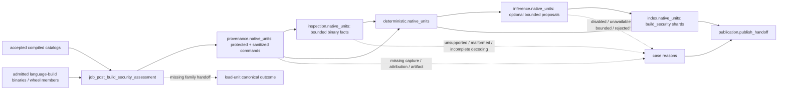

# post_build_security_assessment

## Purpose

Relate accepted build commands and produced binary metadata to deterministic hardening checks,
then optionally ask a bounded model to explain evidence-backed concerns. This answers which
protections were requested or observed for a particular build family and artifact, not whether a
binary is exploitable or the source is secure. Unknown, unsupported and family-inapplicable checks
are not passes; model validation labels remain observations rather than final security findings.

<!-- generated:begin job=job_post_build_security_assessment -->
<!-- generated from: appsec-review.toml, containers/catalog.toml, pipeline/guidance/registry.json, tests/job-test-map.json, src/appsec_review/runtime/registry.py, src/appsec_review/runtime/contracts.py, src/appsec_review/runtime/datasets.py, src/appsec_review/guidance/workers.py, src/appsec_review/mcp/schema.py, src/appsec_review/orchestration/topology.py, src/appsec_review/orchestration/dagster/adapter.py by scripts/generate-docs.py; do not edit -->
## Declared job contract

post_build_security_assessment

Job: `job_post_build_security_assessment`. Enabled in the dev recipe: **true**.
Declarations describe possible work, not successful execution or consumed evidence.

### Steps and tasks

| Step | Task | Workers | Pool | Bound tool or gap | Handler |
| --- | --- | --- | --- | --- | --- |
| `deterministic` | `deterministic.native_units` | 1 | `cpp_analysis` | Undeclared ([T-147](../TODO.md)) | [source](../../src/appsec_review/jobs/job_post_build_security_assessment/job.py#L301) |
| `index` | `index.native_units` | 1 | `application` | Undeclared ([T-147](../TODO.md)) | [source](../../src/appsec_review/jobs/job_post_build_security_assessment/job.py#L301) |
| `inference` | `inference.native_units` | 1 | `cpp_analysis` | Undeclared ([T-147](../TODO.md)) | [source](../../src/appsec_review/jobs/job_post_build_security_assessment/job.py#L301) |
| `inspection` | `inspection.native_units` | 1 | `cpp_analysis` | Undeclared ([T-147](../TODO.md)) | [source](../../src/appsec_review/jobs/job_post_build_security_assessment/job.py#L301) |
| `load` | `load.accepted_cpp_build` | 1 | `application` | Undeclared ([T-147](../TODO.md)) | [source](../../src/appsec_review/jobs/job_post_build_security_assessment/job.py#L271) |
| `provenance` | `provenance.native_units` | 1 | `cpp_analysis` | Undeclared ([T-147](../TODO.md)) | [source](../../src/appsec_review/jobs/job_post_build_security_assessment/job.py#L301) |
| `publication` | `publication.publish_handoff` | 1 | `application` | Undeclared ([T-147](../TODO.md)) | [source](../../src/appsec_review/jobs/job_post_build_security_assessment/job.py#L889) |

### Accepted input declarations

| Producer | Dataset | Schema | Channel | Availability | Missing policy |
| --- | --- | --- | --- | --- | --- |
| `job_build_environment_analysis` | `handoff` | `appsec-review/job-handoff/2` | handoff | optional | gap |
| `job_build_environment_analysis` | `build_environment` | `appsec-review/build-environment-analysis/1` | handoff | optional | gap |
| `job_cpp_compiled_analysis` | `handoff` | `appsec-review/job-handoff/2` | handoff | optional | gap |
| `job_cpp_compiled_analysis` | `cpp_build_graph` | `appsec-review/retrieval-index/2` | handoff | optional | gap |
| `job_cpp_compiled_analysis` | `clang_ast` | `appsec-review/retrieval-index/2` | handoff | optional | gap |
| `job_cpp_compiled_analysis` | `llvm_ir` | `appsec-review/retrieval-index/2` | handoff | optional | gap |
| `job_cpp_compiled_analysis` | `infer_observations` | `appsec-review/retrieval-index/2` | handoff | optional | gap |
| `job_cpp_compiled_analysis` | `binary_symbols` | `appsec-review/retrieval-index/2` | handoff | optional | gap |
| `job_cpp_compiled_analysis` | `cpp_blocked_branches` | `appsec-review/retrieval-index/2` | handoff | optional | gap |
| `job_cpp_compiled_analysis` | `cpp_plan_and_summary` | `appsec-review/cpp-compiled-analysis/2` | handoff | optional | gap |
| `job_cpp_compiled_analysis` | `cpp_case_material` | `application/octet-stream` | handoff | optional | gap |
| `job_language_build` | `handoff` | `appsec-review/job-handoff/2` | handoff | optional | gap |
| `job_language_build` | `topology_refinement_inputs` | `appsec-review/build-topology-refinement/1` | handoff | optional | gap |
| `job_language_build` | `build_actions` | `appsec-review/retrieval-index/2` | handoff | optional | gap |
| `job_language_build` | `jvm_build_actions` | `appsec-review/retrieval-index/2` | handoff | optional | gap |
| `job_language_build` | `language_build_receipts` | `appsec-review/language-build-handoff/2` | handoff | optional | gap |
| `job_language_build` | `build_workspaces` | `application/octet-stream` | handoff | optional | gap |
| `job_project_build` | `handoff` | `appsec-review/job-handoff/2` | handoff | optional | gap |
| `job_project_build` | `topology_refinement_inputs` | `appsec-review/build-topology-refinement/1` | handoff | optional | gap |
| `job_project_build` | `project_build_dispatch` | `appsec-review/project-build-dispatch/3` | handoff | optional | gap |
| `job_project_build` | `probe_workspaces` | `application/octet-stream` | handoff | optional | gap |
| `job_project_build` | `image_build_streams` | `text/plain` | handoff | optional | gap |
| `job_target_analysis_plan` | `handoff` | `appsec-review/job-handoff/2` | handoff | optional | gap |
| `job_target_analysis_plan` | `planning_feedback_cache` | `appsec-review/target-analysis-proposal/3` | handoff | optional | gap |
| `job_target_analysis_plan` | `analysis_plan` | `appsec-review/retrieval-index/2` | handoff | optional | gap |
| `job_target_analysis_plan` | `analysis_plan_documents` | `appsec-review/target-analysis-plan/1` | handoff | optional | gap |
| `job_target_catalog` | `handoff` | `appsec-review/job-handoff/2` | handoff | optional | gap |
| `job_target_catalog` | `target_artifact_inputs` | `appsec-review/target-artifact-intake/1` | handoff | optional | gap |
| `job_target_catalog` | `source_files` | `appsec-review/retrieval-index/2` | handoff | optional | gap |
| `job_target_catalog` | `declaration_symbols` | `appsec-review/retrieval-index/2` | handoff | optional | gap |
| `job_target_catalog` | `components` | `appsec-review/retrieval-index/2` | handoff | optional | gap |
| `job_target_catalog` | `target_documents` | `appsec-review/retrieval-index/2` | handoff | optional | gap |
| `job_target_catalog` | `build_units` | `appsec-review/retrieval-index/2` | handoff | optional | gap |
| `job_target_catalog` | `catalog_documents` | `appsec-review/target-catalog/1` | handoff | optional | gap |

### Published dataset declarations

| Dataset | Step | Schema | Stage | Indexes | MCP route |
| --- | --- | --- | --- | --- | --- |
| `build_security` | `index` | `appsec-review/retrieval-index/2` | indexed | `build_security` | `query_build_security` |
| `build_security_documents` | `publication` | `appsec-review/post-build-security-assessment/1` | artifact_only | Not indexed | `coverage`, `query_dataset_inventory` |

Protected and artifact-only routes expose sanitized metadata, not payload access.

### Model and guidance declarations

These are job-level declarations; exact per-task selection is not declared ([T-147](../TODO.md)).

```json
{
  "model": {
    "enabled": false,
    "max_input_tokens": 32000,
    "max_output_tokens": 8000,
    "model": "claude-haiku-5-5",
    "provider": "claude-cli",
    "reasoning": "medium",
    "retries": 1,
    "timeout_seconds": 120
  }
}
```

- Role: [build_security_assessor](../generated/guidance.md#roles-build_security_assessor).
- Persona: [build_supply_chain](../generated/guidance.md#personas-build_supply_chain).
- Task prompt: `post_build_security_assessment`.
- Runtime skill: [post-build-security-assessment](../generated/guidance.md#runtime_skills-post-build-security-assessment).

### Test selection

| Tier | Files or selectors |
| --- | --- |
| acceptance | None declared |
| integration | None declared |
| live | None declared |
| unit | `tests/test_post_build_security_assessment.py::test_redaction_normalization_and_malicious_inputs_do_not_escape`<br>`tests/test_post_build_security_assessment.py::test_compiler_linker_and_post_link_classification`<br>`tests/test_post_build_security_assessment.py::test_action_provenance_keeps_exact_identity_but_indexes_only_redacted_values` |

### Dagster placement

Dispatch: `review_graph`. Review graph member: **true**. Enabled graph member: **true**.

Declared predecessors: `job_cpp_compiled_analysis`.

### Declared dataflow

```mermaid
flowchart LR
  job["job_post_build_security_assessment"]
  producer0["job_build_environment_analysis"]
  input0["handoff"]
  input_schema0["appsec-review/job-handoff/2"]
  producer0 --> input0 --> job
  input0 -. schema .-> input_schema0
  producer1["job_build_environment_analysis"]
  input1["build_environment"]
  input_schema1["appsec-review/build-environment-analysis/1"]
  producer1 --> input1 --> job
  input1 -. schema .-> input_schema1
  producer2["job_cpp_compiled_analysis"]
  input2["handoff"]
  input_schema2["appsec-review/job-handoff/2"]
  producer2 --> input2 --> job
  input2 -. schema .-> input_schema2
  producer3["job_cpp_compiled_analysis"]
  input3["cpp_build_graph"]
  input_schema3["appsec-review/retrieval-index/2"]
  producer3 --> input3 --> job
  input3 -. schema .-> input_schema3
  producer4["job_cpp_compiled_analysis"]
  input4["clang_ast"]
  input_schema4["appsec-review/retrieval-index/2"]
  producer4 --> input4 --> job
  input4 -. schema .-> input_schema4
  producer5["job_cpp_compiled_analysis"]
  input5["llvm_ir"]
  input_schema5["appsec-review/retrieval-index/2"]
  producer5 --> input5 --> job
  input5 -. schema .-> input_schema5
  producer6["job_cpp_compiled_analysis"]
  input6["infer_observations"]
  input_schema6["appsec-review/retrieval-index/2"]
  producer6 --> input6 --> job
  input6 -. schema .-> input_schema6
  producer7["job_cpp_compiled_analysis"]
  input7["binary_symbols"]
  input_schema7["appsec-review/retrieval-index/2"]
  producer7 --> input7 --> job
  input7 -. schema .-> input_schema7
  producer8["job_cpp_compiled_analysis"]
  input8["cpp_blocked_branches"]
  input_schema8["appsec-review/retrieval-index/2"]
  producer8 --> input8 --> job
  input8 -. schema .-> input_schema8
  producer9["job_cpp_compiled_analysis"]
  input9["cpp_plan_and_summary"]
  input_schema9["appsec-review/cpp-compiled-analysis/2"]
  producer9 --> input9 --> job
  input9 -. schema .-> input_schema9
  producer10["job_cpp_compiled_analysis"]
  input10["cpp_case_material"]
  input_schema10["application/octet-stream"]
  producer10 --> input10 --> job
  input10 -. schema .-> input_schema10
  producer11["job_language_build"]
  input11["handoff"]
  input_schema11["appsec-review/job-handoff/2"]
  producer11 --> input11 --> job
  input11 -. schema .-> input_schema11
  producer12["job_language_build"]
  input12["topology_refinement_inputs"]
  input_schema12["appsec-review/build-topology-refinement/1"]
  producer12 --> input12 --> job
  input12 -. schema .-> input_schema12
  producer13["job_language_build"]
  input13["build_actions"]
  input_schema13["appsec-review/retrieval-index/2"]
  producer13 --> input13 --> job
  input13 -. schema .-> input_schema13
  producer14["job_language_build"]
  input14["jvm_build_actions"]
  input_schema14["appsec-review/retrieval-index/2"]
  producer14 --> input14 --> job
  input14 -. schema .-> input_schema14
  producer15["job_language_build"]
  input15["language_build_receipts"]
  input_schema15["appsec-review/language-build-handoff/2"]
  producer15 --> input15 --> job
  input15 -. schema .-> input_schema15
  producer16["job_language_build"]
  input16["build_workspaces"]
  input_schema16["application/octet-stream"]
  producer16 --> input16 --> job
  input16 -. schema .-> input_schema16
  producer17["job_project_build"]
  input17["handoff"]
  input_schema17["appsec-review/job-handoff/2"]
  producer17 --> input17 --> job
  input17 -. schema .-> input_schema17
  producer18["job_project_build"]
  input18["topology_refinement_inputs"]
  input_schema18["appsec-review/build-topology-refinement/1"]
  producer18 --> input18 --> job
  input18 -. schema .-> input_schema18
  producer19["job_project_build"]
  input19["project_build_dispatch"]
  input_schema19["appsec-review/project-build-dispatch/3"]
  producer19 --> input19 --> job
  input19 -. schema .-> input_schema19
  producer20["job_project_build"]
  input20["probe_workspaces"]
  input_schema20["application/octet-stream"]
  producer20 --> input20 --> job
  input20 -. schema .-> input_schema20
  producer21["job_project_build"]
  input21["image_build_streams"]
  input_schema21["text/plain"]
  producer21 --> input21 --> job
  input21 -. schema .-> input_schema21
  producer22["job_target_analysis_plan"]
  input22["handoff"]
  input_schema22["appsec-review/job-handoff/2"]
  producer22 --> input22 --> job
  input22 -. schema .-> input_schema22
  producer23["job_target_analysis_plan"]
  input23["planning_feedback_cache"]
  input_schema23["appsec-review/target-analysis-proposal/3"]
  producer23 --> input23 --> job
  input23 -. schema .-> input_schema23
  producer24["job_target_analysis_plan"]
  input24["analysis_plan"]
  input_schema24["appsec-review/retrieval-index/2"]
  producer24 --> input24 --> job
  input24 -. schema .-> input_schema24
  producer25["job_target_analysis_plan"]
  input25["analysis_plan_documents"]
  input_schema25["appsec-review/target-analysis-plan/1"]
  producer25 --> input25 --> job
  input25 -. schema .-> input_schema25
  producer26["job_target_catalog"]
  input26["handoff"]
  input_schema26["appsec-review/job-handoff/2"]
  producer26 --> input26 --> job
  input26 -. schema .-> input_schema26
  producer27["job_target_catalog"]
  input27["target_artifact_inputs"]
  input_schema27["appsec-review/target-artifact-intake/1"]
  producer27 --> input27 --> job
  input27 -. schema .-> input_schema27
  producer28["job_target_catalog"]
  input28["source_files"]
  input_schema28["appsec-review/retrieval-index/2"]
  producer28 --> input28 --> job
  input28 -. schema .-> input_schema28
  producer29["job_target_catalog"]
  input29["declaration_symbols"]
  input_schema29["appsec-review/retrieval-index/2"]
  producer29 --> input29 --> job
  input29 -. schema .-> input_schema29
  producer30["job_target_catalog"]
  input30["components"]
  input_schema30["appsec-review/retrieval-index/2"]
  producer30 --> input30 --> job
  input30 -. schema .-> input_schema30
  producer31["job_target_catalog"]
  input31["target_documents"]
  input_schema31["appsec-review/retrieval-index/2"]
  producer31 --> input31 --> job
  input31 -. schema .-> input_schema31
  producer32["job_target_catalog"]
  input32["build_units"]
  input_schema32["appsec-review/retrieval-index/2"]
  producer32 --> input32 --> job
  input32 -. schema .-> input_schema32
  producer33["job_target_catalog"]
  input33["catalog_documents"]
  input_schema33["appsec-review/target-catalog/1"]
  producer33 --> input33 --> job
  input33 -. schema .-> input_schema33
  output0["build_security"]
  output_schema0["appsec-review/retrieval-index/2"]
  job --> output0
  output0 -. schema .-> output_schema0
  output1["build_security_documents"]
  output_schema1["appsec-review/post-build-security-assessment/1"]
  job --> output1
  output1 -. schema .-> output_schema1
```



<!-- generated:end -->

## Process

Source: [handler graph](../../src/appsec_review/jobs/job_post_build_security_assessment/job.py),
[inspection/rules/inference validation](../../src/appsec_review/jobs/job_post_build_security_assessment/assessment.py)
and [family expectations](../../src/appsec_review/jobs/job_post_build_security_assessment/hardening.py).
The job reads binaries as bytes; it does not execute them or launch a new native build.

### `load`

1. Read the accepted compiled-analysis result and manifest; require the current snapshot.
   Retain successful catalogs and unavailable cases separately.
2. If admitted language-build output exists, add successful non-native family cases with native
   binary artifacts or wheel members, excluding native-component cases already covered by the
   C/C++ lane. Exclude managed PE assemblies from native AOT expectations.
3. Missing admitted language-build output is a named load gap; it means non-native family coverage
   was not inspected, not that no such binary exists.

### `provenance`

1. Process sorted cases independently. Not-applicable and blocked cases still write hash-bound
   empty provenance documents so later stages can bind absence without inventing evidence.
2. For native cases, prefer accepted protected compile commands; otherwise read retained compile
   and link rows. Preserve missing exact argv, linker/archiver capture, per-action environment,
   execution receipt and timing/exit facts as reasons.
3. Keep protected raw commands separate from sanitized searchable argv. Normalize action/toolchain
   facts and declared/discovered inputs; distinguish action-level timing from whole-build fallback.
4. Verify cataloged artifact bytes, then inspect supported candidates in the run-owned build
   directory within the local size policy. Associate producing actions by the implemented output
   mapping and retain unresolved attribution; `relationships_exact` is a producer field, not a
   stronger independent guarantee than that mapping.
5. For family cases, verify receipt artifacts and extract only bounded selected binary members
   of wheels into run-owned paths, retaining archive/member identity. No captured native actions
   means family hardening expectations, not fabricated C flags.

### `inspection`

1. Inspect retained artifacts using bounded ELF, PE/COFF, Mach-O, archive and other format readers.
   Preserve unsupported or malformed formats and missing semantic decoding.
2. Join bounded retained native nm/readelf records by binary hash where available; do not invoke
   those tools again here. Missing pinned ELF observation remains a gap.
3. Publish `binary-inspections.json` with inspected counts, raw binary hashes, parser identity,
   extracted facts and reasons. A retained file is not proof every binary property was decoded.

### `deterministic`

1. Evaluate supported compiler/flag and binary-format rules with action/artifact evidence IDs.
   Flag-driven native/mixed cases differ from no-compile-action family cases.
2. Use documented family expectations where applicable. Required protections are tested against
   observed facts; not-offered or undocumented family defaults yield not-applicable with rationale,
   not a pass. Missing applicable facts yield unknown.
3. Publish `deterministic-results.json` with pass/fail/unknown/not-applicable counts and rule version.
   Applicable unknown checks add a reason; a failing check is a judgment, not a tooling gap by itself.

### `inference`

1. Assemble registered guidance and a structured request containing normalized actions, inspected
   artifacts, deterministic checks and admitted evidence IDs. Keep target/raw command text outside
   the worker's authority.
2. For a not-applicable case, publish zero-call results. For no actions/artifacts, an over-budget
   request, disabled model or absent injected client, publish zero-call results with reasons.
3. Otherwise run bounded inference/retries. Validate proposal shape and observation count, require
   supplied evidence IDs and a resolvable known deterministic check/scope, and reject unusable
   observations. Exhausted retries becomes a named failure.
4. Label accepted observations confirmed for a failing related check, refuted for a passing check,
   otherwise unvalidated. This is the validator's deterministic-check comparison, not independent
   proof of every sentence in the model's claim. Publish request/guidance/model identities,
   call counts, rejections and `inference-results.json`.

### `index`

1. Bind protected-command references, binary hashes, tool identities, rule/parser/normalizer,
   model/guidance identity and upstream manifest into a per-case shard fingerprint.
2. Build or reuse a `build_security` shard with actions, compile units, artifacts, archive members,
   loader dependencies, deterministic checks and validated model observations.
3. Add source/compile/link/dependency and observed-at relationships only where this producer resolves
   endpoints. Preserve per-case coverage reasons. Loader dependency names are not verified resolved
   package versions, and model observation counts are not finding counts.

### `publication`

1. Replace inherited `build_security` indices with this attempt's case shards, preserve other
   index names and verify the composed manifest.
2. Publish `post-build-security-summary.json` with case/shard counts and rule/parser/normalizer
   identities. Its gap list joins indexed-case reasons; load-only gaps remain in the originating
   unit's canonical outcome rather than necessarily appearing in this narrower summary.

## Dataflow



## Gaps

This legacy producer emits text reasons. [Interchange](../architecture/job-interchange.md#the-control-layer-beneath-the-envelope)
wraps them as `producer_reported_gap`, normally non-retryable; that is not advisory classification.

- Input absent/failed: unavailable compiled catalog, missing admitted family handoff, missing
  compile/link/action execution provenance, no parseable argv, absent per-action environment or
  timing/exit data, missing/changed cataloged artifacts and unresolved producing actions.
- Present but unsupported: unsupported format, LLVM bitcode semantic decoding, link-map dialect,
  COFF symbol/directive semantics, detailed Mach-O decoding, PE load-configuration protection
  details and empty/unsupported archive member table.
- Coverage missing: wheel member/count/byte limits, binary inspection bounds, unresolved ELF
  dynamic strings, unavailable/truncated PE directories, missing/invalid retained nm/readelf output,
  applicable unknown deterministic checks and bounded model input.
- Tooling/model failure: archive read or malformed binary parsing, disabled/unavailable inference,
  no build evidence to assess, exhausted model retries and rejected observations.

The [legacy provenance code](../../src/appsec_review/jobs/job_post_build_security_assessment/job.py#L188)
currently records some changed artifact identities as reasons and omits those artifacts. Do not
describe those branches as fail-closed exceptions. By contrast, accepted handoff/manifest integrity
errors from the shared reader and invalid required internal artifacts can raise before publication.
This distinction describes existing behavior, not an endorsement of accepting damaged inputs.
No gap is automatically expected for a particular walk.

## Acceptance

1. **A. Inputs:** Compare admitted compiled/language handoff pins, catalog/source/binary hashes,
   protected-command references and wheel-member provenance. Confirm managed PE and native-component
   routing, and account for load-only family coverage loss.
2. **B. Independent comparison:** Independently inspect sanitized flags against protected argv
   without copying secrets; compare binary header/protection facts to retained tool-native output
   or a separate format inspection. Recalculate deterministic status counts by family and verify
   model evidence IDs, related check and validation label. Count unresolved artifact/action links.
3. **C. Gaps:** Group verified canonical outcomes across all stages, not just the final case
   summary. Reconcile parser/tool/model limitations and unknown checks with exact inputs and the
   walk's approved expected list.
4. **D. Baseline:** At authorized acceptance save `stepwise.py accept`, corpus namespace and baseline
   with action/binary/check identities, family decisions, model provenance and coverage. No live
   binary/model acceptance is asserted here.

## Resume and invalidation

Case-stage reuse follows [runtime receipts](../architecture/jobs-and-runtime.md#wave-1-resumability).
Local shard reuse hashes protected commands, binary contents, tool identities, parser/normalizer/
rule versions, model identity including guidance hash, guidance identity and upstream manifest.
The [fingerprint helper](../../src/appsec_review/jobs/job_post_build_security_assessment/assessment.py#L830)
does not hash the actual inference-result document or every stage artifact; matching model
configuration is not proof of an identical new model response. Reconcile retained `source_artifacts`
with any reused shard rather than claiming response-sensitive invalidation.

The final summary is intentionally narrower than the union of originating unit outcomes; read the
verified outcome artifact for admission. Source metadata also contains fixed producer/configuration
labels in indexed binary/model payloads; use actual case and execution provenance rather than
assuming every family was built with those labels. Generated task/dataset binding and applicability
limitations remain [T-147](../TODO.md) and [T-157](../TODO.md). Shared manifest and launch semantics
live in [retrieval](../architecture/python-and-retrieval.md#accepted-index-sets),
[image pins](image-pin-verification.md) and [signing](signing.md).

## Model usage

The [build security assessor role](../generated/guidance.md#roles-build_security_assessor) interprets
the supplied deterministic checks and build evidence; the
[build supply-chain persona](../generated/guidance.md#personas-build_supply_chain) focuses that
interpretation on provenance, build flags and delivered binary properties. Neither can change a
check's deterministic result or authorize new builds, scans or source reads. Disabled/unavailable
inference leaves deterministic assessment intact but incomplete inferential coverage explicit.

The real request and evidence validator are in the
[inference handler](../../src/appsec_review/jobs/job_post_build_security_assessment/job.py#L572)
and [validation helper](../../src/appsec_review/jobs/job_post_build_security_assessment/assessment.py#L790).
Hash-pinned assembly follows [worker contracts](../architecture/worker-prompt-contracts.md#publication-and-compatibility)
and [guidance selection](../architecture/guidance-procedures.md#selection-and-provenance);
budgets, models and retries stay in central configuration.
