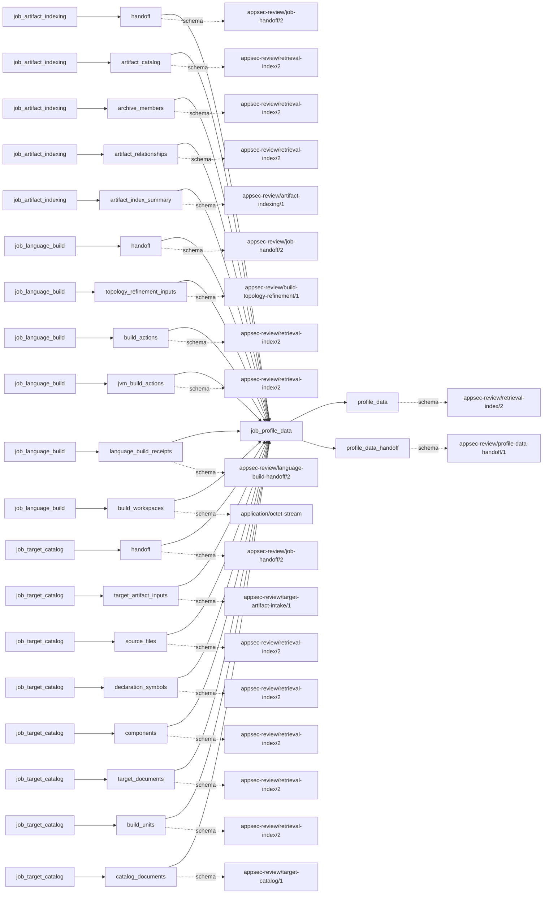
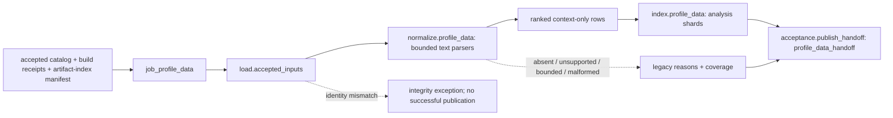

# profile_data

## Purpose

Turn execution-profile files explicitly retained by accepted builds into ranked hotspot context:
which named functions accumulated the reported samples or event costs? This job neither runs the
target nor converts opaque profiles. Hotness is not a vulnerability, defect probability, proof of
reachability in another workload, or a verified source location.

<!-- generated:begin job=job_profile_data -->
<!-- generated from: appsec-review.toml, containers/catalog.toml, pipeline/guidance/registry.json, tests/job-test-map.json, src/appsec_review/runtime/registry.py, src/appsec_review/runtime/contracts.py, src/appsec_review/runtime/datasets.py, src/appsec_review/guidance/workers.py, src/appsec_review/mcp/schema.py, src/appsec_review/orchestration/topology.py, src/appsec_review/orchestration/dagster/adapter.py by scripts/generate-docs.py; do not edit -->
## Declared job contract

profile_data

Job: `job_profile_data`. Enabled in the dev recipe: **true**.
Declarations describe possible work, not successful execution or consumed evidence.

### Steps and tasks

| Step | Task | Workers | Pool | Bound tool or gap | Handler |
| --- | --- | --- | --- | --- | --- |
| `acceptance` | `acceptance.publish_handoff` | 1 | `application` | Undeclared ([T-147](../TODO.md)) | [source](../../src/appsec_review/jobs/job_profile_data/job.py#L339) |
| `index` | `index.profile_data` | 1 | `application` | Undeclared ([T-147](../TODO.md)) | [source](../../src/appsec_review/jobs/job_profile_data/job.py#L289) |
| `load` | `load.accepted_inputs` | 1 | `application` | Undeclared ([T-147](../TODO.md)) | [source](../../src/appsec_review/jobs/job_profile_data/job.py#L270) |
| `normalize` | `normalize.profile_data` | 1 | `application` | Undeclared ([T-147](../TODO.md)) | [source](../../src/appsec_review/jobs/job_profile_data/job.py#L285) |

### Accepted input declarations

| Producer | Dataset | Schema | Channel | Availability | Missing policy |
| --- | --- | --- | --- | --- | --- |
| `job_artifact_indexing` | `handoff` | `appsec-review/job-handoff/2` | handoff | optional | gap |
| `job_artifact_indexing` | `artifact_catalog` | `appsec-review/retrieval-index/2` | handoff | optional | gap |
| `job_artifact_indexing` | `archive_members` | `appsec-review/retrieval-index/2` | handoff | optional | gap |
| `job_artifact_indexing` | `artifact_relationships` | `appsec-review/retrieval-index/2` | handoff | optional | gap |
| `job_artifact_indexing` | `artifact_index_summary` | `appsec-review/artifact-indexing/1` | handoff | optional | gap |
| `job_language_build` | `handoff` | `appsec-review/job-handoff/2` | handoff | optional | gap |
| `job_language_build` | `topology_refinement_inputs` | `appsec-review/build-topology-refinement/1` | handoff | optional | gap |
| `job_language_build` | `build_actions` | `appsec-review/retrieval-index/2` | handoff | optional | gap |
| `job_language_build` | `jvm_build_actions` | `appsec-review/retrieval-index/2` | handoff | optional | gap |
| `job_language_build` | `language_build_receipts` | `appsec-review/language-build-handoff/2` | handoff | optional | gap |
| `job_language_build` | `build_workspaces` | `application/octet-stream` | handoff | optional | gap |
| `job_target_catalog` | `handoff` | `appsec-review/job-handoff/2` | handoff | optional | gap |
| `job_target_catalog` | `target_artifact_inputs` | `appsec-review/target-artifact-intake/1` | handoff | optional | gap |
| `job_target_catalog` | `source_files` | `appsec-review/retrieval-index/2` | handoff | optional | gap |
| `job_target_catalog` | `declaration_symbols` | `appsec-review/retrieval-index/2` | handoff | optional | gap |
| `job_target_catalog` | `components` | `appsec-review/retrieval-index/2` | handoff | optional | gap |
| `job_target_catalog` | `target_documents` | `appsec-review/retrieval-index/2` | handoff | optional | gap |
| `job_target_catalog` | `build_units` | `appsec-review/retrieval-index/2` | handoff | optional | gap |
| `job_target_catalog` | `catalog_documents` | `appsec-review/target-catalog/1` | handoff | optional | gap |

### Published dataset declarations

| Dataset | Step | Schema | Stage | Indexes | MCP route |
| --- | --- | --- | --- | --- | --- |
| `profile_data` | `index` | `appsec-review/retrieval-index/2` | indexed | `analysis` | `query_precomputed` |
| `profile_data_handoff` | `acceptance` | `appsec-review/profile-data-handoff/1` | artifact_only | Not indexed | `coverage`, `query_dataset_inventory` |

Protected and artifact-only routes expose sanitized metadata, not payload access.

### Model and guidance declarations

No job-level model declaration; absence of a task binding remains [T-147](../TODO.md), not a nonexecution claim.

### Test selection

| Tier | Files or selectors |
| --- | --- |
| acceptance | None declared |
| integration | None declared |
| live | None declared |
| unit | `tests/test_profile_data.py` |

### Dagster placement

Dispatch: `review_graph`. Review graph member: **true**. Enabled graph member: **true**.

Declared predecessors: `job_artifact_indexing`.

### Declared dataflow

<!-- generated:end -->

## Process

The [handler](../../src/appsec_review/jobs/job_profile_data/job.py) and
[parsers](../../src/appsec_review/jobs/job_profile_data/parsers.py) define this path; task/tool
binding omissions in the generated inventory remain [T-147](../TODO.md).

### `load`

1. Read the accepted catalog publication, language-build receipts and artifact-index publication
   through the [input contract](../architecture/job-input-contracts.md#admission-and-read-receipts).
   Verify bound artifacts, schema and snapshot agreement; an integrity error stops the job.
2. Retain the three handoff hashes, catalog fingerprint and artifact-index manifest. Do not discover
   extra profiles by walking a target or workspace.

### `normalize`

1. Sort receipts by build-unit identity; select only artifacts whose kind is `execution-profile`,
   sort by path/hash and cap their count. Missing candidates produce `missing_profile_data` text.
2. Reject invalid origin or changed file identity. Skip duplicate path/hash pairs or oversized
   files with explicit reasons. Detect exactly one supported text format: folded stacks, perf-script,
   Callgrind or LLVM sample text. Ambiguous formats and opaque gmon, pprof and LLVM binary formats
   remain unparsed reports, not empty successful profiles.
3. Parse within input-line, line-byte, frame and normalized-row bounds. Malformed input is a gap;
   preserve parser truncation and unresolved symbol/source/line reasons. Attach report hash, build
   unit, origin and context-only semantics to each row.
4. Rank rows within each build unit by descending count, then event, symbol, module, source, line
   and report hash. Record `hotness_population`; no rows means unavailable, rows plus gaps partial.
   The ordering does not make different events or workloads statistically comparable.

### `index`

1. Verify the inherited manifest; replace only prior `profile-data-` analysis shards.
2. Fingerprint each build unit's report identities with snapshot, parser, normalizer, mapping and
   upstream manifest. Reuse an existing fingerprint-addressed file or write hotspot entities and
   one profile-data coverage row. Rows carry names and optional reported paths, not source citations.
3. Write and verify the composed `profile-data-<attempt>.json` retrieval manifest.

### `acceptance`

1. Publish `accepted-profile-data.json` with upstream hashes, parser identities, normalized build
   units, context-only interpretation, gaps and manifest reference.
2. Count normalized rows, not reports. Return completed-with-gaps if any reason exists; otherwise
   success with units, or not-applicable with none.

## Dataflow

## Gaps

These are producer text reasons, not source-emitted canonical codes. The
[interchange conversion](../architecture/job-interchange.md#the-control-layer-beneath-the-envelope)
wraps them as `producer_reported_gap` with default non-retryable metadata; that is **not** an advisory
classification or permission to accept missing coverage.

- Input absent: `missing_profile_data`; a receipt without profiles is not evidence that execution
  was cold. No receipts follows the explicit not-applicable branch.
- Input present but unsupported: `unsupported_profile_format`, `ambiguous_profile_format`,
  `ambiguous_profile_identity`; no converter is launched.
- Coverage missing or failed: `artifact_count_truncation`, `artifact_byte_bound`,
  `profile_row_truncation`, parser `row_truncation` and `frame_truncation`, `ambiguous_symbol`,
  `ambiguous_source`, `ambiguous_line`, and `malformed_profile`. Malformed includes invalid UTF-8,
  NULs, overlong lines, invalid counts and empty/unrecognized sample structures.
- Invalid origin, missing/escaping/symlinked report, changed hash or accepted snapshot disagreement
  raises `ProfileIntegrityError`; it is not an accepted gap document.

Each observed cause must be checked against the particular walk's approved list, with the lost
workload or sample population recorded.

## Acceptance

1. **A. Inputs:** Compare the three consumed handoff hashes and every report path/hash/origin with
   admitted build receipts; confirm no unlisted profile was ingested.
2. **B. Independent comparison:** In a separately inspected retained report, sum named sample
   counts or Callgrind event costs and compare symbol/event rows, rank tie-breaks and population.
   Count omitted frames/lines independently; compare report hashes. Record unverified workloads.
3. **C. Gaps:** Group the verified outcomes' canonical records by code and retained reason; compare
   unsupported-format and truncated-row counts with actual report bytes, then the approved expected
   causes. Missing profiles are not zero hotness.
4. **D. Baseline:** On an authorized walk, save acceptance with `stepwise.py accept`; record corpus
   namespace, baseline, report identities, row counts, ranks and gaps for the next diff. No live
   acceptance is asserted here.

## Resume and invalidation

There is no converter or model checkpoint. Runtime unit reuse follows
[jobs and runtime](../architecture/jobs-and-runtime.md#wave-1-resumability). Per-unit shard identity
binds snapshot, report paths/hashes, parser/normalizer/mapping identities and upstream artifact
manifest. Changed reports or those identities rebuild the affected shard. The local index
fingerprint does **not** explicitly include ingestion bounds; do not assume changing a bound alone
invalidates an existing shard (see `index` in the handler). Existing files are hashed, not reparsed
before local reuse. The accepted loader verifies the publication, semantic tag and complete
[retrieval manifest](../architecture/python-and-retrieval.md#accepted-index-sets).
