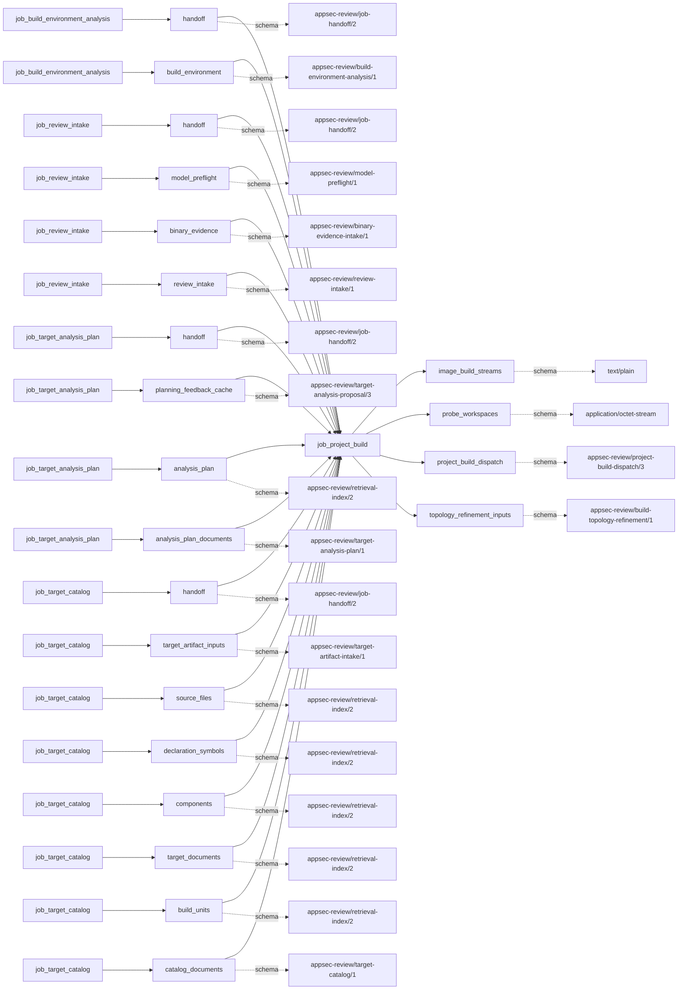

# project_build

This page contains the generated contract; the authored process and acceptance description are tracked by [T-130](../TODO.md).

<!-- generated:begin job=job_project_build -->
<!-- generated from: appsec-review.toml, containers/catalog.toml, pipeline/guidance/registry.json, tests/job-test-map.json, src/appsec_review/runtime/registry.py, src/appsec_review/runtime/contracts.py, src/appsec_review/runtime/datasets.py, src/appsec_review/guidance/workers.py, src/appsec_review/mcp/schema.py, src/appsec_review/orchestration/topology.py, src/appsec_review/orchestration/dagster/adapter.py by scripts/generate-docs.py; do not edit -->
## Declared job contract

project_build

Job: `job_project_build`. Enabled in the dev recipe: **true**.
Declarations describe possible work, not successful execution or consumed evidence.

### Steps and tasks

| Step | Task | Workers | Pool | Bound tool or gap | Handler |
| --- | --- | --- | --- | --- | --- |
| `acceptance` | `acceptance.publish_handoff` | 1 | `application` | Undeclared ([T-147](../TODO.md)) | [source](../../src/appsec_review/jobs/job_project_build/job.py#L1526) |
| `build_dispatch` | `build_dispatch.dotnet` | 1 | `application` | Undeclared ([T-147](../TODO.md)) | [source](../../src/appsec_review/jobs/job_project_build/job.py#L1526) |
| `build_dispatch` | `build_dispatch.go` | 1 | `application` | Undeclared ([T-147](../TODO.md)) | [source](../../src/appsec_review/jobs/job_project_build/job.py#L1526) |
| `build_dispatch` | `build_dispatch.java` | 1 | `application` | Undeclared ([T-147](../TODO.md)) | [source](../../src/appsec_review/jobs/job_project_build/job.py#L1526) |
| `build_dispatch` | `build_dispatch.native` | 1 | `application` | Undeclared ([T-147](../TODO.md)) | [source](../../src/appsec_review/jobs/job_project_build/job.py#L1526) |
| `build_dispatch` | `build_dispatch.node` | 1 | `application` | Undeclared ([T-147](../TODO.md)) | [source](../../src/appsec_review/jobs/job_project_build/job.py#L1526) |
| `build_dispatch` | `build_dispatch.php` | 1 | `application` | Undeclared ([T-147](../TODO.md)) | [source](../../src/appsec_review/jobs/job_project_build/job.py#L1526) |
| `build_dispatch` | `build_dispatch.python` | 1 | `application` | Undeclared ([T-147](../TODO.md)) | [source](../../src/appsec_review/jobs/job_project_build/job.py#L1526) |
| `build_dispatch` | `build_dispatch.rust` | 1 | `application` | Undeclared ([T-147](../TODO.md)) | [source](../../src/appsec_review/jobs/job_project_build/job.py#L1526) |
| `build_dispatch` | `build_dispatch.wasm` | 1 | `application` | Undeclared ([T-147](../TODO.md)) | [source](../../src/appsec_review/jobs/job_project_build/job.py#L1526) |
| `image` | `image.dotnet` | 1 | `cpp_build` | Undeclared ([T-147](../TODO.md)) | [source](../../src/appsec_review/jobs/job_project_build/job.py#L1526) |
| `image` | `image.go` | 1 | `cpp_build` | Undeclared ([T-147](../TODO.md)) | [source](../../src/appsec_review/jobs/job_project_build/job.py#L1526) |
| `image` | `image.java` | 1 | `cpp_build` | Undeclared ([T-147](../TODO.md)) | [source](../../src/appsec_review/jobs/job_project_build/job.py#L1526) |
| `image` | `image.native` | 1 | `cpp_build` | Undeclared ([T-147](../TODO.md)) | [source](../../src/appsec_review/jobs/job_project_build/job.py#L1526) |
| `image` | `image.node` | 1 | `cpp_build` | Undeclared ([T-147](../TODO.md)) | [source](../../src/appsec_review/jobs/job_project_build/job.py#L1526) |
| `image` | `image.php` | 1 | `cpp_build` | Undeclared ([T-147](../TODO.md)) | [source](../../src/appsec_review/jobs/job_project_build/job.py#L1526) |
| `image` | `image.python` | 1 | `cpp_build` | Undeclared ([T-147](../TODO.md)) | [source](../../src/appsec_review/jobs/job_project_build/job.py#L1526) |
| `image` | `image.rust` | 1 | `cpp_build` | Undeclared ([T-147](../TODO.md)) | [source](../../src/appsec_review/jobs/job_project_build/job.py#L1526) |
| `image` | `image.wasm` | 1 | `cpp_build` | Undeclared ([T-147](../TODO.md)) | [source](../../src/appsec_review/jobs/job_project_build/job.py#L1526) |
| `plan` | `plan.load_recipes` | 1 | `application` | Undeclared ([T-147](../TODO.md)) | [source](../../src/appsec_review/jobs/job_project_build/job.py#L1526) |
| `probe` | `probe.dotnet` | 1 | `cpp_build` | Undeclared ([T-147](../TODO.md)) | [source](../../src/appsec_review/jobs/job_project_build/job.py#L1526) |
| `probe` | `probe.go` | 1 | `cpp_build` | Undeclared ([T-147](../TODO.md)) | [source](../../src/appsec_review/jobs/job_project_build/job.py#L1526) |
| `probe` | `probe.java` | 1 | `cpp_build` | Undeclared ([T-147](../TODO.md)) | [source](../../src/appsec_review/jobs/job_project_build/job.py#L1526) |
| `probe` | `probe.native` | 1 | `cpp_build` | Undeclared ([T-147](../TODO.md)) | [source](../../src/appsec_review/jobs/job_project_build/job.py#L1526) |
| `probe` | `probe.node` | 1 | `cpp_build` | Undeclared ([T-147](../TODO.md)) | [source](../../src/appsec_review/jobs/job_project_build/job.py#L1526) |
| `probe` | `probe.php` | 1 | `cpp_build` | Undeclared ([T-147](../TODO.md)) | [source](../../src/appsec_review/jobs/job_project_build/job.py#L1526) |
| `probe` | `probe.python` | 1 | `cpp_build` | Undeclared ([T-147](../TODO.md)) | [source](../../src/appsec_review/jobs/job_project_build/job.py#L1526) |
| `probe` | `probe.rust` | 1 | `cpp_build` | Undeclared ([T-147](../TODO.md)) | [source](../../src/appsec_review/jobs/job_project_build/job.py#L1526) |
| `probe` | `probe.wasm` | 1 | `cpp_build` | Undeclared ([T-147](../TODO.md)) | [source](../../src/appsec_review/jobs/job_project_build/job.py#L1526) |
| `static_dispatch` | `static_dispatch.dotnet` | 1 | `application` | Undeclared ([T-147](../TODO.md)) | [source](../../src/appsec_review/jobs/job_project_build/job.py#L1526) |
| `static_dispatch` | `static_dispatch.global` | 1 | `application` | Undeclared ([T-147](../TODO.md)) | [source](../../src/appsec_review/jobs/job_project_build/job.py#L1526) |
| `static_dispatch` | `static_dispatch.go` | 1 | `application` | Undeclared ([T-147](../TODO.md)) | [source](../../src/appsec_review/jobs/job_project_build/job.py#L1526) |
| `static_dispatch` | `static_dispatch.java` | 1 | `application` | Undeclared ([T-147](../TODO.md)) | [source](../../src/appsec_review/jobs/job_project_build/job.py#L1526) |
| `static_dispatch` | `static_dispatch.native` | 1 | `application` | Undeclared ([T-147](../TODO.md)) | [source](../../src/appsec_review/jobs/job_project_build/job.py#L1526) |
| `static_dispatch` | `static_dispatch.node` | 1 | `application` | Undeclared ([T-147](../TODO.md)) | [source](../../src/appsec_review/jobs/job_project_build/job.py#L1526) |
| `static_dispatch` | `static_dispatch.php` | 1 | `application` | Undeclared ([T-147](../TODO.md)) | [source](../../src/appsec_review/jobs/job_project_build/job.py#L1526) |
| `static_dispatch` | `static_dispatch.python` | 1 | `application` | Undeclared ([T-147](../TODO.md)) | [source](../../src/appsec_review/jobs/job_project_build/job.py#L1526) |
| `static_dispatch` | `static_dispatch.rust` | 1 | `application` | Undeclared ([T-147](../TODO.md)) | [source](../../src/appsec_review/jobs/job_project_build/job.py#L1526) |
| `static_dispatch` | `static_dispatch.wasm` | 1 | `application` | Undeclared ([T-147](../TODO.md)) | [source](../../src/appsec_review/jobs/job_project_build/job.py#L1526) |

### Accepted input declarations

| Producer | Dataset | Schema | Channel | Availability | Missing policy |
| --- | --- | --- | --- | --- | --- |
| `job_build_environment_analysis` | `handoff` | `appsec-review/job-handoff/2` | handoff | optional | gap |
| `job_build_environment_analysis` | `build_environment` | `appsec-review/build-environment-analysis/1` | handoff | optional | gap |
| `job_review_intake` | `handoff` | `appsec-review/job-handoff/2` | handoff | optional | gap |
| `job_review_intake` | `model_preflight` | `appsec-review/model-preflight/1` | handoff | optional | gap |
| `job_review_intake` | `binary_evidence` | `appsec-review/binary-evidence-intake/1` | handoff | optional | gap |
| `job_review_intake` | `review_intake` | `appsec-review/review-intake/1` | handoff | optional | gap |
| `job_target_analysis_plan` | `handoff` | `appsec-review/job-handoff/2` | handoff | required | reject |
| `job_target_analysis_plan` | `planning_feedback_cache` | `appsec-review/target-analysis-proposal/3` | handoff | optional | gap |
| `job_target_analysis_plan` | `analysis_plan` | `appsec-review/retrieval-index/2` | handoff | optional | gap |
| `job_target_analysis_plan` | `analysis_plan_documents` | `appsec-review/target-analysis-plan/1` | handoff | optional | gap |
| `job_target_catalog` | `handoff` | `appsec-review/job-handoff/2` | handoff | optional | gap |
| `job_target_catalog` | `target_artifact_inputs` | `appsec-review/target-artifact-intake/1` | handoff | optional | gap |
| `job_target_catalog` | `source_files` | `appsec-review/retrieval-index/2` | handoff | optional | gap |
| `job_target_catalog` | `declaration_symbols` | `appsec-review/retrieval-index/2` | handoff | optional | gap |
| `job_target_catalog` | `components` | `appsec-review/retrieval-index/2` | handoff | optional | gap |
| `job_target_catalog` | `target_documents` | `appsec-review/retrieval-index/2` | handoff | optional | gap |
| `job_target_catalog` | `build_units` | `appsec-review/retrieval-index/2` | handoff | optional | gap |
| `job_target_catalog` | `catalog_documents` | `appsec-review/target-catalog/1` | handoff | optional | gap |

### Published dataset declarations

| Dataset | Step | Schema | Stage | Indexes | MCP route |
| --- | --- | --- | --- | --- | --- |
| `image_build_streams` | `image` | `text/plain` | protected | Not indexed | `coverage`, `query_dataset_inventory` |
| `probe_workspaces` | `probe` | `application/octet-stream` | protected | Not indexed | `coverage`, `query_dataset_inventory` |
| `project_build_dispatch` | `acceptance` | `appsec-review/project-build-dispatch/3` | artifact_only | Not indexed | `coverage`, `query_dataset_inventory` |
| `topology_refinement_inputs` | `plan` | `appsec-review/build-topology-refinement/1` | protected | Not indexed | `coverage`, `query_dataset_inventory` |

Protected and artifact-only routes expose sanitized metadata, not payload access.

### Model and guidance declarations

These are job-level declarations; exact per-task selection is not declared ([T-147](../TODO.md)).

```json
{
  "model": {
    "enabled": true,
    "max_input_tokens": 16000,
    "max_output_tokens": 2000,
    "model": "claude-haiku-5-5",
    "provider": "claude-cli",
    "reasoning": "medium",
    "timeout_seconds": 180
  }
}
```

- Role template: `build_engineer_{family}`; family selected by the accepted build.
- Persona: [devops_engineer](../generated/guidance.md#personas-devops_engineer).
- Task prompt: `build_image_repair`.
- Runtime skill: [build-image-repair](../generated/guidance.md#runtime_skills-build-image-repair).

### Test selection

| Tier | Files or selectors |
| --- | --- |
| acceptance | `tests/acceptance/job_project_build/test_project_build_graph.py`<br>`tests/acceptance/job_project_build/test_project_build_capture.py`<br>`tests/acceptance/job_project_build/test_family_project_builds.py`<br>`tests/acceptance/job_project_build/test_jvm_dotnet_project_builds.py`<br>`tests/acceptance/job_project_build/test_node_project_builds.py`<br>`tests/acceptance/job_project_build/test_native_build_output_layout.py`<br>`tests/acceptance/job_project_build/test_unity_project_builds.py` |
| integration | `tests/integration/job_project_build/test_executor.py`<br>`tests/integration/job_project_build/test_native_artifacts.py`<br>`tests/integration/job_project_build/test_capture_boundary.py`<br>`tests/integration/job_project_build/test_fixture_provenance.py` |
| live | None declared |
| unit | `tests/unit/job_project_build/test_job_graph.py`<br>`tests/unit/job_project_build/test_contract.py`<br>`tests/unit/job_project_build/test_project_build_helpers.py`<br>`tests/unit/job_project_build/test_repair.py`<br>`tests/unit/job_project_build/test_enforcement.py`<br>`tests/unit/job_project_build/test_build_recovery.py` |

### Dagster placement

Dispatch: `review_graph`. Review graph member: **true**. Enabled graph member: **true**.

Declared predecessors: `job_target_analysis_plan`.

### Declared dataflow



<!-- generated:end -->
