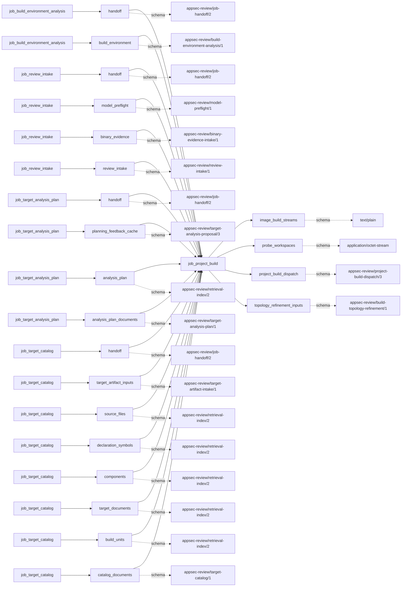
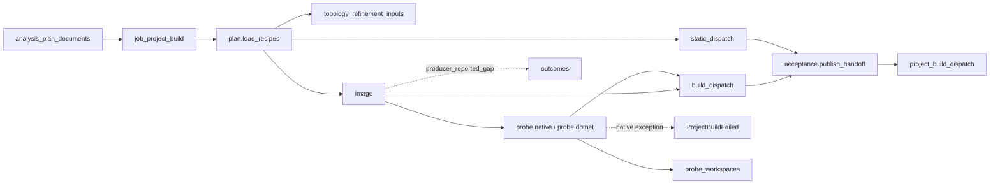

# project_build

## Purpose

Which accepted build actions have an admitted recipe, target refinement and usable image, and
which isolated native or Unity units can already supply a real execution receipt? This job
publishes preparation/dispatch records and the executions it owns. It refuses to call image
preparation a successful compiler run, a static dispatch an executed scan, or a family/image
label proof of the selected native target.

<!-- generated:begin job=job_project_build -->
<!-- generated from: appsec-review.toml, containers/catalog.toml, pipeline/guidance/registry.json, tests/job-test-map.json, src/appsec_review/runtime/registry.py, src/appsec_review/runtime/contracts.py, src/appsec_review/runtime/datasets.py, src/appsec_review/guidance/workers.py, src/appsec_review/mcp/schema.py, src/appsec_review/orchestration/topology.py, src/appsec_review/orchestration/dagster/adapter.py by scripts/generate-docs.py; do not edit -->
## Declared job contract

project_build

Job: `job_project_build`. Enabled in the dev recipe: **true**.
Declarations describe possible work, not successful execution or consumed evidence.

### Steps and tasks

| Step | Task | Workers | Pool | Bound tool or gap | Handler |
| --- | --- | --- | --- | --- | --- |
| `acceptance` | `acceptance.publish_handoff` | 1 | `application` | Undeclared ([T-147](../TODO.md)) | [source](../../src/appsec_review/jobs/job_project_build/job.py#L1526) |
| `build_dispatch` | `build_dispatch.dotnet` | 1 | `application` | Undeclared ([T-147](../TODO.md)) | [source](../../src/appsec_review/jobs/job_project_build/job.py#L1526) |
| `build_dispatch` | `build_dispatch.go` | 1 | `application` | Undeclared ([T-147](../TODO.md)) | [source](../../src/appsec_review/jobs/job_project_build/job.py#L1526) |
| `build_dispatch` | `build_dispatch.java` | 1 | `application` | Undeclared ([T-147](../TODO.md)) | [source](../../src/appsec_review/jobs/job_project_build/job.py#L1526) |
| `build_dispatch` | `build_dispatch.native` | 1 | `application` | Undeclared ([T-147](../TODO.md)) | [source](../../src/appsec_review/jobs/job_project_build/job.py#L1526) |
| `build_dispatch` | `build_dispatch.node` | 1 | `application` | Undeclared ([T-147](../TODO.md)) | [source](../../src/appsec_review/jobs/job_project_build/job.py#L1526) |
| `build_dispatch` | `build_dispatch.php` | 1 | `application` | Undeclared ([T-147](../TODO.md)) | [source](../../src/appsec_review/jobs/job_project_build/job.py#L1526) |
| `build_dispatch` | `build_dispatch.python` | 1 | `application` | Undeclared ([T-147](../TODO.md)) | [source](../../src/appsec_review/jobs/job_project_build/job.py#L1526) |
| `build_dispatch` | `build_dispatch.rust` | 1 | `application` | Undeclared ([T-147](../TODO.md)) | [source](../../src/appsec_review/jobs/job_project_build/job.py#L1526) |
| `build_dispatch` | `build_dispatch.wasm` | 1 | `application` | Undeclared ([T-147](../TODO.md)) | [source](../../src/appsec_review/jobs/job_project_build/job.py#L1526) |
| `image` | `image.dotnet` | 1 | `cpp_build` | Undeclared ([T-147](../TODO.md)) | [source](../../src/appsec_review/jobs/job_project_build/job.py#L1526) |
| `image` | `image.go` | 1 | `cpp_build` | Undeclared ([T-147](../TODO.md)) | [source](../../src/appsec_review/jobs/job_project_build/job.py#L1526) |
| `image` | `image.java` | 1 | `cpp_build` | Undeclared ([T-147](../TODO.md)) | [source](../../src/appsec_review/jobs/job_project_build/job.py#L1526) |
| `image` | `image.native` | 1 | `cpp_build` | Undeclared ([T-147](../TODO.md)) | [source](../../src/appsec_review/jobs/job_project_build/job.py#L1526) |
| `image` | `image.node` | 1 | `cpp_build` | Undeclared ([T-147](../TODO.md)) | [source](../../src/appsec_review/jobs/job_project_build/job.py#L1526) |
| `image` | `image.php` | 1 | `cpp_build` | Undeclared ([T-147](../TODO.md)) | [source](../../src/appsec_review/jobs/job_project_build/job.py#L1526) |
| `image` | `image.python` | 1 | `cpp_build` | Undeclared ([T-147](../TODO.md)) | [source](../../src/appsec_review/jobs/job_project_build/job.py#L1526) |
| `image` | `image.rust` | 1 | `cpp_build` | Undeclared ([T-147](../TODO.md)) | [source](../../src/appsec_review/jobs/job_project_build/job.py#L1526) |
| `image` | `image.wasm` | 1 | `cpp_build` | Undeclared ([T-147](../TODO.md)) | [source](../../src/appsec_review/jobs/job_project_build/job.py#L1526) |
| `plan` | `plan.load_recipes` | 1 | `application` | Undeclared ([T-147](../TODO.md)) | [source](../../src/appsec_review/jobs/job_project_build/job.py#L1526) |
| `probe` | `probe.dotnet` | 1 | `cpp_build` | Undeclared ([T-147](../TODO.md)) | [source](../../src/appsec_review/jobs/job_project_build/job.py#L1526) |
| `probe` | `probe.go` | 1 | `cpp_build` | Undeclared ([T-147](../TODO.md)) | [source](../../src/appsec_review/jobs/job_project_build/job.py#L1526) |
| `probe` | `probe.java` | 1 | `cpp_build` | Undeclared ([T-147](../TODO.md)) | [source](../../src/appsec_review/jobs/job_project_build/job.py#L1526) |
| `probe` | `probe.native` | 1 | `cpp_build` | Undeclared ([T-147](../TODO.md)) | [source](../../src/appsec_review/jobs/job_project_build/job.py#L1526) |
| `probe` | `probe.node` | 1 | `cpp_build` | Undeclared ([T-147](../TODO.md)) | [source](../../src/appsec_review/jobs/job_project_build/job.py#L1526) |
| `probe` | `probe.php` | 1 | `cpp_build` | Undeclared ([T-147](../TODO.md)) | [source](../../src/appsec_review/jobs/job_project_build/job.py#L1526) |
| `probe` | `probe.python` | 1 | `cpp_build` | Undeclared ([T-147](../TODO.md)) | [source](../../src/appsec_review/jobs/job_project_build/job.py#L1526) |
| `probe` | `probe.rust` | 1 | `cpp_build` | Undeclared ([T-147](../TODO.md)) | [source](../../src/appsec_review/jobs/job_project_build/job.py#L1526) |
| `probe` | `probe.wasm` | 1 | `cpp_build` | Undeclared ([T-147](../TODO.md)) | [source](../../src/appsec_review/jobs/job_project_build/job.py#L1526) |
| `static_dispatch` | `static_dispatch.dotnet` | 1 | `application` | Undeclared ([T-147](../TODO.md)) | [source](../../src/appsec_review/jobs/job_project_build/job.py#L1526) |
| `static_dispatch` | `static_dispatch.global` | 1 | `application` | Undeclared ([T-147](../TODO.md)) | [source](../../src/appsec_review/jobs/job_project_build/job.py#L1526) |
| `static_dispatch` | `static_dispatch.go` | 1 | `application` | Undeclared ([T-147](../TODO.md)) | [source](../../src/appsec_review/jobs/job_project_build/job.py#L1526) |
| `static_dispatch` | `static_dispatch.java` | 1 | `application` | Undeclared ([T-147](../TODO.md)) | [source](../../src/appsec_review/jobs/job_project_build/job.py#L1526) |
| `static_dispatch` | `static_dispatch.native` | 1 | `application` | Undeclared ([T-147](../TODO.md)) | [source](../../src/appsec_review/jobs/job_project_build/job.py#L1526) |
| `static_dispatch` | `static_dispatch.node` | 1 | `application` | Undeclared ([T-147](../TODO.md)) | [source](../../src/appsec_review/jobs/job_project_build/job.py#L1526) |
| `static_dispatch` | `static_dispatch.php` | 1 | `application` | Undeclared ([T-147](../TODO.md)) | [source](../../src/appsec_review/jobs/job_project_build/job.py#L1526) |
| `static_dispatch` | `static_dispatch.python` | 1 | `application` | Undeclared ([T-147](../TODO.md)) | [source](../../src/appsec_review/jobs/job_project_build/job.py#L1526) |
| `static_dispatch` | `static_dispatch.rust` | 1 | `application` | Undeclared ([T-147](../TODO.md)) | [source](../../src/appsec_review/jobs/job_project_build/job.py#L1526) |
| `static_dispatch` | `static_dispatch.wasm` | 1 | `application` | Undeclared ([T-147](../TODO.md)) | [source](../../src/appsec_review/jobs/job_project_build/job.py#L1526) |

### Accepted input declarations

| Producer | Dataset | Schema | Channel | Availability | Missing policy |
| --- | --- | --- | --- | --- | --- |
| `job_build_environment_analysis` | `handoff` | `appsec-review/job-handoff/2` | handoff | optional | gap |
| `job_build_environment_analysis` | `build_environment` | `appsec-review/build-environment-analysis/1` | handoff | optional | gap |
| `job_review_intake` | `handoff` | `appsec-review/job-handoff/2` | handoff | optional | gap |
| `job_review_intake` | `model_preflight` | `appsec-review/model-preflight/1` | handoff | optional | gap |
| `job_review_intake` | `binary_evidence` | `appsec-review/binary-evidence-intake/1` | handoff | optional | gap |
| `job_review_intake` | `review_intake` | `appsec-review/review-intake/1` | handoff | optional | gap |
| `job_target_analysis_plan` | `handoff` | `appsec-review/job-handoff/2` | handoff | required | reject |
| `job_target_analysis_plan` | `planning_feedback_cache` | `appsec-review/target-analysis-proposal/3` | handoff | optional | gap |
| `job_target_analysis_plan` | `analysis_plan` | `appsec-review/retrieval-index/2` | handoff | optional | gap |
| `job_target_analysis_plan` | `analysis_plan_documents` | `appsec-review/target-analysis-plan/1` | handoff | optional | gap |
| `job_target_catalog` | `handoff` | `appsec-review/job-handoff/2` | handoff | optional | gap |
| `job_target_catalog` | `target_artifact_inputs` | `appsec-review/target-artifact-intake/1` | handoff | optional | gap |
| `job_target_catalog` | `source_files` | `appsec-review/retrieval-index/2` | handoff | optional | gap |
| `job_target_catalog` | `declaration_symbols` | `appsec-review/retrieval-index/2` | handoff | optional | gap |
| `job_target_catalog` | `components` | `appsec-review/retrieval-index/2` | handoff | optional | gap |
| `job_target_catalog` | `target_documents` | `appsec-review/retrieval-index/2` | handoff | optional | gap |
| `job_target_catalog` | `build_units` | `appsec-review/retrieval-index/2` | handoff | optional | gap |
| `job_target_catalog` | `catalog_documents` | `appsec-review/target-catalog/1` | handoff | optional | gap |

### Published dataset declarations

| Dataset | Step | Schema | Stage | Indexes | MCP route |
| --- | --- | --- | --- | --- | --- |
| `image_build_streams` | `image` | `text/plain` | protected | Not indexed | `coverage`, `query_dataset_inventory` |
| `probe_workspaces` | `probe` | `application/octet-stream` | protected | Not indexed | `coverage`, `query_dataset_inventory` |
| `project_build_dispatch` | `acceptance` | `appsec-review/project-build-dispatch/3` | artifact_only | Not indexed | `coverage`, `query_dataset_inventory` |
| `topology_refinement_inputs` | `plan` | `appsec-review/build-topology-refinement/1` | protected | Not indexed | `coverage`, `query_dataset_inventory` |

Protected and artifact-only routes expose sanitized metadata, not payload access.

### Model and guidance declarations

These are job-level declarations; exact per-task selection is not declared ([T-147](../TODO.md)).

```json
{
  "model": {
    "enabled": true,
    "max_input_tokens": 16000,
    "max_output_tokens": 2000,
    "model": "claude-haiku-5-5",
    "provider": "claude-cli",
    "reasoning": "medium",
    "timeout_seconds": 180
  }
}
```

- Role template: `build_engineer_{family}`; family selected by the accepted build.
- Persona: [devops_engineer](../generated/guidance.md#personas-devops_engineer).
- Task prompt: `build_image_repair`.
- Runtime skill: [build-image-repair](../generated/guidance.md#runtime_skills-build-image-repair).

### Test selection

| Tier | Files or selectors |
| --- | --- |
| acceptance | `tests/acceptance/job_project_build/test_project_build_graph.py`<br>`tests/acceptance/job_project_build/test_project_build_capture.py`<br>`tests/acceptance/job_project_build/test_family_project_builds.py`<br>`tests/acceptance/job_project_build/test_jvm_dotnet_project_builds.py`<br>`tests/acceptance/job_project_build/test_node_project_builds.py`<br>`tests/acceptance/job_project_build/test_native_build_output_layout.py`<br>`tests/acceptance/job_project_build/test_unity_project_builds.py` |
| integration | `tests/integration/job_project_build/test_executor.py`<br>`tests/integration/job_project_build/test_native_artifacts.py`<br>`tests/integration/job_project_build/test_capture_boundary.py`<br>`tests/integration/job_project_build/test_fixture_provenance.py` |
| live | None declared |
| unit | `tests/unit/job_project_build/test_job_graph.py`<br>`tests/unit/job_project_build/test_contract.py`<br>`tests/unit/job_project_build/test_project_build_helpers.py`<br>`tests/unit/job_project_build/test_repair.py`<br>`tests/unit/job_project_build/test_enforcement.py`<br>`tests/unit/job_project_build/test_build_recovery.py` |

### Dagster placement

Dispatch: `review_graph`. Review graph member: **true**. Enabled graph member: **true**.

Declared predecessors: `job_target_analysis_plan`.

### Declared dataflow



<!-- generated:end -->

## Process

Source: [handlers](../../src/appsec_review/jobs/job_project_build/job.py),
[native enforcement](../../src/appsec_review/jobs/job_project_build/enforcement.py) and
[project-image resolver](../../src/appsec_review/container_runtime/project_images.py).
See [project-build operations](project-build.md) for operator context and
[topology/iterations](../architecture/build-topology-and-iterations.md) for shared admission.

### `plan`

1. Load and validate the accepted analysis plan and executable graph; reject graphless plans.
   Read dependency edges without inferring order from directory names.
2. Select eligible deterministic CMake, JVM source-set or phpize recipes, otherwise retain the
   accepted recipe. Keep package suggestions as `package_hints` rather than automatically
   installing them. Honor explicitly selected recipe promotions.
3. Bind the chosen actions to immutable topology refinement and build-selection policy.
   Evaluate build-capture applicability and account for source-only scopes separately.
4. Retain actions selected to run, naming missing recipes and unavailable native capabilities;
   preserve processing decisions and the selected graph. Do not execute source-only syntax
   work as if it were a material build.

### `image`

1. For each family, skip Unity's separate engine path. Reject unavailable native capabilities,
   missing recipes or failed target/refinement guards before constructing the resolver.
2. Resolve the required image profile. Recheck the base tag against its expected ID; use the
   base image when no customization is needed.
3. For customized images, verify base admission and dependency hashes; reuse an exact valid
   image cache or invoke bounded image preparation with retained definition and streams.
   A moved/missing image is not a cache hit.
4. Revalidate any accepted repair-cache recipe and image against the current refinement.
   Retain image/preparation/command identities and bounded diagnostics. Expected unavailability
   becomes `BLOCKED`; preparation failures become `FAILED`, with scoped gap records.

### `static_dispatch`

1. Partition accepted scanner scopes by planned family roots. Keep paths outside all roots in
   the global lane; keep each selected family action's applicable tool scopes.
2. Publish `global_jobflow_static` or `lang_jobflow_static` dispatch descriptions and counts.
   This step depends on planning, not successful compilation, and does not run the scanners.

### `probe`

1. For native actions, identify graph-connected units and leave them for the shared-workspace
   iteration owner. For isolated units, preserve failed preparation as an empty blocked receipt.
2. Execute admitted isolated native units once through the language-build captured executor,
   binding its input to the accepted plan. Retain real commands, outputs and native enforcement.
   An unexpected native execution error writes `failure.json` and raises `ProjectBuildFailed`.
3. In the .NET family, execute Unity once through its configured engine capability; do not
   infer or replay generated project files through a generic SDK.
4. Other families have no production probe here. Return no receipts as `NOT_APPLICABLE`,
   not a fabricated successful build.

### `build_dispatch`

1. Select successful image preparations and construct `lang_jobflow_build` dispatches from
   exact recipe/image/preparation identities.
2. For native work already executed here, attach `execution_owner`, captured receipt hash and
   enforcement proof so language-build will consume the receipt instead of compiling again.
3. Guard each final dispatch against the accepted refinement. Preserve failed-preparation gaps;
   dispatch availability is not universal proof that its eventual build will succeed.

### `acceptance`

1. Gather family image preparations, probe receipts and static/build dispatches.
2. Finalize processing decisions where an actual receipt exists; retain unresolved or failed
   processing rather than inferring success from a selected action.
3. Write `accepted-project-build-dispatch.json` with `execution_mode=iterative`, graph, actions,
   receipts and scoped gaps. Publish only after normal framework validation.

## Dataflow



## Gaps

The `typed` wrapper uses `scoped_gaps`: text becomes `producer_reported_gap`,
`retryable=False`, scoped to the named build unit or handler; existing typed records are
preserved. These are preparation/execution coverage failures, not automatically advisory.

| Where | Source-derived failure/coverage cases |
| --- | --- |
| `plan.load_recipes` | Build applicability gap, unavailable native capability, missing validated recipe; source-only policy/not-applicable decisions remain distinct. |
| `image` | Missing recipe/target closure, refinement or image admission refusal, base/derived identity mismatch, unavailable bounded builder, image build timeout/failure and invalid repair-cache identity. |
| `probe.native` | Failed preparation, command/capture/output gaps, missing expected outputs and unresolved compiler/target enforcement. Thrown execution/integrity errors retain a `producer_failed` diagnostic and reject the attempt. |
| `probe.dotnet` | Unity engine-specific capability, execution, output and capture gaps retained from its executor. |
| `build_dispatch`, `acceptance` | Failed preparation propagated, processing capability/toolchain/evidence/artifact-validation reasons and nested receipt gaps. |

Failed or blocked native statuses/dispositions may also produce runtime retry accounting;
read the canonical outcomes rather than guessing retryability from a message. The diagnostic
`producer_failed` explicitly written on the native exception path defaults to false and is
not an accepted handoff. Missing source/plan identities and publication failures remain hard
refusals. [Interchange](../architecture/job-interchange.md) defines these distinct boundaries.
No image build, repair or native limitation is automatically a walk's expected gap.

## Acceptance

1. **A. Inputs:** Match plan/catalog/environment pins and read receipts to the claim. Verify
   selected recipe promotions, topology refinement, dependency hashes and image preparations
   against their accepted inputs.
2. **B. Independent comparison:** Compare planned unit IDs with prepared/blocked/dispatch IDs.
   Compare image IDs with daemon evidence under [host pin procedures](image-pin-verification.md).
   For executed native/Unity units compare command exits, capture counts and output hashes
   with raw receipts; for preparation-only families record explicitly that no compiler ran.
3. **C. Gaps:** Group canonical records by unit and stage; distinguish unavailable preparation,
   unsupported target proof and failed execution. Verify native rejected outputs are not
   counted as accepted artifacts. Stop on causes outside the walk's expected list.
4. **D. Baseline:** After comparison use `stepwise.py accept`; record corpus namespace and the
   saved baseline of actions, preparations, dispatches, actual executions and coverage.

## Resume and invalidation

Whole-job reuse binds the accepted plan and its revalidated environment/topology, target,
configuration and implementation. `guard_build_cache` rechecks recipe-bound refinement rather
than trusting an old result. Project-image identity binds recipe, dependency-file hashes,
profile/base image and component releases; cache reads also resolve the image and retained
definition/preparation receipt. Accepted repair reuse needs the same base recipe and validated
repair/image identity. Native execution owned here disables the language executor's private
cache: the accepted job receipt owns its reuse. Changed selected recipes/images or target proof
cannot reuse an earlier native result. See [Wave 1 resumability](../architecture/jobs-and-runtime.md#wave-1-resumability)
and [signing](signing.md); this page changes neither launch enforcement nor image policy.

## Model usage

The current `build_job` handlers do **not** call `infer`. `_infer_repair` is reached only from
retained, uncalled probe-repair helpers; accepted repair-cache reuse is not a new inference call.
The declared `build_repair` worker combines the
[DevOps persona](../generated/guidance.md#personas-devops_engineer) with a family Build Engineer
(for example [native](../generated/guidance.md#roles-build_engineer_native)) to propose a bounded
image/recipe repair, not to authorize target execution. Its
[registered procedure](../generated/guidance.md#runtime_skills-build-image-repair) and model
configuration are declarations, not evidence that the present production path uses that worker.
See [worker prompt contracts](../architecture/worker-prompt-contracts.md).
