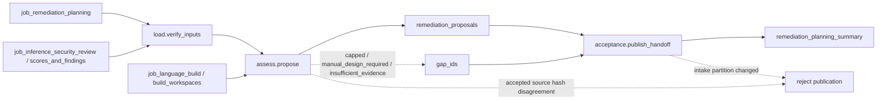

# remediation_planning

## Purpose

Create bounded, inert remediation proposals for the accepted review's confirmed findings only.
Each proposal describes the violated/corrected invariant, exact source edits and a separate safe
regression specification. Planning neither applies a patch to the target nor proves a fix;
supported findings stay outside remediation intake even when they have PoC documentation.

<!-- generated:begin job=job_remediation_planning -->
<!-- generated from: appsec-review.toml, containers/catalog.toml, pipeline/guidance/registry.json, tests/job-test-map.json, src/appsec_review/runtime/registry.py, src/appsec_review/runtime/contracts.py, src/appsec_review/runtime/datasets.py, src/appsec_review/guidance/workers.py, src/appsec_review/mcp/schema.py, src/appsec_review/orchestration/topology.py, src/appsec_review/orchestration/dagster/adapter.py by scripts/generate-docs.py; do not edit -->
## Declared job contract

remediation_planning

Job: `job_remediation_planning`. Enabled in the dev recipe: **true**.
Declarations describe possible work, not successful execution or consumed evidence.

### Steps and tasks

| Step | Task | Workers | Pool | Bound tool or gap | Handler |
| --- | --- | --- | --- | --- | --- |
| `acceptance` | `acceptance.publish_handoff` | 1 | `lifecycle` | Undeclared ([T-147](../TODO.md)) | [source](../../src/appsec_review/jobs/job_remediation_planning/job.py#L152) |
| `assess` | `assess.propose` | 1 | `inference_teams` | Undeclared ([T-147](../TODO.md)) | [source](../../src/appsec_review/jobs/job_remediation_planning/job.py#L71) |
| `load` | `load.verify_inputs` | 1 | `application` | Undeclared ([T-147](../TODO.md)) | [source](../../src/appsec_review/jobs/job_remediation_planning/job.py#L60) |

### Accepted input declarations

| Producer | Dataset | Schema | Channel | Availability | Missing policy |
| --- | --- | --- | --- | --- | --- |
| `job_target_catalog` | `handoff` | `appsec-review/job-handoff/2` | handoff | optional | gap |
| `job_target_catalog` | `source_files` | `appsec-review/retrieval-index/2` | handoff | optional | gap |
| `job_target_catalog` | `declaration_symbols` | `appsec-review/retrieval-index/2` | handoff | optional | gap |
| `job_target_catalog` | `target_documents` | `appsec-review/retrieval-index/2` | handoff | optional | gap |
| `job_tree_sitter_ast` | `handoff` | `appsec-review/job-handoff/2` | handoff | optional | gap |
| `job_tree_sitter_ast` | `tree_sitter_ast` | `appsec-review/tree-sitter-normalizer/1` | handoff | optional | gap |
| `job_tree_sitter_ast` | `tree_sitter_coverage` | `appsec-review/tree-sitter-ast/1` | handoff | optional | gap |
| `job_cpp_compiled_analysis` | `handoff` | `appsec-review/job-handoff/2` | handoff | optional | gap |
| `job_cpp_compiled_analysis` | `clang_ast` | `appsec-review/retrieval-index/2` | handoff | optional | gap |
| `job_cpp_compiled_analysis` | `llvm_ir` | `appsec-review/retrieval-index/2` | handoff | optional | gap |
| `job_cpp_compiled_analysis` | `infer_observations` | `appsec-review/retrieval-index/2` | handoff | optional | gap |
| `job_cpp_compiled_analysis` | `binary_symbols` | `appsec-review/retrieval-index/2` | handoff | optional | gap |
| `job_cpp_compiled_analysis` | `cpp_blocked_branches` | `appsec-review/retrieval-index/2` | handoff | optional | gap |
| `job_cpp_symbol_index` | `handoff` | `appsec-review/job-handoff/2` | handoff | optional | gap |
| `job_cpp_symbol_index` | `clangd_symbols` | `appsec-review/retrieval-index/2` | handoff | optional | gap |
| `job_cpp_symbol_index` | `clangd_coverage` | `appsec-review/cpp-index-coverage/1` | handoff | optional | gap |
| `job_svf_alias_analysis` | `handoff` | `appsec-review/job-handoff/2` | handoff | optional | gap |
| `job_svf_alias_analysis` | `svf_alias_sets` | `appsec-review/retrieval-index/2` | handoff | optional | gap |
| `job_svf_alias_analysis` | `svf_alias_scope_coverage` | `appsec-review/cpp-index-coverage/1` | handoff | optional | gap |
| `job_code_graph_index` | `handoff` | `appsec-review/job-handoff/2` | handoff | optional | gap |
| `job_code_graph_index` | `code_graph_facts` | `appsec-review/graph-fact/1` | handoff | optional | gap |
| `job_codeql_analysis` | `handoff` | `appsec-review/job-handoff/2` | handoff | optional | gap |
| `job_codeql_analysis` | `codeql_observations` | `appsec-review/codeql-sarif-normalizer/3` | handoff | optional | gap |
| `job_evidence_collection` | `handoff` | `appsec-review/job-handoff/2` | handoff | optional | gap |
| `job_evidence_collection` | `static_tool_observations` | `appsec-review/retrieval-index/2` | handoff | optional | gap |
| `job_clang_static_analysis` | `handoff` | `appsec-review/job-handoff/2` | handoff | optional | gap |
| `job_clang_static_analysis` | `clang_static_observations` | `appsec-review/retrieval-index/2` | handoff | optional | gap |
| `job_clang_static_analysis` | `clang_static_scope_coverage` | `appsec-review/cpp-index-coverage/1` | handoff | optional | gap |
| `job_cpg_analysis` | `handoff` | `appsec-review/job-handoff/2` | handoff | optional | gap |
| `job_cpg_analysis` | `cpg_graph_coverage` | `appsec-review/retrieval-index/2` | handoff | optional | gap |
| `job_cpg_analysis` | `cpg_scope_coverage` | `appsec-review/cpp-index-coverage/1` | handoff | optional | gap |
| `job_ci_configuration_analysis` | `handoff` | `appsec-review/job-handoff/2` | handoff | optional | gap |
| `job_ci_configuration_analysis` | `ci_observations` | `appsec-review/retrieval-index/2` | handoff | optional | gap |
| `job_ci_configuration_analysis` | `ci_findings` | `appsec-review/retrieval-index/2` | handoff | optional | gap |
| `job_artifact_security_analysis` | `handoff` | `appsec-review/job-handoff/2` | handoff | optional | gap |
| `job_artifact_security_analysis` | `artifact_security_observations` | `appsec-review/retrieval-index/2` | handoff | optional | gap |
| `job_binary_evidence_indexing` | `handoff` | `appsec-review/job-handoff/2` | handoff | optional | gap |
| `job_binary_evidence_indexing` | `binary_functions` | `appsec-review/retrieval-index/2` | handoff | optional | gap |
| `job_dependency_intelligence` | `handoff` | `appsec-review/job-handoff/2` | handoff | optional | gap |
| `job_dependency_intelligence` | `dependency_context` | `appsec-review/retrieval-index/2` | handoff | optional | gap |
| `job_review_prioritization` | `handoff` | `appsec-review/job-handoff/2` | handoff | optional | gap |
| `job_review_prioritization` | `priority_items` | `appsec-review/retrieval-index/2` | handoff | optional | gap |
| `job_security_tagging` | `handoff` | `appsec-review/job-handoff/2` | handoff | optional | gap |
| `job_security_tagging` | `tag_assignments` | `appsec-review/tag-assignment/1` | handoff | optional | gap |
| `job_review_data_indexing` | `handoff` | `appsec-review/job-handoff/2` | handoff | optional | gap |
| `job_review_data_indexing` | `cross_domain_links` | `appsec-review/retrieval-index/2` | handoff | optional | gap |
| `job_review_data_indexing` | `precomputed_products` | `appsec-review/retrieval-index/2` | handoff | optional | gap |
| `job_inference_security_review` | `handoff` | `appsec-review/job-handoff/2` | handoff | required | reject |
| `job_inference_security_review` | `accepted_scope` | `appsec-review/inference-review-accepted-scope/1` | handoff | optional | gap |
| `job_inference_security_review` | `lead_triage` | `application/json` | handoff | optional | gap |
| `job_inference_security_review` | `review_packages` | `appsec-review/review-package/6` | handoff | optional | gap |
| `job_inference_security_review` | `review_cells` | `appsec-review/cell-attempt-receipt/1` | handoff | optional | gap |
| `job_inference_security_review` | `claim_ledger` | `appsec-review/ledger-event/1` | handoff | optional | gap |
| `job_inference_security_review` | `attack_chains` | `appsec-review/attack-chain-manifest/1` | handoff | optional | gap |
| `job_inference_security_review` | `scores_and_findings` | `appsec-review/finding-package/2` | handoff | optional | gap |
| `job_language_build` | `handoff` | `appsec-review/job-handoff/2` | handoff | optional | gap |
| `job_language_build` | `topology_refinement_inputs` | `appsec-review/build-topology-refinement/1` | handoff | optional | gap |
| `job_language_build` | `build_actions` | `appsec-review/retrieval-index/2` | handoff | optional | gap |
| `job_language_build` | `jvm_build_actions` | `appsec-review/retrieval-index/2` | handoff | optional | gap |
| `job_language_build` | `language_build_receipts` | `appsec-review/language-build-handoff/2` | handoff | optional | gap |
| `job_language_build` | `build_workspaces` | `application/octet-stream` | handoff | optional | gap |

### Published dataset declarations

| Dataset | Step | Schema | Stage | Indexes | MCP route |
| --- | --- | --- | --- | --- | --- |
| `remediation_planning_summary` | `acceptance` | `appsec-review/remediation-planning/1` | artifact_only | Not indexed | `coverage`, `query_dataset_inventory` |
| `remediation_proposals` | `assess` | `appsec-review/remediation-plan/1` | protected | Not indexed | `coverage`, `query_dataset_inventory` |

Protected and artifact-only routes expose sanitized metadata, not payload access.

### Model and guidance declarations

These are job-level declarations; exact per-task selection is not declared ([T-147](../TODO.md)).

```json
{}
```

- Role: [remediation_writer](../generated/guidance.md#roles-remediation_writer).
- Task prompt: `remediation_proposal`.
- Runtime skill: [stateful-invariant-analysis](../generated/guidance.md#runtime_skills-stateful-invariant-analysis).

### Test selection

| Tier | Files or selectors |
| --- | --- |
| acceptance | `tests/test_remediation_jobs.py::test_real_review_produces_exact_confirmed_only_proposals_and_regression_specs` |
| integration | None declared |
| live | None declared |
| unit | `tests/test_remediation_models.py` |

### Dagster placement

Dispatch: `review_graph`. Review graph member: **true**. Enabled graph member: **true**.

Declared predecessors: `job_poc_generation`.

### Declared dataflow

```mermaid
flowchart LR
  job["job_remediation_planning"]
  producer0["job_target_catalog"]
  input0["handoff"]
  input_schema0["appsec-review/job-handoff/2"]
  producer0 --> input0 --> job
  input0 -. schema .-> input_schema0
  producer1["job_target_catalog"]
  input1["source_files"]
  input_schema1["appsec-review/retrieval-index/2"]
  producer1 --> input1 --> job
  input1 -. schema .-> input_schema1
  producer2["job_target_catalog"]
  input2["declaration_symbols"]
  input_schema2["appsec-review/retrieval-index/2"]
  producer2 --> input2 --> job
  input2 -. schema .-> input_schema2
  producer3["job_target_catalog"]
  input3["target_documents"]
  input_schema3["appsec-review/retrieval-index/2"]
  producer3 --> input3 --> job
  input3 -. schema .-> input_schema3
  producer4["job_tree_sitter_ast"]
  input4["handoff"]
  input_schema4["appsec-review/job-handoff/2"]
  producer4 --> input4 --> job
  input4 -. schema .-> input_schema4
  producer5["job_tree_sitter_ast"]
  input5["tree_sitter_ast"]
  input_schema5["appsec-review/tree-sitter-normalizer/1"]
  producer5 --> input5 --> job
  input5 -. schema .-> input_schema5
  producer6["job_tree_sitter_ast"]
  input6["tree_sitter_coverage"]
  input_schema6["appsec-review/tree-sitter-ast/1"]
  producer6 --> input6 --> job
  input6 -. schema .-> input_schema6
  producer7["job_cpp_compiled_analysis"]
  input7["handoff"]
  input_schema7["appsec-review/job-handoff/2"]
  producer7 --> input7 --> job
  input7 -. schema .-> input_schema7
  producer8["job_cpp_compiled_analysis"]
  input8["clang_ast"]
  input_schema8["appsec-review/retrieval-index/2"]
  producer8 --> input8 --> job
  input8 -. schema .-> input_schema8
  producer9["job_cpp_compiled_analysis"]
  input9["llvm_ir"]
  input_schema9["appsec-review/retrieval-index/2"]
  producer9 --> input9 --> job
  input9 -. schema .-> input_schema9
  producer10["job_cpp_compiled_analysis"]
  input10["infer_observations"]
  input_schema10["appsec-review/retrieval-index/2"]
  producer10 --> input10 --> job
  input10 -. schema .-> input_schema10
  producer11["job_cpp_compiled_analysis"]
  input11["binary_symbols"]
  input_schema11["appsec-review/retrieval-index/2"]
  producer11 --> input11 --> job
  input11 -. schema .-> input_schema11
  producer12["job_cpp_compiled_analysis"]
  input12["cpp_blocked_branches"]
  input_schema12["appsec-review/retrieval-index/2"]
  producer12 --> input12 --> job
  input12 -. schema .-> input_schema12
  producer13["job_cpp_symbol_index"]
  input13["handoff"]
  input_schema13["appsec-review/job-handoff/2"]
  producer13 --> input13 --> job
  input13 -. schema .-> input_schema13
  producer14["job_cpp_symbol_index"]
  input14["clangd_symbols"]
  input_schema14["appsec-review/retrieval-index/2"]
  producer14 --> input14 --> job
  input14 -. schema .-> input_schema14
  producer15["job_cpp_symbol_index"]
  input15["clangd_coverage"]
  input_schema15["appsec-review/cpp-index-coverage/1"]
  producer15 --> input15 --> job
  input15 -. schema .-> input_schema15
  producer16["job_svf_alias_analysis"]
  input16["handoff"]
  input_schema16["appsec-review/job-handoff/2"]
  producer16 --> input16 --> job
  input16 -. schema .-> input_schema16
  producer17["job_svf_alias_analysis"]
  input17["svf_alias_sets"]
  input_schema17["appsec-review/retrieval-index/2"]
  producer17 --> input17 --> job
  input17 -. schema .-> input_schema17
  producer18["job_svf_alias_analysis"]
  input18["svf_alias_scope_coverage"]
  input_schema18["appsec-review/cpp-index-coverage/1"]
  producer18 --> input18 --> job
  input18 -. schema .-> input_schema18
  producer19["job_code_graph_index"]
  input19["handoff"]
  input_schema19["appsec-review/job-handoff/2"]
  producer19 --> input19 --> job
  input19 -. schema .-> input_schema19
  producer20["job_code_graph_index"]
  input20["code_graph_facts"]
  input_schema20["appsec-review/graph-fact/1"]
  producer20 --> input20 --> job
  input20 -. schema .-> input_schema20
  producer21["job_codeql_analysis"]
  input21["handoff"]
  input_schema21["appsec-review/job-handoff/2"]
  producer21 --> input21 --> job
  input21 -. schema .-> input_schema21
  producer22["job_codeql_analysis"]
  input22["codeql_observations"]
  input_schema22["appsec-review/codeql-sarif-normalizer/3"]
  producer22 --> input22 --> job
  input22 -. schema .-> input_schema22
  producer23["job_evidence_collection"]
  input23["handoff"]
  input_schema23["appsec-review/job-handoff/2"]
  producer23 --> input23 --> job
  input23 -. schema .-> input_schema23
  producer24["job_evidence_collection"]
  input24["static_tool_observations"]
  input_schema24["appsec-review/retrieval-index/2"]
  producer24 --> input24 --> job
  input24 -. schema .-> input_schema24
  producer25["job_clang_static_analysis"]
  input25["handoff"]
  input_schema25["appsec-review/job-handoff/2"]
  producer25 --> input25 --> job
  input25 -. schema .-> input_schema25
  producer26["job_clang_static_analysis"]
  input26["clang_static_observations"]
  input_schema26["appsec-review/retrieval-index/2"]
  producer26 --> input26 --> job
  input26 -. schema .-> input_schema26
  producer27["job_clang_static_analysis"]
  input27["clang_static_scope_coverage"]
  input_schema27["appsec-review/cpp-index-coverage/1"]
  producer27 --> input27 --> job
  input27 -. schema .-> input_schema27
  producer28["job_cpg_analysis"]
  input28["handoff"]
  input_schema28["appsec-review/job-handoff/2"]
  producer28 --> input28 --> job
  input28 -. schema .-> input_schema28
  producer29["job_cpg_analysis"]
  input29["cpg_graph_coverage"]
  input_schema29["appsec-review/retrieval-index/2"]
  producer29 --> input29 --> job
  input29 -. schema .-> input_schema29
  producer30["job_cpg_analysis"]
  input30["cpg_scope_coverage"]
  input_schema30["appsec-review/cpp-index-coverage/1"]
  producer30 --> input30 --> job
  input30 -. schema .-> input_schema30
  producer31["job_ci_configuration_analysis"]
  input31["handoff"]
  input_schema31["appsec-review/job-handoff/2"]
  producer31 --> input31 --> job
  input31 -. schema .-> input_schema31
  producer32["job_ci_configuration_analysis"]
  input32["ci_observations"]
  input_schema32["appsec-review/retrieval-index/2"]
  producer32 --> input32 --> job
  input32 -. schema .-> input_schema32
  producer33["job_ci_configuration_analysis"]
  input33["ci_findings"]
  input_schema33["appsec-review/retrieval-index/2"]
  producer33 --> input33 --> job
  input33 -. schema .-> input_schema33
  producer34["job_artifact_security_analysis"]
  input34["handoff"]
  input_schema34["appsec-review/job-handoff/2"]
  producer34 --> input34 --> job
  input34 -. schema .-> input_schema34
  producer35["job_artifact_security_analysis"]
  input35["artifact_security_observations"]
  input_schema35["appsec-review/retrieval-index/2"]
  producer35 --> input35 --> job
  input35 -. schema .-> input_schema35
  producer36["job_binary_evidence_indexing"]
  input36["handoff"]
  input_schema36["appsec-review/job-handoff/2"]
  producer36 --> input36 --> job
  input36 -. schema .-> input_schema36
  producer37["job_binary_evidence_indexing"]
  input37["binary_functions"]
  input_schema37["appsec-review/retrieval-index/2"]
  producer37 --> input37 --> job
  input37 -. schema .-> input_schema37
  producer38["job_dependency_intelligence"]
  input38["handoff"]
  input_schema38["appsec-review/job-handoff/2"]
  producer38 --> input38 --> job
  input38 -. schema .-> input_schema38
  producer39["job_dependency_intelligence"]
  input39["dependency_context"]
  input_schema39["appsec-review/retrieval-index/2"]
  producer39 --> input39 --> job
  input39 -. schema .-> input_schema39
  producer40["job_review_prioritization"]
  input40["handoff"]
  input_schema40["appsec-review/job-handoff/2"]
  producer40 --> input40 --> job
  input40 -. schema .-> input_schema40
  producer41["job_review_prioritization"]
  input41["priority_items"]
  input_schema41["appsec-review/retrieval-index/2"]
  producer41 --> input41 --> job
  input41 -. schema .-> input_schema41
  producer42["job_security_tagging"]
  input42["handoff"]
  input_schema42["appsec-review/job-handoff/2"]
  producer42 --> input42 --> job
  input42 -. schema .-> input_schema42
  producer43["job_security_tagging"]
  input43["tag_assignments"]
  input_schema43["appsec-review/tag-assignment/1"]
  producer43 --> input43 --> job
  input43 -. schema .-> input_schema43
  producer44["job_review_data_indexing"]
  input44["handoff"]
  input_schema44["appsec-review/job-handoff/2"]
  producer44 --> input44 --> job
  input44 -. schema .-> input_schema44
  producer45["job_review_data_indexing"]
  input45["cross_domain_links"]
  input_schema45["appsec-review/retrieval-index/2"]
  producer45 --> input45 --> job
  input45 -. schema .-> input_schema45
  producer46["job_review_data_indexing"]
  input46["precomputed_products"]
  input_schema46["appsec-review/retrieval-index/2"]
  producer46 --> input46 --> job
  input46 -. schema .-> input_schema46
  producer47["job_inference_security_review"]
  input47["handoff"]
  input_schema47["appsec-review/job-handoff/2"]
  producer47 --> input47 --> job
  input47 -. schema .-> input_schema47
  producer48["job_inference_security_review"]
  input48["accepted_scope"]
  input_schema48["appsec-review/inference-review-accepted-scope/1"]
  producer48 --> input48 --> job
  input48 -. schema .-> input_schema48
  producer49["job_inference_security_review"]
  input49["lead_triage"]
  input_schema49["application/json"]
  producer49 --> input49 --> job
  input49 -. schema .-> input_schema49
  producer50["job_inference_security_review"]
  input50["review_packages"]
  input_schema50["appsec-review/review-package/6"]
  producer50 --> input50 --> job
  input50 -. schema .-> input_schema50
  producer51["job_inference_security_review"]
  input51["review_cells"]
  input_schema51["appsec-review/cell-attempt-receipt/1"]
  producer51 --> input51 --> job
  input51 -. schema .-> input_schema51
  producer52["job_inference_security_review"]
  input52["claim_ledger"]
  input_schema52["appsec-review/ledger-event/1"]
  producer52 --> input52 --> job
  input52 -. schema .-> input_schema52
  producer53["job_inference_security_review"]
  input53["attack_chains"]
  input_schema53["appsec-review/attack-chain-manifest/1"]
  producer53 --> input53 --> job
  input53 -. schema .-> input_schema53
  producer54["job_inference_security_review"]
  input54["scores_and_findings"]
  input_schema54["appsec-review/finding-package/2"]
  producer54 --> input54 --> job
  input54 -. schema .-> input_schema54
  producer55["job_language_build"]
  input55["handoff"]
  input_schema55["appsec-review/job-handoff/2"]
  producer55 --> input55 --> job
  input55 -. schema .-> input_schema55
  producer56["job_language_build"]
  input56["topology_refinement_inputs"]
  input_schema56["appsec-review/build-topology-refinement/1"]
  producer56 --> input56 --> job
  input56 -. schema .-> input_schema56
  producer57["job_language_build"]
  input57["build_actions"]
  input_schema57["appsec-review/retrieval-index/2"]
  producer57 --> input57 --> job
  input57 -. schema .-> input_schema57
  producer58["job_language_build"]
  input58["jvm_build_actions"]
  input_schema58["appsec-review/retrieval-index/2"]
  producer58 --> input58 --> job
  input58 -. schema .-> input_schema58
  producer59["job_language_build"]
  input59["language_build_receipts"]
  input_schema59["appsec-review/language-build-handoff/2"]
  producer59 --> input59 --> job
  input59 -. schema .-> input_schema59
  producer60["job_language_build"]
  input60["build_workspaces"]
  input_schema60["application/octet-stream"]
  producer60 --> input60 --> job
  input60 -. schema .-> input_schema60
  output0["remediation_planning_summary"]
  output_schema0["appsec-review/remediation-planning/1"]
  job --> output0
  output0 -. schema .-> output_schema0
  output1["remediation_proposals"]
  output_schema1["appsec-review/remediation-plan/1"]
  job --> output1
  output1 -. schema .-> output_schema1
```



<!-- generated:end -->

## Process

See the [handler](../../src/appsec_review/jobs/job_remediation_planning/job.py),
[source reader](../../src/appsec_review/jobs/job_remediation_planning/inputs.py) and
[proposal/patch validators](../../src/appsec_review/jobs/job_remediation_planning/contracts.py).

### `load`

1. In `load.verify_inputs`, verify the accepted review and bounded package set.
2. Select exactly the confirmed partition, sort by claim/package identity and reject state/
   partition disagreement. Record confirmed, bounded-admission and supported-excluded counts.
3. Write an immutable input snapshot; a missing required review is admission failure, not empty
   remediation success.

### `assess`

1. In `assess.propose`, account for every confirmed candidate, including rows beyond the candidate
   bound as `capped`. Resolve its direct evidence relations from the accepted projection.
2. For usable evidence, map accepted locations to run-owned build source. Require index and build
   hashes to agree, enforce relation/file/byte bounds and retain source omissions.
3. Commission the bounded writer with finding identity, source/evidence and invariant/patch/
   regression-specification response fields. Allow retrieval only from already admitted source
   files; retain the model/guidance/answer receipt.
4. Validate closed output, evidence IDs and exact patch scope. Retain `manual_design_required`
   or `insufficient_evidence` rather than repairing an invalid answer into a proposal.
5. Write immutable source context, writer receipt, optional patch and verified plan with
   nonexecution assurance. Record a candidate gap for every non-`proposal_generated` outcome.

### `acceptance`

1. In `acceptance.publish_handoff`, reload the accepted review and verify it has not changed;
   rehash its bindings.
2. Require the ordered outcome finding triples to equal the confirmed candidate intake exactly.
   Reverify each plan/schema and nested patch reference.
3. Publish `remediation_planning_summary` and aggregate row gaps. An empty confirmed intake is
   `SKIPPED_NA`; it does not assert that the review has no supported or unresolved issues.

## Dataflow



The [accepted-input contract](../architecture/job-input-contracts.md#admission-and-read-receipts)
and [retrieval boundary](../architecture/python-and-retrieval.md#query-boundary) restrict source
access. Scheduling after PoC does not make PoC evidence a prerequisite or grant: plan provenance
currently records `poc_handoff = null`.

## Gaps

Rows and plans use legacy strings without a producer-level retryability classification.
[Canonical conversion](../architecture/job-interchange.md#the-control-layer-beneath-the-envelope)
does not make their prefixes new gap codes.

| Emitted cause or outcome | Scope and cost |
| --- | --- |
| `remediation_planning:<claim>:capped` / reason `candidate_bound_reached` | Confirmed finding was not commissioned. |
| `remediation_planning:<claim>:manual_design_required` or `insufficient_evidence` | No valid exact proposal; inspect the retained row/model reason. |
| `confirmed_finding_has_no_resolving_evidence`, writer failure/budget/schema reason, `invalid_patch` | Candidate could not produce a validated proposal. Integrity exceptions still propagate. |
| `source_location_unavailable`, `run_owned_source_unavailable` | Relation/path lacks usable accepted source. |
| `source_file_bound_reached`, `source_byte_bound_reached`, `evidence_relation_bound_reached` | Source context is bounded, not whole-finding verification. |
| `source_encoding_unsupported` | Named source is not usable UTF-8. |

Failed scope/hash verification is not manual-design success. Expected limitations must be recorded
with their cost; no source retryability field implies no automatic advisory classification.

## Acceptance

1. **A. Inputs:** Compare the accepted review pin, confirmed partition, finding triples and direct
   relation IDs with the input snapshot. Verify each supplied source hash against both accepted
   location and run-owned build manifest.
2. **B. Independent comparison:** Independently count confirmed intake and supported exclusions;
   require exactly one outcome per confirmed identity, including capped rows. Compare proposed
   old bytes/offsets and new-file absence proofs with accepted source, and check cited relations
   and regression specifications against the finding's invariant without applying the patch.
3. **C. Gaps:** Group canonical outcomes and resolve row reasons/source gaps. Separate no confirmed
   intake from missing evidence or a failed writer. Record proposal/manual/capped counts and stop
   on unexpected causes.
4. **D. Baseline:** Save an authorized `stepwise.py accept` baseline and corpus namespace with
   intake identities, proposal/patch hashes, outcome partition and source/guidance receipt hashes.
   Record that runtime remediation validation has not been established.

## Resume and invalidation

No separate proposal semantic cache is implemented. [Runtime reuse](../architecture/jobs-and-runtime.md#wave-1-resumability)
requires exact review/build input, configuration and component identities; proposal provenance
additionally records settings, source context, guidance and writer receipt hashes. A changed
confirmed finding, source baseline or writer contract invalidates the plan, not the original
review state. Existing attempt-owned files are refused rather than overwritten, and artifact
results are not portable failed-attempt checkpoints.

## Model usage

The selected [remediation_writer](../generated/guidance.md#roles-remediation_writer) produces
the proposal, not a verdict that the finding is fixed. The specialized-worker selector assigns
no persona or stack; it uses the job-bound role and registered invariant-analysis procedure.
Its in-process protocol permits bounded source retrieval and a closed final answer, not shell
tools or patch execution. See [worker contracts](../architecture/worker-prompt-contracts.md#dispatch-inventory)
and [guidance selection](../architecture/guidance-procedures.md#selection-and-provenance).
