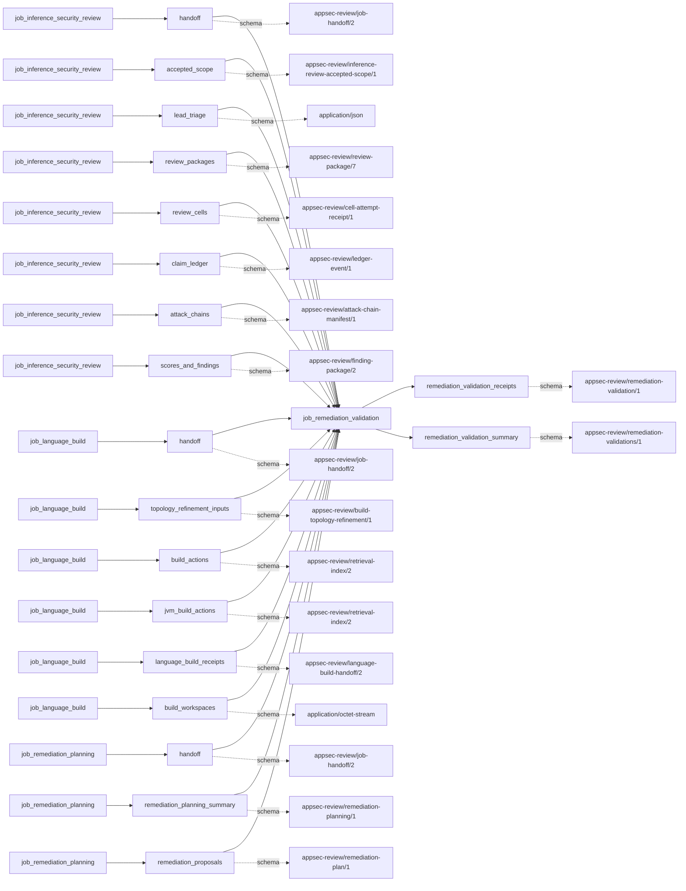
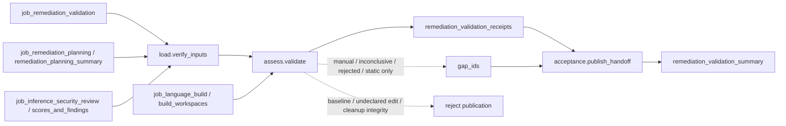

# remediation_validation

## Purpose

Validate an accepted inert remediation proposal through exact scratch application, independent
semantic assessment and, where commissioned and safe, before/after native syntax checks.
`build_checked` is not runtime proof, a fixed finding or a changed ship-block decision.
Generated regression specifications remain unexecuted.

<!-- generated:begin job=job_remediation_validation -->
<!-- generated from: appsec-review.toml, containers/catalog.toml, pipeline/guidance/registry.json, tests/job-test-map.json, src/appsec_review/runtime/registry.py, src/appsec_review/runtime/contracts.py, src/appsec_review/runtime/datasets.py, src/appsec_review/guidance/workers.py, src/appsec_review/mcp/schema.py, src/appsec_review/orchestration/topology.py, src/appsec_review/orchestration/dagster/adapter.py by scripts/generate-docs.py; do not edit -->
## Declared job contract

remediation_validation

Job: `job_remediation_validation`. Enabled in the dev recipe: **true**.
Declarations describe possible work, not successful execution or consumed evidence.

### Steps and tasks

| Step | Task | Workers | Pool | Bound tool or gap | Handler |
| --- | --- | --- | --- | --- | --- |
| `acceptance` | `acceptance.publish_handoff` | 1 | `lifecycle` | Undeclared ([T-147](../TODO.md)) | [source](../../src/appsec_review/jobs/job_remediation_validation/job.py#L298) |
| `assess` | `assess.validate` | 1 | `inference_teams` | Undeclared ([T-147](../TODO.md)) | [source](../../src/appsec_review/jobs/job_remediation_validation/job.py#L281) |
| `load` | `load.verify_inputs` | 1 | `application` | Undeclared ([T-147](../TODO.md)) | [source](../../src/appsec_review/jobs/job_remediation_validation/job.py#L83) |

### Accepted input declarations

| Producer | Dataset | Schema | Channel | Availability | Missing policy |
| --- | --- | --- | --- | --- | --- |
| `job_inference_security_review` | `handoff` | `appsec-review/job-handoff/2` | handoff | required | reject |
| `job_inference_security_review` | `accepted_scope` | `appsec-review/inference-review-accepted-scope/1` | handoff | optional | gap |
| `job_inference_security_review` | `lead_triage` | `application/json` | handoff | optional | gap |
| `job_inference_security_review` | `review_packages` | `appsec-review/review-package/7` | handoff | optional | gap |
| `job_inference_security_review` | `review_cells` | `appsec-review/cell-attempt-receipt/1` | handoff | optional | gap |
| `job_inference_security_review` | `claim_ledger` | `appsec-review/ledger-event/1` | handoff | optional | gap |
| `job_inference_security_review` | `attack_chains` | `appsec-review/attack-chain-manifest/1` | handoff | optional | gap |
| `job_inference_security_review` | `scores_and_findings` | `appsec-review/finding-package/2` | handoff | optional | gap |
| `job_language_build` | `handoff` | `appsec-review/job-handoff/2` | handoff | optional | gap |
| `job_language_build` | `topology_refinement_inputs` | `appsec-review/build-topology-refinement/1` | handoff | optional | gap |
| `job_language_build` | `build_actions` | `appsec-review/retrieval-index/2` | handoff | optional | gap |
| `job_language_build` | `jvm_build_actions` | `appsec-review/retrieval-index/2` | handoff | optional | gap |
| `job_language_build` | `language_build_receipts` | `appsec-review/language-build-handoff/2` | handoff | optional | gap |
| `job_language_build` | `build_workspaces` | `application/octet-stream` | handoff | optional | gap |
| `job_remediation_planning` | `handoff` | `appsec-review/job-handoff/2` | handoff | required | reject |
| `job_remediation_planning` | `remediation_planning_summary` | `appsec-review/remediation-planning/1` | handoff | optional | gap |
| `job_remediation_planning` | `remediation_proposals` | `appsec-review/remediation-plan/1` | handoff | optional | gap |

### Published dataset declarations

| Dataset | Step | Schema | Stage | Indexes | MCP route |
| --- | --- | --- | --- | --- | --- |
| `remediation_validation_receipts` | `assess` | `appsec-review/remediation-validation/1` | protected | Not indexed | `coverage`, `query_dataset_inventory` |
| `remediation_validation_summary` | `acceptance` | `appsec-review/remediation-validations/1` | artifact_only | Not indexed | `coverage`, `query_dataset_inventory` |

Protected and artifact-only routes expose sanitized metadata, not payload access.

### Model and guidance declarations

These are job-level declarations; exact per-task selection is not declared ([T-147](../TODO.md)).

```json
{}
```

- Role: [remediation_reviewer](../generated/guidance.md#roles-remediation_reviewer).
- Task prompt: `remediation_assessment`.
- Runtime skill: [stateful-invariant-analysis](../generated/guidance.md#runtime_skills-stateful-invariant-analysis).

### Test selection

| Tier | Files or selectors |
| --- | --- |
| acceptance | `tests/test_remediation_jobs.py::test_real_runner_publishes_build_checked_without_changing_original_state_or_shipment` |
| integration | None declared |
| live | None declared |
| unit | `tests/test_remediation_patches.py` |

### Dagster placement

Dispatch: `review_graph`. Review graph member: **true**. Enabled graph member: **true**.

Declared predecessors: `job_remediation_planning`.

### Declared dataflow



<!-- generated:end -->

## Process

See the [handler](../../src/appsec_review/jobs/job_remediation_validation/job.py),
[compiler adapter](../../src/appsec_review/jobs/job_remediation_validation/compiler.py) and
[workspace custody](../../src/appsec_review/jobs/job_remediation_validation/workspace.py).

### `load`

1. In `load.verify_inputs`, verify the accepted review and planning handoff, including their
   exact confirmed-finding partition and planning-to-review identity.
2. Record bounded candidate/proposal counts and write an immutable input snapshot.
   Missing required producers or incompatible accepted artifacts fail admission.

### `assess`

1. In `assess.validate`, emit one outcome for every planning item. Candidate overflow and missing
   proposals remain `manual_validation_required` with explicit reasons.
2. Verify each plan, adjudication, evidence relations and source context against the accepted
   finding. Parse the exact patch; reject changed baseline hashes, fuzzy edits or invalid scope.
3. Require a single accepted build unit. Send executable build/tool configuration mutations and
   multi-build proposals to manual validation, not an invented adapter.
4. Materialize bounded baseline and patched scratch workspaces. Apply exact declared edits only;
   verify untouched files and absence proofs. Check UTF-8 source policy, NUL bytes, new conflict
   markers and the declared edit set.
5. Ask the independent reviewer about the accepted invariant, evidence and patch. Missing/unresolved
   review is `inconclusive`; contradiction is `rejected`. A supported assessment permits
   `static_checked`, not an assertion of a successful fix.
6. Only if `native_syntax` is commissioned and every changed file is the accepted exact
   translation unit, compare identical pinned before/after syntax checks. Baseline failure is
   inconclusive; patched failure is rejected; unsafe replay needs manual validation.
   Both passing gives `build_checked`, with no linking or runtime regression.
7. Always clean scratch state and retain cleanup/check receipts. Failed cleanup or compiler
   modification of source is an integrity failure. Preserve regression-compile and runtime
   dimensions as not performed rather than filling them with a passing value.

### `acceptance`

1. In `acceptance.publish_handoff`, reload review and planning and require both accepted pins to
   match the loaded snapshot. Reverify review and validation/check/cleanup references.
2. Require exactly one ordered outcome for each planning finding triple; validate each document.
3. Publish immutable `remediation_validation_summary` with row gaps. Empty intake is `SKIPPED_NA`;
   neither empty nor build-checked output modifies adjudication or shipment state.

## Dataflow



Source access follows [accepted input admission](../architecture/job-input-contracts.md#admission-and-read-receipts).
Native execution uses the accepted build's [pinned image](image-pin-verification.md#the-gate)
and [signing enforcement](signing.md#container-images), not an arbitrary compiler command.

## Gaps

These are legacy row/plan strings, without a producer-supplied retryability classification.
See [canonical outcome semantics](../architecture/job-interchange.md#the-control-layer-beneath-the-envelope).

| Reason or outcome | Scope and walk meaning |
| --- | --- |
| `remediation_validation:<claim>:candidate_bound_reached`, `proposal_unavailable` | Candidate never reached substantive validation. |
| `remediation_validation:<claim>:<status>` for non-`build_checked` status | Named candidate lacks the strongest commissioned compile-only result. |
| `run_owned_source_unavailable`, `multi_build_proposal_requires_manual_validation`, workspace-limit reason | Source or adapter scope unavailable. |
| `unsafe_build_configuration_mutation`, `patch_scope_not_covered_by_native_adapter`, `accepted_build_profile_uncommissioned`, `accepted_build_replay_unsafe` | Manual validation boundary, not a successful bypass. |
| `patch_rejected`, `static_patch_policy_failed`, `analyst_assessed_contradicted`, `patched_build_failed` | Proposal rejected; the original vulnerability claim is not refuted by this. |
| `independent_semantic_review_unavailable`, `analyst_assessed_unresolved`, `baseline_build_failed` | Inconclusive evidence, not proof the patch fails or succeeds. |
| `selected_static_checks_only`, `build_unavailable_static_checks_only` | Static/semantic subset only; inspect individual check states. |
| Inherited plan/source gaps | Retain planning coverage limitations. |

The runtime-regression policy notice and uncommissioned regression compilation are explicit check
dimensions, not invented producer-gap codes. Integrity/admission failures block publication.
Cross-revision fixed-state verification is separately tracked by [T-061/T-074](../TODO.md);
this compile-only job does not implement that verdict.

## Acceptance

1. **A. Inputs:** Compare review/planning pins, finding/adjudication identities, patch/source hashes,
   build command/image identity and configured adapters with the admitted snapshot.
2. **B. Independent comparison:** Independently enumerate planning items and require one validation
   row each. Compare exact edits and scratch manifests with the accepted baseline; inspect
   semantic citations and before/after compiler receipts. Require identical compiler conditions,
   unchanged original source, successful cleanup and explicit nonexecution dimensions.
3. **C. Gaps:** Reconcile canonical outcomes with row reasons and each check's status. Distinguish
   baseline failure, patch failure, manual policy boundary and static-only coverage. Stop on
   unexpected causes; `build_checked` never substitutes for runtime proof.
4. **D. Baseline:** Save an authorized `stepwise.py accept` baseline and corpus namespace with
   plan/validation hashes, outcome partition and per-check evidence. Preserve the unchanged
   review state and shipment decisions in the comparison.

## Resume and invalidation

No standalone validation semantic cache is implemented. [Runtime reuse](../architecture/jobs-and-runtime.md#wave-1-resumability)
binds review/planning/build handoffs, source, settings and component identities. A changed patch,
baseline, reviewer guidance or adapter policy invalidates its validation, not the original
finding. The job reloads accepted inputs at publication and refuses to overwrite attempt-owned
artifacts. Scratch workspaces must be recreated and cleaned; artifact/check receipts are not
portable failed-attempt checkpoints.

## Model usage

The selected [remediation_reviewer](../generated/guidance.md#roles-remediation_reviewer) receives
accepted evidence, the invariant and exact patch, independently of the planning conversation.
No persona or stack is selected. Its closed answer cites accepted relation IDs and classifies
semantic support, contradiction or uncertainty; it cannot change claim state or commission
runtime tests. See [worker contracts](../architecture/worker-prompt-contracts.md#dispatch-inventory)
and [pinned guidance](../architecture/guidance-procedures.md#selection-and-provenance).
