# review_data_indexing

## Purpose

Reconcile accepted producer datasets, build bounded cross-domain links and stage-1 query products,
and publish a queryable inventory with coverage matrices. The inventory distinguishes declared,
available, consumed and cited evidence. Derived facts are not scanner findings, and an audit
violation blocks index acceptance rather than becoming a successful empty inventory.

<!-- generated:begin job=job_review_data_indexing -->
<!-- generated from: appsec-review.toml, containers/catalog.toml, pipeline/guidance/registry.json, tests/job-test-map.json, src/appsec_review/runtime/registry.py, src/appsec_review/runtime/contracts.py, src/appsec_review/runtime/datasets.py, src/appsec_review/guidance/workers.py, src/appsec_review/mcp/schema.py, src/appsec_review/orchestration/topology.py, src/appsec_review/orchestration/dagster/adapter.py by scripts/generate-docs.py; do not edit -->
## Declared job contract

review_data_indexing

Job: `job_review_data_indexing`. Enabled in the dev recipe: **true**.
Declarations describe possible work, not successful execution or consumed evidence.

### Steps and tasks

| Step | Task | Workers | Pool | Bound tool or gap | Handler |
| --- | --- | --- | --- | --- | --- |
| `audit` | `audit.inventory` | 1 | `application` | Undeclared ([T-147](../TODO.md)) | [source](../../src/appsec_review/jobs/job_review_data_indexing/job.py#L455) |
| `fts` | `fts.image_validation` | 1 | `application` | Undeclared ([T-147](../TODO.md)) | [source](../../src/appsec_review/jobs/job_review_data_indexing/job.py#L420) |
| `links` | `links.cross_domain` | 1 | `application` | Undeclared ([T-147](../TODO.md)) | [source](../../src/appsec_review/jobs/job_review_data_indexing/job.py#L320) |
| `load` | `load.accepted_inputs` | 1 | `application` | Undeclared ([T-147](../TODO.md)) | [source](../../src/appsec_review/jobs/job_review_data_indexing/job.py#L258) |
| `matrix` | `matrix.coverage` | 1 | `application` | Undeclared ([T-147](../TODO.md)) | [source](../../src/appsec_review/jobs/job_review_data_indexing/job.py#L500) |
| `precompute` | `precompute.artifact_inventory` | 1 | `application` | Undeclared ([T-147](../TODO.md)) | [source](../../src/appsec_review/jobs/job_review_data_indexing/job.py#L340) |
| `precompute` | `precompute.build_provenance` | 1 | `application` | Undeclared ([T-147](../TODO.md)) | [source](../../src/appsec_review/jobs/job_review_data_indexing/job.py#L340) |
| `precompute` | `precompute.ci_trust` | 1 | `application` | Undeclared ([T-147](../TODO.md)) | [source](../../src/appsec_review/jobs/job_review_data_indexing/job.py#L340) |
| `precompute` | `precompute.control_evidence` | 1 | `application` | Undeclared ([T-147](../TODO.md)) | [source](../../src/appsec_review/jobs/job_review_data_indexing/job.py#L340) |
| `precompute` | `precompute.dependency_advisories` | 1 | `application` | Undeclared ([T-147](../TODO.md)) | [source](../../src/appsec_review/jobs/job_review_data_indexing/job.py#L340) |
| `precompute` | `precompute.document_context` | 1 | `application` | Undeclared ([T-147](../TODO.md)) | [source](../../src/appsec_review/jobs/job_review_data_indexing/job.py#L340) |
| `precompute` | `precompute.history_context` | 1 | `application` | Undeclared ([T-147](../TODO.md)) | [source](../../src/appsec_review/jobs/job_review_data_indexing/job.py#L340) |
| `precompute` | `precompute.reference_intelligence` | 1 | `application` | Undeclared ([T-147](../TODO.md)) | [source](../../src/appsec_review/jobs/job_review_data_indexing/job.py#L340) |
| `precompute` | `precompute.scanner_correlation` | 1 | `application` | Undeclared ([T-147](../TODO.md)) | [source](../../src/appsec_review/jobs/job_review_data_indexing/job.py#L340) |
| `precompute` | `precompute.symbol_links` | 1 | `application` | Undeclared ([T-147](../TODO.md)) | [source](../../src/appsec_review/jobs/job_review_data_indexing/job.py#L340) |
| `publish` | `publish.inventory_index` | 1 | `index` | Undeclared ([T-147](../TODO.md)) | [source](../../src/appsec_review/jobs/job_review_data_indexing/job.py#L537) |

### Accepted input declarations

| Producer | Dataset | Schema | Channel | Availability | Missing policy |
| --- | --- | --- | --- | --- | --- |
| `job_model_connectivity` | `handoff` | `appsec-review/job-handoff/2` | handoff | optional | gap |
| `job_model_connectivity` | `model_connectivity` | `appsec-review/model-preflight/1` | handoff | optional | gap |
| `job_image_pin_verification` | `handoff` | `appsec-review/job-handoff/2` | handoff | optional | gap |
| `job_image_pin_verification` | `image_pin_verification` | `appsec-review/image-pin-verification/1` | handoff | optional | gap |
| `job_target_acquisition` | `handoff` | `appsec-review/job-handoff/2` | handoff | optional | gap |
| `job_target_acquisition` | `target_acquisition` | `appsec-review/target-acquisition-job/2` | handoff | optional | gap |
| `job_artifact_indexing` | `handoff` | `appsec-review/job-handoff/2` | handoff | optional | gap |
| `job_artifact_indexing` | `artifact_catalog` | `appsec-review/retrieval-index/2` | handoff | optional | gap |
| `job_artifact_indexing` | `archive_members` | `appsec-review/retrieval-index/2` | handoff | optional | gap |
| `job_artifact_indexing` | `artifact_relationships` | `appsec-review/retrieval-index/2` | handoff | optional | gap |
| `job_artifact_indexing` | `artifact_index_summary` | `appsec-review/artifact-indexing/1` | handoff | optional | gap |
| `job_artifact_security_analysis` | `handoff` | `appsec-review/job-handoff/2` | handoff | optional | gap |
| `job_artifact_security_analysis` | `artifact_security_observations` | `appsec-review/retrieval-index/2` | handoff | optional | gap |
| `job_artifact_security_analysis` | `artifact_security_results` | `appsec-review/artifact-security-observation/1` | handoff | optional | gap |
| `job_artifact_security_analysis` | `artifact_scanner_io` | `appsec-review/container-execution/1` | handoff | optional | gap |
| `job_binary_evidence_indexing` | `handoff` | `appsec-review/job-handoff/2` | handoff | optional | gap |
| `job_binary_evidence_indexing` | `binary_functions` | `appsec-review/retrieval-index/2` | handoff | optional | gap |
| `job_binary_evidence_indexing` | `binary_pseudo_c` | `appsec-review/binary-source-backing/1` | handoff | optional | gap |
| `job_binary_evidence_indexing` | `binary_evidence_summary` | `appsec-review/binary-evidence-index/1` | handoff | optional | gap |
| `job_build_environment_analysis` | `handoff` | `appsec-review/job-handoff/2` | handoff | optional | gap |
| `job_build_environment_analysis` | `build_environment` | `appsec-review/build-environment-analysis/1` | handoff | optional | gap |
| `job_change_context_analysis` | `handoff` | `appsec-review/job-handoff/2` | handoff | optional | gap |
| `job_change_context_analysis` | `change_context` | `appsec-review/retrieval-index/2` | handoff | optional | gap |
| `job_change_context_analysis` | `change_context_documents` | `appsec-review/change-context-analysis/1` | handoff | optional | gap |
| `job_change_context_analysis` | `operator_exports` | `application/json` | handoff | optional | gap |
| `job_change_context_analysis` | `change_context_tool_io` | `appsec-review/container-execution/1` | handoff | optional | gap |
| `job_ci_configuration_analysis` | `handoff` | `appsec-review/job-handoff/2` | handoff | optional | gap |
| `job_ci_configuration_analysis` | `ci_observations` | `appsec-review/retrieval-index/2` | handoff | optional | gap |
| `job_ci_configuration_analysis` | `ci_findings` | `appsec-review/retrieval-index/2` | handoff | optional | gap |
| `job_ci_configuration_analysis` | `ci_documents` | `appsec-review/ci-configuration-analysis-handoff/1` | handoff | optional | gap |
| `job_ci_configuration_analysis` | `ci_tool_io` | `appsec-review/container-execution/1` | handoff | optional | gap |
| `job_clang_static_analysis` | `handoff` | `appsec-review/job-handoff/2` | handoff | optional | gap |
| `job_clang_static_analysis` | `clang_static_observations` | `appsec-review/retrieval-index/2` | handoff | optional | gap |
| `job_clang_static_analysis` | `clang_static_scope_coverage` | `appsec-review/cpp-index-coverage/1` | handoff | optional | gap |
| `job_clang_static_analysis` | `clang_static_summary` | `appsec-review/clang-static-analysis-handoff/1` | handoff | optional | gap |
| `job_clang_static_analysis` | `clang_static_raw` | `application/json` | handoff | optional | gap |
| `job_code_graph_index` | `handoff` | `appsec-review/job-handoff/2` | handoff | optional | gap |
| `job_code_graph_index` | `code_graph_facts` | `appsec-review/graph-fact/1` | handoff | optional | gap |
| `job_code_graph_index` | `code_graph_stages` | `appsec-review/code-graph-stage/1` | handoff | optional | gap |
| `job_code_graph_index` | `code_graph_checkpoints` | `appsec-review/code-graph-checkpoint/1` | handoff | optional | gap |
| `job_code_graph_index` | `code_graph_summary` | `appsec-review/code-graph-index/1` | handoff | optional | gap |
| `job_codeql_analysis` | `handoff` | `appsec-review/job-handoff/2` | handoff | optional | gap |
| `job_codeql_analysis` | `codeql_predecessor_import` | `appsec-review/codeql-predecessor-import/1` | handoff | optional | gap |
| `job_codeql_analysis` | `codeql_graph_export` | `appsec-review/codeql-graph-export/1` | handoff | optional | gap |
| `job_codeql_analysis` | `codeql_observations` | `appsec-review/codeql-sarif-normalizer/3` | handoff | optional | gap |
| `job_codeql_analysis` | `codeql_plan_and_summary` | `appsec-review/codeql-analysis-handoff/1` | handoff | optional | gap |
| `job_codeql_analysis` | `codeql_scope_material` | `application/octet-stream` | handoff | optional | gap |
| `job_cpg_analysis` | `handoff` | `appsec-review/job-handoff/2` | handoff | optional | gap |
| `job_cpg_analysis` | `cpg_graph_coverage` | `appsec-review/retrieval-index/2` | handoff | optional | gap |
| `job_cpg_analysis` | `cpg_scope_coverage` | `appsec-review/cpp-index-coverage/1` | handoff | optional | gap |
| `job_cpg_analysis` | `cpg_summary` | `appsec-review/cpg-analysis/1` | handoff | optional | gap |
| `job_cpg_analysis` | `cpg_binary` | `application/octet-stream` | handoff | optional | gap |
| `job_cpp_compiled_analysis` | `handoff` | `appsec-review/job-handoff/2` | handoff | optional | gap |
| `job_cpp_compiled_analysis` | `cpp_build_graph` | `appsec-review/retrieval-index/2` | handoff | optional | gap |
| `job_cpp_compiled_analysis` | `clang_ast` | `appsec-review/retrieval-index/2` | handoff | optional | gap |
| `job_cpp_compiled_analysis` | `llvm_ir` | `appsec-review/retrieval-index/2` | handoff | optional | gap |
| `job_cpp_compiled_analysis` | `infer_observations` | `appsec-review/retrieval-index/2` | handoff | optional | gap |
| `job_cpp_compiled_analysis` | `binary_symbols` | `appsec-review/retrieval-index/2` | handoff | optional | gap |
| `job_cpp_compiled_analysis` | `cpp_blocked_branches` | `appsec-review/retrieval-index/2` | handoff | optional | gap |
| `job_cpp_compiled_analysis` | `cpp_plan_and_summary` | `appsec-review/cpp-compiled-analysis/2` | handoff | optional | gap |
| `job_cpp_compiled_analysis` | `cpp_case_material` | `application/octet-stream` | handoff | optional | gap |
| `job_cpp_symbol_index` | `handoff` | `appsec-review/job-handoff/2` | handoff | optional | gap |
| `job_cpp_symbol_index` | `clangd_symbols` | `appsec-review/retrieval-index/2` | handoff | optional | gap |
| `job_cpp_symbol_index` | `clangd_coverage` | `appsec-review/cpp-index-coverage/1` | handoff | optional | gap |
| `job_cpp_symbol_index` | `clangd_summary` | `appsec-review/cpp-symbol-index/1` | handoff | optional | gap |
| `job_cpp_symbol_index` | `clangd_tool_io` | `appsec-review/container-execution/1` | handoff | optional | gap |
| `job_debug_symbol_indexing` | `handoff` | `appsec-review/job-handoff/2` | handoff | optional | gap |
| `job_debug_symbol_indexing` | `normalized_symbols` | `appsec-review/retrieval-index/2` | handoff | optional | gap |
| `job_debug_symbol_indexing` | `symbol_coverage` | `appsec-review/debug-symbol-coverage/1` | handoff | optional | gap |
| `job_debug_symbol_indexing` | `target_decision` | `appsec-review/debug-symbol-decision/2` | handoff | optional | gap |
| `job_debug_symbol_indexing` | `raw_artifact_refs` | `appsec-review/debug-symbol-inputs/1` | handoff | optional | gap |
| `job_debug_symbol_indexing` | `reader_executions` | `appsec-review/container-execution/1` | handoff | optional | gap |
| `job_debug_symbol_indexing` | `debug_symbol_summary` | `appsec-review/debug-symbol-indexing/1` | handoff | optional | gap |
| `job_dependency_intelligence` | `handoff` | `appsec-review/job-handoff/2` | handoff | optional | gap |
| `job_dependency_intelligence` | `native_discovery` | `appsec-review/native-discovery/1` | handoff | optional | gap |
| `job_dependency_intelligence` | `native_component_curation` | `appsec-review/native-component-curation/1` | handoff | optional | gap |
| `job_dependency_intelligence` | `native_metadata_investigation` | `appsec-review/native-metadata-investigation/1` | handoff | optional | gap |
| `job_dependency_intelligence` | `native_inference_metrics` | `appsec-review/native-inference-metrics/1` | handoff | optional | gap |
| `job_dependency_intelligence` | `native_spdx` | `SPDX-2.3` | handoff | optional | gap |
| `job_dependency_intelligence` | `native_sbom_provenance` | `appsec-review/native-sbom-provenance/1` | handoff | optional | gap |
| `job_dependency_intelligence` | `native_sbom_metrics` | `appsec-review/native-sbom-metrics/1` | handoff | optional | gap |
| `job_dependency_intelligence` | `dependency_context` | `appsec-review/retrieval-index/2` | handoff | optional | gap |
| `job_dependency_intelligence` | `scorecard_responses` | `application/json` | handoff | optional | gap |
| `job_dependency_intelligence` | `dependency_intelligence_handoff` | `appsec-review/dependency-intelligence-handoff/1` | handoff | optional | gap |
| `job_evidence_collection` | `handoff` | `appsec-review/job-handoff/2` | handoff | optional | gap |
| `job_evidence_collection` | `static_tool_observations` | `appsec-review/retrieval-index/2` | handoff | optional | gap |
| `job_evidence_collection` | `static_tool_evidence` | `appsec-review/static-tool-evidence/2` | handoff | optional | gap |
| `job_evidence_collection` | `static_tool_io` | `appsec-review/container-execution/1` | handoff | optional | gap |
| `job_language_build` | `handoff` | `appsec-review/job-handoff/2` | handoff | optional | gap |
| `job_language_build` | `topology_refinement_inputs` | `appsec-review/build-topology-refinement/1` | handoff | optional | gap |
| `job_language_build` | `build_actions` | `appsec-review/retrieval-index/2` | handoff | optional | gap |
| `job_language_build` | `jvm_build_actions` | `appsec-review/retrieval-index/2` | handoff | optional | gap |
| `job_language_build` | `language_build_receipts` | `appsec-review/language-build-handoff/2` | handoff | optional | gap |
| `job_language_build` | `build_workspaces` | `application/octet-stream` | handoff | optional | gap |
| `job_owasp_control_assessment` | `handoff` | `appsec-review/job-handoff/2` | handoff | optional | gap |
| `job_owasp_control_assessment` | `owasp_model_receipts` | `appsec-review/owasp-model-receipt/1` | handoff | optional | gap |
| `job_owasp_control_assessment` | `owasp_workbench` | `appsec-review/owasp-index-shard/1` | handoff | optional | gap |
| `job_owasp_control_assessment` | `owasp_documents` | `appsec-review/owasp-workbench-result/1` | handoff | optional | gap |
| `job_post_build_security_assessment` | `handoff` | `appsec-review/job-handoff/2` | handoff | optional | gap |
| `job_post_build_security_assessment` | `build_security` | `appsec-review/retrieval-index/2` | handoff | optional | gap |
| `job_post_build_security_assessment` | `build_security_documents` | `appsec-review/post-build-security-assessment/1` | handoff | optional | gap |
| `job_profile_data` | `handoff` | `appsec-review/job-handoff/2` | handoff | optional | gap |
| `job_profile_data` | `profile_data` | `appsec-review/retrieval-index/2` | handoff | optional | gap |
| `job_profile_data` | `profile_data_handoff` | `appsec-review/profile-data-handoff/1` | handoff | optional | gap |
| `job_project_build` | `handoff` | `appsec-review/job-handoff/2` | handoff | optional | gap |
| `job_project_build` | `topology_refinement_inputs` | `appsec-review/build-topology-refinement/1` | handoff | optional | gap |
| `job_project_build` | `project_build_dispatch` | `appsec-review/project-build-dispatch/3` | handoff | optional | gap |
| `job_project_build` | `probe_workspaces` | `application/octet-stream` | handoff | optional | gap |
| `job_project_build` | `image_build_streams` | `text/plain` | handoff | optional | gap |
| `job_review_intake` | `handoff` | `appsec-review/job-handoff/2` | handoff | optional | gap |
| `job_review_intake` | `model_preflight` | `appsec-review/model-preflight/1` | handoff | optional | gap |
| `job_review_intake` | `binary_evidence` | `appsec-review/binary-evidence-intake/1` | handoff | optional | gap |
| `job_review_intake` | `review_intake` | `appsec-review/review-intake/1` | handoff | optional | gap |
| `job_review_prioritization` | `handoff` | `appsec-review/job-handoff/2` | handoff | optional | gap |
| `job_review_prioritization` | `priority_items` | `appsec-review/retrieval-index/2` | handoff | optional | gap |
| `job_review_prioritization` | `prioritization_documents` | `appsec-review/review-prioritization/1` | handoff | optional | gap |
| `job_sanitizer_build` | `handoff` | `appsec-review/job-handoff/2` | handoff | optional | gap |
| `job_sanitizer_build` | `sanitizer_build_summary` | `appsec-review/sanitizer-build-handoff/1` | handoff | optional | gap |
| `job_sanitizer_build` | `sanitizer_build_workspaces` | `application/octet-stream` | handoff | optional | gap |
| `job_security_tagging` | `handoff` | `appsec-review/job-handoff/2` | handoff | optional | gap |
| `job_security_tagging` | `tag_assignments` | `appsec-review/tag-assignment/1` | handoff | optional | gap |
| `job_security_tagging` | `tagging_documents` | `appsec-review/security-tagging-handoff/1` | handoff | optional | gap |
| `job_source_history_analysis` | `handoff` | `appsec-review/job-handoff/2` | handoff | optional | gap |
| `job_source_history_analysis` | `history_signals` | `appsec-review/retrieval-index/2` | handoff | optional | gap |
| `job_source_history_analysis` | `history_documents` | `appsec-review/source-history-analysis/2` | handoff | optional | gap |
| `job_source_history_analysis` | `raw_git_history` | `application/octet-stream` | handoff | optional | gap |
| `job_source_history_analysis` | `history_tool_io` | `appsec-review/container-execution/1` | handoff | optional | gap |
| `job_svf_alias_analysis` | `handoff` | `appsec-review/job-handoff/2` | handoff | optional | gap |
| `job_svf_alias_analysis` | `svf_alias_sets` | `appsec-review/retrieval-index/2` | handoff | optional | gap |
| `job_svf_alias_analysis` | `svf_alias_scope_coverage` | `appsec-review/cpp-index-coverage/1` | handoff | optional | gap |
| `job_svf_alias_analysis` | `svf_alias_summary` | `appsec-review/svf-alias-analysis-handoff/1` | handoff | optional | gap |
| `job_svf_alias_analysis` | `svf_alias_raw` | `application/json` | handoff | optional | gap |
| `job_target_analysis_plan` | `handoff` | `appsec-review/job-handoff/2` | handoff | optional | gap |
| `job_target_analysis_plan` | `planning_feedback_cache` | `appsec-review/target-analysis-proposal/3` | handoff | optional | gap |
| `job_target_analysis_plan` | `analysis_plan` | `appsec-review/retrieval-index/2` | handoff | optional | gap |
| `job_target_analysis_plan` | `analysis_plan_documents` | `appsec-review/target-analysis-plan/1` | handoff | optional | gap |
| `job_target_catalog` | `handoff` | `appsec-review/job-handoff/2` | handoff | optional | gap |
| `job_target_catalog` | `target_artifact_inputs` | `appsec-review/target-artifact-intake/1` | handoff | optional | gap |
| `job_target_catalog` | `source_files` | `appsec-review/retrieval-index/2` | handoff | optional | gap |
| `job_target_catalog` | `declaration_symbols` | `appsec-review/retrieval-index/2` | handoff | optional | gap |
| `job_target_catalog` | `components` | `appsec-review/retrieval-index/2` | handoff | optional | gap |
| `job_target_catalog` | `target_documents` | `appsec-review/retrieval-index/2` | handoff | optional | gap |
| `job_target_catalog` | `build_units` | `appsec-review/retrieval-index/2` | handoff | optional | gap |
| `job_target_catalog` | `catalog_documents` | `appsec-review/target-catalog/1` | handoff | optional | gap |
| `job_test_coverage` | `handoff` | `appsec-review/job-handoff/2` | handoff | optional | gap |
| `job_test_coverage` | `test_coverage` | `appsec-review/retrieval-index/2` | handoff | optional | gap |
| `job_test_coverage` | `test_coverage_handoff` | `appsec-review/test-coverage-handoff/1` | handoff | optional | gap |
| `job_tree_sitter_ast` | `handoff` | `appsec-review/job-handoff/2` | handoff | optional | gap |
| `job_tree_sitter_ast` | `tree_sitter_ast` | `appsec-review/tree-sitter-normalizer/1` | handoff | optional | gap |
| `job_tree_sitter_ast` | `tree_sitter_coverage` | `appsec-review/tree-sitter-ast/1` | handoff | optional | gap |
| `job_tree_sitter_ast` | `tree_sitter_node_shards` | `appsec-review/tree-sitter-ast/1` | handoff | optional | gap |
| `job_tree_sitter_ast` | `generated_source_backing` | `appsec-review/generated-source-backing/1` | handoff | optional | gap |
| `job_tree_sitter_ast` | `tree_sitter_tool_io` | `appsec-review/container-execution/1` | handoff | optional | gap |
| `job_third_party_data_sync` | `feed_snapshot` | `appsec-review/public-feed-use/1` | external | optional | gap |

### Published dataset declarations

| Dataset | Step | Schema | Stage | Indexes | MCP route |
| --- | --- | --- | --- | --- | --- |
| `accepted_input_summary` | `load` | `appsec-review/review-data-indexing-inputs/2` | artifact_only | Not indexed | `coverage`, `query_dataset_inventory` |
| `coverage_matrices` | `matrix` | `appsec-review/coverage-matrices/2` | artifact_only | Not indexed | `coverage`, `query_dataset_inventory` |
| `cross_domain_links` | `links` | `appsec-review/retrieval-index/2` | indexed | `links` | `find`, `trace` |
| `dataset_audit_report` | `audit` | `appsec-review/dataset-inventory/1` | artifact_only | Not indexed | `coverage`, `query_dataset_inventory` |
| `dataset_inventory` | `publish` | `appsec-review/retrieval-index/2` | indexed | `inventory` | `query_dataset_inventory` |
| `derived_checkpoints` | `precompute` | `appsec-review/derived-shard/1` | artifact_only | Not indexed | `coverage`, `query_dataset_inventory` |
| `fts_image_validation` | `fts` | `appsec-review/sqlite-fts-validation/1` | artifact_only | Not indexed | `coverage`, `query_dataset_inventory` |
| `precomputed_products` | `precompute` | `appsec-review/retrieval-index/2` | indexed | `precomputed` | `query_observations`, `query_precomputed` |

Protected and artifact-only routes expose sanitized metadata, not payload access.

### Model and guidance declarations

No job-level model declaration; absence of a task binding remains [T-147](../TODO.md), not a nonexecution claim.

### Test selection

| Tier | Files or selectors |
| --- | --- |
| acceptance | None declared |
| integration | None declared |
| live | None declared |
| unit | `tests/test_review_data_indexing.py::test_scanner_menu_partition_fits_review_package_page` |

### Dagster placement

Dispatch: `review_graph`. Review graph member: **true**. Enabled graph member: **true**.

Declared predecessors: `job_sanitizer_build`, `job_threat_model_generation`.

### Declared dataflow

```mermaid
flowchart LR
  job["job_review_data_indexing"]
  producer0["job_model_connectivity"]
  input0["handoff"]
  input_schema0["appsec-review/job-handoff/2"]
  producer0 --> input0 --> job
  input0 -. schema .-> input_schema0
  producer1["job_model_connectivity"]
  input1["model_connectivity"]
  input_schema1["appsec-review/model-preflight/1"]
  producer1 --> input1 --> job
  input1 -. schema .-> input_schema1
  producer2["job_image_pin_verification"]
  input2["handoff"]
  input_schema2["appsec-review/job-handoff/2"]
  producer2 --> input2 --> job
  input2 -. schema .-> input_schema2
  producer3["job_image_pin_verification"]
  input3["image_pin_verification"]
  input_schema3["appsec-review/image-pin-verification/1"]
  producer3 --> input3 --> job
  input3 -. schema .-> input_schema3
  producer4["job_target_acquisition"]
  input4["handoff"]
  input_schema4["appsec-review/job-handoff/2"]
  producer4 --> input4 --> job
  input4 -. schema .-> input_schema4
  producer5["job_target_acquisition"]
  input5["target_acquisition"]
  input_schema5["appsec-review/target-acquisition-job/2"]
  producer5 --> input5 --> job
  input5 -. schema .-> input_schema5
  producer6["job_artifact_indexing"]
  input6["handoff"]
  input_schema6["appsec-review/job-handoff/2"]
  producer6 --> input6 --> job
  input6 -. schema .-> input_schema6
  producer7["job_artifact_indexing"]
  input7["artifact_catalog"]
  input_schema7["appsec-review/retrieval-index/2"]
  producer7 --> input7 --> job
  input7 -. schema .-> input_schema7
  producer8["job_artifact_indexing"]
  input8["archive_members"]
  input_schema8["appsec-review/retrieval-index/2"]
  producer8 --> input8 --> job
  input8 -. schema .-> input_schema8
  producer9["job_artifact_indexing"]
  input9["artifact_relationships"]
  input_schema9["appsec-review/retrieval-index/2"]
  producer9 --> input9 --> job
  input9 -. schema .-> input_schema9
  producer10["job_artifact_indexing"]
  input10["artifact_index_summary"]
  input_schema10["appsec-review/artifact-indexing/1"]
  producer10 --> input10 --> job
  input10 -. schema .-> input_schema10
  producer11["job_artifact_security_analysis"]
  input11["handoff"]
  input_schema11["appsec-review/job-handoff/2"]
  producer11 --> input11 --> job
  input11 -. schema .-> input_schema11
  producer12["job_artifact_security_analysis"]
  input12["artifact_security_observations"]
  input_schema12["appsec-review/retrieval-index/2"]
  producer12 --> input12 --> job
  input12 -. schema .-> input_schema12
  producer13["job_artifact_security_analysis"]
  input13["artifact_security_results"]
  input_schema13["appsec-review/artifact-security-observation/1"]
  producer13 --> input13 --> job
  input13 -. schema .-> input_schema13
  producer14["job_artifact_security_analysis"]
  input14["artifact_scanner_io"]
  input_schema14["appsec-review/container-execution/1"]
  producer14 --> input14 --> job
  input14 -. schema .-> input_schema14
  producer15["job_binary_evidence_indexing"]
  input15["handoff"]
  input_schema15["appsec-review/job-handoff/2"]
  producer15 --> input15 --> job
  input15 -. schema .-> input_schema15
  producer16["job_binary_evidence_indexing"]
  input16["binary_functions"]
  input_schema16["appsec-review/retrieval-index/2"]
  producer16 --> input16 --> job
  input16 -. schema .-> input_schema16
  producer17["job_binary_evidence_indexing"]
  input17["binary_pseudo_c"]
  input_schema17["appsec-review/binary-source-backing/1"]
  producer17 --> input17 --> job
  input17 -. schema .-> input_schema17
  producer18["job_binary_evidence_indexing"]
  input18["binary_evidence_summary"]
  input_schema18["appsec-review/binary-evidence-index/1"]
  producer18 --> input18 --> job
  input18 -. schema .-> input_schema18
  producer19["job_build_environment_analysis"]
  input19["handoff"]
  input_schema19["appsec-review/job-handoff/2"]
  producer19 --> input19 --> job
  input19 -. schema .-> input_schema19
  producer20["job_build_environment_analysis"]
  input20["build_environment"]
  input_schema20["appsec-review/build-environment-analysis/1"]
  producer20 --> input20 --> job
  input20 -. schema .-> input_schema20
  producer21["job_change_context_analysis"]
  input21["handoff"]
  input_schema21["appsec-review/job-handoff/2"]
  producer21 --> input21 --> job
  input21 -. schema .-> input_schema21
  producer22["job_change_context_analysis"]
  input22["change_context"]
  input_schema22["appsec-review/retrieval-index/2"]
  producer22 --> input22 --> job
  input22 -. schema .-> input_schema22
  producer23["job_change_context_analysis"]
  input23["change_context_documents"]
  input_schema23["appsec-review/change-context-analysis/1"]
  producer23 --> input23 --> job
  input23 -. schema .-> input_schema23
  producer24["job_change_context_analysis"]
  input24["operator_exports"]
  input_schema24["application/json"]
  producer24 --> input24 --> job
  input24 -. schema .-> input_schema24
  producer25["job_change_context_analysis"]
  input25["change_context_tool_io"]
  input_schema25["appsec-review/container-execution/1"]
  producer25 --> input25 --> job
  input25 -. schema .-> input_schema25
  producer26["job_ci_configuration_analysis"]
  input26["handoff"]
  input_schema26["appsec-review/job-handoff/2"]
  producer26 --> input26 --> job
  input26 -. schema .-> input_schema26
  producer27["job_ci_configuration_analysis"]
  input27["ci_observations"]
  input_schema27["appsec-review/retrieval-index/2"]
  producer27 --> input27 --> job
  input27 -. schema .-> input_schema27
  producer28["job_ci_configuration_analysis"]
  input28["ci_findings"]
  input_schema28["appsec-review/retrieval-index/2"]
  producer28 --> input28 --> job
  input28 -. schema .-> input_schema28
  producer29["job_ci_configuration_analysis"]
  input29["ci_documents"]
  input_schema29["appsec-review/ci-configuration-analysis-handoff/1"]
  producer29 --> input29 --> job
  input29 -. schema .-> input_schema29
  producer30["job_ci_configuration_analysis"]
  input30["ci_tool_io"]
  input_schema30["appsec-review/container-execution/1"]
  producer30 --> input30 --> job
  input30 -. schema .-> input_schema30
  producer31["job_clang_static_analysis"]
  input31["handoff"]
  input_schema31["appsec-review/job-handoff/2"]
  producer31 --> input31 --> job
  input31 -. schema .-> input_schema31
  producer32["job_clang_static_analysis"]
  input32["clang_static_observations"]
  input_schema32["appsec-review/retrieval-index/2"]
  producer32 --> input32 --> job
  input32 -. schema .-> input_schema32
  producer33["job_clang_static_analysis"]
  input33["clang_static_scope_coverage"]
  input_schema33["appsec-review/cpp-index-coverage/1"]
  producer33 --> input33 --> job
  input33 -. schema .-> input_schema33
  producer34["job_clang_static_analysis"]
  input34["clang_static_summary"]
  input_schema34["appsec-review/clang-static-analysis-handoff/1"]
  producer34 --> input34 --> job
  input34 -. schema .-> input_schema34
  producer35["job_clang_static_analysis"]
  input35["clang_static_raw"]
  input_schema35["application/json"]
  producer35 --> input35 --> job
  input35 -. schema .-> input_schema35
  producer36["job_code_graph_index"]
  input36["handoff"]
  input_schema36["appsec-review/job-handoff/2"]
  producer36 --> input36 --> job
  input36 -. schema .-> input_schema36
  producer37["job_code_graph_index"]
  input37["code_graph_facts"]
  input_schema37["appsec-review/graph-fact/1"]
  producer37 --> input37 --> job
  input37 -. schema .-> input_schema37
  producer38["job_code_graph_index"]
  input38["code_graph_stages"]
  input_schema38["appsec-review/code-graph-stage/1"]
  producer38 --> input38 --> job
  input38 -. schema .-> input_schema38
  producer39["job_code_graph_index"]
  input39["code_graph_checkpoints"]
  input_schema39["appsec-review/code-graph-checkpoint/1"]
  producer39 --> input39 --> job
  input39 -. schema .-> input_schema39
  producer40["job_code_graph_index"]
  input40["code_graph_summary"]
  input_schema40["appsec-review/code-graph-index/1"]
  producer40 --> input40 --> job
  input40 -. schema .-> input_schema40
  producer41["job_codeql_analysis"]
  input41["handoff"]
  input_schema41["appsec-review/job-handoff/2"]
  producer41 --> input41 --> job
  input41 -. schema .-> input_schema41
  producer42["job_codeql_analysis"]
  input42["codeql_predecessor_import"]
  input_schema42["appsec-review/codeql-predecessor-import/1"]
  producer42 --> input42 --> job
  input42 -. schema .-> input_schema42
  producer43["job_codeql_analysis"]
  input43["codeql_graph_export"]
  input_schema43["appsec-review/codeql-graph-export/1"]
  producer43 --> input43 --> job
  input43 -. schema .-> input_schema43
  producer44["job_codeql_analysis"]
  input44["codeql_observations"]
  input_schema44["appsec-review/codeql-sarif-normalizer/3"]
  producer44 --> input44 --> job
  input44 -. schema .-> input_schema44
  producer45["job_codeql_analysis"]
  input45["codeql_plan_and_summary"]
  input_schema45["appsec-review/codeql-analysis-handoff/1"]
  producer45 --> input45 --> job
  input45 -. schema .-> input_schema45
  producer46["job_codeql_analysis"]
  input46["codeql_scope_material"]
  input_schema46["application/octet-stream"]
  producer46 --> input46 --> job
  input46 -. schema .-> input_schema46
  producer47["job_cpg_analysis"]
  input47["handoff"]
  input_schema47["appsec-review/job-handoff/2"]
  producer47 --> input47 --> job
  input47 -. schema .-> input_schema47
  producer48["job_cpg_analysis"]
  input48["cpg_graph_coverage"]
  input_schema48["appsec-review/retrieval-index/2"]
  producer48 --> input48 --> job
  input48 -. schema .-> input_schema48
  producer49["job_cpg_analysis"]
  input49["cpg_scope_coverage"]
  input_schema49["appsec-review/cpp-index-coverage/1"]
  producer49 --> input49 --> job
  input49 -. schema .-> input_schema49
  producer50["job_cpg_analysis"]
  input50["cpg_summary"]
  input_schema50["appsec-review/cpg-analysis/1"]
  producer50 --> input50 --> job
  input50 -. schema .-> input_schema50
  producer51["job_cpg_analysis"]
  input51["cpg_binary"]
  input_schema51["application/octet-stream"]
  producer51 --> input51 --> job
  input51 -. schema .-> input_schema51
  producer52["job_cpp_compiled_analysis"]
  input52["handoff"]
  input_schema52["appsec-review/job-handoff/2"]
  producer52 --> input52 --> job
  input52 -. schema .-> input_schema52
  producer53["job_cpp_compiled_analysis"]
  input53["cpp_build_graph"]
  input_schema53["appsec-review/retrieval-index/2"]
  producer53 --> input53 --> job
  input53 -. schema .-> input_schema53
  producer54["job_cpp_compiled_analysis"]
  input54["clang_ast"]
  input_schema54["appsec-review/retrieval-index/2"]
  producer54 --> input54 --> job
  input54 -. schema .-> input_schema54
  producer55["job_cpp_compiled_analysis"]
  input55["llvm_ir"]
  input_schema55["appsec-review/retrieval-index/2"]
  producer55 --> input55 --> job
  input55 -. schema .-> input_schema55
  producer56["job_cpp_compiled_analysis"]
  input56["infer_observations"]
  input_schema56["appsec-review/retrieval-index/2"]
  producer56 --> input56 --> job
  input56 -. schema .-> input_schema56
  producer57["job_cpp_compiled_analysis"]
  input57["binary_symbols"]
  input_schema57["appsec-review/retrieval-index/2"]
  producer57 --> input57 --> job
  input57 -. schema .-> input_schema57
  producer58["job_cpp_compiled_analysis"]
  input58["cpp_blocked_branches"]
  input_schema58["appsec-review/retrieval-index/2"]
  producer58 --> input58 --> job
  input58 -. schema .-> input_schema58
  producer59["job_cpp_compiled_analysis"]
  input59["cpp_plan_and_summary"]
  input_schema59["appsec-review/cpp-compiled-analysis/2"]
  producer59 --> input59 --> job
  input59 -. schema .-> input_schema59
  producer60["job_cpp_compiled_analysis"]
  input60["cpp_case_material"]
  input_schema60["application/octet-stream"]
  producer60 --> input60 --> job
  input60 -. schema .-> input_schema60
  producer61["job_cpp_symbol_index"]
  input61["handoff"]
  input_schema61["appsec-review/job-handoff/2"]
  producer61 --> input61 --> job
  input61 -. schema .-> input_schema61
  producer62["job_cpp_symbol_index"]
  input62["clangd_symbols"]
  input_schema62["appsec-review/retrieval-index/2"]
  producer62 --> input62 --> job
  input62 -. schema .-> input_schema62
  producer63["job_cpp_symbol_index"]
  input63["clangd_coverage"]
  input_schema63["appsec-review/cpp-index-coverage/1"]
  producer63 --> input63 --> job
  input63 -. schema .-> input_schema63
  producer64["job_cpp_symbol_index"]
  input64["clangd_summary"]
  input_schema64["appsec-review/cpp-symbol-index/1"]
  producer64 --> input64 --> job
  input64 -. schema .-> input_schema64
  producer65["job_cpp_symbol_index"]
  input65["clangd_tool_io"]
  input_schema65["appsec-review/container-execution/1"]
  producer65 --> input65 --> job
  input65 -. schema .-> input_schema65
  producer66["job_debug_symbol_indexing"]
  input66["handoff"]
  input_schema66["appsec-review/job-handoff/2"]
  producer66 --> input66 --> job
  input66 -. schema .-> input_schema66
  producer67["job_debug_symbol_indexing"]
  input67["normalized_symbols"]
  input_schema67["appsec-review/retrieval-index/2"]
  producer67 --> input67 --> job
  input67 -. schema .-> input_schema67
  producer68["job_debug_symbol_indexing"]
  input68["symbol_coverage"]
  input_schema68["appsec-review/debug-symbol-coverage/1"]
  producer68 --> input68 --> job
  input68 -. schema .-> input_schema68
  producer69["job_debug_symbol_indexing"]
  input69["target_decision"]
  input_schema69["appsec-review/debug-symbol-decision/2"]
  producer69 --> input69 --> job
  input69 -. schema .-> input_schema69
  producer70["job_debug_symbol_indexing"]
  input70["raw_artifact_refs"]
  input_schema70["appsec-review/debug-symbol-inputs/1"]
  producer70 --> input70 --> job
  input70 -. schema .-> input_schema70
  producer71["job_debug_symbol_indexing"]
  input71["reader_executions"]
  input_schema71["appsec-review/container-execution/1"]
  producer71 --> input71 --> job
  input71 -. schema .-> input_schema71
  producer72["job_debug_symbol_indexing"]
  input72["debug_symbol_summary"]
  input_schema72["appsec-review/debug-symbol-indexing/1"]
  producer72 --> input72 --> job
  input72 -. schema .-> input_schema72
  producer73["job_dependency_intelligence"]
  input73["handoff"]
  input_schema73["appsec-review/job-handoff/2"]
  producer73 --> input73 --> job
  input73 -. schema .-> input_schema73
  producer74["job_dependency_intelligence"]
  input74["native_discovery"]
  input_schema74["appsec-review/native-discovery/1"]
  producer74 --> input74 --> job
  input74 -. schema .-> input_schema74
  producer75["job_dependency_intelligence"]
  input75["native_component_curation"]
  input_schema75["appsec-review/native-component-curation/1"]
  producer75 --> input75 --> job
  input75 -. schema .-> input_schema75
  producer76["job_dependency_intelligence"]
  input76["native_metadata_investigation"]
  input_schema76["appsec-review/native-metadata-investigation/1"]
  producer76 --> input76 --> job
  input76 -. schema .-> input_schema76
  producer77["job_dependency_intelligence"]
  input77["native_inference_metrics"]
  input_schema77["appsec-review/native-inference-metrics/1"]
  producer77 --> input77 --> job
  input77 -. schema .-> input_schema77
  producer78["job_dependency_intelligence"]
  input78["native_spdx"]
  input_schema78["SPDX-2.3"]
  producer78 --> input78 --> job
  input78 -. schema .-> input_schema78
  producer79["job_dependency_intelligence"]
  input79["native_sbom_provenance"]
  input_schema79["appsec-review/native-sbom-provenance/1"]
  producer79 --> input79 --> job
  input79 -. schema .-> input_schema79
  producer80["job_dependency_intelligence"]
  input80["native_sbom_metrics"]
  input_schema80["appsec-review/native-sbom-metrics/1"]
  producer80 --> input80 --> job
  input80 -. schema .-> input_schema80
  producer81["job_dependency_intelligence"]
  input81["dependency_context"]
  input_schema81["appsec-review/retrieval-index/2"]
  producer81 --> input81 --> job
  input81 -. schema .-> input_schema81
  producer82["job_dependency_intelligence"]
  input82["scorecard_responses"]
  input_schema82["application/json"]
  producer82 --> input82 --> job
  input82 -. schema .-> input_schema82
  producer83["job_dependency_intelligence"]
  input83["dependency_intelligence_handoff"]
  input_schema83["appsec-review/dependency-intelligence-handoff/1"]
  producer83 --> input83 --> job
  input83 -. schema .-> input_schema83
  producer84["job_evidence_collection"]
  input84["handoff"]
  input_schema84["appsec-review/job-handoff/2"]
  producer84 --> input84 --> job
  input84 -. schema .-> input_schema84
  producer85["job_evidence_collection"]
  input85["static_tool_observations"]
  input_schema85["appsec-review/retrieval-index/2"]
  producer85 --> input85 --> job
  input85 -. schema .-> input_schema85
  producer86["job_evidence_collection"]
  input86["static_tool_evidence"]
  input_schema86["appsec-review/static-tool-evidence/2"]
  producer86 --> input86 --> job
  input86 -. schema .-> input_schema86
  producer87["job_evidence_collection"]
  input87["static_tool_io"]
  input_schema87["appsec-review/container-execution/1"]
  producer87 --> input87 --> job
  input87 -. schema .-> input_schema87
  producer88["job_language_build"]
  input88["handoff"]
  input_schema88["appsec-review/job-handoff/2"]
  producer88 --> input88 --> job
  input88 -. schema .-> input_schema88
  producer89["job_language_build"]
  input89["topology_refinement_inputs"]
  input_schema89["appsec-review/build-topology-refinement/1"]
  producer89 --> input89 --> job
  input89 -. schema .-> input_schema89
  producer90["job_language_build"]
  input90["build_actions"]
  input_schema90["appsec-review/retrieval-index/2"]
  producer90 --> input90 --> job
  input90 -. schema .-> input_schema90
  producer91["job_language_build"]
  input91["jvm_build_actions"]
  input_schema91["appsec-review/retrieval-index/2"]
  producer91 --> input91 --> job
  input91 -. schema .-> input_schema91
  producer92["job_language_build"]
  input92["language_build_receipts"]
  input_schema92["appsec-review/language-build-handoff/2"]
  producer92 --> input92 --> job
  input92 -. schema .-> input_schema92
  producer93["job_language_build"]
  input93["build_workspaces"]
  input_schema93["application/octet-stream"]
  producer93 --> input93 --> job
  input93 -. schema .-> input_schema93
  producer94["job_owasp_control_assessment"]
  input94["handoff"]
  input_schema94["appsec-review/job-handoff/2"]
  producer94 --> input94 --> job
  input94 -. schema .-> input_schema94
  producer95["job_owasp_control_assessment"]
  input95["owasp_model_receipts"]
  input_schema95["appsec-review/owasp-model-receipt/1"]
  producer95 --> input95 --> job
  input95 -. schema .-> input_schema95
  producer96["job_owasp_control_assessment"]
  input96["owasp_workbench"]
  input_schema96["appsec-review/owasp-index-shard/1"]
  producer96 --> input96 --> job
  input96 -. schema .-> input_schema96
  producer97["job_owasp_control_assessment"]
  input97["owasp_documents"]
  input_schema97["appsec-review/owasp-workbench-result/1"]
  producer97 --> input97 --> job
  input97 -. schema .-> input_schema97
  producer98["job_post_build_security_assessment"]
  input98["handoff"]
  input_schema98["appsec-review/job-handoff/2"]
  producer98 --> input98 --> job
  input98 -. schema .-> input_schema98
  producer99["job_post_build_security_assessment"]
  input99["build_security"]
  input_schema99["appsec-review/retrieval-index/2"]
  producer99 --> input99 --> job
  input99 -. schema .-> input_schema99
  producer100["job_post_build_security_assessment"]
  input100["build_security_documents"]
  input_schema100["appsec-review/post-build-security-assessment/1"]
  producer100 --> input100 --> job
  input100 -. schema .-> input_schema100
  producer101["job_profile_data"]
  input101["handoff"]
  input_schema101["appsec-review/job-handoff/2"]
  producer101 --> input101 --> job
  input101 -. schema .-> input_schema101
  producer102["job_profile_data"]
  input102["profile_data"]
  input_schema102["appsec-review/retrieval-index/2"]
  producer102 --> input102 --> job
  input102 -. schema .-> input_schema102
  producer103["job_profile_data"]
  input103["profile_data_handoff"]
  input_schema103["appsec-review/profile-data-handoff/1"]
  producer103 --> input103 --> job
  input103 -. schema .-> input_schema103
  producer104["job_project_build"]
  input104["handoff"]
  input_schema104["appsec-review/job-handoff/2"]
  producer104 --> input104 --> job
  input104 -. schema .-> input_schema104
  producer105["job_project_build"]
  input105["topology_refinement_inputs"]
  input_schema105["appsec-review/build-topology-refinement/1"]
  producer105 --> input105 --> job
  input105 -. schema .-> input_schema105
  producer106["job_project_build"]
  input106["project_build_dispatch"]
  input_schema106["appsec-review/project-build-dispatch/3"]
  producer106 --> input106 --> job
  input106 -. schema .-> input_schema106
  producer107["job_project_build"]
  input107["probe_workspaces"]
  input_schema107["application/octet-stream"]
  producer107 --> input107 --> job
  input107 -. schema .-> input_schema107
  producer108["job_project_build"]
  input108["image_build_streams"]
  input_schema108["text/plain"]
  producer108 --> input108 --> job
  input108 -. schema .-> input_schema108
  producer109["job_review_intake"]
  input109["handoff"]
  input_schema109["appsec-review/job-handoff/2"]
  producer109 --> input109 --> job
  input109 -. schema .-> input_schema109
  producer110["job_review_intake"]
  input110["model_preflight"]
  input_schema110["appsec-review/model-preflight/1"]
  producer110 --> input110 --> job
  input110 -. schema .-> input_schema110
  producer111["job_review_intake"]
  input111["binary_evidence"]
  input_schema111["appsec-review/binary-evidence-intake/1"]
  producer111 --> input111 --> job
  input111 -. schema .-> input_schema111
  producer112["job_review_intake"]
  input112["review_intake"]
  input_schema112["appsec-review/review-intake/1"]
  producer112 --> input112 --> job
  input112 -. schema .-> input_schema112
  producer113["job_review_prioritization"]
  input113["handoff"]
  input_schema113["appsec-review/job-handoff/2"]
  producer113 --> input113 --> job
  input113 -. schema .-> input_schema113
  producer114["job_review_prioritization"]
  input114["priority_items"]
  input_schema114["appsec-review/retrieval-index/2"]
  producer114 --> input114 --> job
  input114 -. schema .-> input_schema114
  producer115["job_review_prioritization"]
  input115["prioritization_documents"]
  input_schema115["appsec-review/review-prioritization/1"]
  producer115 --> input115 --> job
  input115 -. schema .-> input_schema115
  producer116["job_sanitizer_build"]
  input116["handoff"]
  input_schema116["appsec-review/job-handoff/2"]
  producer116 --> input116 --> job
  input116 -. schema .-> input_schema116
  producer117["job_sanitizer_build"]
  input117["sanitizer_build_summary"]
  input_schema117["appsec-review/sanitizer-build-handoff/1"]
  producer117 --> input117 --> job
  input117 -. schema .-> input_schema117
  producer118["job_sanitizer_build"]
  input118["sanitizer_build_workspaces"]
  input_schema118["application/octet-stream"]
  producer118 --> input118 --> job
  input118 -. schema .-> input_schema118
  producer119["job_security_tagging"]
  input119["handoff"]
  input_schema119["appsec-review/job-handoff/2"]
  producer119 --> input119 --> job
  input119 -. schema .-> input_schema119
  producer120["job_security_tagging"]
  input120["tag_assignments"]
  input_schema120["appsec-review/tag-assignment/1"]
  producer120 --> input120 --> job
  input120 -. schema .-> input_schema120
  producer121["job_security_tagging"]
  input121["tagging_documents"]
  input_schema121["appsec-review/security-tagging-handoff/1"]
  producer121 --> input121 --> job
  input121 -. schema .-> input_schema121
  producer122["job_source_history_analysis"]
  input122["handoff"]
  input_schema122["appsec-review/job-handoff/2"]
  producer122 --> input122 --> job
  input122 -. schema .-> input_schema122
  producer123["job_source_history_analysis"]
  input123["history_signals"]
  input_schema123["appsec-review/retrieval-index/2"]
  producer123 --> input123 --> job
  input123 -. schema .-> input_schema123
  producer124["job_source_history_analysis"]
  input124["history_documents"]
  input_schema124["appsec-review/source-history-analysis/2"]
  producer124 --> input124 --> job
  input124 -. schema .-> input_schema124
  producer125["job_source_history_analysis"]
  input125["raw_git_history"]
  input_schema125["application/octet-stream"]
  producer125 --> input125 --> job
  input125 -. schema .-> input_schema125
  producer126["job_source_history_analysis"]
  input126["history_tool_io"]
  input_schema126["appsec-review/container-execution/1"]
  producer126 --> input126 --> job
  input126 -. schema .-> input_schema126
  producer127["job_svf_alias_analysis"]
  input127["handoff"]
  input_schema127["appsec-review/job-handoff/2"]
  producer127 --> input127 --> job
  input127 -. schema .-> input_schema127
  producer128["job_svf_alias_analysis"]
  input128["svf_alias_sets"]
  input_schema128["appsec-review/retrieval-index/2"]
  producer128 --> input128 --> job
  input128 -. schema .-> input_schema128
  producer129["job_svf_alias_analysis"]
  input129["svf_alias_scope_coverage"]
  input_schema129["appsec-review/cpp-index-coverage/1"]
  producer129 --> input129 --> job
  input129 -. schema .-> input_schema129
  producer130["job_svf_alias_analysis"]
  input130["svf_alias_summary"]
  input_schema130["appsec-review/svf-alias-analysis-handoff/1"]
  producer130 --> input130 --> job
  input130 -. schema .-> input_schema130
  producer131["job_svf_alias_analysis"]
  input131["svf_alias_raw"]
  input_schema131["application/json"]
  producer131 --> input131 --> job
  input131 -. schema .-> input_schema131
  producer132["job_target_analysis_plan"]
  input132["handoff"]
  input_schema132["appsec-review/job-handoff/2"]
  producer132 --> input132 --> job
  input132 -. schema .-> input_schema132
  producer133["job_target_analysis_plan"]
  input133["planning_feedback_cache"]
  input_schema133["appsec-review/target-analysis-proposal/3"]
  producer133 --> input133 --> job
  input133 -. schema .-> input_schema133
  producer134["job_target_analysis_plan"]
  input134["analysis_plan"]
  input_schema134["appsec-review/retrieval-index/2"]
  producer134 --> input134 --> job
  input134 -. schema .-> input_schema134
  producer135["job_target_analysis_plan"]
  input135["analysis_plan_documents"]
  input_schema135["appsec-review/target-analysis-plan/1"]
  producer135 --> input135 --> job
  input135 -. schema .-> input_schema135
  producer136["job_target_catalog"]
  input136["handoff"]
  input_schema136["appsec-review/job-handoff/2"]
  producer136 --> input136 --> job
  input136 -. schema .-> input_schema136
  producer137["job_target_catalog"]
  input137["target_artifact_inputs"]
  input_schema137["appsec-review/target-artifact-intake/1"]
  producer137 --> input137 --> job
  input137 -. schema .-> input_schema137
  producer138["job_target_catalog"]
  input138["source_files"]
  input_schema138["appsec-review/retrieval-index/2"]
  producer138 --> input138 --> job
  input138 -. schema .-> input_schema138
  producer139["job_target_catalog"]
  input139["declaration_symbols"]
  input_schema139["appsec-review/retrieval-index/2"]
  producer139 --> input139 --> job
  input139 -. schema .-> input_schema139
  producer140["job_target_catalog"]
  input140["components"]
  input_schema140["appsec-review/retrieval-index/2"]
  producer140 --> input140 --> job
  input140 -. schema .-> input_schema140
  producer141["job_target_catalog"]
  input141["target_documents"]
  input_schema141["appsec-review/retrieval-index/2"]
  producer141 --> input141 --> job
  input141 -. schema .-> input_schema141
  producer142["job_target_catalog"]
  input142["build_units"]
  input_schema142["appsec-review/retrieval-index/2"]
  producer142 --> input142 --> job
  input142 -. schema .-> input_schema142
  producer143["job_target_catalog"]
  input143["catalog_documents"]
  input_schema143["appsec-review/target-catalog/1"]
  producer143 --> input143 --> job
  input143 -. schema .-> input_schema143
  producer144["job_test_coverage"]
  input144["handoff"]
  input_schema144["appsec-review/job-handoff/2"]
  producer144 --> input144 --> job
  input144 -. schema .-> input_schema144
  producer145["job_test_coverage"]
  input145["test_coverage"]
  input_schema145["appsec-review/retrieval-index/2"]
  producer145 --> input145 --> job
  input145 -. schema .-> input_schema145
  producer146["job_test_coverage"]
  input146["test_coverage_handoff"]
  input_schema146["appsec-review/test-coverage-handoff/1"]
  producer146 --> input146 --> job
  input146 -. schema .-> input_schema146
  producer147["job_tree_sitter_ast"]
  input147["handoff"]
  input_schema147["appsec-review/job-handoff/2"]
  producer147 --> input147 --> job
  input147 -. schema .-> input_schema147
  producer148["job_tree_sitter_ast"]
  input148["tree_sitter_ast"]
  input_schema148["appsec-review/tree-sitter-normalizer/1"]
  producer148 --> input148 --> job
  input148 -. schema .-> input_schema148
  producer149["job_tree_sitter_ast"]
  input149["tree_sitter_coverage"]
  input_schema149["appsec-review/tree-sitter-ast/1"]
  producer149 --> input149 --> job
  input149 -. schema .-> input_schema149
  producer150["job_tree_sitter_ast"]
  input150["tree_sitter_node_shards"]
  input_schema150["appsec-review/tree-sitter-ast/1"]
  producer150 --> input150 --> job
  input150 -. schema .-> input_schema150
  producer151["job_tree_sitter_ast"]
  input151["generated_source_backing"]
  input_schema151["appsec-review/generated-source-backing/1"]
  producer151 --> input151 --> job
  input151 -. schema .-> input_schema151
  producer152["job_tree_sitter_ast"]
  input152["tree_sitter_tool_io"]
  input_schema152["appsec-review/container-execution/1"]
  producer152 --> input152 --> job
  input152 -. schema .-> input_schema152
  producer153["job_third_party_data_sync"]
  input153["feed_snapshot"]
  input_schema153["appsec-review/public-feed-use/1"]
  producer153 --> input153 --> job
  input153 -. schema .-> input_schema153
  output0["accepted_input_summary"]
  output_schema0["appsec-review/review-data-indexing-inputs/2"]
  job --> output0
  output0 -. schema .-> output_schema0
  output1["coverage_matrices"]
  output_schema1["appsec-review/coverage-matrices/2"]
  job --> output1
  output1 -. schema .-> output_schema1
  output2["cross_domain_links"]
  output_schema2["appsec-review/retrieval-index/2"]
  job --> output2
  output2 -. schema .-> output_schema2
  output3["dataset_audit_report"]
  output_schema3["appsec-review/dataset-inventory/1"]
  job --> output3
  output3 -. schema .-> output_schema3
  output4["dataset_inventory"]
  output_schema4["appsec-review/retrieval-index/2"]
  job --> output4
  output4 -. schema .-> output_schema4
  output5["derived_checkpoints"]
  output_schema5["appsec-review/derived-shard/1"]
  job --> output5
  output5 -. schema .-> output_schema5
  output6["fts_image_validation"]
  output_schema6["appsec-review/sqlite-fts-validation/1"]
  job --> output6
  output6 -. schema .-> output_schema6
  output7["precomputed_products"]
  output_schema7["appsec-review/retrieval-index/2"]
  job --> output7
  output7 -. schema .-> output_schema7
```

<!-- generated:end -->

## Process

See the [handler](../../src/appsec_review/jobs/job_review_data_indexing/job.py),
[inventory audit](../../src/appsec_review/indexing/inventory.py) and
[derived-shard publication](../../src/appsec_review/indexing/derive.py).

### `load`

1. In `load.accepted_inputs`, verify the accepted retrieval manifest and target snapshot.
   Reconcile registered jobs, frozen configuration, dispatch classes, disabled jobs and downstream
   consumers; load only the active upstream handoffs.
2. Restore accepted shards omitted by an upstream manifest rewrite, verifying every restored hash.
   Retain conflicting shard identities for the audit rather than choosing an arbitrary winner.
3. Record declarations, consumption contracts, unit states, feed pin/freshness identities and
   accepted OWASP status in `accepted_input_summary`.

### `links`

1. In `links.cross_domain`, select only the shards each explicit link rule declares.
2. Derive bounded relationships, retaining exact versus ambiguous joins and source provenance.
   Publish one immutable fingerprinted shard per rule with its gaps and counts.

### `precompute`

1. Dispatch the configured units `precompute.build_provenance`, `precompute.artifact_inventory`,
   `precompute.dependency_advisories`, `precompute.scanner_correlation`, `precompute.ci_trust`,
   `precompute.history_context`, `precompute.control_evidence`, `precompute.reference_intelligence`,
   `precompute.symbol_links` and `precompute.document_context`.
2. For each product, select its declared shards, link families, feed pins and optional OWASP
   manifest; bind the rule version and fact limit. Preserve unavailable/partial source status.
3. Add source-matched scanner menu accounting, history metric vectors or safe build/capture facts
   only in their respective product handlers. Bind their extra inputs and bounds to reuse.
4. Build or reverify the immutable derived shard and receipt. Publish facts with provenance,
   counts and coverage; do not rerun raw tools or parse arbitrary unbound scanner output.

### `fts`

1. In `fts.image_validation`, collect this job's link and product shards.
2. When commissioned, require the pinned FTS image and perform bounded text-index rebuilding/
   cross-checking. Retain the receipt and actual `verified`, `disabled`, `skipped`, `unavailable`
   or `mismatch` status. In `required` mode, skipped/unavailable/mismatched validation raises
   after retaining its receipt. Disabled validation is a named gap, not image verification.

### `audit`

1. In `audit.inventory`, compare accepted files, shard owners, registered dataset declarations,
   configured steps and consumption records under the bounded run-file inventory.
2. Retain the audit report before deciding acceptance. Registry/configuration mismatch,
   undeclared output ownership and other audit violations raise an error and block publication.
3. Return only a passed audit with its warnings as coverage gaps; do not reclassify a failed
   inventory as partial success.

### `matrix`

1. In `matrix.coverage`, reconcile source languages, build units, product states and producer/
   consumer cells with actual input observations.
2. Keep availability, accepted supply and reads distinct. Record input-source discrepancies and
   graph/query follow-up limitations; a topology edge is not proof of consumption.

### `publish`

1. In `publish.inventory_index`, merge audited producer rows with this job's completed outputs.
   Build inventory entities, audit facts and coverage cells from the verified records.
2. Fingerprint inventory/audit/matrix/FTS content, publish the immutable inventory shard, and
   assemble a combined manifest from accepted, restored, link and product shards.
3. Verify the manifest and publish `dataset_inventory`, matrices and references. Retain each
   noncomplete product disposition in the handoff summary.

## Dataflow

```mermaid
flowchart LR
  job["job_review_data_indexing"] --> load["load.accepted_inputs"]
  load --> input["accepted_input_summary"]
  input --> links["links.cross_domain"]
  links --> linkdata["cross_domain_links"]
  linkdata --> pre["precompute"]
  pre --> products["precomputed_products"]
  pre --> receipts["derived_checkpoints"]
  products --> fts["fts.image_validation"]
  fts --> ftso["fts_image_validation"]
  ftso --> audit["audit.inventory"]
  audit --> auditdata["dataset_audit_report"]
  auditdata --> matrix["matrix.coverage"]
  matrix --> matrices["coverage_matrices"]
  matrices --> publish["publish.inventory_index"]
  publish --> inventory["dataset_inventory"]
  pre -. "partial / unavailable" .-> gaps["product gaps"]
  gaps --> publish
  audit -. "audit violations" .-> reject["reject publication"]
```



The `precompute` node is the ten exact units listed above, not a new task. Retrieval uses
[bounded query products](../architecture/python-and-retrieval.md#query-boundary); authority comes
from [input admission and read receipts](../architecture/job-input-contracts.md#admission-and-read-receipts).
FTS execution follows [host/image pins](image-pin-verification.md#the-gate) and
[signing](signing.md#container-images).

## Gaps

This producer still uses legacy strings without a supplied retryability/advisory classification.
Resolve [canonical outcomes](../architecture/job-interchange.md#the-control-layer-beneath-the-envelope)
back to the named product/link/audit/FTS receipt rather than treating strings as new gap codes.

| Emitted source/reason family | Scope and interpretation |
| --- | --- |
| `restored dropped shard` | Manifest reconciliation repaired availability from an accepted handoff; inspect the original loss, not a new scanner result. |
| `links/<rule>`: link bound, artifact catalog unavailable, `stale_source_hash`, `missing_source_map`, `conflicting_artifact_mapping`, unmatched build artifacts | Rule-selected relationship populations; a missing/ambiguous join is not an exact link. |
| `links/<rule>`: `uncertain_package_identity`, `unavailable_language_or_scope`, no accepted Tree-sitter shards, history shards unavailable, source-to-build mapping unavailable outside C/C++ | Limited identity/language/capture support; inspect link basis rather than inferring reachability. |
| `no <query_set> fact was derivable`, unavailable input statements, inherited index/shard coverage and `truncated` bounds | Empty or bounded products are not complete coverage. |
| Build/artifact `missing_capture`, `ambiguous_producing_action`, `missing_source_map`, no catalogued produced artifact, exec-event/per-action command bounds and unbound protected capture | Provenance gaps; exact argv/environment remain protected rather than being exposed as safe facts. |
| Dependency/reference `unresolved_dependency_identity`, `feed_unavailable`, `stale_feed`, `identity_mismatch`, `uncertain_package_identity`, `applicability_unverified`, `no_cve_identity` | Package/advisory matches are qualified; inspect OSV version-decision reasons and feed-specific prefixes. |
| `nvd_rejected_cve`, CVE alias/pair bounds, missing CAPEC/ATT&CK normalization and discarded weakness identifiers | Pinned reference intelligence has missing or rejected dimensions, not a clean dependency conclusion. |
| Scanner coverage, unlocated observations, `conflicting_locations` and menu/fact bounds | Lead correlation does not establish a source path or vulnerability by proximity. |
| CI-to-build mapping unavailable; history signals/change-context unavailable, missing/ambiguous source binding | No inferred deployment or history evidence beyond the accepted mapping. |
| OWASP `assessment_unavailable`, `validator_gap` | Qualification-only, empty or nonresolving control evidence cannot become assessed target proof. |
| Symbol no-linked-syntax/ambiguous/unavailable-link reasons and unresolved overload/template/indirect-dispatch limitation | Symbol context is not a resolved call graph. |
| No accepted OpenAPI declaration/DFD boundary; document relation/fact bounds | Target-document context is incomplete and is never behavioral proof. |
| FTS disabled, no published shard, export skipped, capability probe unready, unavailable/invalid/unreadable report | Inspect the FTS receipt. Skipped export includes sensitive key/value text, nonlogical paths, conflicting identity and text/record/stream bounds. |
| FTS record-count/input-hash mismatch or probe term returning different identities | Image cross-check did not verify; `required` mode fails. |
| `unreferenced_index_files`, `attempt_provenance_unavailable`, `upstream_not_run` | Actual inventory warning codes; audit violations instead fail the unit. |
| Input-source matrix discrepancies | Declared/available/read dimensions disagree and require investigation. |
| `<query_set>: partial` or `<query_set>: unavailable` | Handoff summaries of product coverage, not additional independent failures. |

These families come from [link rules](../../src/appsec_review/indexing/links.py),
[product constructors](../../src/appsec_review/indexing/products.py),
[build-capture facts](../../src/appsec_review/indexing/build_facts.py) and the
[FTS validator](../../src/appsec_review/indexing/fts_worker.py). Preserve the complete emitted
reason and scope in the walk record; a shared prefix does not erase individual coverage costs.

Known absent exact task/dataset publication bindings remain [T-147](../TODO.md).
Deferred consumers and protected decision products remain [T-149/T-150](../TODO.md);
this inventory does not create their future readers or grants.

## Acceptance

1. **A. Inputs:** Compare active producer pins, manifests, restored-shard hashes, registry/
   configuration membership, feed identities and input observations with the claim. Separate
   disabled/downstream jobs from active producer omissions.
2. **B. Independent comparison:** Independently enumerate accepted handoff artifact/shard
   identities and declared datasets, then compare inventory ownership and dispositions.
   Reconcile per-product source/fact counts, exact/ambiguous links, scanner menu membership and
   safe build-command origins. Compare FTS receipt counts with selected shard text and
   producer/consumer cells with actual read receipts.
3. **C. Gaps:** Group canonical outcomes and reconcile them with underlying product, FTS and
   audit receipts. Record restored shards separately from missing coverage; any audit violation
   or unexpected discrepancy stops acceptance.
4. **D. Baseline:** Save an authorized `stepwise.py accept` baseline and corpus namespace with
   dataset identities/dispositions, manifest hash, product fingerprints and coverage matrices.
   Distinguish changed feeds/rules from newly read evidence on subsequent comparisons.

## Resume and invalidation

`publish_derived` fingerprints selected input identities, target snapshot, rule/version and
bounds. Link and product shards can be reused independently: a changed feed or OWASP manifest
invalidates products that bind it, not every unrelated product. Scanner correlation additionally
binds syntax/dispositions/menu size; build provenance binds capture events and command bounds.
The inventory binds row, audit, matrix and FTS digests. Shared receipt/reference verification
still applies, along with [runtime configuration/release admission](../architecture/jobs-and-runtime.md#wave-1-resumability)
and external feed identity. Artifact-bearing unit outputs are not portable failed-attempt
checkpoints. No model is dispatched.
