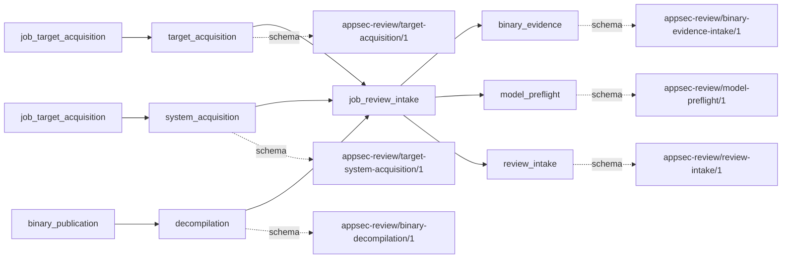
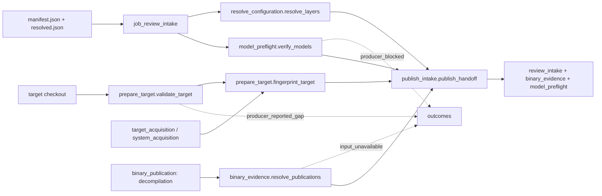

# review_intake

## Purpose

What exact target, configuration layers and pre-existing binary publications does this review
start from? Intake publishes a run binding and bounded inventory coverage, together with model
readiness evidence. It refuses empty bounded-text intake, changed source identities and unusable
required binary publications; it does not acquire targets, decompile binaries or establish that
the accepted inventory covers all target behavior.

<!-- generated:begin job=job_review_intake -->
<!-- generated from: appsec-review.toml, containers/catalog.toml, pipeline/guidance/registry.json, tests/job-test-map.json, src/appsec_review/runtime/registry.py, src/appsec_review/runtime/contracts.py, src/appsec_review/runtime/datasets.py, src/appsec_review/guidance/workers.py, src/appsec_review/mcp/schema.py, src/appsec_review/orchestration/topology.py, src/appsec_review/orchestration/dagster/adapter.py by scripts/generate-docs.py; do not edit -->
## Declared job contract

review_intake

Job: `job_review_intake`. Enabled in the dev recipe: **true**.
Declarations describe possible work, not successful execution or consumed evidence.

### Steps and tasks

| Step | Task | Workers | Pool | Bound tool or gap | Handler |
| --- | --- | --- | --- | --- | --- |
| `binary_evidence` | `binary_evidence.resolve_publications` | 1 | `application` | Undeclared ([T-147](../TODO.md)) | [source](../../src/appsec_review/jobs/job_review_intake/job.py#L409) |
| `model_preflight` | `model_preflight.resolve_models` | 1 | `application` | Undeclared ([T-147](../TODO.md)) | [source](../../src/appsec_review/jobs/job_review_intake/job.py#L277) |
| `model_preflight` | `model_preflight.verify_models` | 1 | `application` | Undeclared ([T-147](../TODO.md)) | [source](../../src/appsec_review/jobs/job_review_intake/job.py#L283) |
| `prepare_target` | `prepare_target.fingerprint_target` | 1 | `application` | Undeclared ([T-147](../TODO.md)) | [source](../../src/appsec_review/jobs/job_review_intake/job.py#L401) |
| `prepare_target` | `prepare_target.resolve_target` | 1 | `application` | Undeclared ([T-147](../TODO.md)) | [source](../../src/appsec_review/jobs/job_review_intake/job.py#L386) |
| `prepare_target` | `prepare_target.validate_target` | 1 | `application` | Undeclared ([T-147](../TODO.md)) | [source](../../src/appsec_review/jobs/job_review_intake/job.py#L390) |
| `publish_intake` | `publish_intake.publish_handoff` | 1 | `application` | Undeclared ([T-147](../TODO.md)) | [source](../../src/appsec_review/jobs/job_review_intake/job.py#L438) |
| `resolve_configuration` | `resolve_configuration.fetch_config` | 1 | `application` | Undeclared ([T-147](../TODO.md)) | [source](../../src/appsec_review/jobs/job_review_intake/job.py#L313) |
| `resolve_configuration` | `resolve_configuration.freeze_config` | 1 | `application` | Undeclared ([T-147](../TODO.md)) | [source](../../src/appsec_review/jobs/job_review_intake/job.py#L379) |
| `resolve_configuration` | `resolve_configuration.resolve_layers` | 1 | `application` | Undeclared ([T-147](../TODO.md)) | [source](../../src/appsec_review/jobs/job_review_intake/job.py#L317) |

### Accepted input declarations

| Producer | Dataset | Schema | Channel | Availability | Missing policy |
| --- | --- | --- | --- | --- | --- |
| `job_target_acquisition` | `target_acquisition` | `appsec-review/target-acquisition/1` | external | optional | gap |
| `job_target_acquisition` | `system_acquisition` | `appsec-review/target-system-acquisition/1` | external | optional | gap |
| `binary_publication` | `decompilation` | `appsec-review/binary-decompilation/1` | external | optional | gap |

### Published dataset declarations

| Dataset | Step | Schema | Stage | Indexes | MCP route |
| --- | --- | --- | --- | --- | --- |
| `binary_evidence` | `binary_evidence` | `appsec-review/binary-evidence-intake/1` | artifact_only | Not indexed | `coverage`, `query_dataset_inventory` |
| `model_preflight` | `model_preflight` | `appsec-review/model-preflight/1` | artifact_only | Not indexed | `coverage`, `query_dataset_inventory` |
| `review_intake` | `publish_intake` | `appsec-review/review-intake/1` | artifact_only | Not indexed | `coverage`, `query_dataset_inventory` |

Protected and artifact-only routes expose sanitized metadata, not payload access.

### Model and guidance declarations

No job-level model declaration; absence of a task binding remains [T-147](../TODO.md), not a nonexecution claim.

### Test selection

| Tier | Files or selectors |
| --- | --- |
| acceptance | None declared |
| integration | `tests/integration/job_review_intake/test_model_preflight.py` `tests/integration/job_review_intake/test_review_intake.py` |
| live | None declared |
| unit | `tests/unit/job_review_intake/test_binary_evidence.py` `tests/unit/job_review_intake/test_configuration.py` `tests/unit/job_review_intake/test_contract.py` `tests/unit/job_review_intake/test_models.py` `tests/unit/job_review_intake/test_target.py` |

### Dagster placement

Dispatch: `review_graph`. Review graph member: **true**. Enabled graph member: **true**.

Declared predecessors: `job_target_acquisition`.

### Declared dataflow

<!-- generated:end -->

## Process

Source: [intake handlers](../../src/appsec_review/jobs/job_review_intake/job.py) and
[inventory and raw snapshot](../../src/appsec_review/jobs/cataloging.py). External observations
follow the [input contract](../architecture/job-input-contracts.md); freezing host bindings is
documented in [image-pin verification](image-pin-verification.md#frozen-configuration).

### `model_preflight`

1. Hash-verify the resolved configuration; classify configured model pairs using enabled
   jobs and model settings, then check every distinct pair once per provider.
2. In the wired production path, write `model-preflight.json`; unavailable non-required
   pairs become `producer_blocked`, `retryable=True`. Raise `ModelPreflightBlocked` for any
   unavailable required pair, after retaining the report.
3. A directly constructed fixture without a callback returns `NOT_APPLICABLE` and a reason;
   this is not the hard gate's behavior and is not evidence that a provider was checked.

### `resolve_configuration`

1. Read the base source identity from the frozen configuration manifest.
2. Require the host-pins layer last. Verify its bytes/hash/document; verify profile and optional
   capacity-overlay identities, order and allowed override keys. Reject inconsistent layers.
3. Return the run-owned TOML path/hash and verified layers from `freeze_config`; do not replace
   the run's configuration with current host files.

### `prepare_target`

1. Resolve the supplied target directory. Inventory files with configured exclusions and the
   configured per-file bound; record omitted paths, asset exclusions and discovery counts.
2. If no bounded text files remain, raise `TargetIntakeError`. Convert non-policy inventory
   omissions to path-scoped records without discarding the raw coverage detail.
3. Recompute `source_fingerprint` and require equality with the planning fingerprint. Despite
   the output's legacy algorithm label, the helper hashes all regular non-VCS target bytes
   and symlink identities, including catalog-excluded bytes.
4. If a matching acquisition record exists, copy its verified manifest into this run and
   observe the appropriate external acquisition schema. Absence of such a record is not an
   instruction to acquire a target.

### `binary_evidence`

1. Resolve each configured binary in the content-addressed publication store. Verify its
   publication and compare processor, compiler specification, loader and debug-symbol hash
   with the configured request.
2. Reject an unusable required publication. For an optional unavailable publication, retain
   `binary_decompilation_unavailable` as payload detail and emit `input_unavailable`,
   `retryable=True`, scoped to the binary ID.
3. Record external observations only for resolved publications; write `binary-evidence.json`
   with manifest identities and publication coverage. Never invoke Ghidra here.

### `publish_intake`

1. Require configuration, target fingerprint, preflight and binary-resolution results.
2. Write `review-intake.json` linking those records. Convert inventory and acquisition gaps
   at this publication boundary; binary/preflight gaps remain on their observing units.
3. Publish the artifact-only intake binding after framework validation, retaining raw
   acquisition/coverage facts rather than interpreting target content as instructions.

## Dataflow

## Gaps

`coverage_gap_records` excludes `excluded_directory`; configured path/asset exclusions are
recorded policy, not lost-coverage gaps. Remaining inventory reasons include
`symlink_excluded`, `non_regular_descriptor`, `path_too_long`, `file_too_large` and
`inventory_bound_reached`. They become `producer_reported_gap`, `retryable=False`, at target
validation and publication. They still describe unreviewed content; false does not mean advisory.

At publication, acquisition reason `component_acquisition_failed` becomes `producer_failed`.
That reason, `component_not_acquired` and `target_changed_since_acquisition` have
`retryable=True`; other acquisition reasons retain `producer_reported_gap` with false.
Optional binary failures emit `input_unavailable` with true; disabled-only model failures emit
`producer_blocked` with true. Required binary/model failures, changed target/configuration,
invalid manifests and publication errors reject the attempt instead of publishing a successful
gap result. See [interchange](../architecture/job-interchange.md) for canonical accounting.
No known omission is automatically on a walk's expected-gaps list.

## Acceptance

1. **A. Inputs:** Match frozen layer hashes, target fingerprint, acquisition observation and
   binary manifest observations to the claim's admitted external selections. Distinguish an
   absent acquisition record from a supplied manifest that failed integrity.
2. **B. Independent comparison:** Compare accepted file count/bytes, omitted-path counts and
   descriptor counts with a separate target listing under the same policy. Independently
   hash the target and configured binary/request identities; compare preflight pairs with
   retained provider responses. Record each unverified quantity.
3. **C. Gaps:** Read verified outcomes, group by cause and path/binary/model, and reconcile
   repeated inventory observations rather than summing copies as separate missing files.
   Classify real omissions and stop for causes not approved in the walk.
4. **D. Baseline:** After checks A–C, use `stepwise.py accept` and record corpus namespace and
   baseline for target/configuration identities, inventory counts and external selections.

## Resume and invalidation

The normal source/configuration/upstream/implementation bindings apply, plus
`external_input_identity`: the selected acquisition manifest hash/schema and every binary's
binary/manifest identity, or explicit unavailable/not-applicable selection. A changed binary
publication or acquisition selection invalidates intake even if target bytes are unchanged.
`source_fingerprint` includes catalog-excluded bytes but excludes VCS metadata; history has its
own additional identity. A failed attempt's artifact-bearing results are not blindly
transplanted as portable checkpoints. Follow [Wave 1 resumability](../architecture/jobs-and-runtime.md#wave-1-resumability)
for selective downstream invalidation and immutable attempts.

## Model usage

The wired preflight calls provider availability checks, with no review role or persona.
It uses the same enabled-pair policy as [model connectivity](job_model_connectivity.md), but
intake itself is reusable and is not the always-fresh gate. A passing response does not imply
any review prompt, inference budget or downstream task has been exercised.
