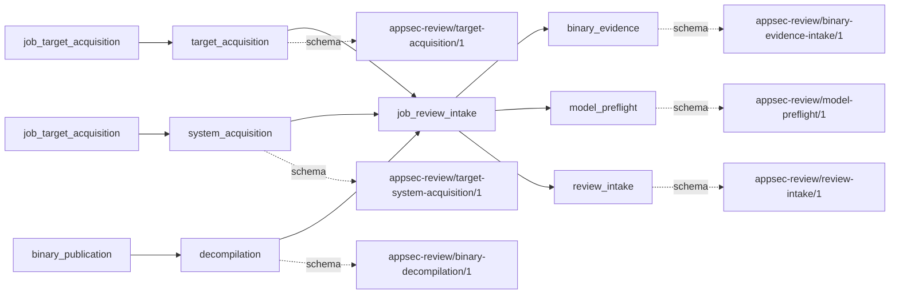

# review_intake

This page contains the generated contract; the authored process and acceptance description are tracked by [T-130](../TODO.md).

<!-- generated:begin job=job_review_intake -->
<!-- generated from: appsec-review.toml, containers/catalog.toml, pipeline/guidance/registry.json, tests/job-test-map.json, src/appsec_review/runtime/registry.py, src/appsec_review/runtime/contracts.py, src/appsec_review/runtime/datasets.py, src/appsec_review/guidance/workers.py, src/appsec_review/mcp/schema.py, src/appsec_review/orchestration/topology.py, src/appsec_review/orchestration/dagster/adapter.py by scripts/generate-docs.py; do not edit -->
## Declared job contract

review_intake

Job: `job_review_intake`. Enabled in the dev recipe: **true**.
Declarations describe possible work, not successful execution or consumed evidence.

### Steps and tasks

| Step | Task | Workers | Pool | Bound tool or gap | Handler |
| --- | --- | --- | --- | --- | --- |
| `binary_evidence` | `binary_evidence.resolve_publications` | 1 | `application` | Undeclared ([T-147](../TODO.md)) | [source](../../src/appsec_review/jobs/job_review_intake/job.py#L409) |
| `model_preflight` | `model_preflight.resolve_models` | 1 | `application` | Undeclared ([T-147](../TODO.md)) | [source](../../src/appsec_review/jobs/job_review_intake/job.py#L277) |
| `model_preflight` | `model_preflight.verify_models` | 1 | `application` | Undeclared ([T-147](../TODO.md)) | [source](../../src/appsec_review/jobs/job_review_intake/job.py#L283) |
| `prepare_target` | `prepare_target.fingerprint_target` | 1 | `application` | Undeclared ([T-147](../TODO.md)) | [source](../../src/appsec_review/jobs/job_review_intake/job.py#L401) |
| `prepare_target` | `prepare_target.resolve_target` | 1 | `application` | Undeclared ([T-147](../TODO.md)) | [source](../../src/appsec_review/jobs/job_review_intake/job.py#L386) |
| `prepare_target` | `prepare_target.validate_target` | 1 | `application` | Undeclared ([T-147](../TODO.md)) | [source](../../src/appsec_review/jobs/job_review_intake/job.py#L390) |
| `publish_intake` | `publish_intake.publish_handoff` | 1 | `application` | Undeclared ([T-147](../TODO.md)) | [source](../../src/appsec_review/jobs/job_review_intake/job.py#L438) |
| `resolve_configuration` | `resolve_configuration.fetch_config` | 1 | `application` | Undeclared ([T-147](../TODO.md)) | [source](../../src/appsec_review/jobs/job_review_intake/job.py#L313) |
| `resolve_configuration` | `resolve_configuration.freeze_config` | 1 | `application` | Undeclared ([T-147](../TODO.md)) | [source](../../src/appsec_review/jobs/job_review_intake/job.py#L379) |
| `resolve_configuration` | `resolve_configuration.resolve_layers` | 1 | `application` | Undeclared ([T-147](../TODO.md)) | [source](../../src/appsec_review/jobs/job_review_intake/job.py#L317) |

### Accepted input declarations

| Producer | Dataset | Schema | Channel | Availability | Missing policy |
| --- | --- | --- | --- | --- | --- |
| `job_target_acquisition` | `target_acquisition` | `appsec-review/target-acquisition/1` | external | optional | gap |
| `job_target_acquisition` | `system_acquisition` | `appsec-review/target-system-acquisition/1` | external | optional | gap |
| `binary_publication` | `decompilation` | `appsec-review/binary-decompilation/1` | external | optional | gap |

### Published dataset declarations

| Dataset | Step | Schema | Stage | Indexes | MCP route |
| --- | --- | --- | --- | --- | --- |
| `binary_evidence` | `binary_evidence` | `appsec-review/binary-evidence-intake/1` | artifact_only | Not indexed | `coverage`, `query_dataset_inventory` |
| `model_preflight` | `model_preflight` | `appsec-review/model-preflight/1` | artifact_only | Not indexed | `coverage`, `query_dataset_inventory` |
| `review_intake` | `publish_intake` | `appsec-review/review-intake/1` | artifact_only | Not indexed | `coverage`, `query_dataset_inventory` |

Protected and artifact-only routes expose sanitized metadata, not payload access.

### Model and guidance declarations

No job-level model declaration; absence of a task binding remains [T-147](../TODO.md), not a nonexecution claim.

### Test selection

| Tier | Files or selectors |
| --- | --- |
| acceptance | None declared |
| integration | `tests/integration/job_review_intake/test_model_preflight.py` `tests/integration/job_review_intake/test_review_intake.py` |
| live | None declared |
| unit | `tests/unit/job_review_intake/test_binary_evidence.py` `tests/unit/job_review_intake/test_configuration.py` `tests/unit/job_review_intake/test_contract.py` `tests/unit/job_review_intake/test_models.py` `tests/unit/job_review_intake/test_target.py` |

### Dagster placement

Dispatch: `review_graph`. Review graph member: **true**. Enabled graph member: **true**.

Declared predecessors: `job_target_acquisition`.

### Declared dataflow

<!-- generated:end -->
