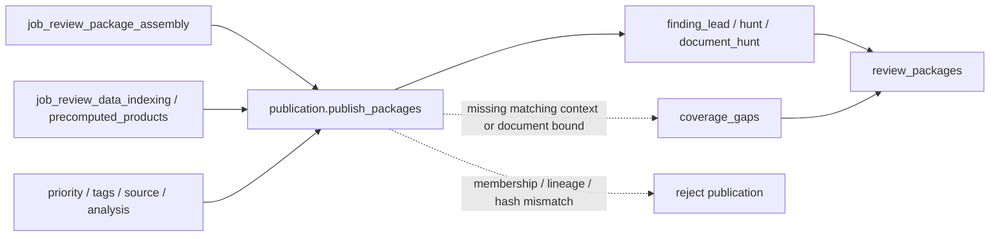

# review_package_assembly

## Purpose

Turn the final accepted indexed evidence into immutable scanner-lead, hunt-menu and document-hunt
packages. This job establishes bounded membership and resolving context, not findings. Its
`review_packages` are upstream routing material; the inference job subsequently assembles its own
lane-specific review packages and adjudicates claims separately.

<!-- generated:begin job=job_review_package_assembly -->
<!-- generated from: appsec-review.toml, containers/catalog.toml, pipeline/guidance/registry.json, tests/job-test-map.json, src/appsec_review/runtime/registry.py, src/appsec_review/runtime/contracts.py, src/appsec_review/runtime/datasets.py, src/appsec_review/guidance/workers.py, src/appsec_review/mcp/schema.py, src/appsec_review/orchestration/topology.py, src/appsec_review/orchestration/dagster/adapter.py by scripts/generate-docs.py; do not edit -->
## Declared job contract

review_package_assembly

Job: `job_review_package_assembly`. Enabled in the dev recipe: **true**.
Declarations describe possible work, not successful execution or consumed evidence.

### Steps and tasks

| Step | Task | Workers | Pool | Bound tool or gap | Handler |
| --- | --- | --- | --- | --- | --- |
| `publication` | `publication.publish_packages` | 1 | `application` | Undeclared ([T-147](../TODO.md)) | [source](../../src/appsec_review/jobs/job_review_package_assembly/job.py#L65) |

### Accepted input declarations

| Producer | Dataset | Schema | Channel | Availability | Missing policy |
| --- | --- | --- | --- | --- | --- |
| `job_artifact_indexing` | `handoff` | `appsec-review/job-handoff/2` | handoff | optional | gap |
| `job_artifact_indexing` | `artifact_catalog` | `appsec-review/retrieval-index/2` | handoff | optional | gap |
| `job_artifact_indexing` | `archive_members` | `appsec-review/retrieval-index/2` | handoff | optional | gap |
| `job_artifact_indexing` | `artifact_relationships` | `appsec-review/retrieval-index/2` | handoff | optional | gap |
| `job_artifact_indexing` | `artifact_index_summary` | `appsec-review/artifact-indexing/1` | handoff | optional | gap |
| `job_artifact_security_analysis` | `handoff` | `appsec-review/job-handoff/2` | handoff | optional | gap |
| `job_artifact_security_analysis` | `artifact_security_observations` | `appsec-review/retrieval-index/2` | handoff | optional | gap |
| `job_artifact_security_analysis` | `artifact_security_results` | `appsec-review/artifact-security-observation/1` | handoff | optional | gap |
| `job_artifact_security_analysis` | `artifact_scanner_io` | `appsec-review/container-execution/1` | handoff | optional | gap |
| `job_binary_evidence_indexing` | `handoff` | `appsec-review/job-handoff/2` | handoff | optional | gap |
| `job_binary_evidence_indexing` | `binary_functions` | `appsec-review/retrieval-index/2` | handoff | optional | gap |
| `job_binary_evidence_indexing` | `binary_pseudo_c` | `appsec-review/binary-source-backing/1` | handoff | optional | gap |
| `job_binary_evidence_indexing` | `binary_evidence_summary` | `appsec-review/binary-evidence-index/1` | handoff | optional | gap |
| `job_change_context_analysis` | `handoff` | `appsec-review/job-handoff/2` | handoff | optional | gap |
| `job_change_context_analysis` | `change_context` | `appsec-review/retrieval-index/2` | handoff | optional | gap |
| `job_change_context_analysis` | `change_context_documents` | `appsec-review/change-context-analysis/1` | handoff | optional | gap |
| `job_change_context_analysis` | `operator_exports` | `application/json` | handoff | optional | gap |
| `job_change_context_analysis` | `change_context_tool_io` | `appsec-review/container-execution/1` | handoff | optional | gap |
| `job_ci_configuration_analysis` | `handoff` | `appsec-review/job-handoff/2` | handoff | optional | gap |
| `job_ci_configuration_analysis` | `ci_observations` | `appsec-review/retrieval-index/2` | handoff | optional | gap |
| `job_ci_configuration_analysis` | `ci_findings` | `appsec-review/retrieval-index/2` | handoff | optional | gap |
| `job_ci_configuration_analysis` | `ci_documents` | `appsec-review/ci-configuration-analysis-handoff/1` | handoff | optional | gap |
| `job_ci_configuration_analysis` | `ci_tool_io` | `appsec-review/container-execution/1` | handoff | optional | gap |
| `job_clang_static_analysis` | `handoff` | `appsec-review/job-handoff/2` | handoff | optional | gap |
| `job_clang_static_analysis` | `clang_static_observations` | `appsec-review/retrieval-index/2` | handoff | optional | gap |
| `job_clang_static_analysis` | `clang_static_scope_coverage` | `appsec-review/cpp-index-coverage/1` | handoff | optional | gap |
| `job_clang_static_analysis` | `clang_static_summary` | `appsec-review/clang-static-analysis-handoff/1` | handoff | optional | gap |
| `job_clang_static_analysis` | `clang_static_raw` | `application/json` | handoff | optional | gap |
| `job_code_graph_index` | `handoff` | `appsec-review/job-handoff/2` | handoff | optional | gap |
| `job_code_graph_index` | `code_graph_facts` | `appsec-review/graph-fact/1` | handoff | optional | gap |
| `job_code_graph_index` | `code_graph_stages` | `appsec-review/code-graph-stage/1` | handoff | optional | gap |
| `job_code_graph_index` | `code_graph_checkpoints` | `appsec-review/code-graph-checkpoint/1` | handoff | optional | gap |
| `job_code_graph_index` | `code_graph_summary` | `appsec-review/code-graph-index/1` | handoff | optional | gap |
| `job_codeql_analysis` | `handoff` | `appsec-review/job-handoff/2` | handoff | optional | gap |
| `job_codeql_analysis` | `codeql_predecessor_import` | `appsec-review/codeql-predecessor-import/1` | handoff | optional | gap |
| `job_codeql_analysis` | `codeql_graph_export` | `appsec-review/codeql-graph-export/1` | handoff | optional | gap |
| `job_codeql_analysis` | `codeql_observations` | `appsec-review/codeql-sarif-normalizer/3` | handoff | optional | gap |
| `job_codeql_analysis` | `codeql_plan_and_summary` | `appsec-review/codeql-analysis-handoff/1` | handoff | optional | gap |
| `job_codeql_analysis` | `codeql_scope_material` | `application/octet-stream` | handoff | optional | gap |
| `job_cpg_analysis` | `handoff` | `appsec-review/job-handoff/2` | handoff | optional | gap |
| `job_cpg_analysis` | `cpg_graph_coverage` | `appsec-review/retrieval-index/2` | handoff | optional | gap |
| `job_cpg_analysis` | `cpg_scope_coverage` | `appsec-review/cpp-index-coverage/1` | handoff | optional | gap |
| `job_cpg_analysis` | `cpg_summary` | `appsec-review/cpg-analysis/1` | handoff | optional | gap |
| `job_cpg_analysis` | `cpg_binary` | `application/octet-stream` | handoff | optional | gap |
| `job_cpp_compiled_analysis` | `handoff` | `appsec-review/job-handoff/2` | handoff | optional | gap |
| `job_cpp_compiled_analysis` | `cpp_build_graph` | `appsec-review/retrieval-index/2` | handoff | optional | gap |
| `job_cpp_compiled_analysis` | `clang_ast` | `appsec-review/retrieval-index/2` | handoff | optional | gap |
| `job_cpp_compiled_analysis` | `llvm_ir` | `appsec-review/retrieval-index/2` | handoff | optional | gap |
| `job_cpp_compiled_analysis` | `infer_observations` | `appsec-review/retrieval-index/2` | handoff | optional | gap |
| `job_cpp_compiled_analysis` | `binary_symbols` | `appsec-review/retrieval-index/2` | handoff | optional | gap |
| `job_cpp_compiled_analysis` | `cpp_blocked_branches` | `appsec-review/retrieval-index/2` | handoff | optional | gap |
| `job_cpp_compiled_analysis` | `cpp_plan_and_summary` | `appsec-review/cpp-compiled-analysis/2` | handoff | optional | gap |
| `job_cpp_compiled_analysis` | `cpp_case_material` | `application/octet-stream` | handoff | optional | gap |
| `job_cpp_symbol_index` | `handoff` | `appsec-review/job-handoff/2` | handoff | optional | gap |
| `job_cpp_symbol_index` | `clangd_symbols` | `appsec-review/retrieval-index/2` | handoff | optional | gap |
| `job_cpp_symbol_index` | `clangd_coverage` | `appsec-review/cpp-index-coverage/1` | handoff | optional | gap |
| `job_cpp_symbol_index` | `clangd_summary` | `appsec-review/cpp-symbol-index/1` | handoff | optional | gap |
| `job_cpp_symbol_index` | `clangd_tool_io` | `appsec-review/container-execution/1` | handoff | optional | gap |
| `job_debug_symbol_indexing` | `handoff` | `appsec-review/job-handoff/2` | handoff | optional | gap |
| `job_debug_symbol_indexing` | `normalized_symbols` | `appsec-review/retrieval-index/2` | handoff | optional | gap |
| `job_debug_symbol_indexing` | `symbol_coverage` | `appsec-review/debug-symbol-coverage/1` | handoff | optional | gap |
| `job_debug_symbol_indexing` | `target_decision` | `appsec-review/debug-symbol-decision/2` | handoff | optional | gap |
| `job_debug_symbol_indexing` | `raw_artifact_refs` | `appsec-review/debug-symbol-inputs/1` | handoff | optional | gap |
| `job_debug_symbol_indexing` | `reader_executions` | `appsec-review/container-execution/1` | handoff | optional | gap |
| `job_debug_symbol_indexing` | `debug_symbol_summary` | `appsec-review/debug-symbol-indexing/1` | handoff | optional | gap |
| `job_dependency_intelligence` | `handoff` | `appsec-review/job-handoff/2` | handoff | optional | gap |
| `job_dependency_intelligence` | `native_discovery` | `appsec-review/native-discovery/1` | handoff | optional | gap |
| `job_dependency_intelligence` | `native_component_curation` | `appsec-review/native-component-curation/1` | handoff | optional | gap |
| `job_dependency_intelligence` | `native_metadata_investigation` | `appsec-review/native-metadata-investigation/1` | handoff | optional | gap |
| `job_dependency_intelligence` | `native_inference_metrics` | `appsec-review/native-inference-metrics/1` | handoff | optional | gap |
| `job_dependency_intelligence` | `native_spdx` | `SPDX-2.3` | handoff | optional | gap |
| `job_dependency_intelligence` | `native_sbom_provenance` | `appsec-review/native-sbom-provenance/1` | handoff | optional | gap |
| `job_dependency_intelligence` | `native_sbom_metrics` | `appsec-review/native-sbom-metrics/1` | handoff | optional | gap |
| `job_dependency_intelligence` | `dependency_context` | `appsec-review/retrieval-index/2` | handoff | optional | gap |
| `job_dependency_intelligence` | `scorecard_responses` | `application/json` | handoff | optional | gap |
| `job_dependency_intelligence` | `dependency_intelligence_handoff` | `appsec-review/dependency-intelligence-handoff/1` | handoff | optional | gap |
| `job_evidence_collection` | `handoff` | `appsec-review/job-handoff/2` | handoff | optional | gap |
| `job_evidence_collection` | `static_tool_observations` | `appsec-review/retrieval-index/2` | handoff | optional | gap |
| `job_evidence_collection` | `static_tool_evidence` | `appsec-review/static-tool-evidence/2` | handoff | optional | gap |
| `job_evidence_collection` | `static_tool_io` | `appsec-review/container-execution/1` | handoff | optional | gap |
| `job_language_build` | `handoff` | `appsec-review/job-handoff/2` | handoff | optional | gap |
| `job_language_build` | `topology_refinement_inputs` | `appsec-review/build-topology-refinement/1` | handoff | optional | gap |
| `job_language_build` | `build_actions` | `appsec-review/retrieval-index/2` | handoff | optional | gap |
| `job_language_build` | `jvm_build_actions` | `appsec-review/retrieval-index/2` | handoff | optional | gap |
| `job_language_build` | `language_build_receipts` | `appsec-review/language-build-handoff/2` | handoff | optional | gap |
| `job_language_build` | `build_workspaces` | `application/octet-stream` | handoff | optional | gap |
| `job_post_build_security_assessment` | `handoff` | `appsec-review/job-handoff/2` | handoff | optional | gap |
| `job_post_build_security_assessment` | `build_security` | `appsec-review/retrieval-index/2` | handoff | optional | gap |
| `job_post_build_security_assessment` | `build_security_documents` | `appsec-review/post-build-security-assessment/1` | handoff | optional | gap |
| `job_profile_data` | `handoff` | `appsec-review/job-handoff/2` | handoff | optional | gap |
| `job_profile_data` | `profile_data` | `appsec-review/retrieval-index/2` | handoff | optional | gap |
| `job_profile_data` | `profile_data_handoff` | `appsec-review/profile-data-handoff/1` | handoff | optional | gap |
| `job_review_data_indexing` | `handoff` | `appsec-review/job-handoff/2` | handoff | required | reject |
| `job_review_data_indexing` | `accepted_input_summary` | `appsec-review/review-data-indexing-inputs/2` | handoff | optional | gap |
| `job_review_data_indexing` | `cross_domain_links` | `appsec-review/retrieval-index/2` | handoff | optional | gap |
| `job_review_data_indexing` | `precomputed_products` | `appsec-review/retrieval-index/2` | handoff | optional | gap |
| `job_review_data_indexing` | `derived_checkpoints` | `appsec-review/derived-shard/1` | handoff | optional | gap |
| `job_review_data_indexing` | `fts_image_validation` | `appsec-review/sqlite-fts-validation/1` | handoff | optional | gap |
| `job_review_data_indexing` | `dataset_audit_report` | `appsec-review/dataset-inventory/1` | handoff | optional | gap |
| `job_review_data_indexing` | `coverage_matrices` | `appsec-review/coverage-matrices/2` | handoff | optional | gap |
| `job_review_data_indexing` | `dataset_inventory` | `appsec-review/retrieval-index/2` | handoff | optional | gap |
| `job_review_prioritization` | `handoff` | `appsec-review/job-handoff/2` | handoff | optional | gap |
| `job_review_prioritization` | `priority_items` | `appsec-review/retrieval-index/2` | handoff | optional | gap |
| `job_review_prioritization` | `prioritization_documents` | `appsec-review/review-prioritization/1` | handoff | optional | gap |
| `job_security_tagging` | `handoff` | `appsec-review/job-handoff/2` | handoff | optional | gap |
| `job_security_tagging` | `tag_assignments` | `appsec-review/tag-assignment/1` | handoff | optional | gap |
| `job_security_tagging` | `tagging_documents` | `appsec-review/security-tagging-handoff/1` | handoff | optional | gap |
| `job_source_history_analysis` | `handoff` | `appsec-review/job-handoff/2` | handoff | optional | gap |
| `job_source_history_analysis` | `history_signals` | `appsec-review/retrieval-index/2` | handoff | optional | gap |
| `job_source_history_analysis` | `history_documents` | `appsec-review/source-history-analysis/2` | handoff | optional | gap |
| `job_source_history_analysis` | `raw_git_history` | `application/octet-stream` | handoff | optional | gap |
| `job_source_history_analysis` | `history_tool_io` | `appsec-review/container-execution/1` | handoff | optional | gap |
| `job_svf_alias_analysis` | `handoff` | `appsec-review/job-handoff/2` | handoff | optional | gap |
| `job_svf_alias_analysis` | `svf_alias_sets` | `appsec-review/retrieval-index/2` | handoff | optional | gap |
| `job_svf_alias_analysis` | `svf_alias_scope_coverage` | `appsec-review/cpp-index-coverage/1` | handoff | optional | gap |
| `job_svf_alias_analysis` | `svf_alias_summary` | `appsec-review/svf-alias-analysis-handoff/1` | handoff | optional | gap |
| `job_svf_alias_analysis` | `svf_alias_raw` | `application/json` | handoff | optional | gap |
| `job_target_analysis_plan` | `handoff` | `appsec-review/job-handoff/2` | handoff | optional | gap |
| `job_target_analysis_plan` | `planning_feedback_cache` | `appsec-review/target-analysis-proposal/3` | handoff | optional | gap |
| `job_target_analysis_plan` | `analysis_plan` | `appsec-review/retrieval-index/2` | handoff | optional | gap |
| `job_target_analysis_plan` | `analysis_plan_documents` | `appsec-review/target-analysis-plan/1` | handoff | optional | gap |
| `job_target_catalog` | `handoff` | `appsec-review/job-handoff/2` | handoff | optional | gap |
| `job_target_catalog` | `target_artifact_inputs` | `appsec-review/target-artifact-intake/1` | handoff | optional | gap |
| `job_target_catalog` | `source_files` | `appsec-review/retrieval-index/2` | handoff | optional | gap |
| `job_target_catalog` | `declaration_symbols` | `appsec-review/retrieval-index/2` | handoff | optional | gap |
| `job_target_catalog` | `components` | `appsec-review/retrieval-index/2` | handoff | optional | gap |
| `job_target_catalog` | `target_documents` | `appsec-review/retrieval-index/2` | handoff | optional | gap |
| `job_target_catalog` | `build_units` | `appsec-review/retrieval-index/2` | handoff | optional | gap |
| `job_target_catalog` | `catalog_documents` | `appsec-review/target-catalog/1` | handoff | optional | gap |
| `job_test_coverage` | `handoff` | `appsec-review/job-handoff/2` | handoff | optional | gap |
| `job_test_coverage` | `test_coverage` | `appsec-review/retrieval-index/2` | handoff | optional | gap |
| `job_test_coverage` | `test_coverage_handoff` | `appsec-review/test-coverage-handoff/1` | handoff | optional | gap |
| `job_tree_sitter_ast` | `handoff` | `appsec-review/job-handoff/2` | handoff | optional | gap |
| `job_tree_sitter_ast` | `tree_sitter_ast` | `appsec-review/tree-sitter-normalizer/1` | handoff | optional | gap |
| `job_tree_sitter_ast` | `tree_sitter_coverage` | `appsec-review/tree-sitter-ast/1` | handoff | optional | gap |
| `job_tree_sitter_ast` | `tree_sitter_node_shards` | `appsec-review/tree-sitter-ast/1` | handoff | optional | gap |
| `job_tree_sitter_ast` | `generated_source_backing` | `appsec-review/generated-source-backing/1` | handoff | optional | gap |
| `job_tree_sitter_ast` | `tree_sitter_tool_io` | `appsec-review/container-execution/1` | handoff | optional | gap |

### Published dataset declarations

| Dataset | Step | Schema | Stage | Indexes | MCP route |
| --- | --- | --- | --- | --- | --- |
| `review_packages` | `publication` | `appsec-review/review-package-manifest/2` | artifact_only | Not indexed | `coverage`, `query_dataset_inventory` |

Protected and artifact-only routes expose sanitized metadata, not payload access.

### Model and guidance declarations

No job-level model declaration; absence of a task binding remains [T-147](../TODO.md), not a nonexecution claim.

### Test selection

| Tier | Files or selectors |
| --- | --- |
| acceptance | None declared |
| integration | None declared |
| live | None declared |
| unit | `tests/review/test_packages.py` |

### Dagster placement

Dispatch: `review_graph`. Review graph member: **true**. Enabled graph member: **true**.

Declared predecessors: `job_review_data_indexing`.

### Declared dataflow

```mermaid
flowchart LR
  job["job_review_package_assembly"]
  producer0["job_artifact_indexing"]
  input0["handoff"]
  input_schema0["appsec-review/job-handoff/2"]
  producer0 --> input0 --> job
  input0 -. schema .-> input_schema0
  producer1["job_artifact_indexing"]
  input1["artifact_catalog"]
  input_schema1["appsec-review/retrieval-index/2"]
  producer1 --> input1 --> job
  input1 -. schema .-> input_schema1
  producer2["job_artifact_indexing"]
  input2["archive_members"]
  input_schema2["appsec-review/retrieval-index/2"]
  producer2 --> input2 --> job
  input2 -. schema .-> input_schema2
  producer3["job_artifact_indexing"]
  input3["artifact_relationships"]
  input_schema3["appsec-review/retrieval-index/2"]
  producer3 --> input3 --> job
  input3 -. schema .-> input_schema3
  producer4["job_artifact_indexing"]
  input4["artifact_index_summary"]
  input_schema4["appsec-review/artifact-indexing/1"]
  producer4 --> input4 --> job
  input4 -. schema .-> input_schema4
  producer5["job_artifact_security_analysis"]
  input5["handoff"]
  input_schema5["appsec-review/job-handoff/2"]
  producer5 --> input5 --> job
  input5 -. schema .-> input_schema5
  producer6["job_artifact_security_analysis"]
  input6["artifact_security_observations"]
  input_schema6["appsec-review/retrieval-index/2"]
  producer6 --> input6 --> job
  input6 -. schema .-> input_schema6
  producer7["job_artifact_security_analysis"]
  input7["artifact_security_results"]
  input_schema7["appsec-review/artifact-security-observation/1"]
  producer7 --> input7 --> job
  input7 -. schema .-> input_schema7
  producer8["job_artifact_security_analysis"]
  input8["artifact_scanner_io"]
  input_schema8["appsec-review/container-execution/1"]
  producer8 --> input8 --> job
  input8 -. schema .-> input_schema8
  producer9["job_binary_evidence_indexing"]
  input9["handoff"]
  input_schema9["appsec-review/job-handoff/2"]
  producer9 --> input9 --> job
  input9 -. schema .-> input_schema9
  producer10["job_binary_evidence_indexing"]
  input10["binary_functions"]
  input_schema10["appsec-review/retrieval-index/2"]
  producer10 --> input10 --> job
  input10 -. schema .-> input_schema10
  producer11["job_binary_evidence_indexing"]
  input11["binary_pseudo_c"]
  input_schema11["appsec-review/binary-source-backing/1"]
  producer11 --> input11 --> job
  input11 -. schema .-> input_schema11
  producer12["job_binary_evidence_indexing"]
  input12["binary_evidence_summary"]
  input_schema12["appsec-review/binary-evidence-index/1"]
  producer12 --> input12 --> job
  input12 -. schema .-> input_schema12
  producer13["job_change_context_analysis"]
  input13["handoff"]
  input_schema13["appsec-review/job-handoff/2"]
  producer13 --> input13 --> job
  input13 -. schema .-> input_schema13
  producer14["job_change_context_analysis"]
  input14["change_context"]
  input_schema14["appsec-review/retrieval-index/2"]
  producer14 --> input14 --> job
  input14 -. schema .-> input_schema14
  producer15["job_change_context_analysis"]
  input15["change_context_documents"]
  input_schema15["appsec-review/change-context-analysis/1"]
  producer15 --> input15 --> job
  input15 -. schema .-> input_schema15
  producer16["job_change_context_analysis"]
  input16["operator_exports"]
  input_schema16["application/json"]
  producer16 --> input16 --> job
  input16 -. schema .-> input_schema16
  producer17["job_change_context_analysis"]
  input17["change_context_tool_io"]
  input_schema17["appsec-review/container-execution/1"]
  producer17 --> input17 --> job
  input17 -. schema .-> input_schema17
  producer18["job_ci_configuration_analysis"]
  input18["handoff"]
  input_schema18["appsec-review/job-handoff/2"]
  producer18 --> input18 --> job
  input18 -. schema .-> input_schema18
  producer19["job_ci_configuration_analysis"]
  input19["ci_observations"]
  input_schema19["appsec-review/retrieval-index/2"]
  producer19 --> input19 --> job
  input19 -. schema .-> input_schema19
  producer20["job_ci_configuration_analysis"]
  input20["ci_findings"]
  input_schema20["appsec-review/retrieval-index/2"]
  producer20 --> input20 --> job
  input20 -. schema .-> input_schema20
  producer21["job_ci_configuration_analysis"]
  input21["ci_documents"]
  input_schema21["appsec-review/ci-configuration-analysis-handoff/1"]
  producer21 --> input21 --> job
  input21 -. schema .-> input_schema21
  producer22["job_ci_configuration_analysis"]
  input22["ci_tool_io"]
  input_schema22["appsec-review/container-execution/1"]
  producer22 --> input22 --> job
  input22 -. schema .-> input_schema22
  producer23["job_clang_static_analysis"]
  input23["handoff"]
  input_schema23["appsec-review/job-handoff/2"]
  producer23 --> input23 --> job
  input23 -. schema .-> input_schema23
  producer24["job_clang_static_analysis"]
  input24["clang_static_observations"]
  input_schema24["appsec-review/retrieval-index/2"]
  producer24 --> input24 --> job
  input24 -. schema .-> input_schema24
  producer25["job_clang_static_analysis"]
  input25["clang_static_scope_coverage"]
  input_schema25["appsec-review/cpp-index-coverage/1"]
  producer25 --> input25 --> job
  input25 -. schema .-> input_schema25
  producer26["job_clang_static_analysis"]
  input26["clang_static_summary"]
  input_schema26["appsec-review/clang-static-analysis-handoff/1"]
  producer26 --> input26 --> job
  input26 -. schema .-> input_schema26
  producer27["job_clang_static_analysis"]
  input27["clang_static_raw"]
  input_schema27["application/json"]
  producer27 --> input27 --> job
  input27 -. schema .-> input_schema27
  producer28["job_code_graph_index"]
  input28["handoff"]
  input_schema28["appsec-review/job-handoff/2"]
  producer28 --> input28 --> job
  input28 -. schema .-> input_schema28
  producer29["job_code_graph_index"]
  input29["code_graph_facts"]
  input_schema29["appsec-review/graph-fact/1"]
  producer29 --> input29 --> job
  input29 -. schema .-> input_schema29
  producer30["job_code_graph_index"]
  input30["code_graph_stages"]
  input_schema30["appsec-review/code-graph-stage/1"]
  producer30 --> input30 --> job
  input30 -. schema .-> input_schema30
  producer31["job_code_graph_index"]
  input31["code_graph_checkpoints"]
  input_schema31["appsec-review/code-graph-checkpoint/1"]
  producer31 --> input31 --> job
  input31 -. schema .-> input_schema31
  producer32["job_code_graph_index"]
  input32["code_graph_summary"]
  input_schema32["appsec-review/code-graph-index/1"]
  producer32 --> input32 --> job
  input32 -. schema .-> input_schema32
  producer33["job_codeql_analysis"]
  input33["handoff"]
  input_schema33["appsec-review/job-handoff/2"]
  producer33 --> input33 --> job
  input33 -. schema .-> input_schema33
  producer34["job_codeql_analysis"]
  input34["codeql_predecessor_import"]
  input_schema34["appsec-review/codeql-predecessor-import/1"]
  producer34 --> input34 --> job
  input34 -. schema .-> input_schema34
  producer35["job_codeql_analysis"]
  input35["codeql_graph_export"]
  input_schema35["appsec-review/codeql-graph-export/1"]
  producer35 --> input35 --> job
  input35 -. schema .-> input_schema35
  producer36["job_codeql_analysis"]
  input36["codeql_observations"]
  input_schema36["appsec-review/codeql-sarif-normalizer/3"]
  producer36 --> input36 --> job
  input36 -. schema .-> input_schema36
  producer37["job_codeql_analysis"]
  input37["codeql_plan_and_summary"]
  input_schema37["appsec-review/codeql-analysis-handoff/1"]
  producer37 --> input37 --> job
  input37 -. schema .-> input_schema37
  producer38["job_codeql_analysis"]
  input38["codeql_scope_material"]
  input_schema38["application/octet-stream"]
  producer38 --> input38 --> job
  input38 -. schema .-> input_schema38
  producer39["job_cpg_analysis"]
  input39["handoff"]
  input_schema39["appsec-review/job-handoff/2"]
  producer39 --> input39 --> job
  input39 -. schema .-> input_schema39
  producer40["job_cpg_analysis"]
  input40["cpg_graph_coverage"]
  input_schema40["appsec-review/retrieval-index/2"]
  producer40 --> input40 --> job
  input40 -. schema .-> input_schema40
  producer41["job_cpg_analysis"]
  input41["cpg_scope_coverage"]
  input_schema41["appsec-review/cpp-index-coverage/1"]
  producer41 --> input41 --> job
  input41 -. schema .-> input_schema41
  producer42["job_cpg_analysis"]
  input42["cpg_summary"]
  input_schema42["appsec-review/cpg-analysis/1"]
  producer42 --> input42 --> job
  input42 -. schema .-> input_schema42
  producer43["job_cpg_analysis"]
  input43["cpg_binary"]
  input_schema43["application/octet-stream"]
  producer43 --> input43 --> job
  input43 -. schema .-> input_schema43
  producer44["job_cpp_compiled_analysis"]
  input44["handoff"]
  input_schema44["appsec-review/job-handoff/2"]
  producer44 --> input44 --> job
  input44 -. schema .-> input_schema44
  producer45["job_cpp_compiled_analysis"]
  input45["cpp_build_graph"]
  input_schema45["appsec-review/retrieval-index/2"]
  producer45 --> input45 --> job
  input45 -. schema .-> input_schema45
  producer46["job_cpp_compiled_analysis"]
  input46["clang_ast"]
  input_schema46["appsec-review/retrieval-index/2"]
  producer46 --> input46 --> job
  input46 -. schema .-> input_schema46
  producer47["job_cpp_compiled_analysis"]
  input47["llvm_ir"]
  input_schema47["appsec-review/retrieval-index/2"]
  producer47 --> input47 --> job
  input47 -. schema .-> input_schema47
  producer48["job_cpp_compiled_analysis"]
  input48["infer_observations"]
  input_schema48["appsec-review/retrieval-index/2"]
  producer48 --> input48 --> job
  input48 -. schema .-> input_schema48
  producer49["job_cpp_compiled_analysis"]
  input49["binary_symbols"]
  input_schema49["appsec-review/retrieval-index/2"]
  producer49 --> input49 --> job
  input49 -. schema .-> input_schema49
  producer50["job_cpp_compiled_analysis"]
  input50["cpp_blocked_branches"]
  input_schema50["appsec-review/retrieval-index/2"]
  producer50 --> input50 --> job
  input50 -. schema .-> input_schema50
  producer51["job_cpp_compiled_analysis"]
  input51["cpp_plan_and_summary"]
  input_schema51["appsec-review/cpp-compiled-analysis/2"]
  producer51 --> input51 --> job
  input51 -. schema .-> input_schema51
  producer52["job_cpp_compiled_analysis"]
  input52["cpp_case_material"]
  input_schema52["application/octet-stream"]
  producer52 --> input52 --> job
  input52 -. schema .-> input_schema52
  producer53["job_cpp_symbol_index"]
  input53["handoff"]
  input_schema53["appsec-review/job-handoff/2"]
  producer53 --> input53 --> job
  input53 -. schema .-> input_schema53
  producer54["job_cpp_symbol_index"]
  input54["clangd_symbols"]
  input_schema54["appsec-review/retrieval-index/2"]
  producer54 --> input54 --> job
  input54 -. schema .-> input_schema54
  producer55["job_cpp_symbol_index"]
  input55["clangd_coverage"]
  input_schema55["appsec-review/cpp-index-coverage/1"]
  producer55 --> input55 --> job
  input55 -. schema .-> input_schema55
  producer56["job_cpp_symbol_index"]
  input56["clangd_summary"]
  input_schema56["appsec-review/cpp-symbol-index/1"]
  producer56 --> input56 --> job
  input56 -. schema .-> input_schema56
  producer57["job_cpp_symbol_index"]
  input57["clangd_tool_io"]
  input_schema57["appsec-review/container-execution/1"]
  producer57 --> input57 --> job
  input57 -. schema .-> input_schema57
  producer58["job_debug_symbol_indexing"]
  input58["handoff"]
  input_schema58["appsec-review/job-handoff/2"]
  producer58 --> input58 --> job
  input58 -. schema .-> input_schema58
  producer59["job_debug_symbol_indexing"]
  input59["normalized_symbols"]
  input_schema59["appsec-review/retrieval-index/2"]
  producer59 --> input59 --> job
  input59 -. schema .-> input_schema59
  producer60["job_debug_symbol_indexing"]
  input60["symbol_coverage"]
  input_schema60["appsec-review/debug-symbol-coverage/1"]
  producer60 --> input60 --> job
  input60 -. schema .-> input_schema60
  producer61["job_debug_symbol_indexing"]
  input61["target_decision"]
  input_schema61["appsec-review/debug-symbol-decision/2"]
  producer61 --> input61 --> job
  input61 -. schema .-> input_schema61
  producer62["job_debug_symbol_indexing"]
  input62["raw_artifact_refs"]
  input_schema62["appsec-review/debug-symbol-inputs/1"]
  producer62 --> input62 --> job
  input62 -. schema .-> input_schema62
  producer63["job_debug_symbol_indexing"]
  input63["reader_executions"]
  input_schema63["appsec-review/container-execution/1"]
  producer63 --> input63 --> job
  input63 -. schema .-> input_schema63
  producer64["job_debug_symbol_indexing"]
  input64["debug_symbol_summary"]
  input_schema64["appsec-review/debug-symbol-indexing/1"]
  producer64 --> input64 --> job
  input64 -. schema .-> input_schema64
  producer65["job_dependency_intelligence"]
  input65["handoff"]
  input_schema65["appsec-review/job-handoff/2"]
  producer65 --> input65 --> job
  input65 -. schema .-> input_schema65
  producer66["job_dependency_intelligence"]
  input66["native_discovery"]
  input_schema66["appsec-review/native-discovery/1"]
  producer66 --> input66 --> job
  input66 -. schema .-> input_schema66
  producer67["job_dependency_intelligence"]
  input67["native_component_curation"]
  input_schema67["appsec-review/native-component-curation/1"]
  producer67 --> input67 --> job
  input67 -. schema .-> input_schema67
  producer68["job_dependency_intelligence"]
  input68["native_metadata_investigation"]
  input_schema68["appsec-review/native-metadata-investigation/1"]
  producer68 --> input68 --> job
  input68 -. schema .-> input_schema68
  producer69["job_dependency_intelligence"]
  input69["native_inference_metrics"]
  input_schema69["appsec-review/native-inference-metrics/1"]
  producer69 --> input69 --> job
  input69 -. schema .-> input_schema69
  producer70["job_dependency_intelligence"]
  input70["native_spdx"]
  input_schema70["SPDX-2.3"]
  producer70 --> input70 --> job
  input70 -. schema .-> input_schema70
  producer71["job_dependency_intelligence"]
  input71["native_sbom_provenance"]
  input_schema71["appsec-review/native-sbom-provenance/1"]
  producer71 --> input71 --> job
  input71 -. schema .-> input_schema71
  producer72["job_dependency_intelligence"]
  input72["native_sbom_metrics"]
  input_schema72["appsec-review/native-sbom-metrics/1"]
  producer72 --> input72 --> job
  input72 -. schema .-> input_schema72
  producer73["job_dependency_intelligence"]
  input73["dependency_context"]
  input_schema73["appsec-review/retrieval-index/2"]
  producer73 --> input73 --> job
  input73 -. schema .-> input_schema73
  producer74["job_dependency_intelligence"]
  input74["scorecard_responses"]
  input_schema74["application/json"]
  producer74 --> input74 --> job
  input74 -. schema .-> input_schema74
  producer75["job_dependency_intelligence"]
  input75["dependency_intelligence_handoff"]
  input_schema75["appsec-review/dependency-intelligence-handoff/1"]
  producer75 --> input75 --> job
  input75 -. schema .-> input_schema75
  producer76["job_evidence_collection"]
  input76["handoff"]
  input_schema76["appsec-review/job-handoff/2"]
  producer76 --> input76 --> job
  input76 -. schema .-> input_schema76
  producer77["job_evidence_collection"]
  input77["static_tool_observations"]
  input_schema77["appsec-review/retrieval-index/2"]
  producer77 --> input77 --> job
  input77 -. schema .-> input_schema77
  producer78["job_evidence_collection"]
  input78["static_tool_evidence"]
  input_schema78["appsec-review/static-tool-evidence/2"]
  producer78 --> input78 --> job
  input78 -. schema .-> input_schema78
  producer79["job_evidence_collection"]
  input79["static_tool_io"]
  input_schema79["appsec-review/container-execution/1"]
  producer79 --> input79 --> job
  input79 -. schema .-> input_schema79
  producer80["job_language_build"]
  input80["handoff"]
  input_schema80["appsec-review/job-handoff/2"]
  producer80 --> input80 --> job
  input80 -. schema .-> input_schema80
  producer81["job_language_build"]
  input81["topology_refinement_inputs"]
  input_schema81["appsec-review/build-topology-refinement/1"]
  producer81 --> input81 --> job
  input81 -. schema .-> input_schema81
  producer82["job_language_build"]
  input82["build_actions"]
  input_schema82["appsec-review/retrieval-index/2"]
  producer82 --> input82 --> job
  input82 -. schema .-> input_schema82
  producer83["job_language_build"]
  input83["jvm_build_actions"]
  input_schema83["appsec-review/retrieval-index/2"]
  producer83 --> input83 --> job
  input83 -. schema .-> input_schema83
  producer84["job_language_build"]
  input84["language_build_receipts"]
  input_schema84["appsec-review/language-build-handoff/2"]
  producer84 --> input84 --> job
  input84 -. schema .-> input_schema84
  producer85["job_language_build"]
  input85["build_workspaces"]
  input_schema85["application/octet-stream"]
  producer85 --> input85 --> job
  input85 -. schema .-> input_schema85
  producer86["job_post_build_security_assessment"]
  input86["handoff"]
  input_schema86["appsec-review/job-handoff/2"]
  producer86 --> input86 --> job
  input86 -. schema .-> input_schema86
  producer87["job_post_build_security_assessment"]
  input87["build_security"]
  input_schema87["appsec-review/retrieval-index/2"]
  producer87 --> input87 --> job
  input87 -. schema .-> input_schema87
  producer88["job_post_build_security_assessment"]
  input88["build_security_documents"]
  input_schema88["appsec-review/post-build-security-assessment/1"]
  producer88 --> input88 --> job
  input88 -. schema .-> input_schema88
  producer89["job_profile_data"]
  input89["handoff"]
  input_schema89["appsec-review/job-handoff/2"]
  producer89 --> input89 --> job
  input89 -. schema .-> input_schema89
  producer90["job_profile_data"]
  input90["profile_data"]
  input_schema90["appsec-review/retrieval-index/2"]
  producer90 --> input90 --> job
  input90 -. schema .-> input_schema90
  producer91["job_profile_data"]
  input91["profile_data_handoff"]
  input_schema91["appsec-review/profile-data-handoff/1"]
  producer91 --> input91 --> job
  input91 -. schema .-> input_schema91
  producer92["job_review_data_indexing"]
  input92["handoff"]
  input_schema92["appsec-review/job-handoff/2"]
  producer92 --> input92 --> job
  input92 -. schema .-> input_schema92
  producer93["job_review_data_indexing"]
  input93["accepted_input_summary"]
  input_schema93["appsec-review/review-data-indexing-inputs/2"]
  producer93 --> input93 --> job
  input93 -. schema .-> input_schema93
  producer94["job_review_data_indexing"]
  input94["cross_domain_links"]
  input_schema94["appsec-review/retrieval-index/2"]
  producer94 --> input94 --> job
  input94 -. schema .-> input_schema94
  producer95["job_review_data_indexing"]
  input95["precomputed_products"]
  input_schema95["appsec-review/retrieval-index/2"]
  producer95 --> input95 --> job
  input95 -. schema .-> input_schema95
  producer96["job_review_data_indexing"]
  input96["derived_checkpoints"]
  input_schema96["appsec-review/derived-shard/1"]
  producer96 --> input96 --> job
  input96 -. schema .-> input_schema96
  producer97["job_review_data_indexing"]
  input97["fts_image_validation"]
  input_schema97["appsec-review/sqlite-fts-validation/1"]
  producer97 --> input97 --> job
  input97 -. schema .-> input_schema97
  producer98["job_review_data_indexing"]
  input98["dataset_audit_report"]
  input_schema98["appsec-review/dataset-inventory/1"]
  producer98 --> input98 --> job
  input98 -. schema .-> input_schema98
  producer99["job_review_data_indexing"]
  input99["coverage_matrices"]
  input_schema99["appsec-review/coverage-matrices/2"]
  producer99 --> input99 --> job
  input99 -. schema .-> input_schema99
  producer100["job_review_data_indexing"]
  input100["dataset_inventory"]
  input_schema100["appsec-review/retrieval-index/2"]
  producer100 --> input100 --> job
  input100 -. schema .-> input_schema100
  producer101["job_review_prioritization"]
  input101["handoff"]
  input_schema101["appsec-review/job-handoff/2"]
  producer101 --> input101 --> job
  input101 -. schema .-> input_schema101
  producer102["job_review_prioritization"]
  input102["priority_items"]
  input_schema102["appsec-review/retrieval-index/2"]
  producer102 --> input102 --> job
  input102 -. schema .-> input_schema102
  producer103["job_review_prioritization"]
  input103["prioritization_documents"]
  input_schema103["appsec-review/review-prioritization/1"]
  producer103 --> input103 --> job
  input103 -. schema .-> input_schema103
  producer104["job_security_tagging"]
  input104["handoff"]
  input_schema104["appsec-review/job-handoff/2"]
  producer104 --> input104 --> job
  input104 -. schema .-> input_schema104
  producer105["job_security_tagging"]
  input105["tag_assignments"]
  input_schema105["appsec-review/tag-assignment/1"]
  producer105 --> input105 --> job
  input105 -. schema .-> input_schema105
  producer106["job_security_tagging"]
  input106["tagging_documents"]
  input_schema106["appsec-review/security-tagging-handoff/1"]
  producer106 --> input106 --> job
  input106 -. schema .-> input_schema106
  producer107["job_source_history_analysis"]
  input107["handoff"]
  input_schema107["appsec-review/job-handoff/2"]
  producer107 --> input107 --> job
  input107 -. schema .-> input_schema107
  producer108["job_source_history_analysis"]
  input108["history_signals"]
  input_schema108["appsec-review/retrieval-index/2"]
  producer108 --> input108 --> job
  input108 -. schema .-> input_schema108
  producer109["job_source_history_analysis"]
  input109["history_documents"]
  input_schema109["appsec-review/source-history-analysis/2"]
  producer109 --> input109 --> job
  input109 -. schema .-> input_schema109
  producer110["job_source_history_analysis"]
  input110["raw_git_history"]
  input_schema110["application/octet-stream"]
  producer110 --> input110 --> job
  input110 -. schema .-> input_schema110
  producer111["job_source_history_analysis"]
  input111["history_tool_io"]
  input_schema111["appsec-review/container-execution/1"]
  producer111 --> input111 --> job
  input111 -. schema .-> input_schema111
  producer112["job_svf_alias_analysis"]
  input112["handoff"]
  input_schema112["appsec-review/job-handoff/2"]
  producer112 --> input112 --> job
  input112 -. schema .-> input_schema112
  producer113["job_svf_alias_analysis"]
  input113["svf_alias_sets"]
  input_schema113["appsec-review/retrieval-index/2"]
  producer113 --> input113 --> job
  input113 -. schema .-> input_schema113
  producer114["job_svf_alias_analysis"]
  input114["svf_alias_scope_coverage"]
  input_schema114["appsec-review/cpp-index-coverage/1"]
  producer114 --> input114 --> job
  input114 -. schema .-> input_schema114
  producer115["job_svf_alias_analysis"]
  input115["svf_alias_summary"]
  input_schema115["appsec-review/svf-alias-analysis-handoff/1"]
  producer115 --> input115 --> job
  input115 -. schema .-> input_schema115
  producer116["job_svf_alias_analysis"]
  input116["svf_alias_raw"]
  input_schema116["application/json"]
  producer116 --> input116 --> job
  input116 -. schema .-> input_schema116
  producer117["job_target_analysis_plan"]
  input117["handoff"]
  input_schema117["appsec-review/job-handoff/2"]
  producer117 --> input117 --> job
  input117 -. schema .-> input_schema117
  producer118["job_target_analysis_plan"]
  input118["planning_feedback_cache"]
  input_schema118["appsec-review/target-analysis-proposal/3"]
  producer118 --> input118 --> job
  input118 -. schema .-> input_schema118
  producer119["job_target_analysis_plan"]
  input119["analysis_plan"]
  input_schema119["appsec-review/retrieval-index/2"]
  producer119 --> input119 --> job
  input119 -. schema .-> input_schema119
  producer120["job_target_analysis_plan"]
  input120["analysis_plan_documents"]
  input_schema120["appsec-review/target-analysis-plan/1"]
  producer120 --> input120 --> job
  input120 -. schema .-> input_schema120
  producer121["job_target_catalog"]
  input121["handoff"]
  input_schema121["appsec-review/job-handoff/2"]
  producer121 --> input121 --> job
  input121 -. schema .-> input_schema121
  producer122["job_target_catalog"]
  input122["target_artifact_inputs"]
  input_schema122["appsec-review/target-artifact-intake/1"]
  producer122 --> input122 --> job
  input122 -. schema .-> input_schema122
  producer123["job_target_catalog"]
  input123["source_files"]
  input_schema123["appsec-review/retrieval-index/2"]
  producer123 --> input123 --> job
  input123 -. schema .-> input_schema123
  producer124["job_target_catalog"]
  input124["declaration_symbols"]
  input_schema124["appsec-review/retrieval-index/2"]
  producer124 --> input124 --> job
  input124 -. schema .-> input_schema124
  producer125["job_target_catalog"]
  input125["components"]
  input_schema125["appsec-review/retrieval-index/2"]
  producer125 --> input125 --> job
  input125 -. schema .-> input_schema125
  producer126["job_target_catalog"]
  input126["target_documents"]
  input_schema126["appsec-review/retrieval-index/2"]
  producer126 --> input126 --> job
  input126 -. schema .-> input_schema126
  producer127["job_target_catalog"]
  input127["build_units"]
  input_schema127["appsec-review/retrieval-index/2"]
  producer127 --> input127 --> job
  input127 -. schema .-> input_schema127
  producer128["job_target_catalog"]
  input128["catalog_documents"]
  input_schema128["appsec-review/target-catalog/1"]
  producer128 --> input128 --> job
  input128 -. schema .-> input_schema128
  producer129["job_test_coverage"]
  input129["handoff"]
  input_schema129["appsec-review/job-handoff/2"]
  producer129 --> input129 --> job
  input129 -. schema .-> input_schema129
  producer130["job_test_coverage"]
  input130["test_coverage"]
  input_schema130["appsec-review/retrieval-index/2"]
  producer130 --> input130 --> job
  input130 -. schema .-> input_schema130
  producer131["job_test_coverage"]
  input131["test_coverage_handoff"]
  input_schema131["appsec-review/test-coverage-handoff/1"]
  producer131 --> input131 --> job
  input131 -. schema .-> input_schema131
  producer132["job_tree_sitter_ast"]
  input132["handoff"]
  input_schema132["appsec-review/job-handoff/2"]
  producer132 --> input132 --> job
  input132 -. schema .-> input_schema132
  producer133["job_tree_sitter_ast"]
  input133["tree_sitter_ast"]
  input_schema133["appsec-review/tree-sitter-normalizer/1"]
  producer133 --> input133 --> job
  input133 -. schema .-> input_schema133
  producer134["job_tree_sitter_ast"]
  input134["tree_sitter_coverage"]
  input_schema134["appsec-review/tree-sitter-ast/1"]
  producer134 --> input134 --> job
  input134 -. schema .-> input_schema134
  producer135["job_tree_sitter_ast"]
  input135["tree_sitter_node_shards"]
  input_schema135["appsec-review/tree-sitter-ast/1"]
  producer135 --> input135 --> job
  input135 -. schema .-> input_schema135
  producer136["job_tree_sitter_ast"]
  input136["generated_source_backing"]
  input_schema136["appsec-review/generated-source-backing/1"]
  producer136 --> input136 --> job
  input136 -. schema .-> input_schema136
  producer137["job_tree_sitter_ast"]
  input137["tree_sitter_tool_io"]
  input_schema137["appsec-review/container-execution/1"]
  producer137 --> input137 --> job
  input137 -. schema .-> input_schema137
  output0["review_packages"]
  output_schema0["appsec-review/review-package-manifest/2"]
  job --> output0
  output0 -. schema .-> output_schema0
```

<!-- generated:end -->

## Process

The [handler](../../src/appsec_review/jobs/job_review_package_assembly/job.py) calls
[review_packages.py](../../src/appsec_review/review_packages.py).

### `publication`

1. In `publication.publish_packages`, resolve the accepted manifest and require its target
   snapshot to match the job. Verify that the accepted review-data-indexing handoff binds that
   manifest or its recorded upstream lineage.
2. Read accepted scanner-correlation and document-context facts. Validate scanner/menu accounting
   before assembling anything; unresolved identities or malformed membership fail rather than
   becoming fabricated empty packages.
3. Emit one `finding_lead` package per admitted scanner lead and one `hunt` package per bounded
   menu partition. Preserve high/critical and unknown-severity accounting, continuation partitions,
   original observations and source locations. Attach only matching metrics, build facts, safe
   commands, tags and compiled-function context.
4. Emit one `document_hunt` package per accepted document-context fact. Keep its anchor and at
   most 63 additional document records, with an explicit omission count and implementation-mapping
   obligation. Document statements remain hypotheses.
5. Validate package membership and schema, write the validated admission projection, then publish
   canonical package files and manifest under the manifest's content hash.
6. Reverify exact directory membership, bytes, package identities, input manifest, counts, menu
   membership and coverage-gap union. Publish all file references; the output validator repeats
   these receipt checks before acceptance.

## Dataflow



Manifest selection and retrieval use the
[accepted index-set contract](../architecture/python-and-retrieval.md#accepted-index-sets).
The [input contract](../architecture/job-input-contracts.md#admission-and-read-receipts)
is the authority boundary, not the mere availability of a shard.

## Gaps

Package gap objects contain producer, scope, state and reason; handler outputs carry their IDs
as legacy strings. They supply no retryable/advisory classification. Their IDs are not new
canonical codes; see [outcome conversion](../architecture/job-interchange.md#the-control-layer-beneath-the-envelope).

| Producer / reason family | Scope and cost |
| --- | --- |
| Inherited shard gaps and noncomplete coverage rows | Original index/shard area remains incomplete. |
| `scanner_correlation`: no accepted scanner-correlation facts | Source-SAST input unavailable; document hunts have no scanner lead. |
| `function_scope`: unresolved or ambiguous source function | Lead-to-function association is not established. |
| `build_provenance`: ambiguous build context, no source-matched safe build-action facts, or no safe compile command explicitly naming the source | No inferred compile authority or fabricated command. |
| `history_context`: no source-matched accepted metric vector | Ranking/history context absent for the package's paths. |
| `security_tagging`: no accepted matching tag assignment | Routing context absent, not absence of security behavior. |
| `compiled_analysis`: no accepted matching Clang function declaration | Native function context unavailable. |
| `document_context`: inherited reasons, document grant bound, or route/boundary not mapped to a unique implementation component | Document evidence remains bounded and unmapped; not behavioral proof. |

These are coverage costs to reconcile with walk terms. Invalid manifest membership, altered files
or unaccepted document anchors fail publication instead of producing successful coverage.

## Acceptance

1. **A. Inputs:** Compare the claim's review-data-indexing pin, manifest lineage, target snapshot
   and shard identities with package-manifest bindings. Record the frozen page bound.
2. **B. Independent comparison:** Independently count scanner leads, menu partitions and
   document-context facts from their accepted shards. Compare `finding_lead`, `hunt`,
   `document_hunt`, high/critical and unknown counts; compare every menu's observation IDs and
   next partition. Verify package files exactly match the manifest and sample source/build
   attachments against accepted evidence.
3. **C. Gaps:** Resolve canonical outcome IDs to the deduplicated package-gap union. Separate
   absent context, ambiguous mapping and actual truncation. An empty scanner set or unmapped
   document is not a clean finding set; unexpected causes stop the walk.
4. **D. Baseline:** Save an authorized `stepwise.py accept` baseline and corpus namespace with
   manifest/content hashes, package-kind counts, menu memberships and omitted document counts.
   Record any quantity not independently compared as not verified.

## Resume and invalidation

Package identity includes accepted manifest/shards, partition, entity context and assembly rule.
The admission projection additionally binds run ID, manifest hash and page size; published files
are content-addressed and reverified, never edited in place. A changed input manifest, membership
rule or page bound requires new packages. [Runtime resume](../architecture/jobs-and-runtime.md#wave-1-resumability)
still requires exact configuration/component/upstream identities; this artifact-bearing unit is
not a portable failed-attempt checkpoint. No model is dispatched.
