# review_prioritization

This page contains the generated contract; the authored process and acceptance description are tracked by [T-130](../TODO.md).

<!-- generated:begin job=job_review_prioritization -->
<!-- generated from: appsec-review.toml, containers/catalog.toml, pipeline/guidance/registry.json, tests/job-test-map.json, src/appsec_review/runtime/registry.py, src/appsec_review/runtime/contracts.py, src/appsec_review/runtime/datasets.py, src/appsec_review/guidance/workers.py, src/appsec_review/mcp/schema.py, src/appsec_review/orchestration/topology.py, src/appsec_review/orchestration/dagster/adapter.py by scripts/generate-docs.py; do not edit -->
## Declared job contract

review_prioritization

Job: `job_review_prioritization`. Enabled in the dev recipe: **true**.
Declarations describe possible work, not successful execution or consumed evidence.

### Steps and tasks

| Step | Task | Workers | Pool | Bound tool or gap | Handler |
| --- | --- | --- | --- | --- | --- |
| `extract` | `extract.dependency_graph` | 1 | `application` | Undeclared ([T-147](../TODO.md)) | [source](../../src/appsec_review/jobs/job_review_prioritization/job.py#L440) |
| `extract` | `extract.semantic_evidence` | 1 | `application` | Undeclared ([T-147](../TODO.md)) | [source](../../src/appsec_review/jobs/job_review_prioritization/job.py#L464) |
| `extract` | `extract.syntax_metrics` | 1 | `application` | Undeclared ([T-147](../TODO.md)) | [source](../../src/appsec_review/jobs/job_review_prioritization/job.py#L257) |
| `load` | `load.accepted_inputs` | 1 | `application` | Undeclared ([T-147](../TODO.md)) | [source](../../src/appsec_review/jobs/job_review_prioritization/job.py#L232) |
| `prioritize` | `prioritize.score` | 1 | `application` | Undeclared ([T-147](../TODO.md)) | [source](../../src/appsec_review/jobs/job_review_prioritization/job.py#L556) |
| `publish` | `publish.index_priority` | 1 | `application` | Undeclared ([T-147](../TODO.md)) | [source](../../src/appsec_review/jobs/job_review_prioritization/job.py#L675) |
| `publish` | `publish.publish_handoff` | 1 | `application` | Undeclared ([T-147](../TODO.md)) | [source](../../src/appsec_review/jobs/job_review_prioritization/job.py#L904) |

### Accepted input declarations

| Producer | Dataset | Schema | Channel | Availability | Missing policy |
| --- | --- | --- | --- | --- | --- |
| `job_codeql_analysis` | `handoff` | `appsec-review/job-handoff/2` | handoff | optional | gap |
| `job_codeql_analysis` | `codeql_predecessor_import` | `appsec-review/codeql-predecessor-import/1` | handoff | optional | gap |
| `job_codeql_analysis` | `codeql_graph_export` | `appsec-review/codeql-graph-export/1` | handoff | optional | gap |
| `job_codeql_analysis` | `codeql_observations` | `appsec-review/codeql-sarif-normalizer/3` | handoff | optional | gap |
| `job_codeql_analysis` | `codeql_plan_and_summary` | `appsec-review/codeql-analysis-handoff/1` | handoff | optional | gap |
| `job_codeql_analysis` | `codeql_scope_material` | `application/octet-stream` | handoff | optional | gap |
| `job_evidence_collection` | `handoff` | `appsec-review/job-handoff/2` | handoff | optional | gap |
| `job_evidence_collection` | `static_tool_observations` | `appsec-review/retrieval-index/2` | handoff | optional | gap |
| `job_evidence_collection` | `static_tool_evidence` | `appsec-review/static-tool-evidence/2` | handoff | optional | gap |
| `job_evidence_collection` | `static_tool_io` | `appsec-review/container-execution/1` | handoff | optional | gap |
| `job_review_intake` | `handoff` | `appsec-review/job-handoff/2` | handoff | optional | gap |
| `job_review_intake` | `model_preflight` | `appsec-review/model-preflight/1` | handoff | optional | gap |
| `job_review_intake` | `binary_evidence` | `appsec-review/binary-evidence-intake/1` | handoff | optional | gap |
| `job_review_intake` | `review_intake` | `appsec-review/review-intake/1` | handoff | optional | gap |
| `job_source_history_analysis` | `handoff` | `appsec-review/job-handoff/2` | handoff | optional | gap |
| `job_source_history_analysis` | `history_signals` | `appsec-review/retrieval-index/2` | handoff | optional | gap |
| `job_source_history_analysis` | `history_documents` | `appsec-review/source-history-analysis/2` | handoff | optional | gap |
| `job_source_history_analysis` | `raw_git_history` | `application/octet-stream` | handoff | optional | gap |
| `job_source_history_analysis` | `history_tool_io` | `appsec-review/container-execution/1` | handoff | optional | gap |
| `job_target_catalog` | `handoff` | `appsec-review/job-handoff/2` | handoff | optional | gap |
| `job_target_catalog` | `target_artifact_inputs` | `appsec-review/target-artifact-intake/1` | handoff | optional | gap |
| `job_target_catalog` | `source_files` | `appsec-review/retrieval-index/2` | handoff | optional | gap |
| `job_target_catalog` | `declaration_symbols` | `appsec-review/retrieval-index/2` | handoff | optional | gap |
| `job_target_catalog` | `components` | `appsec-review/retrieval-index/2` | handoff | optional | gap |
| `job_target_catalog` | `target_documents` | `appsec-review/retrieval-index/2` | handoff | optional | gap |
| `job_target_catalog` | `build_units` | `appsec-review/retrieval-index/2` | handoff | optional | gap |
| `job_target_catalog` | `catalog_documents` | `appsec-review/target-catalog/1` | handoff | optional | gap |
| `job_tree_sitter_ast` | `handoff` | `appsec-review/job-handoff/2` | handoff | optional | gap |
| `job_tree_sitter_ast` | `tree_sitter_ast` | `appsec-review/tree-sitter-normalizer/1` | handoff | optional | gap |
| `job_tree_sitter_ast` | `tree_sitter_coverage` | `appsec-review/tree-sitter-ast/1` | handoff | optional | gap |
| `job_tree_sitter_ast` | `tree_sitter_node_shards` | `appsec-review/tree-sitter-ast/1` | handoff | optional | gap |
| `job_tree_sitter_ast` | `generated_source_backing` | `appsec-review/generated-source-backing/1` | handoff | optional | gap |
| `job_tree_sitter_ast` | `tree_sitter_tool_io` | `appsec-review/container-execution/1` | handoff | optional | gap |

### Published dataset declarations

| Dataset | Step | Schema | Stage | Indexes | MCP route |
| --- | --- | --- | --- | --- | --- |
| `prioritization_documents` | `publish` | `appsec-review/review-prioritization/1` | artifact_only | Not indexed | `coverage`, `query_dataset_inventory` |
| `priority_items` | `publish` | `appsec-review/retrieval-index/2` | indexed | `priority` | `find`, `query_hotspots`, `trace` |

Protected and artifact-only routes expose sanitized metadata, not payload access.

### Model and guidance declarations

No job-level model declaration; absence of a task binding remains [T-147](../TODO.md), not a nonexecution claim.

### Test selection

| Tier | Files or selectors |
| --- | --- |
| acceptance | None declared |
| integration | None declared |
| live | None declared |
| unit | `tests/test_review_prioritization.py::test_go_error_checks_are_error_propagation_branches` `tests/test_review_prioritization.py::test_priority_index_shard_names_its_publication_unit_and_satisfies_required_output` `tests/test_review_prioritization.py::test_rust_question_mark_closures_match_guards_and_recursion` |

### Dagster placement

Dispatch: `review_graph`. Review graph member: **true**. Enabled graph member: **true**.

Declared predecessors: `job_codeql_analysis`.

### Declared dataflow

```mermaid
flowchart LR
  job["job_review_prioritization"]
  producer0["job_codeql_analysis"]
  input0["handoff"]
  input_schema0["appsec-review/job-handoff/2"]
  producer0 --> input0 --> job
  input0 -. schema .-> input_schema0
  producer1["job_codeql_analysis"]
  input1["codeql_predecessor_import"]
  input_schema1["appsec-review/codeql-predecessor-import/1"]
  producer1 --> input1 --> job
  input1 -. schema .-> input_schema1
  producer2["job_codeql_analysis"]
  input2["codeql_graph_export"]
  input_schema2["appsec-review/codeql-graph-export/1"]
  producer2 --> input2 --> job
  input2 -. schema .-> input_schema2
  producer3["job_codeql_analysis"]
  input3["codeql_observations"]
  input_schema3["appsec-review/codeql-sarif-normalizer/3"]
  producer3 --> input3 --> job
  input3 -. schema .-> input_schema3
  producer4["job_codeql_analysis"]
  input4["codeql_plan_and_summary"]
  input_schema4["appsec-review/codeql-analysis-handoff/1"]
  producer4 --> input4 --> job
  input4 -. schema .-> input_schema4
  producer5["job_codeql_analysis"]
  input5["codeql_scope_material"]
  input_schema5["application/octet-stream"]
  producer5 --> input5 --> job
  input5 -. schema .-> input_schema5
  producer6["job_evidence_collection"]
  input6["handoff"]
  input_schema6["appsec-review/job-handoff/2"]
  producer6 --> input6 --> job
  input6 -. schema .-> input_schema6
  producer7["job_evidence_collection"]
  input7["static_tool_observations"]
  input_schema7["appsec-review/retrieval-index/2"]
  producer7 --> input7 --> job
  input7 -. schema .-> input_schema7
  producer8["job_evidence_collection"]
  input8["static_tool_evidence"]
  input_schema8["appsec-review/static-tool-evidence/2"]
  producer8 --> input8 --> job
  input8 -. schema .-> input_schema8
  producer9["job_evidence_collection"]
  input9["static_tool_io"]
  input_schema9["appsec-review/container-execution/1"]
  producer9 --> input9 --> job
  input9 -. schema .-> input_schema9
  producer10["job_review_intake"]
  input10["handoff"]
  input_schema10["appsec-review/job-handoff/2"]
  producer10 --> input10 --> job
  input10 -. schema .-> input_schema10
  producer11["job_review_intake"]
  input11["model_preflight"]
  input_schema11["appsec-review/model-preflight/1"]
  producer11 --> input11 --> job
  input11 -. schema .-> input_schema11
  producer12["job_review_intake"]
  input12["binary_evidence"]
  input_schema12["appsec-review/binary-evidence-intake/1"]
  producer12 --> input12 --> job
  input12 -. schema .-> input_schema12
  producer13["job_review_intake"]
  input13["review_intake"]
  input_schema13["appsec-review/review-intake/1"]
  producer13 --> input13 --> job
  input13 -. schema .-> input_schema13
  producer14["job_source_history_analysis"]
  input14["handoff"]
  input_schema14["appsec-review/job-handoff/2"]
  producer14 --> input14 --> job
  input14 -. schema .-> input_schema14
  producer15["job_source_history_analysis"]
  input15["history_signals"]
  input_schema15["appsec-review/retrieval-index/2"]
  producer15 --> input15 --> job
  input15 -. schema .-> input_schema15
  producer16["job_source_history_analysis"]
  input16["history_documents"]
  input_schema16["appsec-review/source-history-analysis/2"]
  producer16 --> input16 --> job
  input16 -. schema .-> input_schema16
  producer17["job_source_history_analysis"]
  input17["raw_git_history"]
  input_schema17["application/octet-stream"]
  producer17 --> input17 --> job
  input17 -. schema .-> input_schema17
  producer18["job_source_history_analysis"]
  input18["history_tool_io"]
  input_schema18["appsec-review/container-execution/1"]
  producer18 --> input18 --> job
  input18 -. schema .-> input_schema18
  producer19["job_target_catalog"]
  input19["handoff"]
  input_schema19["appsec-review/job-handoff/2"]
  producer19 --> input19 --> job
  input19 -. schema .-> input_schema19
  producer20["job_target_catalog"]
  input20["target_artifact_inputs"]
  input_schema20["appsec-review/target-artifact-intake/1"]
  producer20 --> input20 --> job
  input20 -. schema .-> input_schema20
  producer21["job_target_catalog"]
  input21["source_files"]
  input_schema21["appsec-review/retrieval-index/2"]
  producer21 --> input21 --> job
  input21 -. schema .-> input_schema21
  producer22["job_target_catalog"]
  input22["declaration_symbols"]
  input_schema22["appsec-review/retrieval-index/2"]
  producer22 --> input22 --> job
  input22 -. schema .-> input_schema22
  producer23["job_target_catalog"]
  input23["components"]
  input_schema23["appsec-review/retrieval-index/2"]
  producer23 --> input23 --> job
  input23 -. schema .-> input_schema23
  producer24["job_target_catalog"]
  input24["target_documents"]
  input_schema24["appsec-review/retrieval-index/2"]
  producer24 --> input24 --> job
  input24 -. schema .-> input_schema24
  producer25["job_target_catalog"]
  input25["build_units"]
  input_schema25["appsec-review/retrieval-index/2"]
  producer25 --> input25 --> job
  input25 -. schema .-> input_schema25
  producer26["job_target_catalog"]
  input26["catalog_documents"]
  input_schema26["appsec-review/target-catalog/1"]
  producer26 --> input26 --> job
  input26 -. schema .-> input_schema26
  producer27["job_tree_sitter_ast"]
  input27["handoff"]
  input_schema27["appsec-review/job-handoff/2"]
  producer27 --> input27 --> job
  input27 -. schema .-> input_schema27
  producer28["job_tree_sitter_ast"]
  input28["tree_sitter_ast"]
  input_schema28["appsec-review/tree-sitter-normalizer/1"]
  producer28 --> input28 --> job
  input28 -. schema .-> input_schema28
  producer29["job_tree_sitter_ast"]
  input29["tree_sitter_coverage"]
  input_schema29["appsec-review/tree-sitter-ast/1"]
  producer29 --> input29 --> job
  input29 -. schema .-> input_schema29
  producer30["job_tree_sitter_ast"]
  input30["tree_sitter_node_shards"]
  input_schema30["appsec-review/tree-sitter-ast/1"]
  producer30 --> input30 --> job
  input30 -. schema .-> input_schema30
  producer31["job_tree_sitter_ast"]
  input31["generated_source_backing"]
  input_schema31["appsec-review/generated-source-backing/1"]
  producer31 --> input31 --> job
  input31 -. schema .-> input_schema31
  producer32["job_tree_sitter_ast"]
  input32["tree_sitter_tool_io"]
  input_schema32["appsec-review/container-execution/1"]
  producer32 --> input32 --> job
  input32 -. schema .-> input_schema32
  output0["prioritization_documents"]
  output_schema0["appsec-review/review-prioritization/1"]
  job --> output0
  output0 -. schema .-> output_schema0
  output1["priority_items"]
  output_schema1["appsec-review/retrieval-index/2"]
  job --> output1
  output1 -. schema .-> output_schema1
```

<!-- generated:end -->
