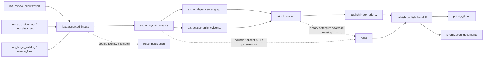

# review_prioritization

## Purpose

Rank accepted source files and functions for review using deterministic complexity, boundary,
dependency, semantic-path and history signals. A high score means “review first,” never
“vulnerable.” Missing features remain missing and reduce feature coverage rather than quietly
becoming zero-valued evidence that code is safe.

<!-- generated:begin job=job_review_prioritization -->
<!-- generated from: appsec-review.toml, containers/catalog.toml, pipeline/guidance/registry.json, tests/job-test-map.json, src/appsec_review/runtime/registry.py, src/appsec_review/runtime/contracts.py, src/appsec_review/runtime/datasets.py, src/appsec_review/guidance/workers.py, src/appsec_review/mcp/schema.py, src/appsec_review/orchestration/topology.py, src/appsec_review/orchestration/dagster/adapter.py by scripts/generate-docs.py; do not edit -->
## Declared job contract

review_prioritization

Job: `job_review_prioritization`. Enabled in the dev recipe: **true**.
Declarations describe possible work, not successful execution or consumed evidence.

### Steps and tasks

| Step | Task | Workers | Pool | Bound tool or gap | Handler |
| --- | --- | --- | --- | --- | --- |
| `extract` | `extract.dependency_graph` | 1 | `application` | Undeclared ([T-147](../TODO.md)) | [source](../../src/appsec_review/jobs/job_review_prioritization/job.py#L440) |
| `extract` | `extract.semantic_evidence` | 1 | `application` | Undeclared ([T-147](../TODO.md)) | [source](../../src/appsec_review/jobs/job_review_prioritization/job.py#L464) |
| `extract` | `extract.syntax_metrics` | 1 | `application` | Undeclared ([T-147](../TODO.md)) | [source](../../src/appsec_review/jobs/job_review_prioritization/job.py#L257) |
| `load` | `load.accepted_inputs` | 1 | `application` | Undeclared ([T-147](../TODO.md)) | [source](../../src/appsec_review/jobs/job_review_prioritization/job.py#L232) |
| `prioritize` | `prioritize.score` | 1 | `application` | Undeclared ([T-147](../TODO.md)) | [source](../../src/appsec_review/jobs/job_review_prioritization/job.py#L556) |
| `publish` | `publish.index_priority` | 1 | `application` | Undeclared ([T-147](../TODO.md)) | [source](../../src/appsec_review/jobs/job_review_prioritization/job.py#L675) |
| `publish` | `publish.publish_handoff` | 1 | `application` | Undeclared ([T-147](../TODO.md)) | [source](../../src/appsec_review/jobs/job_review_prioritization/job.py#L904) |

### Accepted input declarations

| Producer | Dataset | Schema | Channel | Availability | Missing policy |
| --- | --- | --- | --- | --- | --- |
| `job_codeql_analysis` | `handoff` | `appsec-review/job-handoff/2` | handoff | optional | gap |
| `job_codeql_analysis` | `codeql_predecessor_import` | `appsec-review/codeql-predecessor-import/1` | handoff | optional | gap |
| `job_codeql_analysis` | `codeql_graph_export` | `appsec-review/codeql-graph-export/1` | handoff | optional | gap |
| `job_codeql_analysis` | `codeql_observations` | `appsec-review/codeql-sarif-normalizer/3` | handoff | optional | gap |
| `job_codeql_analysis` | `codeql_plan_and_summary` | `appsec-review/codeql-analysis-handoff/1` | handoff | optional | gap |
| `job_codeql_analysis` | `codeql_scope_material` | `application/octet-stream` | handoff | optional | gap |
| `job_evidence_collection` | `handoff` | `appsec-review/job-handoff/2` | handoff | optional | gap |
| `job_evidence_collection` | `static_tool_observations` | `appsec-review/retrieval-index/2` | handoff | optional | gap |
| `job_evidence_collection` | `static_tool_evidence` | `appsec-review/static-tool-evidence/2` | handoff | optional | gap |
| `job_evidence_collection` | `static_tool_io` | `appsec-review/container-execution/1` | handoff | optional | gap |
| `job_review_intake` | `handoff` | `appsec-review/job-handoff/2` | handoff | optional | gap |
| `job_review_intake` | `model_preflight` | `appsec-review/model-preflight/1` | handoff | optional | gap |
| `job_review_intake` | `binary_evidence` | `appsec-review/binary-evidence-intake/1` | handoff | optional | gap |
| `job_review_intake` | `review_intake` | `appsec-review/review-intake/1` | handoff | optional | gap |
| `job_source_history_analysis` | `handoff` | `appsec-review/job-handoff/2` | handoff | optional | gap |
| `job_source_history_analysis` | `history_signals` | `appsec-review/retrieval-index/2` | handoff | optional | gap |
| `job_source_history_analysis` | `history_documents` | `appsec-review/source-history-analysis/2` | handoff | optional | gap |
| `job_source_history_analysis` | `raw_git_history` | `application/octet-stream` | handoff | optional | gap |
| `job_source_history_analysis` | `history_tool_io` | `appsec-review/container-execution/1` | handoff | optional | gap |
| `job_target_catalog` | `handoff` | `appsec-review/job-handoff/2` | handoff | optional | gap |
| `job_target_catalog` | `target_artifact_inputs` | `appsec-review/target-artifact-intake/1` | handoff | optional | gap |
| `job_target_catalog` | `source_files` | `appsec-review/retrieval-index/2` | handoff | optional | gap |
| `job_target_catalog` | `declaration_symbols` | `appsec-review/retrieval-index/2` | handoff | optional | gap |
| `job_target_catalog` | `components` | `appsec-review/retrieval-index/2` | handoff | optional | gap |
| `job_target_catalog` | `target_documents` | `appsec-review/retrieval-index/2` | handoff | optional | gap |
| `job_target_catalog` | `build_units` | `appsec-review/retrieval-index/2` | handoff | optional | gap |
| `job_target_catalog` | `catalog_documents` | `appsec-review/target-catalog/1` | handoff | optional | gap |
| `job_tree_sitter_ast` | `handoff` | `appsec-review/job-handoff/2` | handoff | optional | gap |
| `job_tree_sitter_ast` | `tree_sitter_ast` | `appsec-review/tree-sitter-normalizer/1` | handoff | optional | gap |
| `job_tree_sitter_ast` | `tree_sitter_coverage` | `appsec-review/tree-sitter-ast/1` | handoff | optional | gap |
| `job_tree_sitter_ast` | `tree_sitter_node_shards` | `appsec-review/tree-sitter-ast/1` | handoff | optional | gap |
| `job_tree_sitter_ast` | `generated_source_backing` | `appsec-review/generated-source-backing/1` | handoff | optional | gap |
| `job_tree_sitter_ast` | `tree_sitter_tool_io` | `appsec-review/container-execution/1` | handoff | optional | gap |

### Published dataset declarations

| Dataset | Step | Schema | Stage | Indexes | MCP route |
| --- | --- | --- | --- | --- | --- |
| `prioritization_documents` | `publish` | `appsec-review/review-prioritization/1` | artifact_only | Not indexed | `coverage`, `query_dataset_inventory` |
| `priority_items` | `publish` | `appsec-review/retrieval-index/2` | indexed | `priority` | `find`, `query_hotspots`, `trace` |

Protected and artifact-only routes expose sanitized metadata, not payload access.

### Model and guidance declarations

No job-level model declaration; absence of a task binding remains [T-147](../TODO.md), not a nonexecution claim.

### Test selection

| Tier | Files or selectors |
| --- | --- |
| acceptance | None declared |
| integration | None declared |
| live | None declared |
| unit | `tests/test_review_prioritization.py::test_go_error_checks_are_error_propagation_branches` `tests/test_review_prioritization.py::test_priority_index_shard_names_its_publication_unit_and_satisfies_required_output` `tests/test_review_prioritization.py::test_rust_question_mark_closures_match_guards_and_recursion` |

### Dagster placement

Dispatch: `review_graph`. Review graph member: **true**. Enabled graph member: **true**.

Declared predecessors: `job_codeql_analysis`.

### Declared dataflow

```mermaid
flowchart LR
  job["job_review_prioritization"]
  producer0["job_codeql_analysis"]
  input0["handoff"]
  input_schema0["appsec-review/job-handoff/2"]
  producer0 --> input0 --> job
  input0 -. schema .-> input_schema0
  producer1["job_codeql_analysis"]
  input1["codeql_predecessor_import"]
  input_schema1["appsec-review/codeql-predecessor-import/1"]
  producer1 --> input1 --> job
  input1 -. schema .-> input_schema1
  producer2["job_codeql_analysis"]
  input2["codeql_graph_export"]
  input_schema2["appsec-review/codeql-graph-export/1"]
  producer2 --> input2 --> job
  input2 -. schema .-> input_schema2
  producer3["job_codeql_analysis"]
  input3["codeql_observations"]
  input_schema3["appsec-review/codeql-sarif-normalizer/3"]
  producer3 --> input3 --> job
  input3 -. schema .-> input_schema3
  producer4["job_codeql_analysis"]
  input4["codeql_plan_and_summary"]
  input_schema4["appsec-review/codeql-analysis-handoff/1"]
  producer4 --> input4 --> job
  input4 -. schema .-> input_schema4
  producer5["job_codeql_analysis"]
  input5["codeql_scope_material"]
  input_schema5["application/octet-stream"]
  producer5 --> input5 --> job
  input5 -. schema .-> input_schema5
  producer6["job_evidence_collection"]
  input6["handoff"]
  input_schema6["appsec-review/job-handoff/2"]
  producer6 --> input6 --> job
  input6 -. schema .-> input_schema6
  producer7["job_evidence_collection"]
  input7["static_tool_observations"]
  input_schema7["appsec-review/retrieval-index/2"]
  producer7 --> input7 --> job
  input7 -. schema .-> input_schema7
  producer8["job_evidence_collection"]
  input8["static_tool_evidence"]
  input_schema8["appsec-review/static-tool-evidence/2"]
  producer8 --> input8 --> job
  input8 -. schema .-> input_schema8
  producer9["job_evidence_collection"]
  input9["static_tool_io"]
  input_schema9["appsec-review/container-execution/1"]
  producer9 --> input9 --> job
  input9 -. schema .-> input_schema9
  producer10["job_review_intake"]
  input10["handoff"]
  input_schema10["appsec-review/job-handoff/2"]
  producer10 --> input10 --> job
  input10 -. schema .-> input_schema10
  producer11["job_review_intake"]
  input11["model_preflight"]
  input_schema11["appsec-review/model-preflight/1"]
  producer11 --> input11 --> job
  input11 -. schema .-> input_schema11
  producer12["job_review_intake"]
  input12["binary_evidence"]
  input_schema12["appsec-review/binary-evidence-intake/1"]
  producer12 --> input12 --> job
  input12 -. schema .-> input_schema12
  producer13["job_review_intake"]
  input13["review_intake"]
  input_schema13["appsec-review/review-intake/1"]
  producer13 --> input13 --> job
  input13 -. schema .-> input_schema13
  producer14["job_source_history_analysis"]
  input14["handoff"]
  input_schema14["appsec-review/job-handoff/2"]
  producer14 --> input14 --> job
  input14 -. schema .-> input_schema14
  producer15["job_source_history_analysis"]
  input15["history_signals"]
  input_schema15["appsec-review/retrieval-index/2"]
  producer15 --> input15 --> job
  input15 -. schema .-> input_schema15
  producer16["job_source_history_analysis"]
  input16["history_documents"]
  input_schema16["appsec-review/source-history-analysis/2"]
  producer16 --> input16 --> job
  input16 -. schema .-> input_schema16
  producer17["job_source_history_analysis"]
  input17["raw_git_history"]
  input_schema17["application/octet-stream"]
  producer17 --> input17 --> job
  input17 -. schema .-> input_schema17
  producer18["job_source_history_analysis"]
  input18["history_tool_io"]
  input_schema18["appsec-review/container-execution/1"]
  producer18 --> input18 --> job
  input18 -. schema .-> input_schema18
  producer19["job_target_catalog"]
  input19["handoff"]
  input_schema19["appsec-review/job-handoff/2"]
  producer19 --> input19 --> job
  input19 -. schema .-> input_schema19
  producer20["job_target_catalog"]
  input20["target_artifact_inputs"]
  input_schema20["appsec-review/target-artifact-intake/1"]
  producer20 --> input20 --> job
  input20 -. schema .-> input_schema20
  producer21["job_target_catalog"]
  input21["source_files"]
  input_schema21["appsec-review/retrieval-index/2"]
  producer21 --> input21 --> job
  input21 -. schema .-> input_schema21
  producer22["job_target_catalog"]
  input22["declaration_symbols"]
  input_schema22["appsec-review/retrieval-index/2"]
  producer22 --> input22 --> job
  input22 -. schema .-> input_schema22
  producer23["job_target_catalog"]
  input23["components"]
  input_schema23["appsec-review/retrieval-index/2"]
  producer23 --> input23 --> job
  input23 -. schema .-> input_schema23
  producer24["job_target_catalog"]
  input24["target_documents"]
  input_schema24["appsec-review/retrieval-index/2"]
  producer24 --> input24 --> job
  input24 -. schema .-> input_schema24
  producer25["job_target_catalog"]
  input25["build_units"]
  input_schema25["appsec-review/retrieval-index/2"]
  producer25 --> input25 --> job
  input25 -. schema .-> input_schema25
  producer26["job_target_catalog"]
  input26["catalog_documents"]
  input_schema26["appsec-review/target-catalog/1"]
  producer26 --> input26 --> job
  input26 -. schema .-> input_schema26
  producer27["job_tree_sitter_ast"]
  input27["handoff"]
  input_schema27["appsec-review/job-handoff/2"]
  producer27 --> input27 --> job
  input27 -. schema .-> input_schema27
  producer28["job_tree_sitter_ast"]
  input28["tree_sitter_ast"]
  input_schema28["appsec-review/tree-sitter-normalizer/1"]
  producer28 --> input28 --> job
  input28 -. schema .-> input_schema28
  producer29["job_tree_sitter_ast"]
  input29["tree_sitter_coverage"]
  input_schema29["appsec-review/tree-sitter-ast/1"]
  producer29 --> input29 --> job
  input29 -. schema .-> input_schema29
  producer30["job_tree_sitter_ast"]
  input30["tree_sitter_node_shards"]
  input_schema30["appsec-review/tree-sitter-ast/1"]
  producer30 --> input30 --> job
  input30 -. schema .-> input_schema30
  producer31["job_tree_sitter_ast"]
  input31["generated_source_backing"]
  input_schema31["appsec-review/generated-source-backing/1"]
  producer31 --> input31 --> job
  input31 -. schema .-> input_schema31
  producer32["job_tree_sitter_ast"]
  input32["tree_sitter_tool_io"]
  input_schema32["appsec-review/container-execution/1"]
  producer32 --> input32 --> job
  input32 -. schema .-> input_schema32
  output0["prioritization_documents"]
  output_schema0["appsec-review/review-prioritization/1"]
  job --> output0
  output0 -. schema .-> output_schema0
  output1["priority_items"]
  output_schema1["appsec-review/retrieval-index/2"]
  job --> output1
  output1 -. schema .-> output_schema1
```

<!-- generated:end -->

## Process

The [handler](../../src/appsec_review/jobs/job_review_prioritization/job.py) uses the explicit
[scoring rule](../../src/appsec_review/jobs/job_review_prioritization/scoring.py), accepted syntax
and source custody; it does not dispatch an LLM despite the score's historical name.

### `load`

1. In `load.accepted_inputs`, verify accepted intake, catalog and Tree-sitter results and require
   their source snapshots to agree with the job fingerprint.
2. Verify source backing and collect optional scanner, CodeQL and history handoff identities.
   Retain policy exclusions, including disabled-language coverage, rather than inventing syntax.

### `extract`

1. In `extract.syntax_metrics`, reserve bounded resources and stream accepted syntax rows by file.
   Enforce file, byte, function and signal bounds. Resolve source bytes before deriving function
   spans, SLOC, cyclomatic/cognitive measures, suppressions and behavior signals.
2. Retain parse errors, unsupported constructs, absent/truncated AST and unscored languages.
   Keep error-propagation contributions explicit; do not silently substitute lexical guesses
   for accepted tree structure.
3. In `extract.dependency_graph`, derive bounded import relationships and afferent/efferent
   coupling. Mark unresolved/dynamic imports as lower-bound context.
4. In `extract.semantic_evidence`, normalize accepted Semgrep signals and CodeQL paths against
   accepted file identities and bounded flow steps. A path not bound to accepted files contributes
   a gap, not an accepted semantic signal.

### `prioritize`

1. In `prioritize.score`, join syntax, coupling, semantic evidence and available history metrics.
   Keep unavailable semantic/history dimensions null and retain their disposition.
2. Normalize each available feature to a zero-anchored mid-rank percentile in the configured
   population, separately for file and function items. Compute the weighted mean over available
   features and record the share of configured weight actually covered.
3. Order by descending score, boundary count and feature coverage, then stable source/name
   tie-breakers. Select file and function prefixes under the shared index ceiling; retain the
   full ranking document.

### `publish`

1. In `publish.index_priority`, fingerprint syntax, dependency, semantic and ranking artifacts,
   settings and rule identities. Build or reuse the immutable `priority` shard.
2. Add selected priority items, bounded resolving evidence and dependency context, preserving
   location/mapping identities. Record a dependency-context cap rather than silently claiming
   the full graph was indexed.
3. Verify and publish the combined manifest and `prioritization_documents` summary. Report total
   ranked counts separately from indexed prefixes and retain every extraction/history gap.

## Dataflow

See [accepted input receipts](../architecture/job-input-contracts.md#admission-and-read-receipts)
and the [location contract](../architecture/python-and-retrieval.md#identity-and-location-contract).
Retrieval exposure of a rank does not upgrade it to finding evidence.

## Gaps

These handler/helper reasons are legacy strings without producer-supplied retryability
classification. They are not new `producer-gap/1` codes; use
[canonical outcomes](../architecture/job-interchange.md#the-control-layer-beneath-the-envelope).

| Reason family | Scope and walk interpretation |
| --- | --- |
| Delivery-policy and disabled Swift gaps; `language_not_scored` | Source population excluded or unsupported; absence of rank has no safety meaning. |
| `file_byte_bound_reached`, `file_bound_reached`, `function_bound_reached`, `signals_truncated` | Named file or bounded extraction population omitted. |
| `ast_unavailable`, `ast_truncated`, `parse_errors`, `unsupported_construct`, `parse_error` | Syntax/function metrics incomplete or qualified. |
| `unresolved_or_dynamic_imports`, `import_record_bound_reached` | Coupling is a lower bound, not a complete dependency graph. |
| `semgrep_review_signals_unavailable`, Semgrep review signal without category or location, `semgrep_signal_not_bound_to_accepted_file`; inherited `semgrep` reasons | Scanner signal unavailable, incomplete or rejected at file association. |
| `semantic_paths_unavailable`, `semantic_paths_partial`, `semantic_path_step_bound_reached`, `semantic_path_flow_boundaries_unavailable`, `semantic_paths_truncated`, semantic path not bound to accepted files | CodeQL path coverage unavailable, capped, missing flow boundaries or outside accepted file identities. |
| `history_hotspots_unavailable` | History decision/source does not supply usable hotspot metrics. |
| `dependency_graph_context_bound_reached` | Published retrieval context is smaller than the dependency graph. |

Source/hash disagreement and incompatible input snapshots fail the job. Missing-feature lists and
`feature_coverage` must be inspected alongside gaps; a score alone conceals what was not measured.
Named approximation work remains [T-031](../TODO.md): resolved call targets, fuller import
resolution, API diffs, conditional/macro flow and additional language mappings.

## Acceptance

1. **A. Inputs:** Compare intake/catalog/AST snapshot identities and optional scanner/history pins
   with the claim and summary. Record scored-language and delivery-scope populations and bounds.
2. **B. Independent comparison:** Count eligible accepted source files and AST function spans,
   partitioning scored, skipped and capped cases. Independently recompute representative metrics
   from accepted syntax/source and percentile/weight calculations from the full ranking population.
   Compare ranked totals with indexed prefix counts and resolving evidence, not just top scores.
3. **C. Gaps:** Group canonical outcomes by cause and map path/function reasons to omissions,
   missing features and lower-bound coupling. Unexpected loss or unscored target language stops
   the walk unless its cost was explicitly accepted.
4. **D. Baseline:** Save an authorized `stepwise.py accept` baseline and corpus namespace with
   source/rule hashes, rank population, ranked/indexed counts and feature-coverage distributions.
   Compare rule/settings changes separately from target changes.

## Resume and invalidation

The priority-shard fingerprint binds the four computation artifacts, target snapshot, settings,
score/rule identities, accepted Tree-sitter parser, language/delivery mapping and import-graph
mapping. An upstream syntax, semantic or history change changes its inputs; a weight or selection
change invalidates ranking/index publication without requiring scanner reruns.
[Runtime reuse](../architecture/jobs-and-runtime.md#wave-1-resumability) additionally pins
configuration, component and handoff identities. Artifact-bearing intermediate results are not
portable failed-attempt checkpoints.
