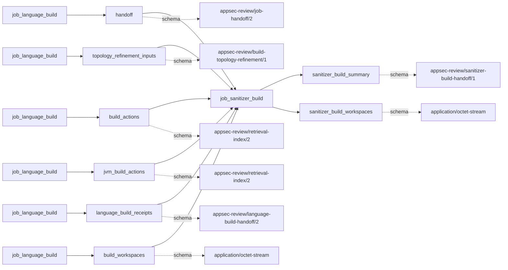
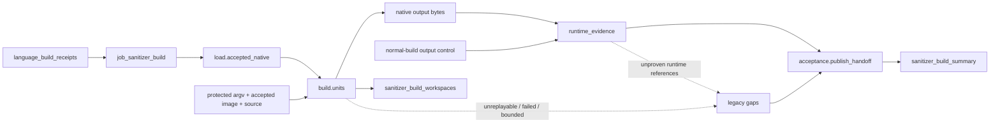

# sanitizer_build

## Purpose

Can the accepted native build be replayed with sanitizer flags, and do its resulting bytes
actually reference the required sanitizer runtime? This job publishes a hash-bound instrumented
output catalog and explicit per-unit failures. It refuses to call injected flags proof of
instrumentation, to infer safety from absent symbols, or to run produced binaries as a security
test; runtime behavior remains unverified.

<!-- generated:begin job=job_sanitizer_build -->
<!-- generated from: appsec-review.toml, containers/catalog.toml, pipeline/guidance/registry.json, tests/job-test-map.json, src/appsec_review/runtime/registry.py, src/appsec_review/runtime/contracts.py, src/appsec_review/runtime/datasets.py, src/appsec_review/guidance/workers.py, src/appsec_review/mcp/schema.py, src/appsec_review/orchestration/topology.py, src/appsec_review/orchestration/dagster/adapter.py by scripts/generate-docs.py; do not edit -->
## Declared job contract

sanitizer_build

Job: `job_sanitizer_build`. Enabled in the dev recipe: **true**.
Declarations describe possible work, not successful execution or consumed evidence.

### Steps and tasks

| Step | Task | Workers | Pool | Bound tool or gap | Handler |
| --- | --- | --- | --- | --- | --- |
| `acceptance` | `acceptance.publish_handoff` | 1 | `application` | Undeclared ([T-147](../TODO.md)) | [source](../../src/appsec_review/jobs/job_sanitizer_build/job.py#L425) |
| `build` | `build.units` | 1 | `application` | Undeclared ([T-147](../TODO.md)) | [source](../../src/appsec_review/jobs/job_sanitizer_build/job.py#L407) |
| `load` | `load.accepted_native` | 1 | `application` | Undeclared ([T-147](../TODO.md)) | [source](../../src/appsec_review/jobs/job_sanitizer_build/job.py#L386) |

### Accepted input declarations

| Producer | Dataset | Schema | Channel | Availability | Missing policy |
| --- | --- | --- | --- | --- | --- |
| `job_language_build` | `handoff` | `appsec-review/job-handoff/2` | handoff | required | reject |
| `job_language_build` | `topology_refinement_inputs` | `appsec-review/build-topology-refinement/1` | handoff | optional | gap |
| `job_language_build` | `build_actions` | `appsec-review/retrieval-index/2` | handoff | optional | gap |
| `job_language_build` | `jvm_build_actions` | `appsec-review/retrieval-index/2` | handoff | optional | gap |
| `job_language_build` | `language_build_receipts` | `appsec-review/language-build-handoff/2` | handoff | optional | gap |
| `job_language_build` | `build_workspaces` | `application/octet-stream` | handoff | optional | gap |

### Published dataset declarations

| Dataset | Step | Schema | Stage | Indexes | MCP route |
| --- | --- | --- | --- | --- | --- |
| `sanitizer_build_summary` | `acceptance` | `appsec-review/sanitizer-build-handoff/1` | artifact_only | Not indexed | `coverage`, `query_dataset_inventory` |
| `sanitizer_build_workspaces` | `build` | `application/octet-stream` | protected | Not indexed | `coverage`, `query_dataset_inventory` |

Protected and artifact-only routes expose sanitized metadata, not payload access.

### Model and guidance declarations

No job-level model declaration; absence of a task binding remains [T-147](../TODO.md), not a nonexecution claim.

### Test selection

| Tier | Files or selectors |
| --- | --- |
| acceptance | None declared |
| integration | None declared |
| live | `tests/live/test_sanitizer_live.py` |
| unit | `tests/test_sanitizer_build.py::test_invalid_settings_are_rejected` `tests/test_sanitizer_build.py::test_unknown_and_missing_settings_are_rejected` `tests/test_sanitizer_build.py::test_single_sanitizer_configuration_changes_the_flags` |

### Dagster placement

Dispatch: `review_graph`. Review graph member: **true**. Enabled graph member: **true**.

Declared predecessors: `job_language_build`.

### Declared dataflow

<!-- generated:end -->

## Process

Source: [handlers and replay checks](../../src/appsec_review/jobs/job_sanitizer_build/job.py),
[flag policy](../../src/appsec_review/jobs/job_sanitizer_build/settings.py) and
[runtime-reference evidence](../../src/appsec_review/jobs/job_sanitizer_build/evidence.py).
[Sanitizer operations](sanitizer-build.md) owns settings and output-layout details; accepted
reads follow the [input contract](../architecture/job-input-contracts.md).

### `load`

1. Validate the configured steps/tasks and typed sanitizer settings.
2. Read the accepted language-build document and require its source fingerprint to match the
   claim. Reject duplicate build-unit identities.
3. Sort native receipts by build-unit ID; select at most `max_units` and retain every omitted
   native unit. Record other families explicitly as `SKIPPED_NA`.
4. Bind the selected list to the exact language-build handoff hash. Do not equate selection
   with successful or replayable native work.

### `build`

1. Re-read accepted language-build authority and require the same handoff hash. Rebuild only
   the selected receipts through the configured bounded worker pool.
2. For each native unit, require prior `SUCCEEDED` status and an enabled build system. Resolve
   the complete configure/build replay set and hash-check protected argv documents, working
   directories, image IDs and argv hashes. Missing/redacted/invalid commands are unreplayable;
   changed accepted command identity raises `FrameworkIntegrityError`.
3. Detect command-line or recorded-environment flags that would mask or conflict with
   sanitizer injection. On conflict, report the reason without building. Otherwise prepend
   configured sanitizer flags to `CFLAGS`, `CXXFLAGS` and `LDFLAGS` and apply the configured
   compatible build environment.
4. Remove the prior per-unit sanitizer workspace if present and copy source into a fresh one.
   Record the protected replay plan and bounded pre-build file snapshot. Do not reuse the
   ordinary build tree as the instrumented workspace.
5. Resolve the accepted build image and replay its commands with bounded time/output through
   `BuildContainerExecutor`. Retain command exits and streams; stop on the first failure,
   including a recognized missing sanitizer runtime. Never invoke a produced file afterward.
6. Recheck target identity. For a nonfailed rebuild, replay accepted output-tree classifications,
   prune dependency/excluded/bookkeeping content and catalog newly changed native objects,
   executables and shared libraries up to the artifact bound.
7. Read ELF symbol tables and linked runtime names using the bounded in-repository reader.
   Mark each output instrumented only when all configured `required_evidence` references are
   established. Compare the normal-build artifact at the same path/kind as a control when
   available; record unavailable/changed control evidence without inventing a negative result.
8. Retain the output digest and complete workspace manifest. A linked output without proof,
   no useful outputs, catalog truncation or missing complete manifest prevents a successful
   instrumented-unit verdict. Aggregate omissions and unit reasons without losing failed
   unit status inside the summary.

### `acceptance`

1. Gather unit results, omitted units and nonnative dispositions. Count instrumented units
   separately from individually instrumented outputs: some outputs can have runtime evidence
   while their unit remains incomplete.
2. Write `sanitizer-build-summary.json` with upstream handoff, flags/settings identity,
   build-output policy, per-output evidence/control records, counts and gaps.
3. Publish dataset `sanitizer_build_summary` as artifact-only metadata and retain
   `sanitizer_build_workspaces` as protected bytes. Nothing here becomes indexed source text
   or proof of a runtime test. Framework publication failure is not partial acceptance.

## Dataflow

## Gaps

This pinned job returns legacy strings from `build.units` and publication, not dedicated typed
codes for each message. Canonical outcomes convert them to `producer_reported_gap` with
`retryable=False`. `_bounded` retains a bounded unique per-unit list plus an omitted-reasons
count. These are real coverage losses, not automatically advisory.

| Where | Source-derived reasons |
| --- | --- |
| Selection/replay | Native unit bound reached; ordinary build did not succeed; unsupported configured build system; missing recipe/image/replay set; missing, invalid or secret-redacted protected command. |
| Flag preparation | Accepted arguments mask flag variables or already select sanitizers; recorded environment selects sanitizers or contradicts configured build environment. |
| Workspace/image | Previous workspace cannot be removed; source cannot be copied; source/workspace file bound reached; accepted image unavailable or changed. |
| Command execution | Command cannot run, times out or exits unsuccessfully; diagnostics can specifically identify a missing sanitizer runtime. |
| Output/evidence | Artifact-count truncation; no native output; no linked output and no instrumented object; malformed ELF; absent symbol tables; missing required runtime references; incomplete workspace manifest. |

A failed individual rebuild retains `terminal_status=FAILED`, but the aggregate can publish
`COMPLETED_WITH_GAPS`. The job does not add a retry disposition merely because such a nested
unit failed; its false-retryable legacy records do not promise an automatic retry on resume.
No native units is `NOT_APPLICABLE`; omitted native units are not. Target drift, accepted-command
hash/identity mismatch, wrong upstream snapshot, changed handoff or duplicate IDs raise
framework-integrity errors instead of a successful gap publication.
See [job interchange](../architecture/job-interchange.md). A walk must establish and approve
the cost of each actual cause; unsupported or ignored flags are never clean coverage.

## Acceptance

1. **A. Inputs:** Match the language-build read receipt and handoff hash to the claim; verify
   selected native IDs, source snapshot, protected replay command hashes and image identities.
   Account separately for omitted native and not-applicable nonnative receipts.
2. **B. Independent comparison:** Compare planned/rebuilt/instrumented counts with the accepted
   native receipt list. Independently inspect symbol/loader tables of sampled retained output
   bytes and their normal-build controls without executing either. Compare output hashes,
   sizes and workspace manifest membership; state which required sanitizer evidence was checked.
3. **C. Gaps:** Group canonical outcomes by unit and reason; reconcile aggregate coverage with
   nested failed-unit statuses and omitted-reason counts. Missing symbols do not prove absence
   of instrumentation or safety. Stop for causes outside the walk's expected-gaps list.
4. **D. Baseline:** After checks A–C, use `stepwise.py accept`; record corpus namespace and saved
   baseline of selected units, replay identities, instrumentation/control evidence and gaps.

## Resume and invalidation

There is no custom per-unit sanitizer checkpoint or independent input-identity probe.
Whole-job reuse binds target, accepted language-build handoff, frozen job/configuration,
implementation/schema/validation and retained artifact identities through
[Wave 1 resumability](../architecture/jobs-and-runtime.md#wave-1-resumability). The summary also
records receipt fingerprints, sanitizer settings identity and output-policy identity.
Changing flags, required evidence, selection bounds, upstream recipes/images or source requires
new computation under the appropriate frozen configuration. A fresh execution replaces its
per-unit sanitizer workspace and replays commands; it does not resume a half-instrumented tree.
An accepted partial result is not automatically retried solely because its nested rebuild failed.
