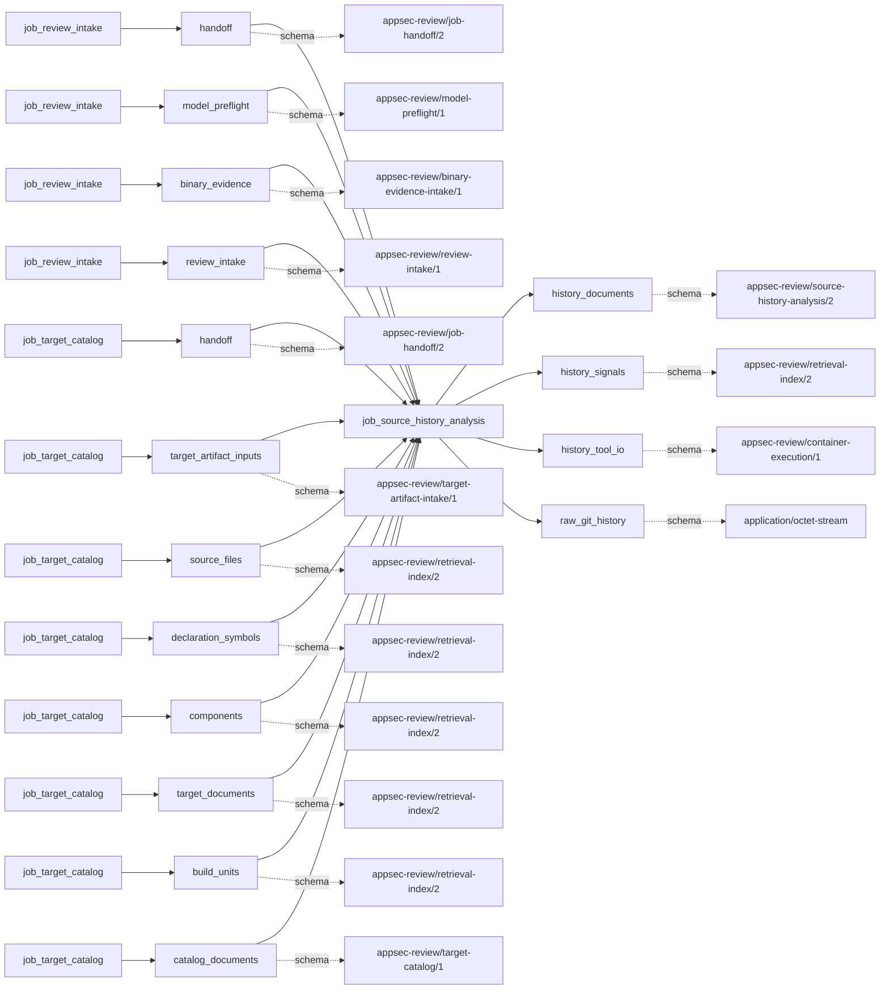

# source_history_analysis

## Purpose

Where does the accepted source's change history suggest concentrating review attention? This
job publishes source-bound churn, ownership, complexity and fix-pattern signals, per-source
Security Instability Index rankings, and weaker change-log context. It refuses to interpret a
hotspot score, fix label, missing history or absent symbol as vulnerability evidence or a clean
security result.

<!-- generated:begin job=job_source_history_analysis -->
<!-- generated from: appsec-review.toml, containers/catalog.toml, pipeline/guidance/registry.json, tests/job-test-map.json, src/appsec_review/runtime/registry.py, src/appsec_review/runtime/contracts.py, src/appsec_review/runtime/datasets.py, src/appsec_review/guidance/workers.py, src/appsec_review/mcp/schema.py, src/appsec_review/orchestration/topology.py, src/appsec_review/orchestration/dagster/adapter.py by scripts/generate-docs.py; do not edit -->
## Declared job contract

source_history_analysis

Job: `job_source_history_analysis`. Enabled in the dev recipe: **true**.
Declarations describe possible work, not successful execution or consumed evidence.

### Steps and tasks

| Step | Task | Workers | Pool | Bound tool or gap | Handler |
| --- | --- | --- | --- | --- | --- |
| `acquire` | `acquire.changelog_history` | 1 | `application` | Undeclared ([T-147](../TODO.md)) | [source](../../src/appsec_review/jobs/job_source_history_analysis/job.py#L1173) |
| `acquire` | `acquire.git_history` | 1 | `application` | Undeclared ([T-147](../TODO.md)) | [source](../../src/appsec_review/jobs/source_lanes.py#L57) |
| `acquire` | `acquire.github_enrichment` | 1 | `application` | Undeclared ([T-147](../TODO.md)) | [source](../../src/appsec_review/jobs/source_lanes.py#L57) |
| `acquire` | `acquire.normalize_changes` | 1 | `application` | Undeclared ([T-147](../TODO.md)) | [source](../../src/appsec_review/jobs/source_lanes.py#L57) |
| `analyze` | `analyze.blame_age` | 1 | `application` | Undeclared ([T-147](../TODO.md)) | [source](../../src/appsec_review/jobs/source_lanes.py#L57) |
| `analyze` | `analyze.classify_changes` | 1 | `application` | Undeclared ([T-147](../TODO.md)) | [source](../../src/appsec_review/jobs/source_lanes.py#L57) |
| `analyze` | `analyze.co_change` | 1 | `application` | Undeclared ([T-147](../TODO.md)) | [source](../../src/appsec_review/jobs/source_lanes.py#L57) |
| `analyze` | `analyze.compute_signals` | 1 | `application` | Undeclared ([T-147](../TODO.md)) | [source](../../src/appsec_review/jobs/source_lanes.py#L57) |
| `analyze` | `analyze.fix_on_fix` | 1 | `application` | Undeclared ([T-147](../TODO.md)) | [source](../../src/appsec_review/jobs/source_lanes.py#L57) |
| `analyze` | `analyze.line_history` | 1 | `application` | Undeclared ([T-147](../TODO.md)) | [source](../../src/appsec_review/jobs/source_lanes.py#L57) |
| `analyze` | `analyze.rank` | 1 | `application` | Undeclared ([T-147](../TODO.md)) | [source](../../src/appsec_review/jobs/source_lanes.py#L57) |
| `analyze` | `analyze.symbol_signals` | 1 | `application` | Undeclared ([T-147](../TODO.md)) | [source](../../src/appsec_review/jobs/source_lanes.py#L57) |
| `analyze` | `analyze.symbol_spans` | 1 | `application` | Undeclared ([T-147](../TODO.md)) | [source](../../src/appsec_review/jobs/source_lanes.py#L57) |
| `publish` | `publish.index_history` | 1 | `application` | Undeclared ([T-147](../TODO.md)) | [source](../../src/appsec_review/jobs/source_lanes.py#L57) |
| `publish` | `publish.publish_handoff` | 1 | `application` | Undeclared ([T-147](../TODO.md)) | [source](../../src/appsec_review/jobs/source_lanes.py#L57) |
| `resolve_sources` | `resolve_sources.bind_snapshot` | 1 | `application` | Undeclared ([T-147](../TODO.md)) | [source](../../src/appsec_review/jobs/source_lanes.py#L57) |
| `resolve_sources` | `resolve_sources.resolve_history_source` | 1 | `application` | Undeclared ([T-147](../TODO.md)) | [source](../../src/appsec_review/jobs/job_source_history_analysis/job.py#L447) |

### Accepted input declarations

| Producer | Dataset | Schema | Channel | Availability | Missing policy |
| --- | --- | --- | --- | --- | --- |
| `job_review_intake` | `handoff` | `appsec-review/job-handoff/2` | handoff | required | reject |
| `job_review_intake` | `model_preflight` | `appsec-review/model-preflight/1` | handoff | optional | gap |
| `job_review_intake` | `binary_evidence` | `appsec-review/binary-evidence-intake/1` | handoff | optional | gap |
| `job_review_intake` | `review_intake` | `appsec-review/review-intake/1` | handoff | optional | gap |
| `job_target_catalog` | `handoff` | `appsec-review/job-handoff/2` | handoff | required | reject |
| `job_target_catalog` | `target_artifact_inputs` | `appsec-review/target-artifact-intake/1` | handoff | optional | gap |
| `job_target_catalog` | `source_files` | `appsec-review/retrieval-index/2` | handoff | optional | gap |
| `job_target_catalog` | `declaration_symbols` | `appsec-review/retrieval-index/2` | handoff | optional | gap |
| `job_target_catalog` | `components` | `appsec-review/retrieval-index/2` | handoff | optional | gap |
| `job_target_catalog` | `target_documents` | `appsec-review/retrieval-index/2` | handoff | optional | gap |
| `job_target_catalog` | `build_units` | `appsec-review/retrieval-index/2` | handoff | optional | gap |
| `job_target_catalog` | `catalog_documents` | `appsec-review/target-catalog/1` | handoff | optional | gap |

### Published dataset declarations

| Dataset | Step | Schema | Stage | Indexes | MCP route |
| --- | --- | --- | --- | --- | --- |
| `history_documents` | `publish` | `appsec-review/source-history-analysis/2` | artifact_only | Not indexed | `coverage`, `query_dataset_inventory` |
| `history_signals` | `publish` | `appsec-review/retrieval-index/2` | indexed | `history` | `find`, `query_precomputed`, `search`, `trace` |
| `history_tool_io` | `analyze` | `appsec-review/container-execution/1` | protected | Not indexed | `coverage`, `query_dataset_inventory` |
| `raw_git_history` | `acquire` | `application/octet-stream` | protected | Not indexed | `coverage`, `query_dataset_inventory` |

Protected and artifact-only routes expose sanitized metadata, not payload access.

### Model and guidance declarations

No job-level model declaration; absence of a task binding remains [T-147](../TODO.md), not a nonexecution claim.

### Test selection

| Tier | Files or selectors |
| --- | --- |
| acceptance | None declared |
| integration | `tests/integration/job_source_history_analysis/test_analysis.py` `tests/integration/job_source_history_analysis/test_changelog_projection.py` `tests/integration/job_source_history_analysis/test_components.py` `tests/integration/job_source_history_analysis/test_hotspots.py` |
| live | None declared |
| unit | `tests/unit/job_source_history_analysis/test_algorithms.py` `tests/unit/job_source_history_analysis/test_artifacts.py` `tests/unit/job_source_history_analysis/test_changelog.py` `tests/unit/job_source_history_analysis/test_contract.py` `tests/unit/job_source_history_analysis/test_edge_cases.py` `tests/unit/job_source_history_analysis/test_fingerprint.py` `tests/unit/job_source_history_analysis/test_git.py` `tests/unit/job_source_history_analysis/test_github.py` `tests/unit/job_source_history_analysis/test_handlers.py` `tests/unit/job_source_history_analysis/test_legacy_hotspots.py` `tests/unit/job_source_history_analysis/test_publication.py` `tests/unit/job_source_history_analysis/test_settings.py` `tests/unit/job_source_history_analysis/test_sources.py` `tests/unit/job_source_history_analysis/test_symbols_handler.py` |

### Dagster placement

Dispatch: `review_graph`. Review graph member: **true**. Enabled graph member: **true**.

Declared predecessors: `job_target_catalog`.

### Declared dataflow

<!-- generated:end -->

## Process

Source: [handlers](../../src/appsec_review/jobs/job_source_history_analysis/job.py),
[source discovery](../../src/appsec_review/jobs/job_source_history_analysis/discovery.py),
[Git parsing](../../src/appsec_review/jobs/job_source_history_analysis/git.py) and
[ranking](../../src/appsec_review/jobs/job_source_history_analysis/hotspots.py).
Metric definitions live in [source-history architecture](../architecture/source-history-analysis.md);
operator context is in [source-history operations](source-history-analysis.md).

### `resolve_sources`

1. Read accepted intake and catalog artifacts through the [input contract](../architecture/job-input-contracts.md);
   require equal source identities. Load acquisition identity and catalog component roots.
   Apply configured exclusions and the Swift execution policy without inventing target scope.
2. Discover bounded local/acquired source lanes, retaining source IDs, root mappings and pinned
   revisions. Each lane owns its files rather than borrowing a neighboring repository's history.
3. Resolve local Git metadata. The current `resolve_git_source` anchors at resolved `HEAD`;
   only unresolved `HEAD` falls back to a known mainline tip, with an observation. Verify
   acquired revision binding; do not silently analyze a newer branch tip.
4. Run the bounded tree listing and compare accepted SHA-256 file bytes with Git blob IDs.
   Retain exact versus divergent/untracked paths. If no accepted files match, mark history
   unrelated and empty the eligible set. Changed accepted source bytes raise.
5. Record skipped policy/not-applicable lanes distinctly from discovery or execution gaps.

### `acquire`

1. For bound Git lanes, request first-parent log and message streams with one extra change to
   detect the configured change bound. Enforce tool-output/file-size and parser record/path
   bounds; discard incomplete output rather than normalize it as complete history.
2. Retain protected raw streams with image, command and source identities. Verify their hashes
   while parsing. Normalize renames/current paths, shallow history, bulk changes and a calendar
   window anchored at the selected snapshot commit's committer time, not the current date.
3. Enrich only eligible repository identities at the configured GitHub endpoint, subject to
   credentials and request/page/record limits. Preserve unavailable/indeterminate review facts.
4. Independently parse accepted change-log files in shallowest-path order within configured
   file/byte/entry/line/path bounds. Remove author/message text from normalized output;
   bind path mentions to accepted catalog identities. Contain ordinary parser failures per
   file/source, but propagate `ChangelogIntegrityError` for changed accepted bytes.

### `analyze`

1. Classify changes from bounded messages and accepted review labels. Compute file/component
   churn, frequency, author and recency signals; apply ranking exclusions to generated,
   vendored, fixture, documentation, lockfile, bulk and formatting work as configured.
2. Select highest-churn eligible files for bounded blame, co-change and line-history analysis.
   Divergent files do not acquire exact line attribution.
3. Obtain bounded Tree-sitter spans only for supported, exact files. Verify grammar/image,
   request scope, file hashes and returned locations; report missing/truncated parsing.
4. Attribute hunks to innermost symbols and detect fix-on-fix only where line/symbol evidence
   permits it. Preserve undetermined matches and unavailable timing signals.
5. Rank file and symbol populations separately using transformed, min-max-normalized metrics.
   Missing metrics reduce `weight_coverage`, not zero-fill the inputs. Break ties deterministically;
   derive component priority from its best file and retain only configured top hotspot counts.

### `publish`

1. Build or reuse the fingerprinted `history` shard for each source, with changes, signals,
   hotspots, resolving locations, coverage and separately labeled change-log records.
2. Set change-log role to `primary` only when it ranks files and Git ranking is absent or has
   shallow/truncated/unrelated coverage; otherwise use `supplement`. Never add entry mentions
   to Git commit counts or SII.
3. Compose the verified upstream retrieval manifest without replacing unrelated shards.
   Recompute the history identity before writing `source-history.json`; reject drift.
4. Publish source-local rankings, hotspot references and gaps. Multi-source publication keeps
   per-source populations rather than constructing one misleading cross-repository ranking.

## Dataflow

```mermaid
flowchart LR
  intake["review_intake"] --> job["job_source_history_analysis"]
  catalog["catalog_documents"] --> job
  job --> resolve["resolve_sources.resolve_history_source"]
  resolve --> bind["resolve_sources.bind_snapshot"]
  bind --> git["acquire.git_history"]
  git --> normalize["acquire.normalize_changes"]
  normalize --> github["acquire.github_enrichment"]
  resolve --> changelog["acquire.changelog_history"]
  normalize --> signals["analyze.compute_signals"]
  github --> signals
  signals --> spans["analyze.line_history + analyze.symbol_spans"]
  spans --> rank["analyze.rank"]
  rank --> index["publish.index_history"]
  changelog --> index
  index --> output["history_signals + history_documents"]
  git -. "execution / bounds" .-> gaps["outcomes"]
  changelog -. "typed change-log gaps" .-> gaps
  spans -. "unavailable attribution" .-> gaps
```

## Gaps

Git, GitHub and analysis units principally return legacy reason strings; their canonical
records are `producer_reported_gap`, `retryable=False`, not codes named after those strings.
Explicit `GAP` dispositions additionally request retry for Git tree/log/message failures,
Git output limits, retryable GitHub enrichment, line-history execution and unavailable/failed
Tree-sitter execution. Read canonical outcomes for the resulting retry flag; do not assign
true to every string mentioning a tool. Framework failures remain rejected attempts.

| Observing area | Source-derived reasons and interpretation |
| --- | --- |
| Source discovery/binding | Missing Git metadata or commits can be `SKIPPED_NA`; disabled Git/Swift is policy. Outside-target metadata, linked worktrees, unsupported object/ref formats, partial clones, unresolved alternates, invalid shallow data, discovery bounds, unsupported acquisition backends and revision mismatches leave missing/unsupported history. `tree_listing_truncated`, `submodule_history_not_followed`, `history_not_of_snapshot`, `working_tree_divergent` and `untracked_path` limit binding. |
| Acquisition/normalization/classification | `git_execution_failed`, `git_output_limit_reached`, `git_record_bound_reached`, `git_changed_path_bound_reached`, `history_window_truncated`, `shallow_history`, `commit_message_bound_reached` and `message_stream_misaligned` retain incomplete history or classification. |
| GitHub enrichment | Disabled/unidentified repositories are explicit skips. Missing credentials, unavailable/not-found snapshot, transport/auth/rate-limit failures, request budget, malformed/unavailable pages, unsafe pagination and page/record bounds leave missing or indeterminate review facts; incomplete review history is not proof of bypass. |
| Blame/line/symbol analysis | `blame_bound_reached`, `blame_execution_failed`; line-history file/count/truncation/parse/execution limits; disabled/unsupported/oversize/bounded/truncated symbols; unavailable/failed/omitted Tree-sitter results; `fix_on_fix_undetermined` and `symbol_attribution_incomplete`. Per-hotspot coverage also names unavailable complexity, young-line share, PR timing and deployment timing. |

`acquire.changelog_history` emits actual typed records, all with `retryable=False`:

| Canonical code | Change-log payload reasons |
| --- | --- |
| `input_unavailable` | `changelog_excluded_from_inventory`, `changelog_unreadable` |
| `truncated` | `changelog_file_bound_reached`, `changelog_bytes_truncated`, `changelog_entry_bound_reached`, `changelog_entry_paths_truncated`, `changelog_line_too_long`, `changelog_message_truncated` |
| `producer_failed` | `changelog_parser_failed`, `changelog_unit_failed` |
| `parser_error` | `changelog_format_unrecognized`, `changelog_mixed_format`, `changelog_unparsed_lines` |
| `location_unresolved` | `changelog_paths_unbound` |

The change-log records stay on their observing unit, while publication payloads retain
source-specific reason lists. False retryability is not an advisory classification. Deleted-file
mentions, unsupported prose formats and shallow histories may be understandable, but a walk
must explicitly approve their cost; no known limitation is automatically expected.
See [job interchange](../architecture/job-interchange.md).

## Acceptance

1. **A. Inputs:** Match intake/catalog/read receipts and acquisition revisions to the claim.
   Verify each source-root/file mapping, Git snapshot and retained raw-stream identity.
2. **B. Independent comparison:** Independently count first-parent commits in the same window,
   compare added/deleted lines for selected files and recompute one ranking from raw metrics.
   Compare exact/divergent/untracked totals with Git blob/source bytes. Separately count
   change-log entries/path mentions and verify sampled symbol locations; never compare their
   entry counts as if they were commits.
3. **C. Gaps:** Group canonical outcomes by code, reason and source; reconcile typed change-log
   records with payload counts and inspect hotspot weight coverage. Classify unsupported
   history, tooling failures and omitted coverage against the walk's expected list; stop on
   unlisted causes, even when another lane produced useful rankings.
4. **D. Baseline:** After comparison, use `stepwise.py accept`; record corpus namespace and saved
   per-source baseline of snapshot/window, eligible counts, ranking populations and coverage.

## Resume and invalidation

Target bytes alone exclude VCS metadata, so this job adds `history_identity` and
`_run_history_identity`: bounded source metadata, refs/HEAD, object format, shallow boundaries
and Git configuration hashes, using accepted component roots. It rechecks that identity at
publication. The history index additionally binds normalized/ranked/hotspot/GitHub/change-log
artifacts, raw log/message hashes, image, Git limits, full job settings and parser/rules/ranking/
symbol/mapping identities. Changing any of these selects a new shard even if ranks happen to
look unchanged. Transport state is not itself a freshness timer. Retryable canonical outcomes
prevent whole-job reuse; otherwise immutable identity checks and selective invalidation follow
[Wave 1 resumability](../architecture/jobs-and-runtime.md#wave-1-resumability).
