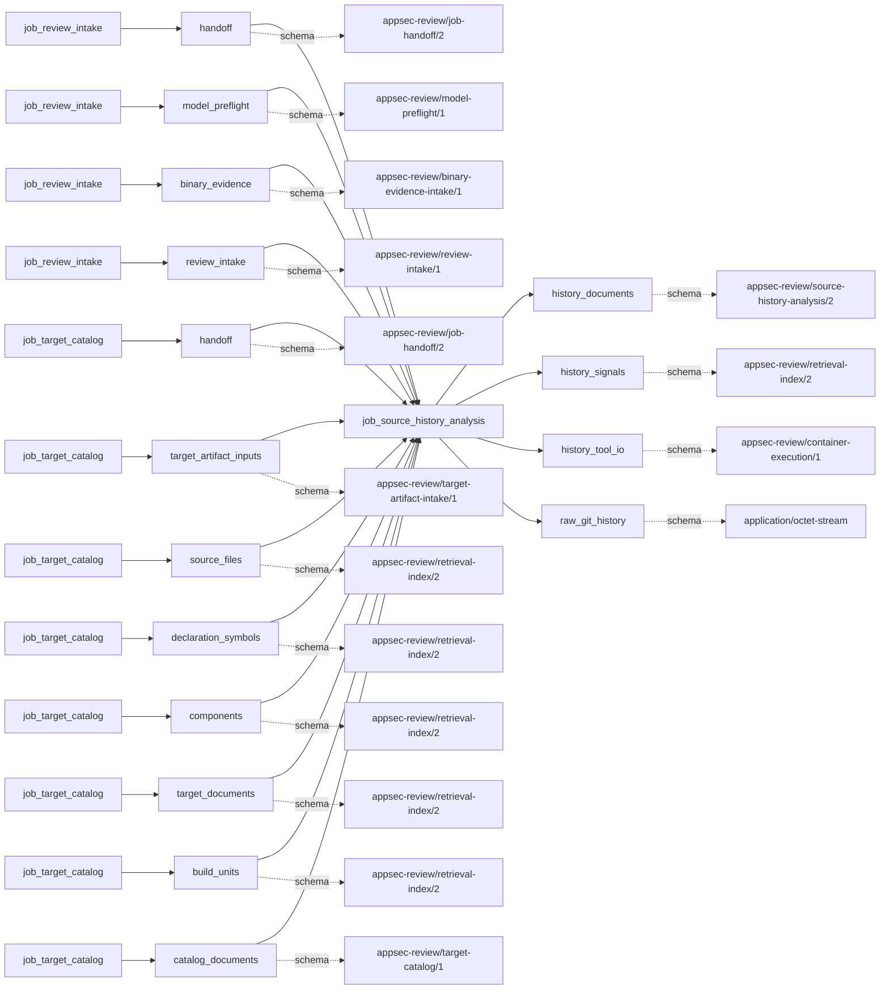

# source_history_analysis

This page contains the generated contract; the authored process and acceptance description are tracked by [T-130](../TODO.md).

<!-- generated:begin job=job_source_history_analysis -->
<!-- generated from: appsec-review.toml, containers/catalog.toml, pipeline/guidance/registry.json, tests/job-test-map.json, src/appsec_review/runtime/registry.py, src/appsec_review/runtime/contracts.py, src/appsec_review/runtime/datasets.py, src/appsec_review/guidance/workers.py, src/appsec_review/mcp/schema.py, src/appsec_review/orchestration/topology.py, src/appsec_review/orchestration/dagster/adapter.py by scripts/generate-docs.py; do not edit -->
## Declared job contract

source_history_analysis

Job: `job_source_history_analysis`. Enabled in the dev recipe: **true**.
Declarations describe possible work, not successful execution or consumed evidence.

### Steps and tasks

| Step | Task | Workers | Pool | Bound tool or gap | Handler |
| --- | --- | --- | --- | --- | --- |
| `acquire` | `acquire.changelog_history` | 1 | `application` | Undeclared ([T-147](../TODO.md)) | [source](../../src/appsec_review/jobs/job_source_history_analysis/job.py#L1173) |
| `acquire` | `acquire.git_history` | 1 | `application` | Undeclared ([T-147](../TODO.md)) | [source](../../src/appsec_review/jobs/source_lanes.py#L57) |
| `acquire` | `acquire.github_enrichment` | 1 | `application` | Undeclared ([T-147](../TODO.md)) | [source](../../src/appsec_review/jobs/source_lanes.py#L57) |
| `acquire` | `acquire.normalize_changes` | 1 | `application` | Undeclared ([T-147](../TODO.md)) | [source](../../src/appsec_review/jobs/source_lanes.py#L57) |
| `analyze` | `analyze.blame_age` | 1 | `application` | Undeclared ([T-147](../TODO.md)) | [source](../../src/appsec_review/jobs/source_lanes.py#L57) |
| `analyze` | `analyze.classify_changes` | 1 | `application` | Undeclared ([T-147](../TODO.md)) | [source](../../src/appsec_review/jobs/source_lanes.py#L57) |
| `analyze` | `analyze.co_change` | 1 | `application` | Undeclared ([T-147](../TODO.md)) | [source](../../src/appsec_review/jobs/source_lanes.py#L57) |
| `analyze` | `analyze.compute_signals` | 1 | `application` | Undeclared ([T-147](../TODO.md)) | [source](../../src/appsec_review/jobs/source_lanes.py#L57) |
| `analyze` | `analyze.fix_on_fix` | 1 | `application` | Undeclared ([T-147](../TODO.md)) | [source](../../src/appsec_review/jobs/source_lanes.py#L57) |
| `analyze` | `analyze.line_history` | 1 | `application` | Undeclared ([T-147](../TODO.md)) | [source](../../src/appsec_review/jobs/source_lanes.py#L57) |
| `analyze` | `analyze.rank` | 1 | `application` | Undeclared ([T-147](../TODO.md)) | [source](../../src/appsec_review/jobs/source_lanes.py#L57) |
| `analyze` | `analyze.symbol_signals` | 1 | `application` | Undeclared ([T-147](../TODO.md)) | [source](../../src/appsec_review/jobs/source_lanes.py#L57) |
| `analyze` | `analyze.symbol_spans` | 1 | `application` | Undeclared ([T-147](../TODO.md)) | [source](../../src/appsec_review/jobs/source_lanes.py#L57) |
| `publish` | `publish.index_history` | 1 | `application` | Undeclared ([T-147](../TODO.md)) | [source](../../src/appsec_review/jobs/source_lanes.py#L57) |
| `publish` | `publish.publish_handoff` | 1 | `application` | Undeclared ([T-147](../TODO.md)) | [source](../../src/appsec_review/jobs/source_lanes.py#L57) |
| `resolve_sources` | `resolve_sources.bind_snapshot` | 1 | `application` | Undeclared ([T-147](../TODO.md)) | [source](../../src/appsec_review/jobs/source_lanes.py#L57) |
| `resolve_sources` | `resolve_sources.resolve_history_source` | 1 | `application` | Undeclared ([T-147](../TODO.md)) | [source](../../src/appsec_review/jobs/job_source_history_analysis/job.py#L447) |

### Accepted input declarations

| Producer | Dataset | Schema | Channel | Availability | Missing policy |
| --- | --- | --- | --- | --- | --- |
| `job_review_intake` | `handoff` | `appsec-review/job-handoff/2` | handoff | required | reject |
| `job_review_intake` | `model_preflight` | `appsec-review/model-preflight/1` | handoff | optional | gap |
| `job_review_intake` | `binary_evidence` | `appsec-review/binary-evidence-intake/1` | handoff | optional | gap |
| `job_review_intake` | `review_intake` | `appsec-review/review-intake/1` | handoff | optional | gap |
| `job_target_catalog` | `handoff` | `appsec-review/job-handoff/2` | handoff | required | reject |
| `job_target_catalog` | `target_artifact_inputs` | `appsec-review/target-artifact-intake/1` | handoff | optional | gap |
| `job_target_catalog` | `source_files` | `appsec-review/retrieval-index/2` | handoff | optional | gap |
| `job_target_catalog` | `declaration_symbols` | `appsec-review/retrieval-index/2` | handoff | optional | gap |
| `job_target_catalog` | `components` | `appsec-review/retrieval-index/2` | handoff | optional | gap |
| `job_target_catalog` | `target_documents` | `appsec-review/retrieval-index/2` | handoff | optional | gap |
| `job_target_catalog` | `build_units` | `appsec-review/retrieval-index/2` | handoff | optional | gap |
| `job_target_catalog` | `catalog_documents` | `appsec-review/target-catalog/1` | handoff | optional | gap |

### Published dataset declarations

| Dataset | Step | Schema | Stage | Indexes | MCP route |
| --- | --- | --- | --- | --- | --- |
| `history_documents` | `publish` | `appsec-review/source-history-analysis/2` | artifact_only | Not indexed | `coverage`, `query_dataset_inventory` |
| `history_signals` | `publish` | `appsec-review/retrieval-index/2` | indexed | `history` | `find`, `query_precomputed`, `search`, `trace` |
| `history_tool_io` | `analyze` | `appsec-review/container-execution/1` | protected | Not indexed | `coverage`, `query_dataset_inventory` |
| `raw_git_history` | `acquire` | `application/octet-stream` | protected | Not indexed | `coverage`, `query_dataset_inventory` |

Protected and artifact-only routes expose sanitized metadata, not payload access.

### Model and guidance declarations

No job-level model declaration; absence of a task binding remains [T-147](../TODO.md), not a nonexecution claim.

### Test selection

| Tier | Files or selectors |
| --- | --- |
| acceptance | None declared |
| integration | `tests/integration/job_source_history_analysis/test_analysis.py` `tests/integration/job_source_history_analysis/test_changelog_projection.py` `tests/integration/job_source_history_analysis/test_components.py` `tests/integration/job_source_history_analysis/test_hotspots.py` |
| live | None declared |
| unit | `tests/unit/job_source_history_analysis/test_algorithms.py` `tests/unit/job_source_history_analysis/test_artifacts.py` `tests/unit/job_source_history_analysis/test_changelog.py` `tests/unit/job_source_history_analysis/test_contract.py` `tests/unit/job_source_history_analysis/test_edge_cases.py` `tests/unit/job_source_history_analysis/test_fingerprint.py` `tests/unit/job_source_history_analysis/test_git.py` `tests/unit/job_source_history_analysis/test_github.py` `tests/unit/job_source_history_analysis/test_handlers.py` `tests/unit/job_source_history_analysis/test_legacy_hotspots.py` `tests/unit/job_source_history_analysis/test_publication.py` `tests/unit/job_source_history_analysis/test_settings.py` `tests/unit/job_source_history_analysis/test_sources.py` `tests/unit/job_source_history_analysis/test_symbols_handler.py` |

### Dagster placement

Dispatch: `review_graph`. Review graph member: **true**. Enabled graph member: **true**.

Declared predecessors: `job_target_catalog`.

### Declared dataflow

<!-- generated:end -->
