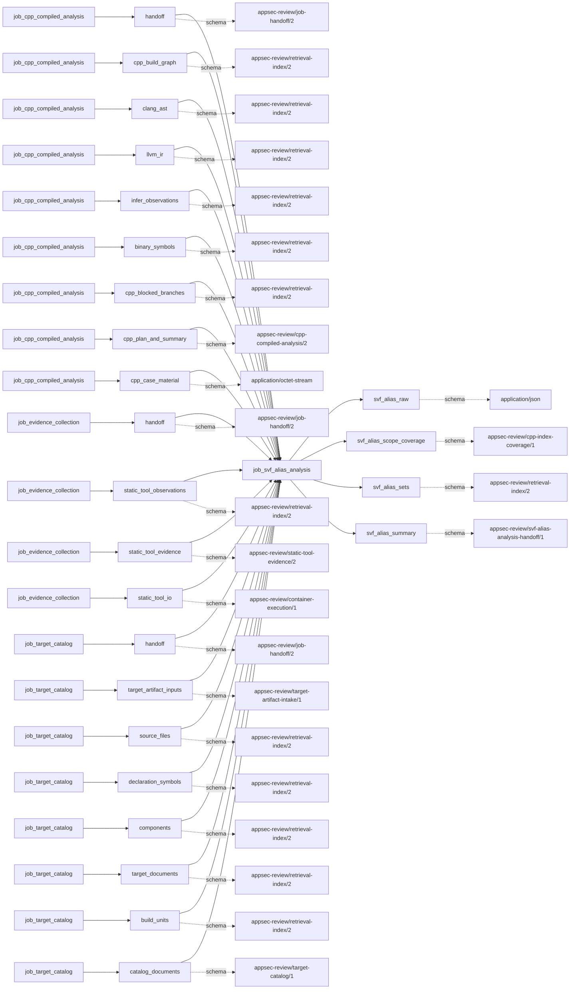
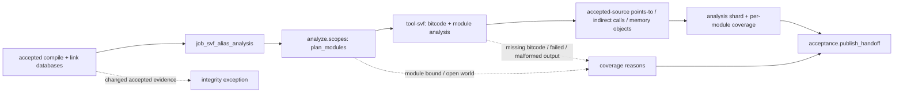

# svf_alias_analysis

## Purpose

Compute bounded points-to sets, indirect-call targets and memory-object relationships from
accepted native compile/link inputs for independent graph cross-checking. These are facts about
the analyzed bitcode, not findings. Open-world modules, incomplete sites and truncated target sets
cannot justify negative claims about aliases or callees outside the modeled program.

<!-- generated:begin job=job_svf_alias_analysis -->
<!-- generated from: appsec-review.toml, containers/catalog.toml, pipeline/guidance/registry.json, tests/job-test-map.json, src/appsec_review/runtime/registry.py, src/appsec_review/runtime/contracts.py, src/appsec_review/runtime/datasets.py, src/appsec_review/guidance/workers.py, src/appsec_review/mcp/schema.py, src/appsec_review/orchestration/topology.py, src/appsec_review/orchestration/dagster/adapter.py by scripts/generate-docs.py; do not edit -->
## Declared job contract

svf_alias_analysis

Job: `job_svf_alias_analysis`. Enabled in the dev recipe: **false**.
Declarations describe possible work, not successful execution or consumed evidence.

### Steps and tasks

| Step | Task | Workers | Pool | Bound tool or gap | Handler |
| --- | --- | --- | --- | --- | --- |
| `acceptance` | `acceptance.publish_handoff` | 1 | `application` | Undeclared ([T-147](../TODO.md)) | [source](../../src/appsec_review/jobs/job_svf_alias_analysis/job.py#L506) |
| `analyze` | `analyze.scopes` | 1 | `application` | Undeclared ([T-147](../TODO.md)) | [source](../../src/appsec_review/jobs/job_svf_alias_analysis/job.py#L487) |
| `load` | `load.accepted_cpp` | 1 | `application` | Undeclared ([T-147](../TODO.md)) | [source](../../src/appsec_review/jobs/job_svf_alias_analysis/job.py#L480) |

### Accepted input declarations

| Producer | Dataset | Schema | Channel | Availability | Missing policy |
| --- | --- | --- | --- | --- | --- |
| `job_cpp_compiled_analysis` | `handoff` | `appsec-review/job-handoff/2` | handoff | required | reject |
| `job_cpp_compiled_analysis` | `cpp_build_graph` | `appsec-review/retrieval-index/2` | handoff | optional | gap |
| `job_cpp_compiled_analysis` | `clang_ast` | `appsec-review/retrieval-index/2` | handoff | optional | gap |
| `job_cpp_compiled_analysis` | `llvm_ir` | `appsec-review/retrieval-index/2` | handoff | optional | gap |
| `job_cpp_compiled_analysis` | `infer_observations` | `appsec-review/retrieval-index/2` | handoff | optional | gap |
| `job_cpp_compiled_analysis` | `binary_symbols` | `appsec-review/retrieval-index/2` | handoff | optional | gap |
| `job_cpp_compiled_analysis` | `cpp_blocked_branches` | `appsec-review/retrieval-index/2` | handoff | optional | gap |
| `job_cpp_compiled_analysis` | `cpp_plan_and_summary` | `appsec-review/cpp-compiled-analysis/2` | handoff | optional | gap |
| `job_cpp_compiled_analysis` | `cpp_case_material` | `application/octet-stream` | handoff | optional | gap |
| `job_evidence_collection` | `handoff` | `appsec-review/job-handoff/2` | handoff | optional | gap |
| `job_evidence_collection` | `static_tool_observations` | `appsec-review/retrieval-index/2` | handoff | optional | gap |
| `job_evidence_collection` | `static_tool_evidence` | `appsec-review/static-tool-evidence/2` | handoff | optional | gap |
| `job_evidence_collection` | `static_tool_io` | `appsec-review/container-execution/1` | handoff | optional | gap |
| `job_target_catalog` | `handoff` | `appsec-review/job-handoff/2` | handoff | optional | gap |
| `job_target_catalog` | `target_artifact_inputs` | `appsec-review/target-artifact-intake/1` | handoff | optional | gap |
| `job_target_catalog` | `source_files` | `appsec-review/retrieval-index/2` | handoff | optional | gap |
| `job_target_catalog` | `declaration_symbols` | `appsec-review/retrieval-index/2` | handoff | optional | gap |
| `job_target_catalog` | `components` | `appsec-review/retrieval-index/2` | handoff | optional | gap |
| `job_target_catalog` | `target_documents` | `appsec-review/retrieval-index/2` | handoff | optional | gap |
| `job_target_catalog` | `build_units` | `appsec-review/retrieval-index/2` | handoff | optional | gap |
| `job_target_catalog` | `catalog_documents` | `appsec-review/target-catalog/1` | handoff | optional | gap |

### Published dataset declarations

| Dataset | Step | Schema | Stage | Indexes | MCP route |
| --- | --- | --- | --- | --- | --- |
| `svf_alias_raw` | `analyze` | `application/json` | protected | Not indexed | `coverage`, `query_dataset_inventory` |
| `svf_alias_scope_coverage` | `acceptance` | `appsec-review/cpp-index-coverage/1` | indexed | `analysis` | `coverage` |
| `svf_alias_sets` | `analyze` | `appsec-review/retrieval-index/2` | indexed | `analysis` | `find` |
| `svf_alias_summary` | `acceptance` | `appsec-review/svf-alias-analysis-handoff/1` | artifact_only | Not indexed | `coverage`, `query_dataset_inventory` |

Protected and artifact-only routes expose sanitized metadata, not payload access.

### Model and guidance declarations

No job-level model declaration; absence of a task binding remains [T-147](../TODO.md), not a nonexecution claim.

### Test selection

| Tier | Files or selectors |
| --- | --- |
| acceptance | None declared |
| integration | None declared |
| live | `tests/live/test_svf_live.py` |
| unit | `tests/test_svf_alias_analysis.py::test_link_command_becomes_one_module_and_unlinked_units_stand_alone` `tests/test_svf_alias_analysis.py::test_unresolved_archives_and_inputs_are_named_open_world_reasons` `tests/test_svf_alias_analysis.py::test_module_bound_omits_trailing_modules_with_a_gap_and_ids_are_deterministic` |

### Dagster placement

Dispatch: `review_graph`. Review graph member: **true**. Enabled graph member: **false**.

Declared predecessors: `job_cpp_compiled_analysis`.

### Declared dataflow

<!-- generated:end -->

## Process

Source: [handler and record normalization](../../src/appsec_review/jobs/job_svf_alias_analysis/job.py),
[module planning](../../src/appsec_review/jobs/job_svf_alias_analysis/planning.py) and
[accepted-scope execution](../../src/appsec_review/jobs/cpp_index_scopes.py).

### `load`

1. Verify the accepted compiled-analysis handoff/result, source maps, compile databases and
   snapshot. Retain unavailable catalogs and commandless projects separately.
2. Freeze runnable scope identities; this producer does not acquire new sources or rebuild the
   accepted language-build result.

### `analyze`

1. Re-load scopes and reject plan changes. Filter unsupported compile inputs; scopes with no
   supported commands are `SKIPPED_NA`.
2. Build bounded modules from supported compile commands and normalized link commands. Preserve
   link-unit membership and open-world reasons; unlinked translation units remain separate.
   Record omitted trailing modules when the module bound is reached.
3. Check a scope checkpoint; otherwise invoke `tool-svf` with a bounded plan document and
   per-module output ceiling. Read bounded run-result JSON only after successful execution.
   Retain compile-to-bitcode failures; unavailable image, timeout, OOM, size limit or bad result
   leaves affected modules unavailable.
4. For each planned module, require an analyzed outcome, an in-scratch output path and a valid
   bounded driver document. Reject missing/failed/escaping/malformed output for that module.
5. Map pointer sites and indirect calls to accepted source locations; count outside-source sites
   instead of giving them locations. Preserve target/object sets, truncation, incomplete reasons,
   module closed-world state and unmodeled externals. Add bounded memory-object relations.
6. Write an analysis shard with per-module coverage and counts; no modules yields unavailable
   coverage. Save the scope checkpoint, including failed or partial scope results.

### `acceptance`

1. Compose analysis shards and unavailable-scope coverage into a verified manifest.
2. Publish `svf-alias-analysis-summary.json` with record, module and closed-world-module counts.
   No runnable or unavailable cases is not-applicable; aggregate scope gaps prevent success.

## Dataflow

## Gaps

[T-159](../TODO.md) records an accounting limitation: module-level partial reasons can survive
in coverage rows without reaching the aggregate gap list. Root outcomes do not inspect those
nested rows. Acceptance must compare module coverage with the root summary rather than treating
an empty aggregate gap list as complete SVF coverage.

Text reasons are wrapped as `producer_reported_gap` by
[interchange](../architecture/job-interchange.md#the-control-layer-beneath-the-envelope), normally
with non-retryable metadata. This is not an advisory classification.

- Input absent/failed: unavailable accepted catalog, no commands or no compile units to analyze.
- Tooling failure: unavailable image, timeout/OOM/nonzero exit, output limit, invalid run-result
  envelope, compile units without bitcode, unanalyzed module outcomes, missing/escaping/invalid
  module output or malformed driver document.
- Coverage missing: module/site/indirect-call/memory-object limits, missing bitcode, lossy debug
  upgrades and open-world reasons such as unlinked units, dynamic loading or unmodeled externals.
  Per-site incomplete flags and outside-accepted-source counters must be inspected too.
- In the current [scope loop](../../src/appsec_review/jobs/job_svf_alias_analysis/job.py#L324),
  normalization reasons are written into module coverage but are not all appended to the
  top-level gap list. Aggregate publication can therefore understate those reasons; compare
  coverage rows and per-scope status, not only the summary count.
- Changed accepted sources/database or damaged matching checkpoint evidence raises an exception,
  not a successful unavailable publication.

The walk must separately approve any expected coverage loss.

## Acceptance

1. **A. Inputs:** Match consumed compiled handoff, source/compile/link identities and supported
   command set to admitted pins; independently enumerate planned versus omitted modules.
2. **B. Independent comparison:** Compare native module JSON's points-to objects, indirect targets,
   bitcode-production outcomes and closed-world flags with indexed rows. Verify sampled locations
   against source bytes and independently count outside-source and truncated sites.
3. **C. Gaps:** Group verified canonical outcomes, then reconcile module coverage rows and scope
   terminal statuses for reasons omitted from aggregate gaps. Compare each cause with receipts,
   native output and the walk's approved list.
4. **D. Baseline:** At authorized acceptance save `stepwise.py accept`, corpus namespace and baseline
   with module identities, closed-world counts and coverage reasons. This page does not claim
   live SVF acceptance.

## Resume and invalidation

Checkpoint identity includes scope/source/compile state, link commands, adapter, settings and tool
identity. A changed link topology invalidates that scope even with unchanged source. Matching
checkpoints verify retained artifacts and index metadata; they may retain failed/partial results,
so an unchanged retry need not rerun SVF. Manifest composition follows
[accepted index sets](../architecture/python-and-retrieval.md#accepted-index-sets).
Task binding omissions remain [T-147](../TODO.md);
no model makes the points-to decisions.
