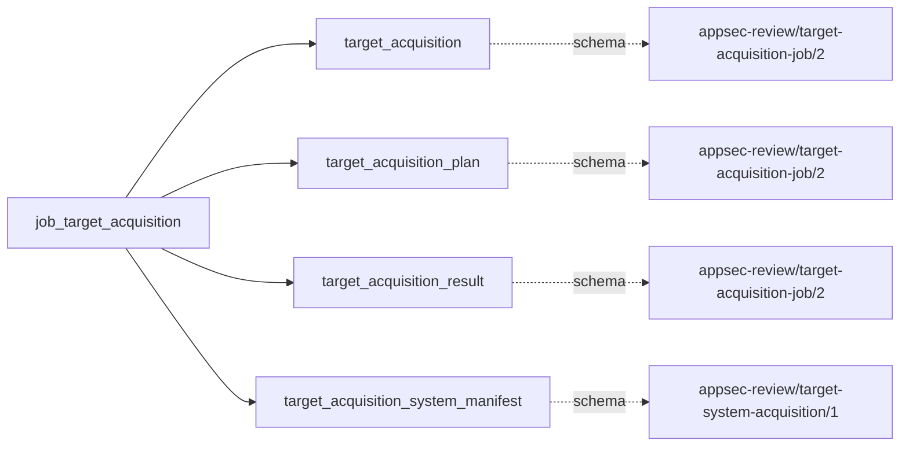
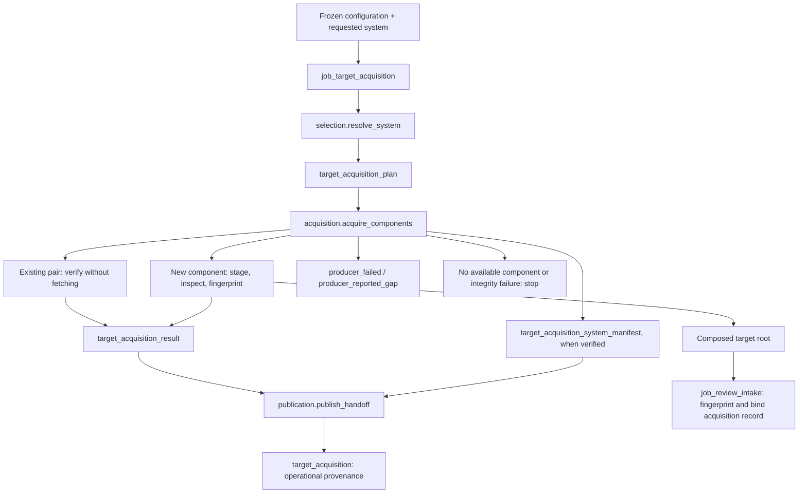

# Target acquisition

## Purpose

`job_target_acquisition` materializes or re-verifies the configured components of a requested
review system before intake. It answers which pinned source components are available and which
bytes their composed root contains. A system can combine Git, Perforce and supported code-review
exports; it is not necessarily one repository. Acquisition provenance is operational metadata,
not a finding or proof of complete coverage. An existing component is never pulled, replaced or
repaired by this gate. With no requested system, it records non-applicability without changing
the target.

<!-- generated:begin job=job_target_acquisition -->
<!-- generated from: appsec-review.toml, containers/catalog.toml, pipeline/guidance/registry.json, tests/job-test-map.json, src/appsec_review/runtime/registry.py, src/appsec_review/runtime/contracts.py, src/appsec_review/runtime/datasets.py, src/appsec_review/guidance/workers.py, src/appsec_review/mcp/schema.py, src/appsec_review/orchestration/topology.py, src/appsec_review/orchestration/dagster/adapter.py by scripts/generate-docs.py; do not edit -->
## Declared job contract

target_acquisition

Job: `job_target_acquisition`. Enabled in the dev recipe: **true**.
Declarations describe possible work, not successful execution or consumed evidence.

### Steps and tasks

| Step | Task | Workers | Pool | Bound tool or gap | Handler |
| --- | --- | --- | --- | --- | --- |
| `acquisition` | `acquisition.acquire_components` | 1 | `application` | Undeclared ([T-147](../TODO.md)) | [source](../../src/appsec_review/jobs/job_target_acquisition/job.py#L113) |
| `publication` | `publication.publish_handoff` | 1 | `application` | Undeclared ([T-147](../TODO.md)) | [source](../../src/appsec_review/jobs/job_target_acquisition/job.py#L170) |
| `selection` | `selection.resolve_system` | 1 | `application` | Undeclared ([T-147](../TODO.md)) | [source](../../src/appsec_review/jobs/job_target_acquisition/job.py#L90) |

### Accepted input declarations

| Producer | Dataset | Schema | Channel | Availability | Missing policy |
| --- | --- | --- | --- | --- | --- |

### Published dataset declarations

| Dataset | Step | Schema | Stage | Indexes | MCP route |
| --- | --- | --- | --- | --- | --- |
| `target_acquisition` | `publication` | `appsec-review/target-acquisition-job/2` | artifact_only | Not indexed | `coverage`, `query_dataset_inventory` |
| `target_acquisition_plan` | `selection` | `appsec-review/target-acquisition-job/2` | artifact_only | Not indexed | `coverage`, `query_dataset_inventory` |
| `target_acquisition_result` | `acquisition` | `appsec-review/target-acquisition-job/2` | artifact_only | Not indexed | `coverage`, `query_dataset_inventory` |
| `target_acquisition_system_manifest` | `acquisition` | `appsec-review/target-system-acquisition/1` | artifact_only | Not indexed | `coverage`, `query_dataset_inventory` |

Protected and artifact-only routes expose sanitized metadata, not payload access.

### Model and guidance declarations

No job-level model declaration; absence of a task binding remains [T-147](../TODO.md), not a nonexecution claim.

### Test selection

| Tier | Files or selectors |
| --- | --- |
| acceptance | None declared |
| integration | None declared |
| live | None declared |
| unit | `tests/test_target_acquisition.py::test_configuration_refuses_unsafe_or_incomplete_targets` `tests/test_target_acquisition.py::test_configuration_refuses_duplicate_ids_and_escaping_directories` `tests/test_target_acquisition.py::test_url_and_path_safety_primitives` `tests/unit/runtime/test_wave1a_contracts.py` |

### Dagster placement

Dispatch: `review_graph`. Review graph member: **true**. Enabled graph member: **true**.

Declared predecessors: `job_image_pin_verification`.

### Declared dataflow

<!-- generated:end -->

## Process

The [job implementation](../../src/appsec_review/jobs/job_target_acquisition/job.py) calls the
[acquisition implementation](../../src/appsec_review/target_acquisition/acquire.py).
The [operator procedure](target-acquisition.md) owns provider configuration and credentials.
This job has no model dispatch.

### `selection`

1. `resolve_system`: read the requested system selector and the run's frozen configuration.
2. Reject an invalid or unknown system, a target root different from its composed root, or
   invalid topology/settings. These are execution failures, not successful empty acquisitions.
3. Write `target-acquisition-plan.json`, binding the configuration digest and selected component
   specifications. Without a selector, write `requested: false`; do not select a default system.

### `acquisition`

1. `acquire_components`: for an unrequested plan, write `NOT_REQUESTED` in the result and return
   terminal status `NOT_APPLICABLE`.
2. Otherwise acquire components concurrently within the configured component bound. Existing
   checkout/record pairs take the verification path; new components are materialized in staging,
   inspected, fingerprinted and moved into place only after checks succeed.
3. Preserve component-scoped reasons from provider, source and verification checks. Convert
   `component_acquisition_failed` to `producer_failed`; convert other path reasons to
   `producer_reported_gap`, with retry flags as specified below.
4. Write `target-acquisition-result.json`. Copy the composed manifest to `system-manifest.json`
   only when present and its bytes match the reported digest.
5. Continue for domain status `COMPLETE` or `PARTIAL`. If no component is available, or acquisition
   was refused, raise `TargetAcquisitionFailed` after retaining the result. A manifest hash race
   also fails execution. Neither path publishes an accepted acquisition result.

### `publication`

1. `publish_handoff`: write `target-acquisition-handoff.json` with the result, optional copied
   manifest and composed-system identities.
2. Keep canonical gap records on `acquisition.acquire_components`; publication adds no duplicate
   gap records. The copied payload still describes the acquisition gaps.
3. Publish four distinct possible dataset kinds: selection plan, acquisition result, copied
   system manifest and final handoff. The first, second and fourth use
   `appsec-review/target-acquisition-job/2`; the copied manifest retains
   `appsec-review/target-system-acquisition/1`. The manifest is conditional, not guaranteed.
   The generated declarations above are the path/schema authority.

## Dataflow

## Gaps

These are source reason labels, not additional canonical codes.
[`path_gap_records`](../../src/appsec_review/interchange.py) preserves the component/path scope.
Only `component_acquisition_failed` and `component_not_acquired` are marked retryable by this
job. All other reported reasons have `retryable: false`; that is not an advisory or expected-gap
classification. An execution failure is separately represented by the runtime's `producer_failed`
record with its execution retry flag.

| Reasons / failure | Condition and walk expectation |
|---|---|
| `component_acquisition_failed` | A component could not be acquired or was refused. Canonical code `producer_failed`, retryable. Resolve the cause before an authorized retry; available siblings do not erase the missing component. |
| `component_not_acquired` | A configured but unselected component is absent. Canonical code `producer_reported_gap`, retryable. The job normally selects every configured component; the acquisition helper also supports explicit subsets. |
| `component_verification_failed`, `unconfigured_system_entry` | Recorded bytes/specifications no longer agree, or the composed root contains an unconfigured entry. Nonretryable reported gaps; preserve the discrepancy for an operator decision. |
| `symlink_materialized_as_text`, `git_lfs_object_not_fetched` | A Git checkout contains a textual link or unresolved LFS pointer rather than the referenced content. Compare the actual materialization, not the expected linked file. |
| `submodule_not_materialized`, `submodule_depth_exceeded`, `submodule_url_missing`, `submodule_url_refused`, `submodule_checkout_failed`, `submodule_commit_mismatch` | Submodule policy, bounds, location, fetch or identity prevented full materialization. Check each component-relative path and pinned gitlink. |
| `gap_list_truncated` | The provider gap list reached its bound. The retained list is not exhaustive. |
| `perforce_revision_unavailable`, `perforce_symlink_skipped`, `perforce_digest_unverified` | Perforce revision, link materialization or digest verification was unavailable. Check the retained per-file manifest against the requested changelist. |
| `change_base_unavailable`, `change_diff_failed`, `change_diff_too_large` | A review export cannot supply its complete bounded base-to-head diff. The acquired head is not evidence that change context is complete. |
| `review_approvals_unavailable`, `review_approval_times_unavailable`, `review_commits_truncated`, `review_commit_ids_rejected`, `review_head_not_in_commit_list`, `review_not_merged` | Review metadata is incomplete or does not establish the claimed merged state. Compare provider facts and retained export bounds; do not infer approval or merge. |
| Invalid selector/configuration/root, unavailable whole system, changed manifest bytes | The gate fails rather than publishing acceptable empty output. Diagnose the retained failure/result; do not classify a failed gate as an advisory gap. |

`target_changed_since_acquisition` belongs to the later intake-record check in the shared
acquisition module, not this gate's successful component-acquisition path.
Any cause absent from the walk's confirmed expected-gap list requires the user's decision.

## Acceptance

Apply the [four walk checks](../processes/walk-charter.md#5-accepting-a-job-the-four-checks):

- **A. Inputs:** bind the frozen configuration digest, selector, component specs and composed
  target root. The scheduling predecessor is not a semantic input grant; this job declares no
  upstream evidence consumption.
- **B. Independent comparison:** compare component commits/changelists, component manifest
  hashes and the composed tree hash with independently inspected source/host truth. For a
  repeat invocation, confirm existing checkouts were verified rather than fetched or edited.
  For no selector, confirm no acquisition occurred.
- **C. Gaps:** reconcile component results, original path reasons, canonical outcomes and any
  rejected execution. Verify the copied manifest digest independently; a partial system is not
  complete just because intake can inspect its root.
- **D. Baseline:** record the explicitly accepted system/component corpus, pins and expected
  omissions. A changed component set or missing source is not an automatic baseline update.

## Resume and invalidation

The job is `always_execute` and does not propagate its handoff as ordinary downstream evidence.
It re-verifies existing component bytes, recorded specification and artifact hashes instead of
fetching newer source. The composed manifest is rewritten only when its canonical contents
change; invocation time/actions go into the separate verification record. Intake binds the
composed tree and acquisition record, so unchanged re-verification does not manufacture a new
source identity. Changed bytes/specifications require an explicit acquisition/review decision,
not mutation of a pinned checkout. See [runtime resume](../architecture/jobs-and-runtime.md)
and [accepted-input contracts](../architecture/job-input-contracts.md).
