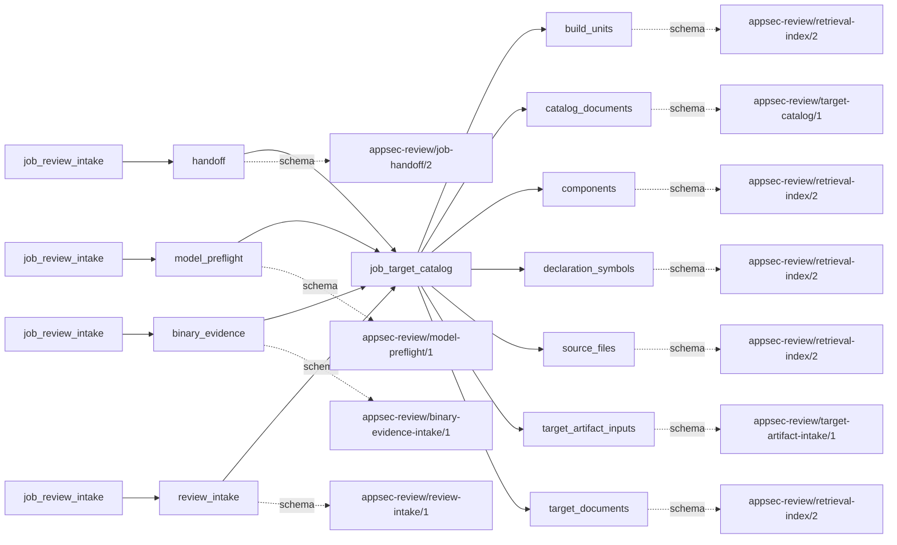

# target_catalog

This page contains the generated contract; the authored process and acceptance description are tracked by [T-130](../TODO.md).

<!-- generated:begin job=job_target_catalog -->
<!-- generated from: appsec-review.toml, containers/catalog.toml, pipeline/guidance/registry.json, tests/job-test-map.json, src/appsec_review/runtime/registry.py, src/appsec_review/runtime/contracts.py, src/appsec_review/runtime/datasets.py, src/appsec_review/guidance/workers.py, src/appsec_review/mcp/schema.py, src/appsec_review/orchestration/topology.py, src/appsec_review/orchestration/dagster/adapter.py by scripts/generate-docs.py; do not edit -->
## Declared job contract

target_catalog

Job: `job_target_catalog`. Enabled in the dev recipe: **true**.
Declarations describe possible work, not successful execution or consumed evidence.

### Steps and tasks

| Step | Task | Workers | Pool | Bound tool or gap | Handler |
| --- | --- | --- | --- | --- | --- |
| `build_discovery` | `build_discovery.catalog_build_targets` | 1 | `application` | Undeclared ([T-147](../TODO.md)) | [source](../../src/appsec_review/jobs/job_target_catalog/job.py#L266) |
| `build_discovery` | `build_discovery.discover_build_systems` | 1 | `application` | Undeclared ([T-147](../TODO.md)) | [source](../../src/appsec_review/jobs/job_target_catalog/job.py#L218) |
| `build_discovery` | `build_discovery.discover_compile_commands` | 1 | `application` | Undeclared ([T-147](../TODO.md)) | [source](../../src/appsec_review/jobs/job_target_catalog/job.py#L258) |
| `component_discovery` | `component_discovery.catalog_components` | 1 | `application` | Undeclared ([T-147](../TODO.md)) | [source](../../src/appsec_review/jobs/job_target_catalog/job.py#L294) |
| `component_discovery` | `component_discovery.catalog_dependencies` | 1 | `application` | Undeclared ([T-147](../TODO.md)) | [source](../../src/appsec_review/jobs/job_target_catalog/job.py#L306) |
| `publish_catalog` | `publish_catalog.publish_handoff` | 1 | `application` | Undeclared ([T-147](../TODO.md)) | [source](../../src/appsec_review/jobs/job_target_catalog/job.py#L568) |
| `publish_catalog` | `publish_catalog.validate_catalog` | 1 | `application` | Undeclared ([T-147](../TODO.md)) | [source](../../src/appsec_review/jobs/job_target_catalog/job.py#L555) |
| `repository_discovery` | `repository_discovery.census_languages` | 1 | `application` | Undeclared ([T-147](../TODO.md)) | [source](../../src/appsec_review/jobs/job_target_catalog/job.py#L186) |
| `repository_discovery` | `repository_discovery.discover_projects` | 1 | `application` | Undeclared ([T-147](../TODO.md)) | [source](../../src/appsec_review/jobs/job_target_catalog/job.py#L193) |
| `repository_discovery` | `repository_discovery.partition_repository` | 1 | `application` | Undeclared ([T-147](../TODO.md)) | [source](../../src/appsec_review/jobs/job_target_catalog/job.py#L143) |
| `retrieval_indexes` | `retrieval_indexes.build_component_index` | 1 | `index` | Undeclared ([T-147](../TODO.md)) | [source](../../src/appsec_review/jobs/job_target_catalog/job.py#L437) |
| `retrieval_indexes` | `retrieval_indexes.build_path_index` | 1 | `index` | Undeclared ([T-147](../TODO.md)) | [source](../../src/appsec_review/jobs/job_target_catalog/job.py#L339) |
| `retrieval_indexes` | `retrieval_indexes.build_symbol_index` | 1 | `index` | Undeclared ([T-147](../TODO.md)) | [source](../../src/appsec_review/jobs/job_target_catalog/job.py#L379) |
| `retrieval_indexes` | `retrieval_indexes.build_target_documents` | 1 | `application` | Undeclared ([T-147](../TODO.md)) | [source](../../src/appsec_review/jobs/job_target_catalog/job.py#L458) |

### Accepted input declarations

| Producer | Dataset | Schema | Channel | Availability | Missing policy |
| --- | --- | --- | --- | --- | --- |
| `job_review_intake` | `handoff` | `appsec-review/job-handoff/2` | handoff | required | reject |
| `job_review_intake` | `model_preflight` | `appsec-review/model-preflight/1` | handoff | optional | gap |
| `job_review_intake` | `binary_evidence` | `appsec-review/binary-evidence-intake/1` | handoff | optional | gap |
| `job_review_intake` | `review_intake` | `appsec-review/review-intake/1` | handoff | optional | gap |

### Published dataset declarations

| Dataset | Step | Schema | Stage | Indexes | MCP route |
| --- | --- | --- | --- | --- | --- |
| `build_units` | `publish_catalog` | `appsec-review/retrieval-index/2` | indexed | `build` | `find`, `search` |
| `catalog_documents` | `publish_catalog` | `appsec-review/target-catalog/1` | artifact_only | Not indexed | `coverage`, `query_dataset_inventory` |
| `components` | `retrieval_indexes` | `appsec-review/retrieval-index/2` | indexed | `components` | `find`, `search` |
| `declaration_symbols` | `retrieval_indexes` | `appsec-review/retrieval-index/2` | indexed | `analysis` | `find`, `search`, `trace` |
| `source_files` | `retrieval_indexes` | `appsec-review/retrieval-index/2` | indexed | `source` | `find`, `read_excerpt`, `search` |
| `target_artifact_inputs` | `repository_discovery` | `appsec-review/target-artifact-intake/1` | artifact_only | Not indexed | `coverage`, `query_dataset_inventory` |
| `target_documents` | `retrieval_indexes` | `appsec-review/retrieval-index/2` | indexed | `documents` | `find`, `read_excerpt`, `search` |

Protected and artifact-only routes expose sanitized metadata, not payload access.

### Model and guidance declarations

No job-level model declaration; absence of a task binding remains [T-147](../TODO.md), not a nonexecution claim.

### Test selection

| Tier | Files or selectors |
| --- | --- |
| acceptance | None declared |
| integration | `tests/test_target_document_pipeline.py::test_catalog_publishes_northwind_documents_with_queryable_provenance_and_intent` |
| live | None declared |
| unit | `tests/test_cataloging_languages.py` `tests/test_wave1_resume.py::test_catalog_path_index_accepts_structured_inventory_gaps` |

### Dagster placement

Dispatch: `review_graph`. Review graph member: **true**. Enabled graph member: **true**.

Declared predecessors: `job_review_intake`.

### Declared dataflow

<!-- generated:end -->
