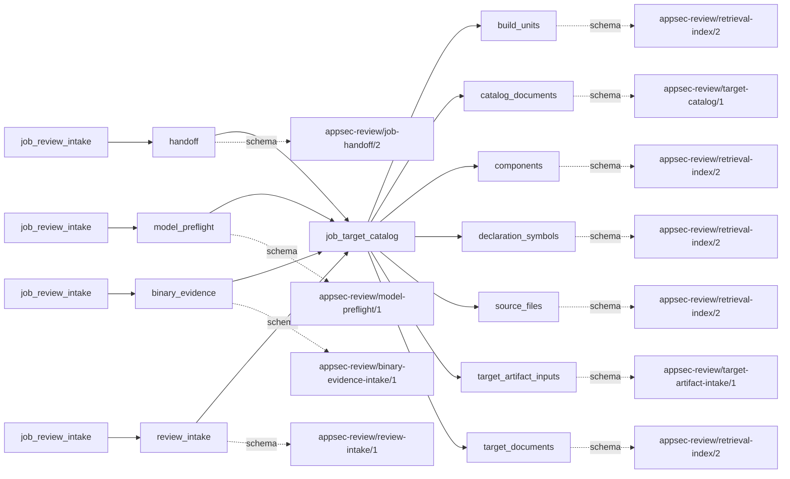
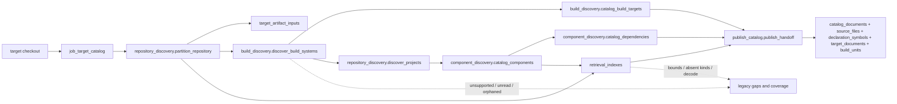

# target_catalog

## Purpose

Which files, components, build points and target-authored documents can later jobs address by
identity? The catalog publishes bounded inventories and source-resolving retrieval shards,
including explicit unsupported and omitted coverage. It refuses to treat a marker as a successful
build, a declaration-pattern symbol as semantic analysis, or a target document as security proof.

<!-- generated:begin job=job_target_catalog -->
<!-- generated from: appsec-review.toml, containers/catalog.toml, pipeline/guidance/registry.json, tests/job-test-map.json, src/appsec_review/runtime/registry.py, src/appsec_review/runtime/contracts.py, src/appsec_review/runtime/datasets.py, src/appsec_review/guidance/workers.py, src/appsec_review/mcp/schema.py, src/appsec_review/orchestration/topology.py, src/appsec_review/orchestration/dagster/adapter.py by scripts/generate-docs.py; do not edit -->
## Declared job contract

target_catalog

Job: `job_target_catalog`. Enabled in the dev recipe: **true**.
Declarations describe possible work, not successful execution or consumed evidence.

### Steps and tasks

| Step | Task | Workers | Pool | Bound tool or gap | Handler |
| --- | --- | --- | --- | --- | --- |
| `build_discovery` | `build_discovery.catalog_build_targets` | 1 | `application` | Undeclared ([T-147](../TODO.md)) | [source](../../src/appsec_review/jobs/job_target_catalog/job.py#L266) |
| `build_discovery` | `build_discovery.discover_build_systems` | 1 | `application` | Undeclared ([T-147](../TODO.md)) | [source](../../src/appsec_review/jobs/job_target_catalog/job.py#L218) |
| `build_discovery` | `build_discovery.discover_compile_commands` | 1 | `application` | Undeclared ([T-147](../TODO.md)) | [source](../../src/appsec_review/jobs/job_target_catalog/job.py#L258) |
| `component_discovery` | `component_discovery.catalog_components` | 1 | `application` | Undeclared ([T-147](../TODO.md)) | [source](../../src/appsec_review/jobs/job_target_catalog/job.py#L294) |
| `component_discovery` | `component_discovery.catalog_dependencies` | 1 | `application` | Undeclared ([T-147](../TODO.md)) | [source](../../src/appsec_review/jobs/job_target_catalog/job.py#L306) |
| `publish_catalog` | `publish_catalog.publish_handoff` | 1 | `application` | Undeclared ([T-147](../TODO.md)) | [source](../../src/appsec_review/jobs/job_target_catalog/job.py#L568) |
| `publish_catalog` | `publish_catalog.validate_catalog` | 1 | `application` | Undeclared ([T-147](../TODO.md)) | [source](../../src/appsec_review/jobs/job_target_catalog/job.py#L555) |
| `repository_discovery` | `repository_discovery.census_languages` | 1 | `application` | Undeclared ([T-147](../TODO.md)) | [source](../../src/appsec_review/jobs/job_target_catalog/job.py#L186) |
| `repository_discovery` | `repository_discovery.discover_projects` | 1 | `application` | Undeclared ([T-147](../TODO.md)) | [source](../../src/appsec_review/jobs/job_target_catalog/job.py#L193) |
| `repository_discovery` | `repository_discovery.partition_repository` | 1 | `application` | Undeclared ([T-147](../TODO.md)) | [source](../../src/appsec_review/jobs/job_target_catalog/job.py#L143) |
| `retrieval_indexes` | `retrieval_indexes.build_component_index` | 1 | `index` | Undeclared ([T-147](../TODO.md)) | [source](../../src/appsec_review/jobs/job_target_catalog/job.py#L437) |
| `retrieval_indexes` | `retrieval_indexes.build_path_index` | 1 | `index` | Undeclared ([T-147](../TODO.md)) | [source](../../src/appsec_review/jobs/job_target_catalog/job.py#L339) |
| `retrieval_indexes` | `retrieval_indexes.build_symbol_index` | 1 | `index` | Undeclared ([T-147](../TODO.md)) | [source](../../src/appsec_review/jobs/job_target_catalog/job.py#L379) |
| `retrieval_indexes` | `retrieval_indexes.build_target_documents` | 1 | `application` | Undeclared ([T-147](../TODO.md)) | [source](../../src/appsec_review/jobs/job_target_catalog/job.py#L458) |

### Accepted input declarations

| Producer | Dataset | Schema | Channel | Availability | Missing policy |
| --- | --- | --- | --- | --- | --- |
| `job_review_intake` | `handoff` | `appsec-review/job-handoff/2` | handoff | required | reject |
| `job_review_intake` | `model_preflight` | `appsec-review/model-preflight/1` | handoff | optional | gap |
| `job_review_intake` | `binary_evidence` | `appsec-review/binary-evidence-intake/1` | handoff | optional | gap |
| `job_review_intake` | `review_intake` | `appsec-review/review-intake/1` | handoff | optional | gap |

### Published dataset declarations

| Dataset | Step | Schema | Stage | Indexes | MCP route |
| --- | --- | --- | --- | --- | --- |
| `build_units` | `publish_catalog` | `appsec-review/retrieval-index/2` | indexed | `build` | `find`, `search` |
| `catalog_documents` | `publish_catalog` | `appsec-review/target-catalog/1` | artifact_only | Not indexed | `coverage`, `query_dataset_inventory` |
| `components` | `retrieval_indexes` | `appsec-review/retrieval-index/2` | indexed | `components` | `find`, `search` |
| `declaration_symbols` | `retrieval_indexes` | `appsec-review/retrieval-index/2` | indexed | `analysis` | `find`, `search`, `trace` |
| `source_files` | `retrieval_indexes` | `appsec-review/retrieval-index/2` | indexed | `source` | `find`, `read_excerpt`, `search` |
| `target_artifact_inputs` | `repository_discovery` | `appsec-review/target-artifact-intake/1` | artifact_only | Not indexed | `coverage`, `query_dataset_inventory` |
| `target_documents` | `retrieval_indexes` | `appsec-review/retrieval-index/2` | indexed | `documents` | `find`, `read_excerpt`, `search` |

Protected and artifact-only routes expose sanitized metadata, not payload access.

### Model and guidance declarations

No job-level model declaration; absence of a task binding remains [T-147](../TODO.md), not a nonexecution claim.

### Test selection

| Tier | Files or selectors |
| --- | --- |
| acceptance | None declared |
| integration | `tests/test_target_document_pipeline.py::test_catalog_publishes_northwind_documents_with_queryable_provenance_and_intent` |
| live | None declared |
| unit | `tests/test_cataloging_languages.py` `tests/test_wave1_resume.py::test_catalog_path_index_accepts_structured_inventory_gaps` |

### Dagster placement

Dispatch: `review_graph`. Review graph member: **true**. Enabled graph member: **true**.

Declared predecessors: `job_review_intake`.

### Declared dataflow

<!-- generated:end -->

## Process

Source: [catalog handlers](../../src/appsec_review/jobs/job_target_catalog/job.py),
[inventory](../../src/appsec_review/jobs/cataloging.py),
[build discovery](../../src/appsec_review/jobs/build_discovery.py) and
[document extraction](../../src/appsec_review/indexing/target_documents.py).
The [retrieval architecture](../architecture/python-and-retrieval.md) defines resolving indices.

### `repository_discovery`

1. Inventory the checkout under configured path/asset exclusions. Bound content files and bytes,
   but continue descriptor discovery beyond the content budget; retain descriptor unavailability
   separately. Do not follow symlinks.
2. Add delivery/scope classifications. Re-read bounded binary candidates and require their hashes
   and sizes to match before retaining immutable target-input objects.
3. Count languages from accepted files. Discover manifest roots, using build discovery's engine
   results to avoid treating generated Unity projects as independent generic projects.
4. Publish partition, census and project documents; missing recognized manifests is a legacy
   payload gap, not proof that there are no components.

### `build_discovery`

1. Read only accepted, hash-bound descriptors through `descriptor_reader` and its byte ceiling.
   Changed descriptors fail; oversized descriptors retain named unread coverage.
2. Run engine and build discovery. Preserve build points, descriptor membership, driver
   relationships, folded roots, demoted markers, source-only scopes and orphaned sources.
3. List accepted `compile_commands.json` files without claiming their commands ran.
4. Build descriptor packages and Android/Unity facts for each build target; derive
   `required_image_profile`. Publish targets with discovery gaps, not inferred compiled outputs.

### `component_discovery`

1. Assign deterministic component IDs from discovered projects; use a root fallback component
   when no project manifest exists.
2. Extract `dependencies` and `devDependencies` from `package.json`, preserving source and
   declaration location. Mark development declarations as build dependencies; ordinary
   declarations alone leave delivery unknown.
3. Record absent manifests, deferred non-Node parsers and parsing failures in the dependency
   document. Do not claim a lockfile-resolved or complete dependency inventory.

### `retrieval_indexes`

1. Build `source` only for source-in-scope files, retaining path/hash/byte locations and bounded
   decodable text. Preserve decode failures and upstream inventory gaps.
2. Build `analysis` from the bounded declaration regex, not a compiler or AST. Stop at the
   symbol-count ceiling; name oversize or undecodable symbol sources.
3. Build `components` from catalog component identities.
4. Select target documents from the accepted inventory; enforce configured file, byte, record,
   chunk and parser bounds. Verify source hashes and line/byte ranges before adding document
   entities and references. Missing document kinds and extraction gaps remain coverage facts;
   changed or escaping accepted files raise integrity errors.

### `publish_catalog`

1. Rehash the four retrieval artifacts; reject missing or changed indices.
2. Build the `build` shard from target actions and compile-database identities, with separate
   coverage for discovered actions and available compile units.
3. Write a manifest containing `source`, `analysis`, `components`, `documents` and `build`;
   write `target-catalog.json` referencing the catalog artifacts and validation.
4. Publish catalog datasets only after framework validation. `security_findings` is empty by
   design, not an assessment of target safety.

## Dataflow

## Gaps

This pinned implementation is not strict-gap migrated. Unit `gaps` include strings and
inventory mappings; canonical outcomes convert legacy values to `producer_reported_gap`
with `retryable=False`, rather than treating each string as a registered code.

| Observing unit(s) | Causes retained by the implementation | Walk interpretation |
| --- | --- | --- |
| `repository_discovery.partition_repository` | VCS `excluded_directory`, symlink, nonregular descriptor, path/file-size and inventory bounds | Separate configured exclusions and binary candidates from omitted content; VCS exclusion is policy, not source coverage. |
| `repository_discovery.discover_projects` | Engine discovery gaps; no recognized project manifests | Check actual manifests/engine markers; fallback component is not discovery completeness. |
| `build_discovery.discover_build_systems`, `build_discovery.catalog_build_targets` | Unsupported descriptors, unread descriptor byte bound, engine gaps, orphaned sources, no recognized build system | Unsupported/present input or missing coverage; orphaned code is not an executable build unit. |
| `build_discovery.discover_compile_commands` | Compile database absent | Absent compile evidence, not proof compilation is unnecessary. |
| `component_discovery.catalog_dependencies` | Missing manifest, deferred parser, parse failure, unknown dependency delivery | Incomplete dependency/delivery knowledge; preserve each declaration's scope. |
| `retrieval_indexes` | Text decode failures, symbol byte/count bound, absent document kinds, extraction/parser bounds and truncated gap list | Compare requested versus represented files/records; absence of a kind is not automatically expected. |

`source_metric_gaps` also retain SLOC-specific size/count/byte/decode omissions in the partition;
they are not all copied to unit `gaps`. Read this payload when comparing metrics. Validation and
publication aggregate some gaps again; count canonical outcomes and unique affected paths, not
repeated strings. Changed descriptors, target artifacts, index hashes or document locations are
exceptions, not successful partial coverage. See [interchange](../architecture/job-interchange.md).

## Acceptance

1. **A. Inputs:** Match required intake admission and target fingerprint to the claim. The
   handlers inventory the checkout rather than reading intake payloads; do not describe the
   contract's optional datasets as actual reads without receipts.
2. **B. Independent comparison:** Compare accepted text files, binary candidates, descriptor
   matches/retentions, language counts and SLOC with an independent file listing under the
   same exclusions. Check several build roots/drivers against descriptor lines and compare
   index entity counts and sample source hashes/locations with those source bytes.
3. **C. Gaps:** Group verified outcomes by reason/path and also examine document coverage and
   source-metric omissions. Distinguish missing input, unsupported input and parsing/bound
   losses; stop for every cause outside the walk's expected-gaps list.
4. **D. Baseline:** Use `stepwise.py accept` only after those comparisons; record corpus namespace
   and the saved inventory/index-count baseline, including exclusions and descriptor coverage.

## Resume and invalidation

The job binds the target snapshot, intake admission, configured exclusions/bounds and normal
implementation/schema/validator identities. Source/symbol/component/build index fingerprints
bind their producer artifact hashes and catalog parser, retrieval normalizer, delivery policy
and mapping identities. The document fingerprint additionally binds extraction limits and the
target-document release/parser identity. A changed input therefore selects different shards;
an existing path is not a license to accept altered bytes. Whole-job reuse and selective
downstream invalidation follow [Wave 1 resumability](../architecture/jobs-and-runtime.md#wave-1-resumability);
artifact-bearing units are not generic portable failed-attempt checkpoints.
