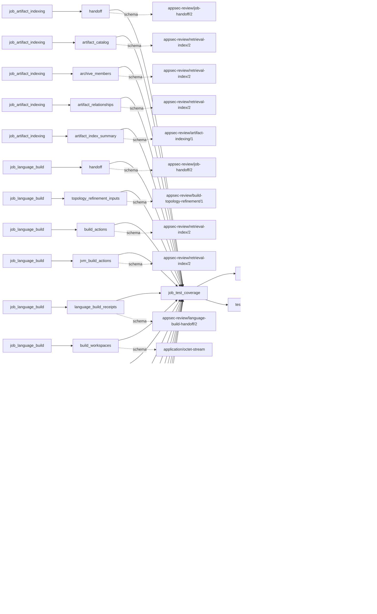
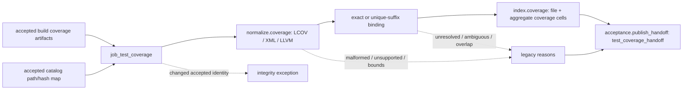

# test_coverage

## Purpose

Normalize coverage reports enumerated by accepted builds and ask how much reported line, branch
and function coverage can be bound to the accepted source inventory. The job never executes tests,
searches for undeclared reports, or infers test quality or security from a percentage. Unresolved
paths remain visible but do not enter bound-source totals.

<!-- generated:begin job=job_test_coverage -->
<!-- generated from: appsec-review.toml, containers/catalog.toml, pipeline/guidance/registry.json, tests/job-test-map.json, src/appsec_review/runtime/registry.py, src/appsec_review/runtime/contracts.py, src/appsec_review/runtime/datasets.py, src/appsec_review/guidance/workers.py, src/appsec_review/mcp/schema.py, src/appsec_review/orchestration/topology.py, src/appsec_review/orchestration/dagster/adapter.py by scripts/generate-docs.py; do not edit -->
## Declared job contract

test_coverage

Job: `job_test_coverage`. Enabled in the dev recipe: **true**.
Declarations describe possible work, not successful execution or consumed evidence.

### Steps and tasks

| Step | Task | Workers | Pool | Bound tool or gap | Handler |
| --- | --- | --- | --- | --- | --- |
| `acceptance` | `acceptance.publish_handoff` | 1 | `application` | Undeclared ([T-147](../TODO.md)) | [source](../../src/appsec_review/jobs/job_test_coverage/job.py#L390) |
| `index` | `index.coverage` | 1 | `application` | Undeclared ([T-147](../TODO.md)) | [source](../../src/appsec_review/jobs/job_test_coverage/job.py#L333) |
| `load` | `load.accepted_inputs` | 1 | `application` | Undeclared ([T-147](../TODO.md)) | [source](../../src/appsec_review/jobs/job_test_coverage/job.py#L313) |
| `normalize` | `normalize.coverage` | 1 | `application` | Undeclared ([T-147](../TODO.md)) | [source](../../src/appsec_review/jobs/job_test_coverage/job.py#L327) |

### Accepted input declarations

| Producer | Dataset | Schema | Channel | Availability | Missing policy |
| --- | --- | --- | --- | --- | --- |
| `job_artifact_indexing` | `handoff` | `appsec-review/job-handoff/2` | handoff | optional | gap |
| `job_artifact_indexing` | `artifact_catalog` | `appsec-review/retrieval-index/2` | handoff | optional | gap |
| `job_artifact_indexing` | `archive_members` | `appsec-review/retrieval-index/2` | handoff | optional | gap |
| `job_artifact_indexing` | `artifact_relationships` | `appsec-review/retrieval-index/2` | handoff | optional | gap |
| `job_artifact_indexing` | `artifact_index_summary` | `appsec-review/artifact-indexing/1` | handoff | optional | gap |
| `job_language_build` | `handoff` | `appsec-review/job-handoff/2` | handoff | optional | gap |
| `job_language_build` | `topology_refinement_inputs` | `appsec-review/build-topology-refinement/1` | handoff | optional | gap |
| `job_language_build` | `build_actions` | `appsec-review/retrieval-index/2` | handoff | optional | gap |
| `job_language_build` | `jvm_build_actions` | `appsec-review/retrieval-index/2` | handoff | optional | gap |
| `job_language_build` | `language_build_receipts` | `appsec-review/language-build-handoff/2` | handoff | optional | gap |
| `job_language_build` | `build_workspaces` | `application/octet-stream` | handoff | optional | gap |
| `job_target_catalog` | `handoff` | `appsec-review/job-handoff/2` | handoff | optional | gap |
| `job_target_catalog` | `target_artifact_inputs` | `appsec-review/target-artifact-intake/1` | handoff | optional | gap |
| `job_target_catalog` | `source_files` | `appsec-review/retrieval-index/2` | handoff | optional | gap |
| `job_target_catalog` | `declaration_symbols` | `appsec-review/retrieval-index/2` | handoff | optional | gap |
| `job_target_catalog` | `components` | `appsec-review/retrieval-index/2` | handoff | optional | gap |
| `job_target_catalog` | `target_documents` | `appsec-review/retrieval-index/2` | handoff | optional | gap |
| `job_target_catalog` | `build_units` | `appsec-review/retrieval-index/2` | handoff | optional | gap |
| `job_target_catalog` | `catalog_documents` | `appsec-review/target-catalog/1` | handoff | optional | gap |

### Published dataset declarations

| Dataset | Step | Schema | Stage | Indexes | MCP route |
| --- | --- | --- | --- | --- | --- |
| `test_coverage` | `index` | `appsec-review/retrieval-index/2` | indexed | `analysis` | `query_precomputed` |
| `test_coverage_handoff` | `acceptance` | `appsec-review/test-coverage-handoff/1` | artifact_only | Not indexed | `coverage`, `query_dataset_inventory` |

Protected and artifact-only routes expose sanitized metadata, not payload access.

### Model and guidance declarations

No job-level model declaration; absence of a task binding remains [T-147](../TODO.md), not a nonexecution claim.

### Test selection

| Tier | Files or selectors |
| --- | --- |
| acceptance | None declared |
| integration | None declared |
| live | None declared |
| unit | `tests/test_test_coverage.py` |

### Dagster placement

Dispatch: `review_graph`. Review graph member: **true**. Enabled graph member: **true**.

Declared predecessors: `job_artifact_indexing`.

### Declared dataflow

<!-- generated:end -->

## Process

Source: [handler and path binding](../../src/appsec_review/jobs/job_test_coverage/job.py),
[format parsers](../../src/appsec_review/jobs/job_test_coverage/parsers.py).

### `load`

1. Read the accepted catalog's repository partition; verify artifact binding, schema, unique paths
   and SHA-256 values. Load accepted language-build and artifact-index publications and require
   their snapshots to match this job.
2. Retain catalog path/hash map, build receipts, three upstream handoff hashes and the artifact
   manifest. Admission is governed by [job input contracts](../architecture/job-input-contracts.md).

### `normalize`

1. Sort build receipts, filter configured applicable families, and select enumerated coverage
   exchange paths or coverage kinds. Cap candidate count; verify each report's origin and bytes.
   An integrity failure stops rather than publishing an unsupported-report gap.
2. Skip oversized artifacts; detect LCOV, Cobertura, JaCoCo or LLVM coverage JSON. Parse within
   format row/node bounds and cap source-file rows. Unsupported or malformed reports contribute
   reasons, never invented zero counters.
3. Normalize separators, file URI and drive prefixes. Try exact catalog paths and build-root
   variants first, then unique suffixes. Bind only one match; preserve unresolved/ambiguous rows
   with null path/hash and bounded candidate lists.
4. Record overlapping bound paths across reports, but retain and sum their rows rather than
   deduplicating coverage. Sum only bound rows into build-unit totals. Successful or partially
   successful receipts without candidates emit `missing_applicable_coverage`. No bound rows is
   unavailable; any gaps with bound rows is partial.

### `index`

1. Verify the inherited manifest and replace only `test-coverage-` analysis shards.
2. Fingerprint each build unit with accepted report identities, snapshot, parser/normalizer/mapping
   and upstream manifest. Write file coverage-cell entities, one aggregate cell and a coverage row,
   or reuse the fingerprint-addressed file.
3. Compose and verify `test-coverage-<attempt>.json`; do not turn unbound cells into source locations.

### `acceptance`

1. Write `accepted-test-coverage.json` with all units, summed totals, upstream hashes and manifest.
2. Publish unit count, not file count, as the item count; use completed-with-gaps when reasons exist,
   success when units exist without gaps, otherwise not-applicable.

## Dataflow

## Gaps

The handler emits legacy reasons; [interchange](../architecture/job-interchange.md#the-control-layer-beneath-the-envelope)
converts them to `producer_reported_gap` with non-retryable metadata. Non-retryable is not advisory.

- Input absent: `missing_applicable_coverage` for an applicable successful build without candidates.
- Present but unsupported: `unsupported_coverage_format`.
- Coverage missing or failed: `malformed_coverage`, `artifact_count_truncation`,
  `artifact_byte_bound`, `coverage_file_truncation`, `unresolved_source_path`,
  `ambiguous_source_path`, `path_candidate_truncation`, `overlapping_coverage_reports`.
  Parser failures include negative/inconsistent counts, invalid LCOV ordering, invalid JSON/XML,
  forbidden XML declarations and exceeded parser bounds. Overlap can inflate totals: it is not a
  successful report merge.
- `CoverageIntegrityError` covers missing/bad accepted publication, duplicate catalog paths,
  changed report hashes, invalid origin and snapshot mismatch. These failures are not normal gap
  publications.

No listed cause is automatically approved for a walk; missing applicable coverage has a stated cost.

## Acceptance

1. **A. Inputs:** Compare admitted catalog, language-build and artifact-index handoff hashes;
   reconcile report paths/hashes/origins and family selection against receipts.
2. **B. Independent comparison:** Independently count covered/total lines, branches and functions in
   retained tool-native reports; compare exact and suffix-bound file identities against the catalog.
   Recalculate totals excluding unresolved rows and explicitly account for overlapping reports.
3. **C. Gaps:** Read verified outcomes, group canonical records with their retained reasons, and
   compare skipped reports, ambiguous candidates and omitted rows with the input inventory and
   walk's approved expected causes.
4. **D. Baseline:** At authorized acceptance, use `stepwise.py accept` and record corpus namespace,
   saved baseline, report identities, bound/unbound counts and totals for a future diff. This page
   is not evidence that tests or live acceptance ran.

## Resume and invalidation

Per-unit shards bind report identities, source snapshot, parser/normalizer/mapping versions and
upstream artifact manifest; changed reports rebuild that unit without replacing unrelated indices.
The handler's local fingerprint does not explicitly bind bounds or family settings, so a settings
change alone is not a documented guarantee of shard invalidation. Runtime receipt reuse has the
separate [configuration boundary](../architecture/jobs-and-runtime.md#wave-1-resumability).
The accepted reader verifies both document and full manifest. Generated task binding omissions
remain [T-147](../TODO.md);
they do not authorize interpreting this producer as a test runner.
