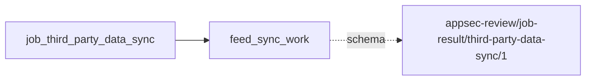

# third_party_data_sync

This page contains the generated contract; the authored process and acceptance description are tracked by [T-130](../TODO.md).

<!-- generated:begin job=job_third_party_data_sync -->
<!-- generated from: appsec-review.toml, containers/catalog.toml, pipeline/guidance/registry.json, tests/job-test-map.json, src/appsec_review/runtime/registry.py, src/appsec_review/runtime/contracts.py, src/appsec_review/runtime/datasets.py, src/appsec_review/guidance/workers.py, src/appsec_review/mcp/schema.py, src/appsec_review/orchestration/topology.py, src/appsec_review/orchestration/dagster/adapter.py by scripts/generate-docs.py; do not edit -->
## Declared job contract

third_party_data_sync

Job: `job_third_party_data_sync`. Enabled in the dev recipe: **true**.
Declarations describe possible work, not successful execution or consumed evidence.

### Steps and tasks

| Step | Task | Workers | Pool | Bound tool or gap | Handler |
| --- | --- | --- | --- | --- | --- |
| `cve_bin_tool_db_build` | `cve_bin_tool_db_build.build` | 1 | `application` | Undeclared ([T-147](../TODO.md)) | [source](../../src/appsec_review/jobs/job_third_party_data_sync/job.py#L233) |
| `cve_bin_tool_db_build` | `cve_bin_tool_db_build.publish` | 1 | `application` | Undeclared ([T-147](../TODO.md)) | [source](../../src/appsec_review/jobs/job_third_party_data_sync/job.py#L237) |
| `cve_bin_tool_db_build` | `cve_bin_tool_db_build.resolve_nvd_snapshot` | 1 | `application` | Undeclared ([T-147](../TODO.md)) | [source](../../src/appsec_review/jobs/job_third_party_data_sync/job.py#L229) |
| `epss_sync` | `epss_sync.fetch` | 1 | `application` | Undeclared ([T-147](../TODO.md)) | [source](../../src/appsec_review/jobs/job_third_party_data_sync/job.py#L178) |
| `epss_sync` | `epss_sync.normalize` | 1 | `application` | Undeclared ([T-147](../TODO.md)) | [source](../../src/appsec_review/jobs/job_third_party_data_sync/job.py#L181) |
| `epss_sync` | `epss_sync.publish` | 1 | `application` | Undeclared ([T-147](../TODO.md)) | [source](../../src/appsec_review/jobs/job_third_party_data_sync/job.py#L184) |
| `grype_db_sync` | `grype_db_sync.fetch` | 1 | `application` | Undeclared ([T-147](../TODO.md)) | [source](../../src/appsec_review/jobs/job_third_party_data_sync/job.py#L200) |
| `grype_db_sync` | `grype_db_sync.import` | 1 | `application` | Undeclared ([T-147](../TODO.md)) | [source](../../src/appsec_review/jobs/job_third_party_data_sync/job.py#L204) |
| `grype_db_sync` | `grype_db_sync.publish` | 1 | `application` | Undeclared ([T-147](../TODO.md)) | [source](../../src/appsec_review/jobs/job_third_party_data_sync/job.py#L215) |
| `kev_sync` | `kev_sync.fetch` | 1 | `application` | Undeclared ([T-147](../TODO.md)) | [source](../../src/appsec_review/jobs/job_third_party_data_sync/job.py#L178) |
| `kev_sync` | `kev_sync.normalize` | 1 | `application` | Undeclared ([T-147](../TODO.md)) | [source](../../src/appsec_review/jobs/job_third_party_data_sync/job.py#L181) |
| `kev_sync` | `kev_sync.publish` | 1 | `application` | Undeclared ([T-147](../TODO.md)) | [source](../../src/appsec_review/jobs/job_third_party_data_sync/job.py#L184) |
| `mitre_sync` | `mitre_sync.fetch` | 1 | `application` | Undeclared ([T-147](../TODO.md)) | [source](../../src/appsec_review/jobs/job_third_party_data_sync/job.py#L157) |
| `mitre_sync` | `mitre_sync.normalize` | 1 | `application` | Undeclared ([T-147](../TODO.md)) | [source](../../src/appsec_review/jobs/job_third_party_data_sync/job.py#L160) |
| `mitre_sync` | `mitre_sync.publish` | 1 | `application` | Undeclared ([T-147](../TODO.md)) | [source](../../src/appsec_review/jobs/job_third_party_data_sync/job.py#L163) |
| `nvd_sync` | `nvd_sync.fetch` | 1 | `application` | Undeclared ([T-147](../TODO.md)) | [source](../../src/appsec_review/jobs/job_third_party_data_sync/job.py#L119) |
| `nvd_sync` | `nvd_sync.process` | 1 | `application` | Undeclared ([T-147](../TODO.md)) | [source](../../src/appsec_review/jobs/job_third_party_data_sync/job.py#L124) |
| `nvd_sync` | `nvd_sync.publish` | 1 | `application` | Undeclared ([T-147](../TODO.md)) | [source](../../src/appsec_review/jobs/job_third_party_data_sync/job.py#L132) |
| `osv_sync` | `osv_sync.fetch` | 1 | `application` | Undeclared ([T-147](../TODO.md)) | [source](../../src/appsec_review/jobs/job_third_party_data_sync/job.py#L140) |
| `osv_sync` | `osv_sync.index` | 1 | `application` | Undeclared ([T-147](../TODO.md)) | [source](../../src/appsec_review/jobs/job_third_party_data_sync/job.py#L143) |
| `osv_sync` | `osv_sync.publish` | 1 | `application` | Undeclared ([T-147](../TODO.md)) | [source](../../src/appsec_review/jobs/job_third_party_data_sync/job.py#L146) |

### Accepted input declarations

| Producer | Dataset | Schema | Channel | Availability | Missing policy |
| --- | --- | --- | --- | --- | --- |

### Published dataset declarations

| Dataset | Step | Schema | Stage | Indexes | MCP route |
| --- | --- | --- | --- | --- | --- |
| `feed_sync_work` | `nvd_sync` | `appsec-review/job-result/third-party-data-sync/1` | protected | Not indexed | `coverage`, `query_dataset_inventory` |

Protected and artifact-only routes expose sanitized metadata, not payload access.

### Model and guidance declarations

No job-level model declaration; absence of a task binding remains [T-147](../TODO.md), not a nonexecution claim.

### Test selection

| Tier | Files or selectors |
| --- | --- |
| acceptance | None declared |
| integration | `tests/integration/job_third_party_data_sync/test_feed_transport.py` `tests/integration/job_third_party_data_sync/test_failure_receipts.py` `tests/integration/job_third_party_data_sync/test_publication_filesystem.py` `tests/integration/job_third_party_data_sync/test_reference_transport.py` `tests/integration/job_third_party_data_sync/test_nvd_transport.py` `tests/integration/job_third_party_data_sync/test_fixture_provenance.py` `tests/integration/job_third_party_data_sync/test_grype_container.py` `tests/integration/job_third_party_data_sync/test_cve_builder.py` |
| live | None declared |
| unit | `tests/unit/job_third_party_data_sync/test_job_graph.py` `tests/unit/job_third_party_data_sync/test_publication.py` `tests/unit/job_third_party_data_sync/test_cve_bin_tool_database.py` `tests/unit/job_third_party_data_sync/test_osv_feed.py` `tests/unit/job_third_party_data_sync/test_nvd_sync_job.py` `tests/unit/job_third_party_data_sync/test_nvd_http.py` `tests/unit/job_third_party_data_sync/test_reference_feed_sync.py` `tests/unit/job_third_party_data_sync/test_grype_db_sync.py` |

### Dagster placement

Dispatch: `maintenance`. Review graph member: **false**. Enabled graph member: **false**.

Declared predecessors: None.

### Declared dataflow

<!-- generated:end -->
