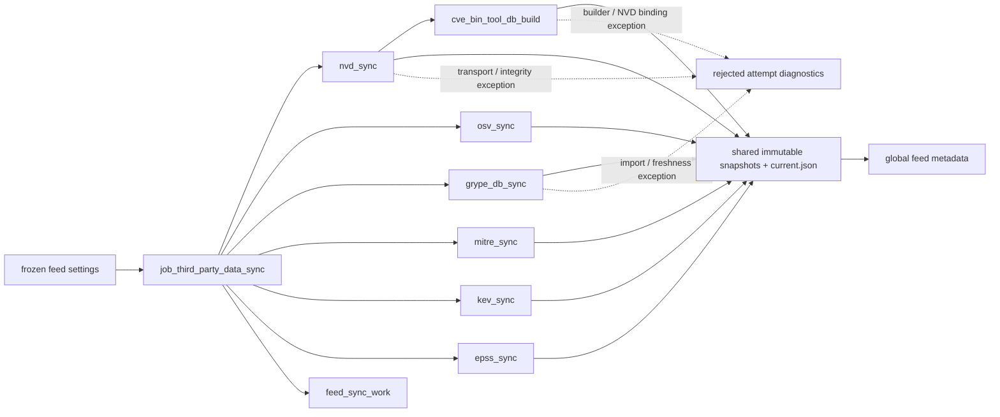

# third_party_data_sync

## Purpose

Which verified external vulnerability and classification snapshots are available for later
review consumers? This standalone maintenance job refreshes bounded feeds and derived
databases, retaining exact source/tool identities and immutable publications. It refuses to
interpret a CVE match, KEV listing, EPSS score or MITRE classification as evidence that any
particular target is affected, reachable or exploitable.

<!-- generated:begin job=job_third_party_data_sync -->
<!-- generated from: appsec-review.toml, containers/catalog.toml, pipeline/guidance/registry.json, tests/job-test-map.json, src/appsec_review/runtime/registry.py, src/appsec_review/runtime/contracts.py, src/appsec_review/runtime/datasets.py, src/appsec_review/guidance/workers.py, src/appsec_review/mcp/schema.py, src/appsec_review/orchestration/topology.py, src/appsec_review/orchestration/dagster/adapter.py by scripts/generate-docs.py; do not edit -->
## Declared job contract

third_party_data_sync

Job: `job_third_party_data_sync`. Enabled in the dev recipe: **true**.
Declarations describe possible work, not successful execution or consumed evidence.

### Steps and tasks

| Step | Task | Workers | Pool | Bound tool or gap | Handler |
| --- | --- | --- | --- | --- | --- |
| `cve_bin_tool_db_build` | `cve_bin_tool_db_build.build` | 1 | `application` | Undeclared ([T-147](../TODO.md)) | [source](../../src/appsec_review/jobs/job_third_party_data_sync/job.py#L233) |
| `cve_bin_tool_db_build` | `cve_bin_tool_db_build.publish` | 1 | `application` | Undeclared ([T-147](../TODO.md)) | [source](../../src/appsec_review/jobs/job_third_party_data_sync/job.py#L237) |
| `cve_bin_tool_db_build` | `cve_bin_tool_db_build.resolve_nvd_snapshot` | 1 | `application` | Undeclared ([T-147](../TODO.md)) | [source](../../src/appsec_review/jobs/job_third_party_data_sync/job.py#L229) |
| `epss_sync` | `epss_sync.fetch` | 1 | `application` | Undeclared ([T-147](../TODO.md)) | [source](../../src/appsec_review/jobs/job_third_party_data_sync/job.py#L178) |
| `epss_sync` | `epss_sync.normalize` | 1 | `application` | Undeclared ([T-147](../TODO.md)) | [source](../../src/appsec_review/jobs/job_third_party_data_sync/job.py#L181) |
| `epss_sync` | `epss_sync.publish` | 1 | `application` | Undeclared ([T-147](../TODO.md)) | [source](../../src/appsec_review/jobs/job_third_party_data_sync/job.py#L184) |
| `grype_db_sync` | `grype_db_sync.fetch` | 1 | `application` | Undeclared ([T-147](../TODO.md)) | [source](../../src/appsec_review/jobs/job_third_party_data_sync/job.py#L200) |
| `grype_db_sync` | `grype_db_sync.import` | 1 | `application` | Undeclared ([T-147](../TODO.md)) | [source](../../src/appsec_review/jobs/job_third_party_data_sync/job.py#L204) |
| `grype_db_sync` | `grype_db_sync.publish` | 1 | `application` | Undeclared ([T-147](../TODO.md)) | [source](../../src/appsec_review/jobs/job_third_party_data_sync/job.py#L215) |
| `kev_sync` | `kev_sync.fetch` | 1 | `application` | Undeclared ([T-147](../TODO.md)) | [source](../../src/appsec_review/jobs/job_third_party_data_sync/job.py#L178) |
| `kev_sync` | `kev_sync.normalize` | 1 | `application` | Undeclared ([T-147](../TODO.md)) | [source](../../src/appsec_review/jobs/job_third_party_data_sync/job.py#L181) |
| `kev_sync` | `kev_sync.publish` | 1 | `application` | Undeclared ([T-147](../TODO.md)) | [source](../../src/appsec_review/jobs/job_third_party_data_sync/job.py#L184) |
| `mitre_sync` | `mitre_sync.fetch` | 1 | `application` | Undeclared ([T-147](../TODO.md)) | [source](../../src/appsec_review/jobs/job_third_party_data_sync/job.py#L157) |
| `mitre_sync` | `mitre_sync.normalize` | 1 | `application` | Undeclared ([T-147](../TODO.md)) | [source](../../src/appsec_review/jobs/job_third_party_data_sync/job.py#L160) |
| `mitre_sync` | `mitre_sync.publish` | 1 | `application` | Undeclared ([T-147](../TODO.md)) | [source](../../src/appsec_review/jobs/job_third_party_data_sync/job.py#L163) |
| `nvd_sync` | `nvd_sync.fetch` | 1 | `application` | Undeclared ([T-147](../TODO.md)) | [source](../../src/appsec_review/jobs/job_third_party_data_sync/job.py#L119) |
| `nvd_sync` | `nvd_sync.process` | 1 | `application` | Undeclared ([T-147](../TODO.md)) | [source](../../src/appsec_review/jobs/job_third_party_data_sync/job.py#L124) |
| `nvd_sync` | `nvd_sync.publish` | 1 | `application` | Undeclared ([T-147](../TODO.md)) | [source](../../src/appsec_review/jobs/job_third_party_data_sync/job.py#L132) |
| `osv_sync` | `osv_sync.fetch` | 1 | `application` | Undeclared ([T-147](../TODO.md)) | [source](../../src/appsec_review/jobs/job_third_party_data_sync/job.py#L140) |
| `osv_sync` | `osv_sync.index` | 1 | `application` | Undeclared ([T-147](../TODO.md)) | [source](../../src/appsec_review/jobs/job_third_party_data_sync/job.py#L143) |
| `osv_sync` | `osv_sync.publish` | 1 | `application` | Undeclared ([T-147](../TODO.md)) | [source](../../src/appsec_review/jobs/job_third_party_data_sync/job.py#L146) |

### Accepted input declarations

| Producer | Dataset | Schema | Channel | Availability | Missing policy |
| --- | --- | --- | --- | --- | --- |

### Published dataset declarations

| Dataset | Step | Schema | Stage | Indexes | MCP route |
| --- | --- | --- | --- | --- | --- |
| `feed_sync_work` | `nvd_sync` | `appsec-review/job-result/third-party-data-sync/1` | protected | Not indexed | `coverage`, `query_dataset_inventory` |

Protected and artifact-only routes expose sanitized metadata, not payload access.

### Model and guidance declarations

No job-level model declaration; absence of a task binding remains [T-147](../TODO.md), not a nonexecution claim.

### Test selection

| Tier | Files or selectors |
| --- | --- |
| acceptance | None declared |
| integration | `tests/integration/job_third_party_data_sync/test_feed_transport.py` `tests/integration/job_third_party_data_sync/test_failure_receipts.py` `tests/integration/job_third_party_data_sync/test_publication_filesystem.py` `tests/integration/job_third_party_data_sync/test_reference_transport.py` `tests/integration/job_third_party_data_sync/test_nvd_transport.py` `tests/integration/job_third_party_data_sync/test_fixture_provenance.py` `tests/integration/job_third_party_data_sync/test_grype_container.py` `tests/integration/job_third_party_data_sync/test_cve_builder.py` |
| live | None declared |
| unit | `tests/unit/job_third_party_data_sync/test_job_graph.py` `tests/unit/job_third_party_data_sync/test_publication.py` `tests/unit/job_third_party_data_sync/test_cve_bin_tool_database.py` `tests/unit/job_third_party_data_sync/test_osv_feed.py` `tests/unit/job_third_party_data_sync/test_nvd_sync_job.py` `tests/unit/job_third_party_data_sync/test_nvd_http.py` `tests/unit/job_third_party_data_sync/test_reference_feed_sync.py` `tests/unit/job_third_party_data_sync/test_grype_db_sync.py` |

### Dagster placement

Dispatch: `maintenance`. Review graph member: **false**. Enabled graph member: **false**.

Declared predecessors: None.

### Declared dataflow

<!-- generated:end -->

## Process

Source: [unit graph and validators](../../src/appsec_review/jobs/job_third_party_data_sync/job.py)
and [publication helpers](../../src/appsec_review/jobs/job_third_party_data_sync/publication.py).
[Third-party sync operations](third-party-data-sync.md) owns transport and publication details.
Validate the exact task order, typed settings, feed roots beneath repository `data` and metadata
root beneath run storage before starting. The six download branches are independent; only the
cve-bin-tool branch depends on this execution's NVD publication.

### `nvd_sync`

1. Acquire the NVD writer lock and select the existing current snapshot, if any. Bootstrap
   official yearly feeds when no extendable parent exists; otherwise fetch bounded
   last-modified windows and pages from the parent's cursor.
2. For bootstrap, fetch fresh `.meta` identities and reuse a yearly download only after
   rechecking compressed/uncompressed sizes and hash. Transport retries are bounded and
   identity-aware; protocol/integrity errors fail instead of publishing partial bytes.
3. Parse raw CVEs into metadata layers, reject invalid/duplicate identities and construct
   `index/nvd.sqlite` from the parent index or replayable metadata chain plus new layers.
4. Publish the immutable snapshot and advance its pointer only after verification. In
   `process`, verify chain, manifests, blobs and index and require the snapshot still equals
   `fetch`'s selected result.
5. Publish global NVD feed metadata with the verified identity; a changed current snapshot
   between stages is a failure, not a newer snapshot silently substituted.

### `osv_sync`

1. Fetch each explicitly configured ecosystem archive from the fixed allowed HTTPS source
   under archive-byte and transport bounds.
2. In `index`, reject unsafe archive names and expansion/record bounds. Parse advisory IDs;
   store a multi-ecosystem advisory once while merging distinct package associations.
3. Build advisory, package and alias tables and retain the set of whole ecosystems fetched.
   Package rows mentioning another ecosystem do not prove that ecosystem's complete coverage.
4. Check SQLite integrity; publish source archives and `index/osv.sqlite` as one snapshot,
   verify it and write global feed metadata.

### `grype_db_sync`

1. Fetch the active database listing; validate schema, freshness, safe archive location and
   checksum. Fetch only the bounded archive selected by that listing.
2. Enforce compressed/uncompressed/member/window bounds and extract only the expected raw
   database, rejecting unsafe, duplicate, unexpected or incomplete members.
3. In `import`, pin one resolved `tool-grype` image for version, database import and status
   invocations. Require its executable/catalog version, imported schema/build time, valid
   status, cache path and closed cache contents to agree with the listing.
4. Rehash imported files and validate again before publishing the database, import metadata,
   listing and tool-validation records. Verify the snapshot, require publication and verified
   IDs to match, then publish global metadata.

### `mitre_sync`

1. Fetch the configured, hash-pinned source selections. Reject missing required selections,
   invalid source definitions, hash mismatches and source-byte violations.
2. Normalize ATT&CK/CAPEC STIX bundles and CWE XML into keyed entries. Bound archive/XML
   expansion, reject DTD/entity declarations and check the declared CWE version.
3. Retain bounded CWE consequence scopes/impacts and count truncated weaknesses explicitly;
   enforce total-record bounds and SQLite integrity.
4. Publish source bytes, normalized `index/mitre.sqlite`, counts and consequence-truncation
   metadata; verify the snapshot and publish its global feed identity.

### `cve_bin_tool_db_build`

1. Resolve the exact NVD snapshot from `nvd_sync.publish`; require current pointer and manifest
   hash to match. Verify the acyclic parent chain and raw layers in oldest-first replay order.
2. Copy and rehash those layers into bounded build input. Use the configured builder/tool
   image and record its observed identity; this database build does not download NVD again.
3. The Docker path can build an unpinned missing builder image, but an explicit missing or
   mismatched image pin refuses that fallback. Run database construction without network and
   enforce configured build/run timeouts. [Signing](signing.md) remains the launch-policy authority.
4. Require the configured tool version, NVD-only nonempty CVE rows, matching build counts and
   successful SQLite checks for both databases.
5. Publish `cve.db`, `version_map.db` and `build.json`, verify their snapshot against this
   execution's NVD identity, and write global feed metadata.

### `kev_sync`

1. Fetch the configured HTTPS catalog from its host allowlist under the source-byte bound;
   verify an optional source hash pin.
2. Require catalog version, release date and vulnerability array; validate declared count,
   unique CVE IDs, dates and the record bound.
3. Normalize sorted records into `index/kev.sqlite`, check SQLite integrity and publish the
   source JSON with its version/count metadata.
4. Verify the snapshot and publish global metadata. Known exploitation somewhere is reference
   context, not a target-specific exploitability result.

### `epss_sync`

1. Fetch the configured HTTPS gzip source within its allowlist and compressed-byte bound;
   verify an optional source pin.
2. Bound decompression; require model/date metadata, the exact CSV header, unique valid CVE
   IDs, finite probabilities/percentiles within range and a nonempty bounded record set.
3. Write sorted rows to `index/epss.sqlite`; check integrity and publish source bytes,
   score date, model version and record count.
4. Verify the snapshot and publish global metadata. The population-level score is not a
   measurement of this target's risk.

Every unit validates its expected result schema. The job result transform records global job
metadata, and the final validator requires the complete unit-receipt set. Shared snapshot
publication is per feed, not one transaction across all branches; successful earlier
publications are not rolled back when another branch fails.

## Dataflow

## Gaps

This strict-gap job does not manufacture successful `producer-gap/1` feed results. Failures
are exceptions with failed task receipts and dependent work blocked; a failed whole attempt
has no accepted handoff. Framework diagnostics can account for failed/blocked tasks using
`producer_failed`/`producer_blocked` with `retryable=True`. That runtime classification is
not a promise that an unchanged integrity error will heal, nor a feed-specific advisory.

| Boundary | Failure conditions |
| --- | --- |
| Configuration/transport | Unsafe roots, invalid selection/settings, disallowed URL, timeout/HTTP failure, download size/length mismatch, exhausted bounded NVD transport retries. |
| NVD | Invalid metadata/hash/size/CVE, duplicate yearly IDs, malformed or discontinuous pagination, clock before cursor, changed parent/current identity, cyclic/damaged chain or blob/index failure. |
| OSV/MITRE | Unsafe archive or expansion/record bounds, invalid advisory/STIX/XML, pin/version mismatch, prohibited XML declarations or SQLite integrity failure. |
| Grype | Stale/future/unsupported listing, checksum mismatch, unsafe or truncated archive, import/tool/status/cache mismatch, changed bytes or publication identity. |
| cve-bin-tool | Changed bound NVD selection/layers, unavailable/mismatched image, builder timeout/failure, wrong tool/source/count or invalid/empty databases. |
| KEV/EPSS | Invalid version/date/header/IDs, duplicate records, count or byte bound, invalid probabilities, unreadable compressed data, empty EPSS scores or SQLite integrity failure. |
| Publication | Unsafe/missing/changed payload, manifest collision, missing provenance, writer contention or metadata/publication failure. |

MITRE consequence truncation is retained as `consequence_truncated_weaknesses`, not emitted
as a canonical gap record. Feed limitations and configured ecosystem/source subsets are
coverage facts, not claims that unselected references do not exist. During a walk, inspect
those counts as well as canonical outcomes; no understood limitation is automatically on
the expected-gaps list. See [job interchange](../architecture/job-interchange.md).

## Acceptance

1. **A. Inputs:** Confirm maintenance dispatch has no target or semantic upstream inputs.
   Match frozen source selections/pins, tool identities, raw download hashes and NVD parent
   selection to the attempt; cve-bin-tool must bind this execution's NVD publication.
2. **B. Independent comparison:** Independently count unique source CVEs/advisories/entries
   and compare normalized database counts, distinguishing NVD changed-layer counts from
   total indexed CVEs. Compare KEV declared count, EPSS date/model, OSV whole-ecosystem
   coverage, MITRE per-source/truncation counts and Grype raw version/status records.
   Rehash sampled manifest payloads and compare derived NVD database counts with builder records.
3. **C. Gaps:** Read rejected or accepted canonical outcomes as appropriate and inspect each
   branch's publication identity. A prior usable snapshot is not a successful failed refresh.
   Record unselected-source and truncation costs; stop on unexpected causes rather than
   accepting tooling/integrity failure as clean coverage.
4. **D. Baseline:** Record the approved corpus namespace and saved standalone snapshot/count
   baseline, including all feed manifest hashes, NVD chain and cve-bin-tool binding. This
   maintenance job is outside the review graph: do not claim `stepwise.py accept` accepted a
   review stage merely because feed pointers advanced. The walk must name its baseline
   admission procedure before asserting all four checks are satisfied.

## Resume and invalidation

The maintenance contract is target-independent (`none`) and `always_execute=True`: a new
dispatch refreshes rather than reusing a target-review handoff. Feed-level reuse is narrower.
NVD reuses verified yearly downloads only against fresh upstream metadata, or extends a
verified parent cursor/index/metadata chain; corrupt or changed bytes cannot become a
successful incremental update. Interrupted unverified downloads are not accepted snapshots.
Other feed snapshots are content-addressed from manifest/source/index identities; identical
publication bytes can reuse the immutable directory after verification, not skip validation.

Shared producer provenance binds configuration, publisher release, manifest inputs and the
producing claim; consuming attempts pin exact snapshots rather than following later pointer
movement. cve-bin-tool additionally binds NVD snapshot/manifest and tool identity; Grype binds
validated tool/version/schema/build identity and freshness. A failed stage leaves earlier
published branches intact but is not a reusable accepted job. Path/pointer-bearing work is not
a generic portable failed-attempt checkpoint. See
[immutable publication provenance](third-party-data-sync.md#immutable-publication-provenance)
and [Wave 1 resumability](../architecture/jobs-and-runtime.md#wave-1-resumability).
