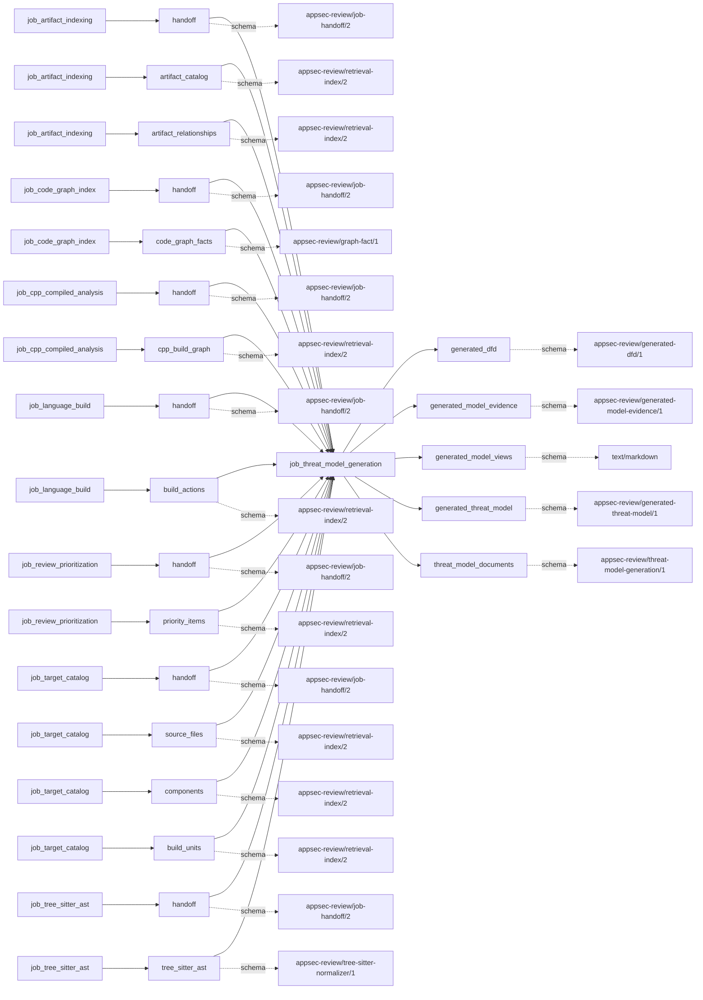
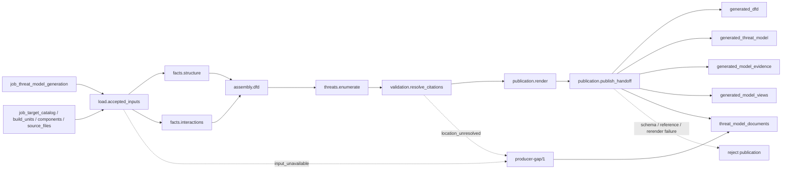

# threat_model_generation

## Purpose

Derive an evidence-linked DFD and candidate threat questions from accepted structure and interaction
facts. Outputs are artifact-only routing context, not findings or proof that mitigations are
absent; candidate mitigation state remains `not_examined`. This deterministic slice is disabled
by default. The current inference behavior loader can use an admitted generated model as routing
context, but must return to original evidence to establish claim predicates.

<!-- generated:begin job=job_threat_model_generation -->
<!-- generated from: appsec-review.toml, containers/catalog.toml, pipeline/guidance/registry.json, tests/job-test-map.json, src/appsec_review/runtime/registry.py, src/appsec_review/runtime/contracts.py, src/appsec_review/runtime/datasets.py, src/appsec_review/guidance/workers.py, src/appsec_review/mcp/schema.py, src/appsec_review/orchestration/topology.py, src/appsec_review/orchestration/dagster/adapter.py by scripts/generate-docs.py; do not edit -->
## Declared job contract

threat_model_generation

Job: `job_threat_model_generation`. Enabled in the dev recipe: **false**.
Declarations describe possible work, not successful execution or consumed evidence.

### Steps and tasks

| Step | Task | Workers | Pool | Bound tool or gap | Handler |
| --- | --- | --- | --- | --- | --- |
| `assembly` | `assembly.dfd` | 1 | `application` | Undeclared ([T-147](../TODO.md)) | [source](../../src/appsec_review/jobs/job_threat_model_generation/job.py#L245) |
| `facts` | `facts.interactions` | 1 | `application` | Undeclared ([T-147](../TODO.md)) | [source](../../src/appsec_review/jobs/job_threat_model_generation/job.py#L240) |
| `facts` | `facts.structure` | 1 | `application` | Undeclared ([T-147](../TODO.md)) | [source](../../src/appsec_review/jobs/job_threat_model_generation/job.py#L236) |
| `load` | `load.accepted_inputs` | 1 | `application` | Undeclared ([T-147](../TODO.md)) | [source](../../src/appsec_review/jobs/job_threat_model_generation/job.py#L205) |
| `publication` | `publication.publish_handoff` | 1 | `lifecycle` | Undeclared ([T-147](../TODO.md)) | [source](../../src/appsec_review/jobs/job_threat_model_generation/job.py#L286) |
| `publication` | `publication.render` | 1 | `lifecycle` | Undeclared ([T-147](../TODO.md)) | [source](../../src/appsec_review/jobs/job_threat_model_generation/job.py#L276) |
| `threats` | `threats.enumerate` | 1 | `application` | Undeclared ([T-147](../TODO.md)) | [source](../../src/appsec_review/jobs/job_threat_model_generation/job.py#L255) |
| `validation` | `validation.resolve_citations` | 1 | `application` | Undeclared ([T-147](../TODO.md)) | [source](../../src/appsec_review/jobs/job_threat_model_generation/job.py#L262) |

### Accepted input declarations

| Producer | Dataset | Schema | Channel | Availability | Missing policy |
| --- | --- | --- | --- | --- | --- |
| `job_artifact_indexing` | `handoff` | `appsec-review/job-handoff/2` | handoff | optional | gap |
| `job_artifact_indexing` | `artifact_catalog` | `appsec-review/retrieval-index/2` | handoff | optional | gap |
| `job_artifact_indexing` | `artifact_relationships` | `appsec-review/retrieval-index/2` | handoff | optional | gap |
| `job_code_graph_index` | `handoff` | `appsec-review/job-handoff/2` | handoff | optional | gap |
| `job_code_graph_index` | `code_graph_facts` | `appsec-review/graph-fact/1` | handoff | optional | gap |
| `job_cpp_compiled_analysis` | `handoff` | `appsec-review/job-handoff/2` | handoff | optional | gap |
| `job_cpp_compiled_analysis` | `cpp_build_graph` | `appsec-review/retrieval-index/2` | handoff | optional | gap |
| `job_language_build` | `handoff` | `appsec-review/job-handoff/2` | handoff | optional | gap |
| `job_language_build` | `build_actions` | `appsec-review/retrieval-index/2` | handoff | optional | gap |
| `job_review_prioritization` | `handoff` | `appsec-review/job-handoff/2` | handoff | optional | gap |
| `job_review_prioritization` | `priority_items` | `appsec-review/retrieval-index/2` | handoff | optional | gap |
| `job_target_catalog` | `handoff` | `appsec-review/job-handoff/2` | handoff | required | reject |
| `job_target_catalog` | `source_files` | `appsec-review/retrieval-index/2` | handoff | optional | gap |
| `job_target_catalog` | `components` | `appsec-review/retrieval-index/2` | handoff | optional | gap |
| `job_target_catalog` | `build_units` | `appsec-review/retrieval-index/2` | handoff | optional | gap |
| `job_tree_sitter_ast` | `handoff` | `appsec-review/job-handoff/2` | handoff | optional | gap |
| `job_tree_sitter_ast` | `tree_sitter_ast` | `appsec-review/tree-sitter-normalizer/1` | handoff | optional | gap |

### Published dataset declarations

| Dataset | Step | Schema | Stage | Indexes | MCP route |
| --- | --- | --- | --- | --- | --- |
| `generated_dfd` | `publication` | `appsec-review/generated-dfd/1` | artifact_only | Not indexed | `coverage`, `query_dataset_inventory` |
| `generated_model_evidence` | `publication` | `appsec-review/generated-model-evidence/1` | artifact_only | Not indexed | `coverage`, `query_dataset_inventory` |
| `generated_model_views` | `publication` | `text/markdown` | artifact_only | Not indexed | `coverage`, `query_dataset_inventory` |
| `generated_threat_model` | `publication` | `appsec-review/generated-threat-model/1` | artifact_only | Not indexed | `coverage`, `query_dataset_inventory` |
| `threat_model_documents` | `publication` | `appsec-review/threat-model-generation/1` | artifact_only | Not indexed | `coverage`, `query_dataset_inventory` |

Protected and artifact-only routes expose sanitized metadata, not payload access.

### Model and guidance declarations

No job-level model declaration; absence of a task binding remains [T-147](../TODO.md), not a nonexecution claim.

### Test selection

| Tier | Files or selectors |
| --- | --- |
| acceptance | `tests/acceptance/test_threat_model_generation.py` |
| integration | `tests/integration/test_threat_model_generation.py` |
| live | None declared |
| unit | `tests/test_threat_model_generation_job.py` |

### Dagster placement

Dispatch: `review_graph`. Review graph member: **true**. Enabled graph member: **false**.

Declared predecessors: `job_owasp_control_assessment`.

### Declared dataflow

<!-- generated:end -->

## Process

The [handler](../../src/appsec_review/jobs/job_threat_model_generation/job.py) uses
[bounded index views](../../src/appsec_review/threat_model/index_view.py), not a checkout or model.
The consumer boundary is explicit in [review behavior context](../../src/appsec_review/review/behavior.py).

### `load`

1. In `load.accepted_inputs`, verify the three reference-data files and require an authenticated
   evidence target snapshot. Record run/attempt/snapshot/reference hashes in the origin.
2. Open declared inputs not read by either fact lane to record their input-ledger states.
   Record the unregistered deployment-inventory producer and an `input_unavailable` gap.
3. Write attempt-owned canonical working records; missing or changed admitted bytes fail.

### `facts`

1. In `facts.structure`, hold the configured resource reservation while reading bounded catalog,
   artifact and build evidence. Derive process/structure facts with provenance, input counts and
   explicit unknowns; do not infer deployed architecture merely from a directory name.
2. In `facts.interactions`, read eligible graph entry/sink, syntax-call and priority-signal rows
   using the pinned interaction catalog. Retain evidence basis and location limitations.
3. Each lane reports only its own unavailable/partial inputs, truncations, empty result and
   provenance/location gaps. Write immutable working references for later assembly.

### `assembly`

1. In `assembly.dfd`, recheck reference hashes and join both lanes into elements, flows,
   boundaries, entry points, actors and unknowns.
2. Apply deterministic identity/merge and bound rules, retaining stronger evidence first.
   Record truncated flow/entry populations instead of claiming a complete DFD.

### `threats`

1. In `threats.enumerate`, match the assembled model to pinned threat templates/crosswalks.
2. Keep bounded candidate questions with cited evidence and unexamined mitigations. Record
   a reached threat bound; do not convert template applicability into a confirmed finding.

### `validation`

1. In `validation.resolve_citations`, resolve cited identities against admitted inputs.
2. Remove records with no resolving support and demote them to `citation_unresolved` unknowns;
   propagate dependent removals without reporting the same causing gap repeatedly.
3. Write the validated assembly and remaining threats, with citation and demotion counts.

### `publication`

1. In `publication.render`, render Markdown/Mermaid from validated records and joined prior gaps.
   If the rendering bound is reached, add its truncation gap and rerender so the view names it.
2. In `publication.publish_handoff`, assemble DFD, threat-model, evidence and result documents;
   validate schemas, cross-references, counts and artifact bindings.
3. Re-render all views and compare exact bytes with the earlier output. Reject changed working
   files or nonpure document assembly. Write final canonical documents and artifact references.
   The final unit returns no duplicate gaps: originating units already reported each one.

## Dataflow

Each input read follows [accepted-upstream admission](../architecture/job-input-contracts.md#admission-and-read-receipts);
index custody is described in [accepted index sets](../architecture/python-and-retrieval.md#accepted-index-sets).
No model, scanner, network or target execution is commissioned.

## Gaps

This job sets strict gaps. The [constructors](../../src/appsec_review/threat_model/view.py)
use real `producer-gap/1` codes, all with `retryable = false` here. Re-running this consumer over
the same accepted inputs cannot repair upstream coverage. **Nonretryable does not mean advisory.**
See [canonical gap semantics](../architecture/job-interchange.md#the-control-layer-beneath-the-envelope).

| Code | Scope and walk meaning |
| --- | --- |
| `input_unavailable` | Absent, disabled or unregistered producer; includes deployment inventory on every current execution. [T-108](../TODO.md) names that producer gap. |
| `output_missing` | Declared producer/dataset published no material. |
| `producer_reported_gap` | Dataset accepted with partial upstream coverage; readable, not complete. |
| `truncated` | Named query, process/entry/flow/threat bound or `publication.max_render_nodes`. |
| `empty_result` | Structure/interactions lane read inputs but established no facts. |
| `provenance_unavailable` | Structure names/paths were redacted or truncated by the index; affected processes are identified by record instead of name. |
| `location_unresolved` | Interaction fact lacks a usable location, or final cited record is demoted. |

Reference-data corruption, admitted-input tampering, malformed working records and invalid final
documents fail publication. The always-present deployment gap means the current job cannot be
accepted as complete coverage even though the final publishing unit itself returns `SUCCEEDED`.

## Acceptance

1. **A. Inputs:** Compare claim pins and input-ledger states/hashes with accepted catalog, artifact,
   build, graph, syntax and priority inputs. Verify target snapshot and three reference hashes;
   distinguish declared-but-unread rows from records actually read.
2. **B. Independent comparison:** Independently count relevant accepted structure/interaction
   rows and resolve sample DFD elements, flows and entry points to them. Reconcile retained,
   capped and demoted records with model counts. Verify evidence-set membership, unexamined
   mitigation state and byte-identical fresh rendering of views.
3. **C. Gaps:** Group verified outcomes by the seven codes above, preserving originating unit and
   scope. Compare the joined result without double counting. Record the deployment gap's cost;
   stop for any unexpected cause rather than treating `retryable = false` as acceptance.
4. **D. Baseline:** Save an authorized `stepwise.py accept` baseline and corpus namespace, with
   origin hashes, ledger states/read counts, model identities, unknowns and demotions.
   A later comparison must name changed evidence, reference data or bounds.

## Resume and invalidation

[Runtime reuse](../architecture/jobs-and-runtime.md#wave-1-resumability) binds resolved
configuration, contract, target snapshot, releases and admitted upstream digests. A repaired
producer changes its pin and invalidates this consumer without rerunning unrelated producers.
Reference hashes are checked repeatedly within the attempt. Working artifacts are path/hash-bound
to that attempt, so failed-attempt unit portability does not permit copying them into another
attempt. Reference, schema or render changes require fresh validation and view comparison.
