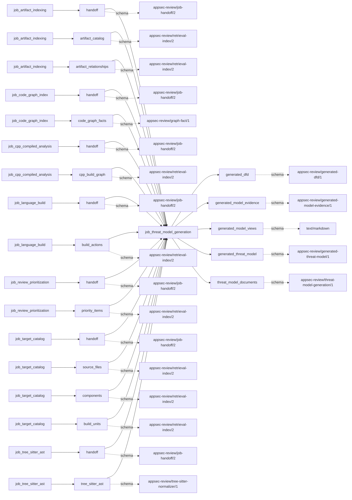

# threat_model_generation

This page contains the generated contract; the authored process and acceptance description are tracked by [T-130](../TODO.md).

<!-- generated:begin job=job_threat_model_generation -->
<!-- generated from: appsec-review.toml, containers/catalog.toml, pipeline/guidance/registry.json, tests/job-test-map.json, src/appsec_review/runtime/registry.py, src/appsec_review/runtime/contracts.py, src/appsec_review/runtime/datasets.py, src/appsec_review/guidance/workers.py, src/appsec_review/mcp/schema.py, src/appsec_review/orchestration/topology.py, src/appsec_review/orchestration/dagster/adapter.py by scripts/generate-docs.py; do not edit -->
## Declared job contract

threat_model_generation

Job: `job_threat_model_generation`. Enabled in the dev recipe: **false**.
Declarations describe possible work, not successful execution or consumed evidence.

### Steps and tasks

| Step | Task | Workers | Pool | Bound tool or gap | Handler |
| --- | --- | --- | --- | --- | --- |
| `assembly` | `assembly.dfd` | 1 | `application` | Undeclared ([T-147](../TODO.md)) | [source](../../src/appsec_review/jobs/job_threat_model_generation/job.py#L245) |
| `facts` | `facts.interactions` | 1 | `application` | Undeclared ([T-147](../TODO.md)) | [source](../../src/appsec_review/jobs/job_threat_model_generation/job.py#L240) |
| `facts` | `facts.structure` | 1 | `application` | Undeclared ([T-147](../TODO.md)) | [source](../../src/appsec_review/jobs/job_threat_model_generation/job.py#L236) |
| `load` | `load.accepted_inputs` | 1 | `application` | Undeclared ([T-147](../TODO.md)) | [source](../../src/appsec_review/jobs/job_threat_model_generation/job.py#L205) |
| `publication` | `publication.publish_handoff` | 1 | `lifecycle` | Undeclared ([T-147](../TODO.md)) | [source](../../src/appsec_review/jobs/job_threat_model_generation/job.py#L286) |
| `publication` | `publication.render` | 1 | `lifecycle` | Undeclared ([T-147](../TODO.md)) | [source](../../src/appsec_review/jobs/job_threat_model_generation/job.py#L276) |
| `threats` | `threats.enumerate` | 1 | `application` | Undeclared ([T-147](../TODO.md)) | [source](../../src/appsec_review/jobs/job_threat_model_generation/job.py#L255) |
| `validation` | `validation.resolve_citations` | 1 | `application` | Undeclared ([T-147](../TODO.md)) | [source](../../src/appsec_review/jobs/job_threat_model_generation/job.py#L262) |

### Accepted input declarations

| Producer | Dataset | Schema | Channel | Availability | Missing policy |
| --- | --- | --- | --- | --- | --- |
| `job_artifact_indexing` | `handoff` | `appsec-review/job-handoff/2` | handoff | optional | gap |
| `job_artifact_indexing` | `artifact_catalog` | `appsec-review/retrieval-index/2` | handoff | optional | gap |
| `job_artifact_indexing` | `artifact_relationships` | `appsec-review/retrieval-index/2` | handoff | optional | gap |
| `job_code_graph_index` | `handoff` | `appsec-review/job-handoff/2` | handoff | optional | gap |
| `job_code_graph_index` | `code_graph_facts` | `appsec-review/graph-fact/1` | handoff | optional | gap |
| `job_cpp_compiled_analysis` | `handoff` | `appsec-review/job-handoff/2` | handoff | optional | gap |
| `job_cpp_compiled_analysis` | `cpp_build_graph` | `appsec-review/retrieval-index/2` | handoff | optional | gap |
| `job_language_build` | `handoff` | `appsec-review/job-handoff/2` | handoff | optional | gap |
| `job_language_build` | `build_actions` | `appsec-review/retrieval-index/2` | handoff | optional | gap |
| `job_review_prioritization` | `handoff` | `appsec-review/job-handoff/2` | handoff | optional | gap |
| `job_review_prioritization` | `priority_items` | `appsec-review/retrieval-index/2` | handoff | optional | gap |
| `job_target_catalog` | `handoff` | `appsec-review/job-handoff/2` | handoff | required | reject |
| `job_target_catalog` | `source_files` | `appsec-review/retrieval-index/2` | handoff | optional | gap |
| `job_target_catalog` | `components` | `appsec-review/retrieval-index/2` | handoff | optional | gap |
| `job_target_catalog` | `build_units` | `appsec-review/retrieval-index/2` | handoff | optional | gap |
| `job_tree_sitter_ast` | `handoff` | `appsec-review/job-handoff/2` | handoff | optional | gap |
| `job_tree_sitter_ast` | `tree_sitter_ast` | `appsec-review/tree-sitter-normalizer/1` | handoff | optional | gap |

### Published dataset declarations

| Dataset | Step | Schema | Stage | Indexes | MCP route |
| --- | --- | --- | --- | --- | --- |
| `generated_dfd` | `publication` | `appsec-review/generated-dfd/1` | artifact_only | Not indexed | `coverage`, `query_dataset_inventory` |
| `generated_model_evidence` | `publication` | `appsec-review/generated-model-evidence/1` | artifact_only | Not indexed | `coverage`, `query_dataset_inventory` |
| `generated_model_views` | `publication` | `text/markdown` | artifact_only | Not indexed | `coverage`, `query_dataset_inventory` |
| `generated_threat_model` | `publication` | `appsec-review/generated-threat-model/1` | artifact_only | Not indexed | `coverage`, `query_dataset_inventory` |
| `threat_model_documents` | `publication` | `appsec-review/threat-model-generation/1` | artifact_only | Not indexed | `coverage`, `query_dataset_inventory` |

Protected and artifact-only routes expose sanitized metadata, not payload access.

### Model and guidance declarations

No job-level model declaration; absence of a task binding remains [T-147](../TODO.md), not a nonexecution claim.

### Test selection

| Tier | Files or selectors |
| --- | --- |
| acceptance | `tests/acceptance/test_threat_model_generation.py` |
| integration | `tests/integration/test_threat_model_generation.py` |
| live | None declared |
| unit | `tests/test_threat_model_generation_job.py` |

### Dagster placement

Dispatch: `review_graph`. Review graph member: **true**. Enabled graph member: **false**.

Declared predecessors: `job_owasp_control_assessment`.

### Declared dataflow

<!-- generated:end -->
