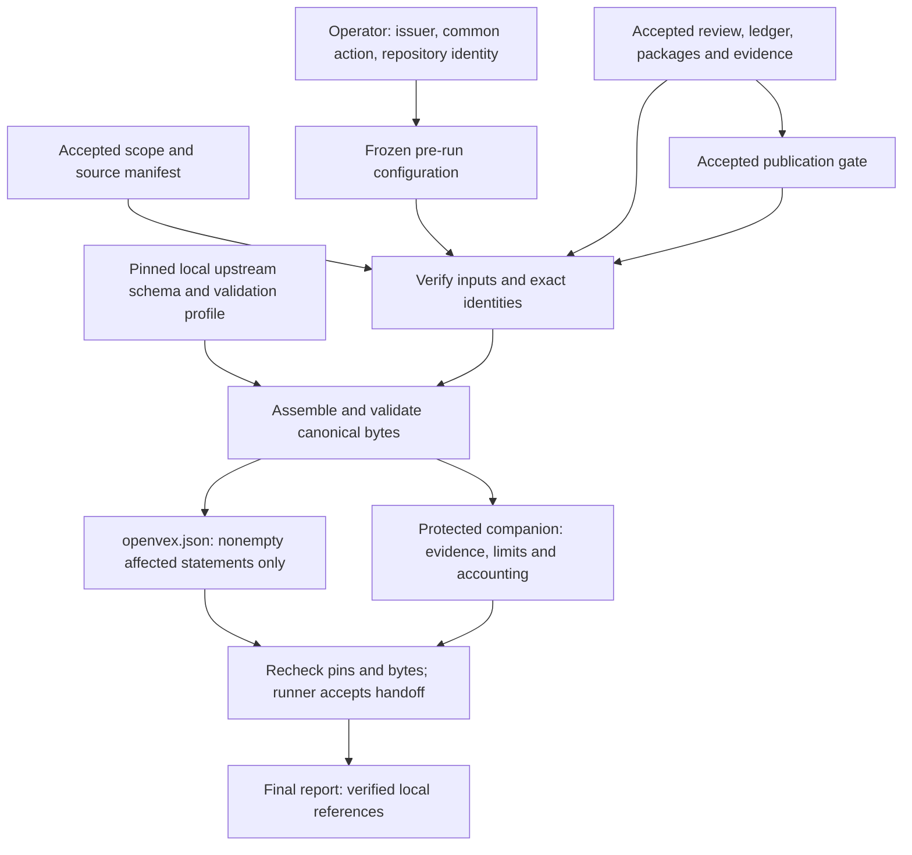
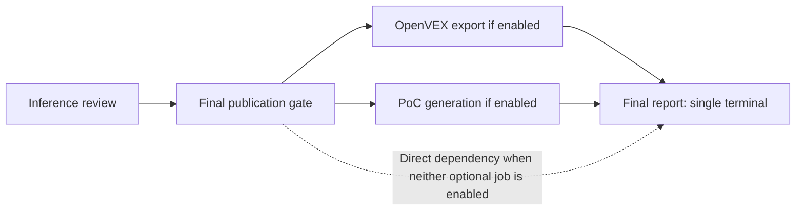
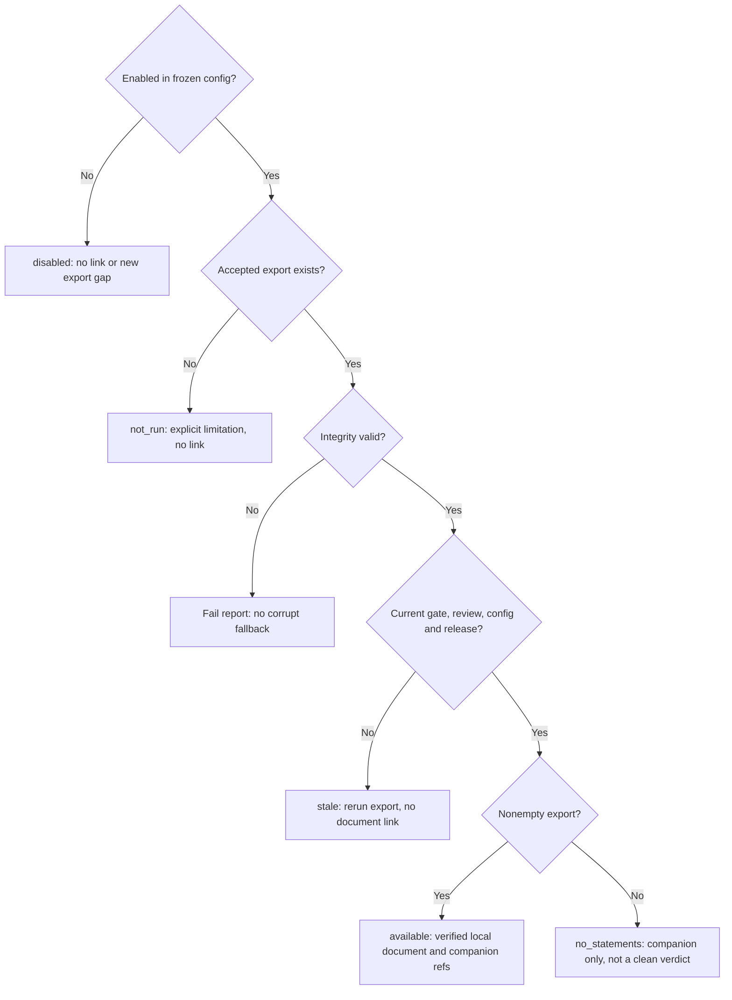

# OpenVEX findings export

Status: **planned; not implemented at the documentation baseline
`b7c31ba23af840f14cc919d56b8c557ffdb2d010`**. This operator guide describes the
[approved design](../architecture/openvex-export.md), not a shipped command or a successful
test run. Configuration, commands, outputs and metric fields below are intended contracts;
they require reconciliation against the implementation before use.

## What this export means

`job_openvex_export` is designed to serialize OpenVEX v0.2.0 without a model, target scan,
subprocess, container, network lookup or vulnerability reassessment. It exports **all and
only the accepted final publication gate's publishable confirmed packages**, one `affected`
statement per package. Supported packages in the verification backlog and withheld packages
are accounted for in the companion, not exported as statements. A confirmed withheld package
is still excluded. No package is silently skipped to produce a partial export.

Only `affected` is supported. Missing coverage, an empty review, an unreachable observation,
refutation or PoC absence/failure cannot produce `not_affected`, `fixed` or
`under_investigation`. Review confirmation does not mean an exploit was executed, and export
success does not mean a product is clean or approved to ship. Scores, independence,
ship-block decisions and coverage remain separate dimensions, preserved without reinterpretation.

## Trust and data flow

The planned exporter reads accepted, hash-bound run artifacts, not the current target checkout
or advice in target-owned guidance. It re-verifies the gate against the accepted review,
including package accounting, evidence and both package manifests; resolves accepted scope;
and binds the full frozen configuration separately from the semantic review-settings hash.



The design pins the upstream schema rather than retrieving it or the JSON-LD context during
export. Schema validation alone is insufficient: nonblank action, a real product identity,
timestamp/IRI rules, exact membership and source/configuration bindings also require semantic
validation. Hash binding protects byte integrity; it is not a signature or verification of
the issuer's authority.

## Configure before creating a run

The checked-in job is intended to be **disabled by default**. Automatic dispatch omits it,
and manual dispatch while disabled is refused; unlike the optional PoC job, there is no
manual disabled-job exception. Enable it only in the configuration used to create the run,
with the publication gate and inference review also enabled.

The following is a **design-only settings example**, not a configuration validated against
an implemented loader. Merge these keys into the future central job table; do not treat this
excerpt as a complete job/step/task configuration. Replace the illustrative issuer, action
and repository identity with reviewed values that accurately apply to the entire export.

```toml
[jobs.job_openvex_export.settings]
enabled = true
author_kind = "organization"
author = "Example Security Team"
role = "" # Optional; no supplier role is inferred.
action_statement = "Do not deploy the reviewed snapshot until the confirmed findings have been remediated and validated."
repository_iri = "https://example.invalid/reviewed-system"
max_packages = 10000
max_bindings = 30000
max_artifact_bytes = 67108864
max_total_input_bytes = 536870912
max_document_bytes = 33554432
max_manifest_bytes = 134217728
max_action_bytes = 8192
max_identifier_bytes = 2048
timeout_seconds = 120
```

The disabled defaults use `enabled = false`, `author_kind = "organization"` and empty
`author`, `role`, `action_statement` and `repository_iri`. The numeric values above are the
design's defaults and hard maxima; positive lower bounds are permitted. They are UTF-8 byte
limits where named as bytes, not character counts. Individual input size cannot exceed total
input size. The design also bounds JSON depth to 32. Exceeding any bound or timeout fails
the attempt, never truncates the statements.

| Input | Operator responsibility |
| --- | --- |
| `author_kind`, `author` | Identify an `individual` or `organization` that authorizes issuance. A tool/model/bot is not the author. Selection does not verify real-world authority or imply supplier endorsement. |
| `role` | Optional nonblank role when supplied; empty means omitted from OpenVEX. |
| `action_statement` | Supply exact, nonblank plain text accurate for **every** exported finding. No model-generated fallback, per-finding override or post-run approval intake exists. |
| `repository_iri` | Supply the reviewed system's stable absolute `https:` or `urn:` identity, not a local path, branch, credential-bearing URL or release range. It must agree with accepted acquisition provenance when present. |

Unknown settings, invalid nonempty values, bool-as-integer bounds, unsafe controls,
detected credentials and unresolved template markers are errors even when disabled.
Required issuer/action/repository values are checked when enabled even if no findings
will be exported. Text is preserved exactly, not silently redacted or rewritten.
Secret detection cannot replace operator review.

If no accurate common action can be authorized for all publishable findings, leave this v1
export disabled for that run. It is not a per-finding consent or partial-export workflow.
The full resolved configuration is immutable under the run's `data/configuration/`.
Changing issuer, action or repository policy requires a **new run**; do not edit an existing
run's frozen configuration or expect a pre-feature run to gain the settings.

## Product, vulnerability and time identity

Every statement uses the same reviewed-source product, scoped to the accepted snapshot and
the **full resolved configuration**, not just the inference-review settings:

```text
urn:appsec-review:source-snapshot:<H(repository_iri)>:<target_snapshot>:<resolved_config_sha256>
```

`H` is SHA-256 over canonical JSON bytes. This is not a shipped binary hash, release,
version range or assertion about all builds of the repository. No dependency purls,
SBOM-to-release guesses, product hashes or subcomponents are emitted in v1. When acquisition
provenance is absent, the operator-declared repository identity and accepted snapshot remain
explicit; the exporter does not invent a Git commit.

Vulnerability names and IDs are internal `urn:appsec-review:vulnerability:...` identities,
derived from the repository, snapshot and claim. A CWE is not a vulnerability ID, and a CVE
is not inferred. Statement/document IDs are content-addressed. The design specifies
`version = 1`, a fixed source-scope qualification, canonical UTF-8 JSON with a trailing LF,
and statement order by finding-package ID.

The document and statement timestamp comes from the accepted gate handoff's `completed_at`,
normalized to UTC, not the export wall clock or an exploit-execution time. Identical accepted
pins, settings, schema and exporter release produce identical OpenVEX bytes. Changed content
gets a new document ID rather than changed bytes under an old ID. Companion run-relative
paths may differ after new upstream attempts even when OpenVEX semantic bytes do not.

## Planned operation and outputs

In the planned normal graph, enabled export and optional compile-only PoC generation are
independent siblings after the gate. The final report waits for every enabled sibling.
When both are disabled, the report depends directly on the gate. The direct CLI runs the
enabled optional jobs sequentially; Dagster may schedule siblings independently.



Export does not wait for, inspect live output from, or require PoC generation. The report
continues to consume its separate accepted PoC handoff. PoC `compile_verified` means
compilation only, not exploitation; `compile_failed` does not refute an affected finding.
See [PoC operation](poc-generation.md).

After implementation, standalone dispatch is intended to use these commands **only for a
run whose original frozen configuration enabled export** and whose required upstream jobs
already have accepted handoffs:

```text
appsec-review run job_openvex_export --run-id <id> --upstream-from-run
appsec-review run job_final_report_publication --run-id <id> --upstream-from-run
```

The designed unit topology is
`load.verify_inputs -> export.assemble -> acceptance.publish_handoff`.
Outputs belong under
`runs/<run-id>/data/jobs/job_openvex_export/attempts/<attempt>/steps/...`.
Use the accepted job handoff's references, not a guessed attempt path or newest-looking file.

| Artifact | Meaning |
| --- | --- |
| `verified-inputs.json` | Bounded, verified input identities from the load unit. |
| `openvex.json` | Nonempty upstream-compatible document with `affected` statements; absent when no statements qualify. |
| `openvex-manifest.json` | Protected companion: provenance, source qualification, per-package inclusion/exclusion, statement-to-evidence mapping, separate scores/independence/ship-block context, limitations, bindings and exact counts. |
| `openvex-result.json` | Accepted handoff's artifact: outcome, gate identity, manifest reference, document reference or null, counts and gaps. |

Every gate package must appear once in the companion as `included`,
`gate_verification_backlog` or `gate_withheld`. Counts and actual identity sets must agree:
`gate_total = included + excluded`, `included = gate_publishable = statement_count`, and
`excluded = backlog_exclusions + withheld_exclusions`. Each statement maps to one included
package. Zero is explicit, never a stand-in for an unreadable input.

| Accepted outcome | Document and runtime meaning |
| --- | --- |
| `exported` | Nonempty validated document, no gate gap limitations; `SUCCEEDED`. Not-run limitations remain recorded. |
| `exported_with_gaps` | Nonempty validated document retains gate gaps; `COMPLETED_WITH_GAPS`. |
| `no_statements` | No publishable confirmed packages; null document reference and no document file, companion retained, named non-clean gap; `COMPLETED_WITH_GAPS`. |

An empty `statements` array is invalid OpenVEX and is not written. Invalid settings,
corrupt/missing evidence, stale input, schema/semantic failure, unsafe paths, bound
exceedance and timeout fail the whole attempt with no new accepted handoff, rather than
producing `no_statements`. Acceptance rechecks pointers and bytes to catch concurrent changes.

## Report states and recovery

The planned [final-report block](final-report.md#planned-openvex-export-projection) distinguishes
export state from vulnerability status:



Normal enabled-export failure blocks a refreshed report in either orchestrator. A standalone
report run dispatched early can describe `not_run` or `stale`; neither is an accepted export
outcome. Corruption is an integrity failure, not a missing/stale success. Existing immutable
accepted output is usable only if all current identities and bytes still match, never as the
claimed output of a failed attempt.

For stale output, rerun export against current accepted upstream handoffs, then rerun the
report. For settings changes, create a new run instead. For integrity/bound failures, inspect
the protected failure receipts and repair the actual upstream problem; do not edit receipts,
drop packages, lower assertions or use old files to make the job appear successful.

## Privacy, telemetry and validation limits

Both document and companion can disclose vulnerabilities. The design classifies their
datasets as protected, sensitive, internal run-owned artifacts with metadata-only query
exposure. Private run-root permissions/ACLs remain required. Enabling local export is **not**
permission to upload, attach to GitHub, publish a release or distribute files externally.
No signing, external publication endpoint or automatic outbound transfer is added.

The companion is not the small OpenVEX document: it retains internal evidence/policy
references, but no source snippets, secrets, prompts, model output or PoC code. Preserve its
hash-bound relationship when inspecting the document; do not flatten evidence, scores or
limitations into unsupported OpenVEX properties.

[Planned metrics](metrics.md#planned-openvex-metrics) distinguish fresh attempts, accepted
statements/bytes, empty results, failures, reuse and unavailable observations. Runtime timing
belongs in telemetry, not deterministic export artifacts. A completion event or a file on disk
does not prove acceptance; the runner's accepted handoff is authoritative.

This draft establishes no implementation or feature-test result. Focused offline unit
coverage is required by the design for configuration, selection, identity, tamper/replay,
outputs, report/topology and telemetry. Integration, acceptance and live Dagster validation
remain manual and unverified until separately recorded; unit success alone cannot establish
them. The design contains the proposed selectors and manual validation contracts.
