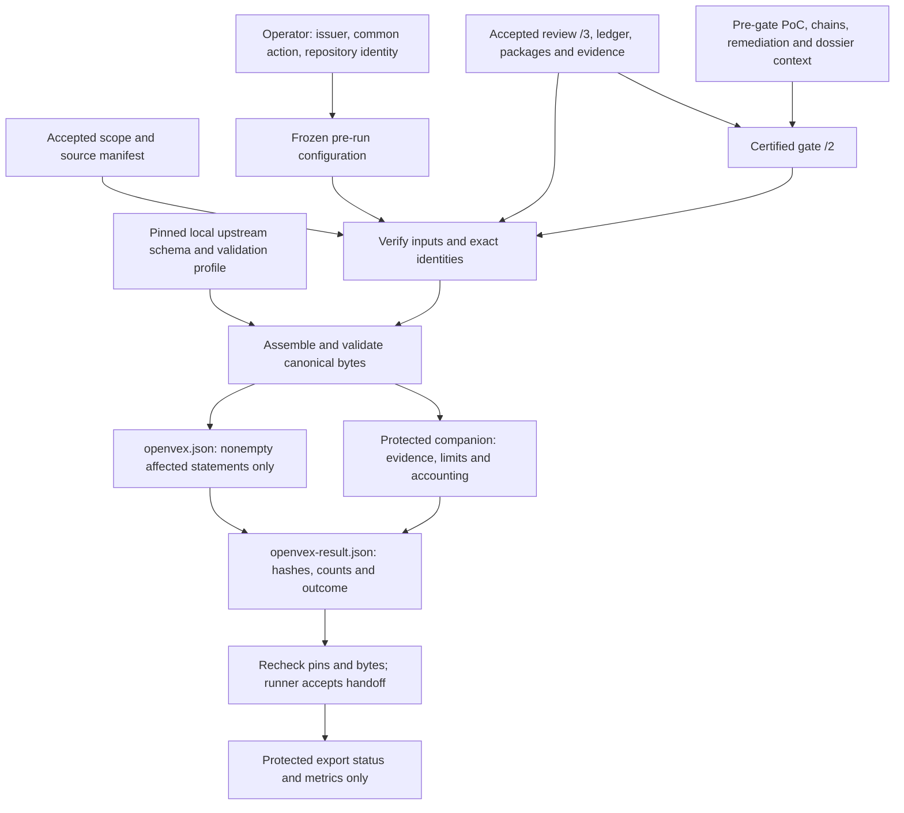
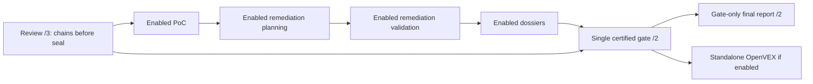
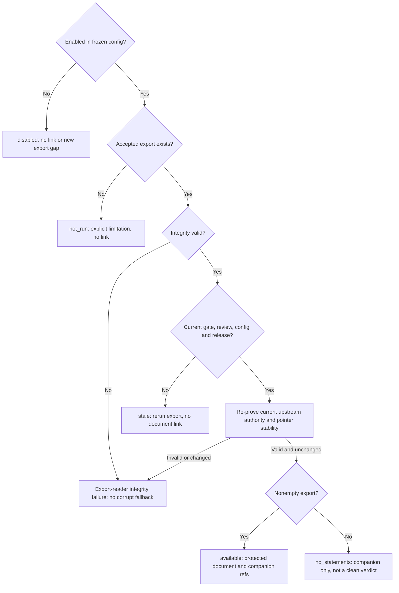

# OpenVEX findings export

**Certified-gate implementation assembled at
`e628041cd734d854e749aa4e373bdc718d9a7363`.** The user-selected architecture is standalone
post-gate export with gate-only reporting. Strict contracts/settings, shared certified-gate
reader, exporter input verifier/projector and topology reflect gate `/2`, review `/3`.
Combined focused verification and final exact-main reconciliation remain separately tracked;
this guide does not claim real accepted whole-chain, integration, acceptance, Linux or live
Dagster validation. See the [design](../architecture/openvex-export.md) and
[verification record](../reviews/openvex-export-implementation.md).

## What this export means

`job_openvex_export` serializes OpenVEX v0.2.0 without a model, target scan,
subprocess, container, network lookup or vulnerability reassessment. It exports **all and
only the accepted final publication gate's publishable confirmed packages**, one `affected`
statement per package. Supported packages in the verification backlog and withheld packages
are accounted for in the companion, not exported as statements. A confirmed withheld package
is still excluded. No package is silently skipped to produce a partial export.
PoC, attack-chain and dossier availability are not eligibility requirements. The exporter
does not generate, plan or validate remediation, or add a remediation job.

Only `affected` is supported. Missing coverage, an empty review, an unreachable observation,
refutation or PoC absence/failure cannot produce `not_affected`, `fixed` or
`under_investigation`. Review confirmation does not mean an exploit was executed, and export
success does not mean a product is clean or approved to ship. Scores, independence,
ship-block decisions and coverage remain separate dimensions, preserved without reinterpretation.

## Trust and data flow

The exporter contract reads accepted, hash-bound run artifacts, not the current target checkout
or advice in target-owned guidance. It re-verifies the gate against the accepted review,
including package accounting, evidence and both package manifests; resolves accepted scope;
and binds the full frozen configuration separately from the semantic review-settings hash.



The gate's `capabilities` and `attachments` are authoritative context; every nested reference
must already belong to its certified bindings, not merely appear in the exporter's inventory.
PoC/chain/dossier availability is not an eligibility filter, but corrupt certified context
is an integrity failure. Preserve `gap`, `not_run` and `notice` limitations distinctly:
`compile_only_nonexecution` is a notice, not an export gap or proof of a fixed finding.

The strict resource contract pins **nine** local resources: seven schemas, the upstream
license and its lock. Transitive `final-report.schema.json` supplies PoC-item definitions
referenced by gate `/2`; it is not permission to load final-report data or discover attachments.
The loader uses the source schema directory when present, otherwise installed wheel resources;
an existing corrupt/incomplete source copy fails rather than falling back to another copy.
It never retrieves a schema or the JSON-LD context during export.
Installed-resource fallback supports offline schema validation and pure projection, not a
self-contained installed application. Job execution still requires the configured application
checkout and guidance resources, including `pipeline/guidance/registry.json`; schema-resource
availability does not establish full installed-job execution.
Schema validation alone is insufficient: nonblank action, a real product identity,
timestamp/IRI rules, exact membership and source/configuration bindings also require semantic
validation. Hash binding protects byte integrity; it is not a signature or verification of
the issuer's authority.

Mutable gate/review/intake `latest.json` pointers and the exact `data/indices/accepted.json`
pointer are bounded and rechecked during input admission, but are **not durable exported
evidence bindings**. Immutable accepted handoffs, manifests, index shards and other input
bytes remain bound. A valid newer upstream pointer therefore makes an old export stale
for current export status/latest-accepted metrics, without corrupting its historical immutable
evidence or discarding independently reverified historical semantic work.

## Configure before creating a run

The checked-in job is **disabled by default**. Automatic dispatch omits it,
and manual dispatch while disabled is refused; unlike the optional PoC job, there is no
manual disabled-job exception. Enable it only in the configuration used to create the run,
with the publication gate and inference review also enabled.

The following settings example is valid for the typed loader. Replace the settings in
the existing central job table; the checked-in job/step/task topology remains required.
Replace the illustrative issuer, action and repository identity with reviewed values that
accurately apply to the entire export. This example does not authorize real issuance.

```toml
[jobs.job_openvex_export.settings]
enabled = true
author_kind = "organization"
author = "Example Security Team"
role = "" # Optional; no supplier role is inferred.
action_statement = "Do not deploy the reviewed snapshot until the confirmed findings have been remediated and validated."
repository_iri = "https://example.invalid/reviewed-system"
max_packages = 10000
max_bindings = 30000
max_artifact_bytes = 67108864
max_total_input_bytes = 536870912
max_document_bytes = 33554432
max_manifest_bytes = 134217728
max_action_bytes = 8192
max_identifier_bytes = 2048
timeout_seconds = 120
```

The disabled defaults use `enabled = false`, `author_kind = "organization"` and empty
`author`, `role`, `action_statement` and `repository_iri`. The numeric values above are the
checked-in defaults and hard maxima; positive lower bounds are permitted. They are UTF-8 byte
limits where named as bytes, not character counts. Individual input size cannot exceed total
input size. JSON depth is bounded to 32, and result JSON has a fixed 1 MiB limit.
Unique references/aggregate input bytes are measured rather than silently truncated.
The job enforces its attempt deadline at unit boundaries, with monotonic checks during
bounded reads and processing. Exceeding a bound or timeout fails the attempt.

| Input | Operator responsibility |
| --- | --- |
| `author_kind`, `author` | Identify an `individual` or `organization` that authorizes issuance. A tool/model/bot is not the author. Selection does not verify real-world authority or imply supplier endorsement. |
| `role` | Optional nonblank role when supplied; empty means omitted from OpenVEX. |
| `action_statement` | Supply exact, nonblank plain text accurate for **every** exported finding. No model-generated fallback, per-finding override or post-run approval intake exists. |
| `repository_iri` | Supply the reviewed system's stable absolute ASCII `https:` or `urn:` identity, not a local path, branch, credential-bearing URL or release range. Query/fragment and branch/commit URL forms are rejected. It must agree when accepted acquisition provenance establishes a repository IRI. |

Unknown settings, invalid nonempty values, bool-as-integer bounds, unsafe controls,
detected credentials and unresolved template markers are errors even when disabled.
Required issuer/action/repository values are checked when enabled even if no findings
will be exported. Text is preserved exactly, not silently redacted or rewritten.
Ordinary LF/tab formatting in action text is allowed; executable markup is not.
Secret detection cannot replace operator review. Exporter implementation identity is declared
centrally as `review_policy.releases.job_openvex_export` (checked-in value
`openvex-export-1`), not inferred from installed files or model output.

If no accurate common action can be authorized for all publishable findings, leave this v1
export disabled for that run. It is not a per-finding consent or partial-export workflow.
The full resolved configuration is immutable under the run's `data/configuration/`.
Changing issuer, action or repository policy requires a **new run**; do not edit an existing
run's frozen configuration or expect a pre-feature run to gain the settings.

## Product, vulnerability and time identity

Every statement uses the same reviewed-source product, scoped to the accepted snapshot and
the **full resolved configuration**, not just the inference-review settings:

```text
urn:appsec-review:source-snapshot:<H(repository_iri)>:<target_snapshot>:<resolved_config_sha256>
```

`H` is SHA-256 over canonical JSON bytes. This is not a shipped binary hash, release,
version range or assertion about all builds of the repository. No dependency purls,
SBOM-to-release guesses, product hashes or subcomponents are emitted in v1. When acquisition
provenance is absent, the operator-declared repository identity and accepted snapshot remain
explicit; the exporter does not invent a Git commit. Acquisition without a single repository
IRI retains an explicit operator-asserted qualification. A mismatch between an acquired tree
and reviewed tree is recorded, never promoted to an assertion that the acquired revision is
the reviewed snapshot. A build-index presence is not proof of build success.

Vulnerability names and IDs are internal `urn:appsec-review:vulnerability:...` identities,
derived from the repository, snapshot and claim. A CWE is not a vulnerability ID, and a CVE
is not inferred. Statement/document IDs are content-addressed. Serialization uses
`version = 1`, a fixed source-scope qualification, canonical UTF-8 JSON with a trailing LF,
and statement order by finding-package ID.

The document and statement timestamp comes from the accepted gate handoff's `completed_at`,
normalized to UTC, not the export wall clock or an exploit-execution time. Identical accepted
pins, settings, schema and exporter release produce identical OpenVEX bytes. Changed content
gets a new document ID rather than changed bytes under an old ID. Companion run-relative
paths may differ after new upstream attempts even when OpenVEX semantic bytes do not.

## Operation and outputs

Enabled PoC generation, remediation planning/validation and dossier publication run **before
one final gate**. Chains are part of review before its seal. The gate then feeds independent
report and OpenVEX-export peers. Report source, schema and `CONSUMES` stay gate-only;
export neither attaches itself to the report nor adds a report prerequisite.



The diagram compresses the pre-gate completion dependencies; disabled jobs are transparent
according to frozen configuration. Export reads the gate's certified context, not live optional
producer output. PoC `compile_verified` means compilation only, not exploitation;
`compile_failed` does not refute an affected finding. See [PoC operation](poc-generation.md)
and [completion publication](final-report.md). The direct CLI dispatches export before report
sequentially; Dagster exposes independent gate-dependent peers. A failed sequential export can
stop the driver before report dispatch, but is not a report-input dependency.

Use standalone dispatch **only for a run whose original frozen configuration enabled export**
and whose required upstream jobs already have accepted handoffs:

```text
appsec-review run job_openvex_export --run-id <id> --upstream-from-run
```

There is no required report rerun after export. A standalone report uses the accepted gate
snapshot only and cannot discover or admit newer producer output. Create/re-certify the gate
through the completion workflow when those upstream outputs change.

The unit topology is
`load.verify_inputs -> export.assemble -> acceptance.publish_handoff`.
Outputs belong under
`runs/<run-id>/data/jobs/job_openvex_export/attempts/<attempt>/steps/...`.
Use the accepted job handoff's references, not a guessed attempt path or newest-looking file.

| Artifact | Meaning |
| --- | --- |
| `verified-inputs.json` | Bounded, verified input identities from the load unit. |
| `schemas/` under the load task | Nine hash-pinned schema/license/lock snapshots, including transitive PoC-item definitions; no report data input. |
| `openvex.json` | Nonempty upstream-compatible document with `affected` statements; absent when no statements qualify. |
| `openvex-manifest.json` | Protected companion: provenance, source qualification, exact certified capabilities/attachments, per-package inclusion/exclusion, statement-to-evidence mapping, separate scores/independence/ship-block context, limitations, bindings and exact counts. |
| `openvex-result.json` | Accepted handoff's artifact: outcome, gate identity, manifest reference, document reference or null, counts and gaps. |

Every gate package must appear once in the companion as `included`,
`gate_verification_backlog` or `gate_withheld`. Counts and actual identity sets must agree:
`gate_total = included + excluded`, `included = gate_publishable = statement_count`, and
`excluded = backlog_exclusions + withheld_exclusions`. Each statement maps to one included
package. Zero is explicit, never a stand-in for an unreadable input.

| Accepted outcome | Document and runtime meaning |
| --- | --- |
| `exported` | Nonempty validated document, no gate gap limitations; `SUCCEEDED`. Not-run limitations remain recorded. |
| `exported_with_gaps` | Nonempty validated document retains gate gaps; `COMPLETED_WITH_GAPS`. |
| `no_statements` | No publishable confirmed packages; null document reference and no document file, companion retained, named non-clean gap; `COMPLETED_WITH_GAPS`. |

The empty-result gap is `openvex_no_publishable_confirmed_findings`.
Only `kind = gap` limitations make a nonempty export `exported_with_gaps`; policy-not-run
and compile-only notices stay visible without becoming gaps.
An empty `statements` array is invalid OpenVEX and is not written. Invalid settings,
corrupt/missing evidence, stale input, schema/semantic failure, unsafe paths, bound
exceedance and timeout fail the whole attempt with no new accepted handoff, rather than
producing `no_statements`. Acceptance rechecks pointers and bytes to catch concurrent changes.

## Export status and recovery

The protected status-reader/metrics interface distinguishes export state from vulnerability
status. Despite the retained Python names `ExportReportView`/`ExportReportState`, these are
**operator export views, not final-report fields**. A failure is an attempt outcome with no
new acceptance, not `no_statements` or a fabricated successful status.



The final report does not inspect this state, link export files or gain publication gaps from
disabled/missing/empty/stale export. It consumes only certified gate `/2`.
Corruption is an export-reader integrity failure, not a missing/stale success. Existing immutable
accepted output is current only if all present authority pins and bytes still match, never as
the claimed output of a failed attempt. Historical verification rehashes
immutable inputs and every runtime-declared output artifact, checks release/identities and
validates exact canonical reassembly. Before exposing current output, the operator reader re-proves
current upstream authority and checks that acceptance did not change.

The operator view's `handoff`, `result`, `manifest` and `document` references are nullable
`{path, sha256}` objects, not public URLs; its statement/included/excluded counts are nullable
too. `disabled`, `not_run` and `stale` expose no output references or accepted counts.
`no_statements` retains handoff/result/companion references and exact counts, but no document.
Missing, empty and stale states remain explicit non-clean export observations without changing
claims, gate counts, ship-block decisions or report publication status.

For stale output, rerun export against current certified upstream handoffs; no report rerun is
required by export. For settings changes, create a new run instead. For integrity/bound failures, inspect
the protected failure receipts and repair the actual upstream problem; do not edit receipts,
drop packages, lower assertions or use old files to make the job appear successful.

## Privacy, telemetry and validation limits

Both document and companion can disclose vulnerabilities. The exporter classifies their
datasets as protected, sensitive, internal run-owned artifacts with metadata-only query
exposure. Private run-root permissions/ACLs remain required. Enabling local export is **not**
permission to upload, attach to GitHub, publish a release or distribute files externally.
No signing, external publication endpoint or automatic outbound transfer is added.

The companion is not the small OpenVEX document: it retains internal evidence/policy
references, but no source snippets, secrets, prompts, model output or PoC code. Preserve its
hash-bound relationship when inspecting the document; do not flatten evidence, scores or
limitations into unsupported OpenVEX properties.

[Metrics](metrics.md#openvex-metrics) distinguish fresh attempts, accepted
statements/bytes, empty results, failures, reuse and unavailable observations. Runtime timing
belongs in telemetry, not deterministic export artifacts. A completion event or a file on disk
does not prove acceptance; the runner's accepted handoff is authoritative. The ordinary runtime
metrics snapshot precedes `HANDOFF_ACCEPTED`; a later job snapshot or
`appsec-review metrics --run-id <id>` refreshes accepted semantic counts. A successful export
can therefore be awaiting reconciliation in its initial summary, not an accepted zero.

Latest state/`latest_accepted` requires current authority through `load_export`; cumulative
semantic counters independently reverify historical accepted bundles through
`read_accepted_export`, deduplicated by accepted handoff digest. A newer gate/review pointer
can stale latest without invalidating historical work. Tampered/unreadable historical bytes
preserve known execution counts but make their semantic contribution unknown with a named gap.

Focused offline unit files cover settings/contracts, input custody, projection/validation,
handler deadlines, export consumers, topology/wiring and metrics. The certified `/2` reader,
verifier and projector are implemented at this base; exact combined focused results and final
source proof belong in the [verification record](../reviews/openvex-export-implementation.md).
The coordinator's isolated installed-only wheel proof at `212f21a8` verifies all nine resource
pins, the transitive report-item definition, canonical assembly and semantic validation using
synthetic gate `/2` context, not a real accepted run. It does not establish a self-contained
application or full installed-job execution. Real accepted whole-chain, integration, acceptance,
Linux, live Dagster and full-suite validation remain unclaimed; unit/pure-boundary success
alone cannot establish them.
