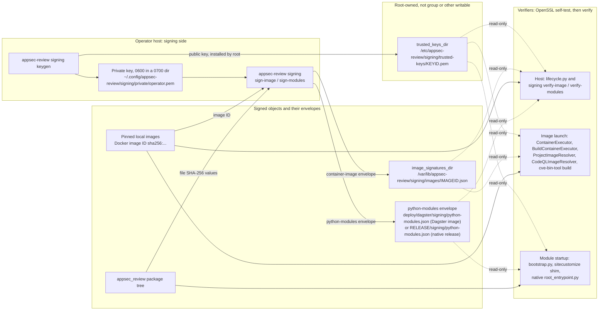
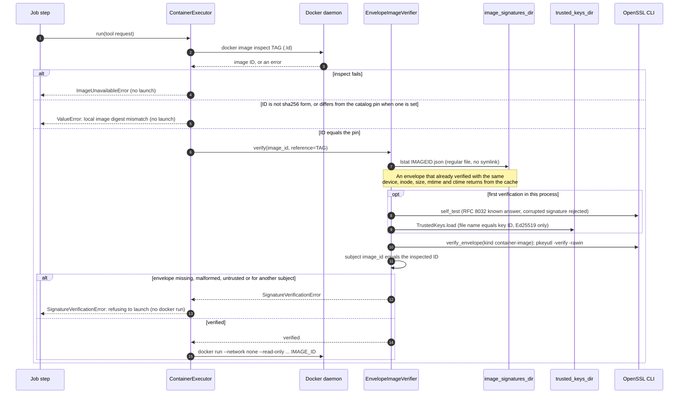
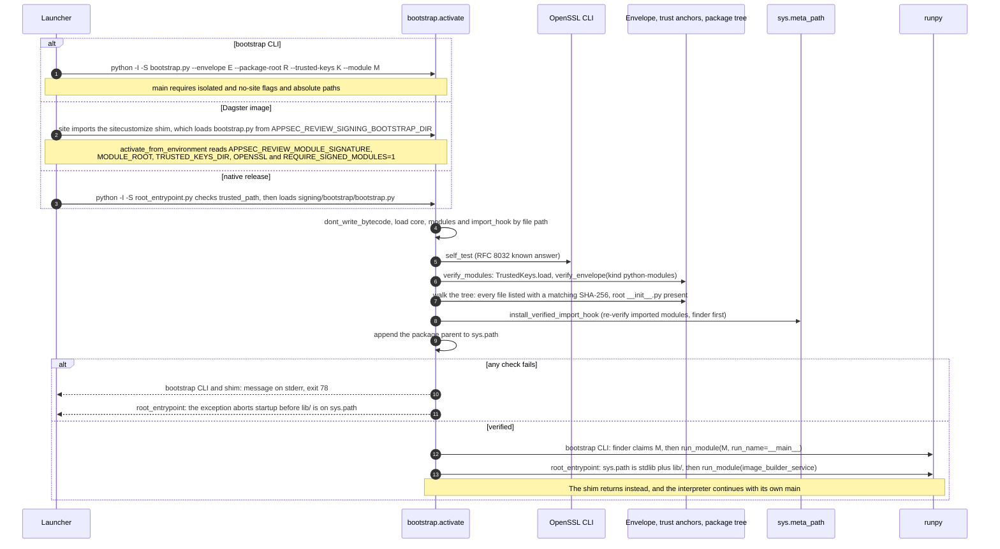

# Container image and Python module signing

Pinned container images and the installed `appsec_review` package are signed by the operator on the
review host and verified wherever they are launched or imported. Verification fails closed: a
missing, malformed, untrusted or mismatched signature stops the launch or the process. It is never
reported as clean. Code: `src/appsec_review/signing/`, `src/appsec_review/config/signing.py`,
`deploy/dagster/bin/image_signing.py` and `deploy/dagster/native/root_entrypoint.py`.

## Threat model

Signing protects against a local image or package tree that was changed, swapped or added after
the operator approved it. Examples are a tag moved to another image, a retagged or rebuilt image, an
edited, added or removed module, a planted `.pth` or extension module, or a stale bytecode cache.
The following are rejected:

- an image whose Docker ID has no envelope in the signatures directory, or whose envelope is not
  signed by a trust anchor, or signs a different image ID or statement kind;
- an installed package file that the signed manifest does not list or whose SHA-256 differs, a
  missing root `__init__.py`, symbolic links, non-regular files, `.so`/`.pyd`/extension-suffix and
  `.pth` files in the tree, and loose bytecode outside `__pycache__/`;
- a trust-anchor file whose name is not the key ID it contains, a key that is not Ed25519, and
  envelopes with duplicate JSON keys, floats, `NaN`, duplicate signers, more than 16 signatures or
  more than 64 MiB;
- an OpenSSL binary that is missing, not absolute, or fails its known-answer self-test.

Signing does not protect against a compromised operator key or host root, and it does not cover
the gaps listed under [Named gaps](#named-gaps).

## Mechanism

- **Algorithm.** Ed25519 detached signatures, computed and checked by the OS OpenSSL 3 CLI
  (`openssl pkeyutl -rawin`, no digest option) at an absolute path, default `/usr/bin/openssl`. No
  Python crypto dependency is added, so an unverified Python module never verifies Python modules.
  OpenSSL runs without a shell, with `cwd=/`, and with a sanitized environment that contains only
  `PATH=/usr/bin:/bin`, `LANG=C.UTF-8` and `OPENSSL_CONF=/dev/null`. It never inherits
  `OPENSSL_CONF`, `OPENSSL_MODULES` or `OPENSSL_ENGINES`. Before the first verification, each
  verifier verifies the RFC 8032 section 7.1 TEST 2 vector and checks that a one-bit corruption of
  that signature is rejected.
- **Statement.** `{"schema": "appsec-review.signed-statement/v1", "kind": ..., "subject": ...}` is
  serialized as canonical JSON (sorted keys, `,`/`:` separators, UTF-8, no floats) and signed as raw
  bytes.
- **Envelope.** The envelope is
  `{"statement": {...}, "signatures": [{"key_id", "algorithm": "ed25519", "signature": <base64>}]}`.
  Verification canonicalizes the statement and requires at least one valid signature by a trusted
  key. It then compares the subject with the object that is actually being launched or loaded.
- **Key ID.** The key ID is `sha256:` plus the hex SHA-256 of the key's DER SubjectPublicKeyInfo. The
  verifier recomputes it from every trust-anchor file.
- **Kinds.** `container-image` has the subject `{"image_id": "sha256:<64 hex>", "id_kind":
  "docker-image-id"}`. The ID is the `.Id` that the same daemon reports, and launch then uses that
  exact ID. `python-modules` has the subject `{"package": "appsec_review", "files": {relpath:
  "sha256:<hex>"}}`.

## Key custody

- **Private keys** live only on the operator host. The default is
  `~/.config/appsec-review/signing/private/operator.pem`, created by `appsec-review signing keygen`.
  The directory is `0700` and owned by the operator, and the key is `0600`. Keys are never
  overwritten or printed. They never enter the repository, an image, a build context, `runs/` or a
  test fixture. Tests generate ephemeral keys under `test/tmp/` at run time.
- **Trust anchors** are public-key PEM files named `<key_id hex>.pem` (without `sha256:`) in
  `trusted_keys_dir`, default `/etc/appsec-review/signing/trusted-keys`. They must be root-owned and
  not writable by group or others. The native release checks this with `trusted_path`. Elsewhere it
  is an installation duty, because `TrustedKeys.load` checks names and key types but not ownership.
  A missing or empty directory trusts no key, so every verification fails.
- **Image signatures** are stored as `<image id hex>.json` in `image_signatures_dir`, default
  `/var/lib/appsec-review/signing/images`. Envelopes are self-authenticating, so the operator who
  signs only needs write access to this directory. The Dagster services mount it read-only.

The private key signs on the operator host and never leaves it. Every verifier reads only public
trust anchors and envelopes, and each one runs the OpenSSL self-test before it first verifies:



## Configuration: `[signing]`

`[signing]` in `appsec-review.toml` is parsed into the typed `SigningConfig`. Unknown keys and wrong
types fail configuration loading. Runtime profiles and capacity overlays cannot set this table.

| Key | Default | Meaning |
| --- | --- | --- |
| `openssl` | `/usr/bin/openssl` | Absolute path to the OS-owned OpenSSL 3 binary; a relative path or `..` is rejected. |
| `trusted_keys_dir` | `/etc/appsec-review/signing/trusted-keys` | Trust anchors; a relative path resolves against the configuration file's directory. |
| `image_signatures_dir` | `/var/lib/appsec-review/signing/images` | Image envelopes; a relative path resolves the same way. |
| `image_enforcement` | `"required"` | `"required"` verifies every image launch or reuse; only an explicit `"disabled"` turns image verification off. |

A missing table means these defaults, including `"required"`. `signing.policy.default_image_verifier`
resolves the policy once per process from `APPSEC_REVIEW_CONFIG`, or from `appsec-review.toml` at the
application root. If the configuration cannot be loaded or the verifier cannot be built, it raises
`SignatureVerificationError` and caches nothing. A failure never falls back to
`DisabledImageVerifier`. `verify-image` always checks envelopes, whatever `image_enforcement` says.
Module enforcement does not use `[signing]`. It is driven by the environment or by the release
layout (see [Modules](#python-modules)).

## Container images

Every pinned image is verified when it is launched or reused, after its identity check:

| Call site | Image verified |
| --- | --- |
| `ContainerExecutor.resolve_image` (`container_runtime/executor.py`) | Every catalog tool image before `docker run`. |
| `BuildContainerExecutor.resolve`, each build/capture run, and the gitleaks capture scan (`container_runtime/build_executor.py`) | The build profile image, or the recorded pinned base of a derived project image; the gitleaks image. A gitleaks failure redacts the capture and records a named gap. |
| `ProjectImageResolver.resolve` via `_verify_base` (`container_runtime/project_images.py`) | The pinned base before a project image is derived from it or reused over it. |
| `CodeQLImageResolver.resolve` (`codeql/runtime.py`) | The licensed CodeQL source image, the environment image (or its recorded pinned base), and a preinstalled runtime image. |
| cve-bin-tool database build (`jobs/job_third_party_data_sync/steps/cve_bin_tool_db_build/database.py`) | A pre-existing local `settings.image` (Docker path) or the approved preinstalled image (native path). The image is launched by ID. |

A catalog tool launch through `ContainerExecutor.resolve_image` runs in this order. The other call
sites use the same `EnvelopeImageVerifier` after their own identity checks:



The pipeline never signs the images that it derives at run time: project images and CodeQL derived
images. Such an image is trusted only through its verified signed inputs and the identity recorded
in its manifest (`project_images.derived_base_image_id` and `BuildProfile.derived_from_image_id`).
Every executor accepts an injectable `image_verifier`. Unit tests use a conftest-installed accepting
verifier, and enforcement tests pass explicit verifiers. Live, integration and acceptance tests run
under the configured policy.

## Python modules

- **Manifest.** `sign-modules` hashes every regular file under the package root except `__pycache__/`
  and `*.pyc`/`*.pyo`. Data files are included. Signing happens on the host from `src/appsec_review`,
  and pip must install identical bytes. During verification, every installed file must be listed and
  must match. Listed files may be absent, except the root `__init__.py`.
- **Import hook.** `install_verified_import_hook` re-verifies modules that were already imported and
  sets `sys.dont_write_bytecode`. It then puts a finder first on `sys.meta_path`. The finder claims
  `appsec_review` and every `appsec_review.*` name and resolves them only from the manifest. If a name
  cannot be resolved, the finder raises `ModuleNotFoundError` and never returns `None`, so no later
  finder, `.pyc` or zip importer is consulted. The loader reads each file once without following
  symbolic links, checks its hash, and compiles exactly those bytes. `__path__` edits are ignored.
  Namespace packages come from the manifest, and `importlib.resources` reads return only verified
  bytes.
- **Bootstrap.** `signing/bootstrap.py` is stdlib-only and loads `core.py`, `modules.py` and
  `import_hook.py` by file path from its own directory. It runs under `python -I -S`, so `.pth`
  files are never processed. It verifies the envelope and the whole tree and installs the hook.
  Only then does it append the package parent to `sys.path` and run the target with `runpy`:
  `python -I -S bootstrap.py --envelope E --package-root R --trusted-keys K --module M [-- args]`.
  A failure exits with code 78. `activate_from_environment` reads `APPSEC_REVIEW_MODULE_SIGNATURE`,
  `APPSEC_REVIEW_MODULE_ROOT`, `APPSEC_REVIEW_TRUSTED_KEYS_DIR` and `APPSEC_REVIEW_OPENSSL`
  (absolute paths). It enforces when an envelope is named or `APPSEC_REVIEW_REQUIRE_SIGNED_MODULES=1`.
  Console scripts in a development checkout are not enforced unless these variables are set.
- **Dagster image.** `sitecustomize_shim.py` is installed as the interpreter's `sitecustomize.py`. It
  loads the root-owned bootstrap from `APPSEC_REVIEW_SIGNING_BOOTSTRAP_DIR`
  (`/opt/appsec-review/signing-bootstrap`). It calls `activate_from_environment` and, on any failure,
  ends the process with exit code 78. The final stages (`runtime`, `runtime-copilot`,
  `runtime-windows`) copy the envelope to `/opt/appsec-review/signing/python-modules.json` and set
  `APPSEC_REVIEW_REQUIRE_SIGNED_MODULES=1`. Trust anchors are mounted read-only at run time, and the
  image contains no keys. The `test` stage does not enforce. Details are in
  [Signed image](../../deploy/dagster/README.md#signed-image).
- **Native release.** `root_entrypoint.py` checks with `trusted_path` that `signing/`, the envelope,
  every trust anchor, the four verifier files and `/usr/bin/openssl` are root-owned and on a read-only
  release. It loads `signing/bootstrap/bootstrap.py` and verifies `lib/appsec_review` before anything
  from `lib/` is imported or placed on `sys.path`. The layout is in
  [the native README](../../deploy/dagster/native/README.md).

All three entry points run the same `bootstrap.activate` steps before any `appsec_review` module is
imported. They differ in how they start and how they fail:



## Operator runbook

Run these steps on the review host from the repository checkout, never during a running review.

1. **Create the key and trust anchor once.** Installing the anchor into a root-owned directory needs
   root, for example a separate `install -o root -g root -m 0644` of the printed public key.

   ```bash
   appsec-review signing keygen --trusted-keys-dir /etc/appsec-review/signing/trusted-keys
   ```

2. **Sign pinned images after building and pinning them.** Follow the
   [image-pin procedure](image-pin-verification.md#host-procedure-rebuild-re-pin-reload) first.

   ```bash
   appsec-review signing sign-image --all-pinned --private-key ~/.config/appsec-review/signing/private/operator.pem
   appsec-review signing verify-image <tag> [<tag> ...]
   ```

   `--all-pinned` signs every enabled catalog image and every configured `*image_id` pin whose tag
   resolves locally to exactly its pin. A mismatched or missing tag fails and is not signed. An
   unpinned catalog image is reported `skipped_unpinned`; sign it explicitly with
   `sign-image REFERENCE`.
3. **Sign modules for a native release or a manual deployment.** The output must lie outside the
   package tree. Then export the bootstrap files into the release.

   ```bash
   appsec-review signing sign-modules --private-key <key> --package-root src/appsec_review --output <envelope>
   appsec-review signing verify-modules --envelope <envelope> --trusted-keys-dir <anchors> --package-root <installed>/appsec_review
   appsec-review signing export-bootstrap <release>/signing/bootstrap
   ```

4. **Build and start Dagster only through the operator scripts or `lifecycle.py`.**
   `lifecycle.py build` (`scripts/stack-rebuild.sh`) signs and verifies modules, builds the final stage,
   and signs and verifies the image ID. `lifecycle.py start`/`reload` verify the image on the host,
   record `APPSEC_REVIEW_DAGSTER_IMAGE=sha256:<id>` in `deploy/dagster/.env` and launch exactly that
   ID. If verification fails they exit 3, and the scripts report `refused`. Settings are described in
   [Signed image](../../deploy/dagster/README.md#signed-image) and
   [operator scripts](operator-scripts.md).

   ```mermaid
   flowchart TD
       subgraph build["lifecycle.py build (stack-rebuild, or stack-start with --build or a missing image)"]
           settings["signing_settings: APPSEC_SIGNING_* from the environment over .env"]
           signmods["signing sign-modules<br/>src/appsec_review to deploy/dagster/signing/python-modules.json"]
           verifymods["signing verify-modules: status verified"]
           dockerbuild["docker build --target runtime, runtime-copilot or runtime-windows<br/>tag appsec-review-dagster:PLATFORM[-copilot]"]
           signimg["signing sign-image TAG<br/>envelope in image_signatures_dir"]
           verifyimg["signing verify-image: status verified, same image ID"]
       end
       subgraph launch["lifecycle.py start (stack-start, stack-restart, stack-rebuild)<br/>or reload (stack-restart --code-location-only)"]
           reference["APPSEC_REVIEW_DAGSTER_IMAGE from the process environment, else the local tag"]
           verify["signing verify-image of that reference"]
           record["record_image: APPSEC_REVIEW_DAGSTER_IMAGE=sha256:ID<br/>in deploy/dagster/.env (atomic, 0600)"]
           compose["docker compose up -d --wait with that exact ID<br/>reload: --no-deps --force-recreate code-location"]
       end
       failed["FAILED, exit 1: lifecycle build failed"]
       refused["REFUSED, exit 3: refusing to start or reload<br/>Compose is not run, ops.py reports refused"]
       settings --> signmods --> verifymods --> dockerbuild --> signimg --> verifyimg
       verifyimg --> reference --> verify
       verify -- verified --> record --> compose
       signmods & verifymods & dockerbuild & signimg & verifyimg -- error --> failed
       reference & verify -- SigningError --> refused
   ```

Every CLI command prints one JSON report, never key material, and exits nonzero on any failure.

## Windows hosts

A native Windows operator host signs and verifies with the same envelopes as Linux and WSL:

- **OpenSSL.** The default is the Git for Windows build,
  `C:\Program Files\Git\mingw64\bin\openssl.exe` (or under `%ProgramFiles%`/`%ProgramW6432%`).
  An absolute path on Windows needs a drive or a UNC share; a drive-less `/rooted` path is
  rejected. OpenSSL runs with only `SYSTEMROOT`, `WINDIR`, `TEMP`, `TMP`, `PATHEXT`, `COMSPEC` and a
  `PATH` of the binary's directory (its MinGW DLLs) plus `System32`. `OPENSSL_CONF` names an empty
  file in a private temporary directory, because Windows has no `/dev/null` file.
- **Defaults.** A missing `[signing]` value, or exactly the POSIX default that the repository
  `appsec-review.toml` names, becomes the Windows default: the OpenSSL above,
  `%ProgramData%\appsec-review\signing\trusted-keys` and `%ProgramData%\appsec-review\signing\images`.
  Any other drive-less path fails configuration loading. The Dagster `lifecycle.py` reads the same
  defaults for unset `APPSEC_SIGNING_*` variables and passes the verified directories to Compose
  as bind-mount sources.
- **Custody.** Windows has no POSIX owner or mode bits, so the private-key directory and trust
  anchors are not mode-checked there. Their privacy comes from NTFS ACLs: keep the private key under
  the user profile (`%USERPROFILE%\.config\appsec-review\signing\private`) and make
  `%ProgramData%\appsec-review\signing` writable only by Administrators. Symbolic links, junctions
  and other reparse points are still refused.
- **Manifests.** Manifest paths are always `/`-separated and package-relative, so a manifest signed
  in WSL verifies on Windows and the reverse. Hashes cover raw bytes: a checkout that converts line
  endings (`core.autocrlf`) changes them. The repository's `.gitattributes` pins LF for source files.

## Named gaps

These areas are not covered by signing. Do not read their absence from a failure report as
evidence that they are verified.

- **Native bounded-builder and engine paths do not verify signatures yet.** The follow-up locations
  are as follows (line numbers at commit `b0cb93407`); see [Planned work](#planned-work):
  - `container_runtime/engine_broker.py`: `DockerEngine.image` (~368), `_image_policies` (~806) and
    `_reference` (~824) (deferred);
  - `container_runtime/buildkit_worker.py`: `BuildkitDriver.prepare` worker-image inspect (~589/598),
    `worker` (~441/444), the egress proxy image check (~718/720) and `_inputs` (~736) (in progress);
  - `container_runtime/image_builder_service.py`: `_start_spec` allowed and aliased images
    (~504, at ~513 and ~523) (in progress).
- **Third-party packages are not covered per module.** Only `appsec_review` is in a manifest.
  `site-packages` dependencies and their native libraries are covered only by the signed Dagster
  image. In a native release, the `lib/` closure is an installation and commissioning duty.
- **Derived images are unsigned.** They rely on verified inputs and recorded identities.
- **The cve-bin-tool image is built locally and unpinned.** On the first Docker-path run, when
  `settings.image` is absent, the image is built from its context and launched unverified. Later
  runs find the tag and require a signature, so they fail until the operator runs
  `sign-image <settings.image>`. `--all-pinned` does not cover the image.
- **Data read through `__file__` paths** instead of `importlib.resources` is covered only by the
  startup tree verification. The deployed trees are read-only or image-pinned.
- **Code that runs before the hook is installed** is outside module verification. This includes
  interpreter startup, standard-library modules (possibly from cached bytecode), the shim and
  bootstrap, and, in the Dagster image, `site` processing of `site-packages` `.pth` files before
  `sitecustomize`. The re-hash at activation catches changed `appsec_review` sources but not
  bytecode that a standard loader already executed. In the Dagster image this code is covered only
  by the signed image. In the native release it is covered only by root ownership and `-I -S`.
- **A direct `docker compose up`** skips host verification. Compose requires a recorded image ID,
  but nothing re-verifies that ID.
- **`lifecycle.py reload`** verifies the image and then recreates only `code-location`. The other
  services keep running the image that they started with.

## Planned work

Each remaining gap has a status. "In progress on this branch" items are being closed on the
`container-module-signing` branch and change to "done" when their change lands. "Deferred" items
have no work scheduled on this branch.

| Gap | Status | Remaining work |
| --- | --- | --- |
| Windows host support | In progress on this branch | The code supports a native Windows host (see [Windows hosts](#windows-hosts)). The unit tests and the Dagster signed build and start flow still need validation on Windows with Docker Desktop. |
| Native release third-party dependency manifest | In progress on this branch | Sign and verify the native release `lib/` closure outside `appsec_review`, which is now an installation and commissioning duty (see [Named gaps](#named-gaps)). |
| Compose bypass and reload | In progress on this branch | Re-verify the recorded image ID when Compose is started directly, and make `lifecycle.py reload` cover every service, not only `code-location`. |
| cve-bin-tool pin | In progress on this branch | Pin the locally built cve-bin-tool image and cover it with `--all-pinned`, so that no run launches it unverified. |
| BuildKit worker and image builder service verification | In progress on this branch | Verify the worker, egress proxy and input images in `buildkit_worker.py` and the allowed and aliased images in `image_builder_service.py`. |
| Engine broker | Deferred | Verify images in `engine_broker.py` (`DockerEngine.image`, `_image_policies`, `_reference`). This overlaps the native-broker-process branch and waits for it. |

## Tests

The focused unit tests use real OpenSSL and ephemeral keys:

```bash
.venv/bin/python -m pytest -q --basetemp=test/tmp/signing tests/signing tests/test_signing_config.py \
    tests/test_dagster_signing.py tests/test_native_root_entrypoint.py tests/test_operator_scripts.py
```

The integration tests need `/usr/bin/openssl`, Docker with buildx and the local
`appsec-review/base-python:3.12-bookworm` image, which is never pulled. They build only
`appsec-review-signing-test:*` images and remove only those images. The acceptance tests drive the
operator CLI end to end. Both suites are manual validation that the user owns:

```bash
APPSEC_REVIEW_SIGNING_INTEGRATION=1 python -m pytest -p no:cacheprovider -rs \
    tests/integration/signing --basetemp=test/tmp/signing-integration
APPSEC_REVIEW_SIGNING_ACCEPTANCE=1 python -m pytest -p no:cacheprovider -rs \
    tests/acceptance/signing --basetemp=test/tmp/signing-acceptance
```
