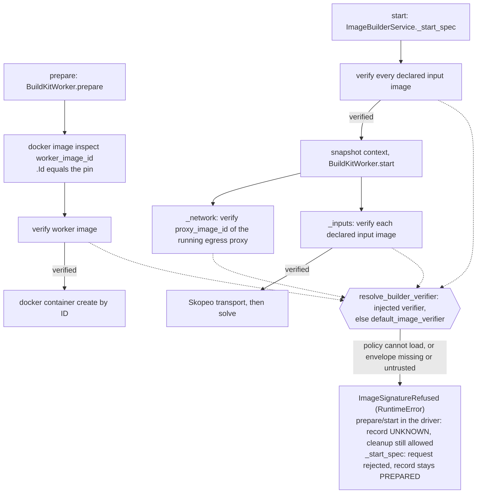
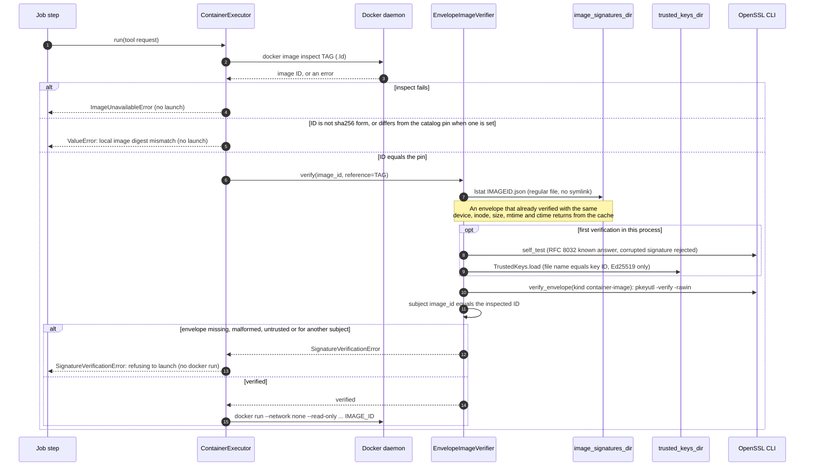
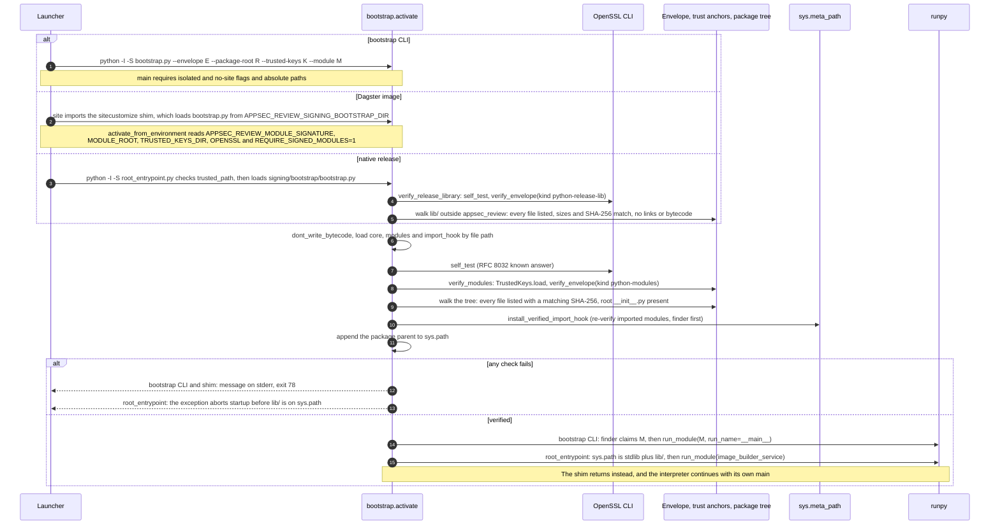

# Container image and Python module signing

Pinned container images and the installed `appsec_review` package are signed by the operator on the
review host and verified wherever they are launched or imported. Verification fails closed: a
missing, malformed, untrusted or mismatched signature stops the launch or the process. It is never
reported as clean. Code: `src/appsec_review/signing/`, `src/appsec_review/config/signing.py`,
`deploy/dagster/bin/image_signing.py` and `deploy/dagster/native/root_entrypoint.py`.

## Threat model

Signing protects against a local image or package tree that was changed, swapped or added after
the operator approved it. Examples are a tag moved to another image, a retagged or rebuilt image, an
edited, added or removed module, a planted `.pth` or extension module, or a stale bytecode cache.
The following are rejected:

- an image whose Docker ID has no envelope in the signatures directory, or whose envelope is not
  signed by a trust anchor, or signs a different image ID or statement kind;
- an installed package file that the signed manifest does not list or whose SHA-256 differs, a
  missing root `__init__.py`, symbolic links, non-regular files, `.so`/`.pyd`/extension-suffix and
  `.pth` files in the tree, and loose bytecode outside `__pycache__/`;
- a trust-anchor file whose name is not the key ID it contains, a key that is not Ed25519, and
  envelopes with duplicate JSON keys, floats, `NaN`, duplicate signers, more than 16 signatures or
  more than 64 MiB;
- an OpenSSL binary that is missing, not absolute, or fails its known-answer self-test.

Signing does not protect against a compromised operator key or host root, and it does not cover
the gaps listed under [Named gaps](#named-gaps).

## Mechanism

- **Algorithm.** Ed25519 detached signatures, computed and checked by the OS OpenSSL 3 CLI
  (`openssl pkeyutl -rawin`, no digest option) at an absolute path, default `/usr/bin/openssl`. No
  Python crypto dependency is added, so an unverified Python module never verifies Python modules.
  OpenSSL runs without a shell, with `cwd=/`, and with a sanitized environment that contains only
  `PATH=/usr/bin:/bin`, `LANG=C.UTF-8` and `OPENSSL_CONF=/dev/null`. It never inherits
  `OPENSSL_CONF`, `OPENSSL_MODULES` or `OPENSSL_ENGINES`. Before the first verification, each
  verifier verifies the RFC 8032 section 7.1 TEST 2 vector and checks that a one-bit corruption of
  that signature is rejected.
- **Statement.** `{"schema": "appsec-review.signed-statement/v1", "kind": ..., "subject": ...}` is
  serialized as canonical JSON (sorted keys, `,`/`:` separators, UTF-8, no floats) and signed as raw
  bytes.
- **Envelope.** The envelope is
  `{"statement": {...}, "signatures": [{"key_id", "algorithm": "ed25519", "signature": <base64>}]}`.
  Verification canonicalizes the statement and requires at least one valid signature by a trusted
  key. It then compares the subject with the object that is actually being launched or loaded.
- **Key ID.** The key ID is `sha256:` plus the hex SHA-256 of the key's DER SubjectPublicKeyInfo. The
  verifier recomputes it from every trust-anchor file.
- **Kinds.** `container-image` has the subject `{"image_id": "sha256:<64 hex>", "id_kind":
  "docker-image-id"}`. The ID is the `.Id` that the same daemon reports, and launch then uses that
  exact ID. `python-modules` has the subject `{"package": "appsec_review", "files": {relpath:
  "sha256:<hex>"}}`. `python-release-lib` has the subject `{"excluded": ["appsec_review"], "files":
  {relpath: {"sha256": "<hex>", "size": <bytes>}}}` over a native release `lib/` directory.

## Key custody

- **Private keys** live only on the operator host. The default is
  `~/.config/appsec-review/signing/private/operator.pem`, created by `appsec-review signing keygen`.
  The directory is `0700` and owned by the operator, and the key is `0600`. Keys are never
  overwritten or printed. They never enter the repository, an image, a build context, `runs/` or a
  test fixture. Tests generate ephemeral keys under `test/tmp/` at run time. On POSIX `keygen`
  checks the directory's owner and mode; signing does not re-check them. On Windows the NTFS ACLs of
  the key directory and the key are checked at `keygen` and again before every signing use (see
  [Windows hosts](#windows-hosts)).
- **Trust anchors** are public-key PEM files named `<key_id hex>.pem` (without `sha256:`) in
  `trusted_keys_dir`, default `/etc/appsec-review/signing/trusted-keys`. They must be root-owned and
  not writable by group or others. The native release checks this with `trusted_path`. Elsewhere on
  POSIX it is an installation duty, because `TrustedKeys.load` checks names and key types but not
  ownership; on Windows `TrustedKeys.load` checks the NTFS ACLs (see [Windows hosts](#windows-hosts)).
  A missing or empty directory trusts no key, so every verification fails.
- **Image signatures** are stored as `<image id hex>.json` in `image_signatures_dir`, default
  `/var/lib/appsec-review/signing/images`. Envelopes are self-authenticating, so the operator who
  signs only needs write access to this directory. The Dagster services mount it read-only.

The private key signs on the operator host and never leaves it. Every verifier reads only public
trust anchors and envelopes, and each one runs the OpenSSL self-test before it first verifies:

```mermaid
flowchart LR
    subgraph host["Operator host: signing side"]
        keygen["appsec-review signing keygen"]
        key["Private key, 0600 in a 0700 dir<br/>~/.config/appsec-review/signing/private/operator.pem"]
        keyacl{{"Windows only, at keygen and before every signing use:<br/>NTFS ACLs of the key dir and key (private rule)"}}
        signer["appsec-review signing<br/>sign-image / sign-modules / sign-release-lib"]
        svcconf["Bounded builder service.toml<br/>--builder-service-config (optional, repeatable)"]
    end
    subgraph anchors["Root-owned, not group or other writable"]
        trusted["trusted_keys_dir<br/>/etc/appsec-review/signing/trusted-keys/KEYID.pem"]
    end
    subgraph objects["Signed objects and their envelopes"]
        images["Pinned local images<br/>Docker image ID sha256:..."]
        sigs["image_signatures_dir<br/>/var/lib/appsec-review/signing/images/IMAGEID.json"]
        tree["appsec_review package tree"]
        manifest["python-modules envelope<br/>deploy/dagster/signing/python-modules.json (Dagster image)<br/>or RELEASE/signing/python-modules.json (native release),<br/>plus RELEASE/signing/python-release-lib.json over lib/"]
    end
    subgraph verifiers["Verifiers: OpenSSL self-test, then verify"]
        anchoracl{{"TrustedKeys.load: name equals key ID, Ed25519 only,<br/>Windows only: NTFS ACLs of the dir and every anchor (anchor rule)"}}
        hostv["Host: lifecycle.py and<br/>signing verify-image / verify-modules"]
        imgv["Image launch: ContainerExecutor, BuildContainerExecutor,<br/>ProjectImageResolver, CodeQLImageResolver, cve-bin-tool build,<br/>BuildKitWorker, ImageBuilderService,<br/>Dagster code-location container_self_check"]
        modv["Module startup: bootstrap.py, sitecustomize shim,<br/>native root_entrypoint.py"]
    end
    keygen --> key
    keygen -- "public key, installed by root" --> trusted
    key --> keyacl
    keyacl -- "passes, or POSIX" --> signer
    keyacl -- "broad principal" --> keyrefused["SignatureVerificationError with the icacls fix<br/>OpenSSL never reads the key"]
    images -- "image ID (--all-pinned: equals its pin)" --> signer
    svcconf -- "worker, egress proxy and input image IDs (--all-pinned)" --> signer
    tree -- "file SHA-256 values" --> signer
    signer -- "container-image envelope" --> sigs
    signer -- "python-modules and python-release-lib envelopes" --> manifest
    trusted -. "read-only" .-> anchoracl
    anchoracl -. "trusted keys" .-> hostv & imgv & modv
    sigs -. "read-only" .-> hostv & imgv
    images --> hostv & imgv
    manifest -. "read-only" .-> hostv & modv
    tree --> modv
```



## Configuration: `[signing]`

`[signing]` in `appsec-review.toml` is parsed into the typed `SigningConfig`. Unknown keys and wrong
types fail configuration loading. Runtime profiles and capacity overlays cannot set this table.

| Key | Default | Meaning |
| --- | --- | --- |
| `openssl` | `/usr/bin/openssl` | Absolute path to the OS-owned OpenSSL 3 binary; a relative path or `..` is rejected. |
| `trusted_keys_dir` | `/etc/appsec-review/signing/trusted-keys` | Trust anchors; a relative path resolves against the configuration file's directory. |
| `image_signatures_dir` | `/var/lib/appsec-review/signing/images` | Image envelopes; a relative path resolves the same way. |
| `image_enforcement` | `"required"` | `"required"` verifies every image launch or reuse; only an explicit `"disabled"` turns image verification off. |

A missing table means these defaults, including `"required"`. `signing.policy.default_image_verifier`
resolves the policy once per process from `APPSEC_REVIEW_CONFIG`, or from `appsec-review.toml` at the
application root. If the configuration cannot be loaded or the verifier cannot be built, it raises
`SignatureVerificationError` and caches nothing. A failure never falls back to
`DisabledImageVerifier`. `verify-image` always checks envelopes, whatever `image_enforcement` says.
Module enforcement does not use `[signing]`. It is driven by the environment or by the release
layout (see [Modules](#python-modules)).

## Container images

Every pinned image is verified when it is launched or reused, after its identity check:

| Call site | Image verified |
| --- | --- |
| `ContainerExecutor.resolve_image` (`container_runtime/executor.py`) | Every catalog tool image before `docker run`. |
| `BuildContainerExecutor.resolve`, each build/capture run, and the gitleaks capture scan (`container_runtime/build_executor.py`) | The build profile image, or the recorded pinned base of a derived project image; the gitleaks image. A gitleaks failure redacts the capture and records a named gap. |
| `ProjectImageResolver.resolve` via `_verify_base` (`container_runtime/project_images.py`) | The pinned base before a project image is derived from it or reused over it. |
| `CodeQLImageResolver.resolve` (`codeql/runtime.py`) | The licensed CodeQL source image, the environment image (or its recorded pinned base), and a preinstalled runtime image. |
| cve-bin-tool database build (`jobs/job_third_party_data_sync/steps/cve_bin_tool_db_build/database.py`) | A pre-existing local `settings.image` (Docker path) or the approved preinstalled image (native path), after checking that it resolves to the optional `settings.image_id` pin. The image is launched by ID. |
| `BuildKitWorker.prepare`, `_network` and `_inputs` (`container_runtime/buildkit_worker.py`) | The pinned `worker_image_id` after `docker image inspect` confirms that exact ID and before `docker container create` (the worker is created by ID); the pinned `proxy_image_id` of the running operator egress proxy whenever the isolated network is checked; each declared operator input image (`[[image_builder_service.images]]`) before Skopeo transports it. |
| `ImageBuilderService._start_spec` (`container_runtime/image_builder_service.py`) | Every declared operator input image before a `start` request is accepted, so nothing is snapshotted or solved. |
| `container_self_check.main` (`signing/container_self_check.py`), the Dagster code location's Compose command | The image its own container runs (`docker container inspect` `.Image`, which must equal `APPSEC_REVIEW_DAGSTER_IMAGE`) before `dagster code-server` is exec'd. |

Same-run outputs that a later build in the bounded builder consumes are derived images. They are
not signed: they are trusted through their verified pinned bases and the operator journal records
that authorize them (`ImageBuilderService._prior_output_ids`). A refusal in the bounded builder
raises `buildkit_worker.ImageSignatureRefused`, which is both an `EnforcementUnavailable` and a
`SignatureVerificationError`. The verifier is resolved inside the same refusal
(`buildkit_worker.resolve_builder_verifier`), so a `[signing]` configuration or OpenSSL that cannot
load refuses each build instead of stopping the service. The service records the build as `UNKNOWN`
(or rejects the `start` request) and the client can still clean up.



A catalog tool launch through `ContainerExecutor.resolve_image` runs in this order. The other call
sites use the same `EnvelopeImageVerifier` after their own identity checks:



The pipeline never signs the images that it derives at run time: project images and CodeQL derived
images. Such an image is trusted only through its verified signed inputs and the identity recorded
in its manifest (`project_images.derived_base_image_id` and `BuildProfile.derived_from_image_id`).
Every executor accepts an injectable `image_verifier`. Unit tests use a conftest-installed accepting
verifier, and enforcement tests pass explicit verifiers. Live, integration and acceptance tests run
under the configured policy.

## Python modules

- **Manifest.** `sign-modules` hashes every regular file under the package root except `__pycache__/`
  and `*.pyc`/`*.pyo`. Data files are included. Signing happens on the host from `src/appsec_review`,
  and pip must install identical bytes. During verification, every installed file must be listed and
  must match. Listed files may be absent, except the root `__init__.py`.
- **Import hook.** `install_verified_import_hook` re-verifies modules that were already imported and
  sets `sys.dont_write_bytecode`. It then puts a finder first on `sys.meta_path`. The finder claims
  `appsec_review` and every `appsec_review.*` name and resolves them only from the manifest. If a name
  cannot be resolved, the finder raises `ModuleNotFoundError` and never returns `None`, so no later
  finder, `.pyc` or zip importer is consulted. The loader reads each file once without following
  symbolic links, checks its hash, and compiles exactly those bytes. `__path__` edits are ignored.
  Namespace packages come from the manifest, and `importlib.resources` reads return only verified
  bytes.
- **Bootstrap.** `signing/bootstrap.py` is stdlib-only and loads `core.py`, `modules.py` and
  `import_hook.py` by file path from its own directory. It runs under `python -I -S`, so `.pth`
  files are never processed. It verifies the envelope and the whole tree and installs the hook.
  Only then does it append the package parent to `sys.path` and run the target with `runpy`:
  `python -I -S bootstrap.py --envelope E --package-root R --trusted-keys K --module M [-- args]`.
  A failure exits with code 78. `activate_from_environment` reads `APPSEC_REVIEW_MODULE_SIGNATURE`,
  `APPSEC_REVIEW_MODULE_ROOT`, `APPSEC_REVIEW_TRUSTED_KEYS_DIR` and `APPSEC_REVIEW_OPENSSL`
  (absolute paths). It enforces when an envelope is named or `APPSEC_REVIEW_REQUIRE_SIGNED_MODULES=1`.
  Console scripts in a development checkout are not enforced unless these variables are set.
- **Dagster image.** `sitecustomize_shim.py` is installed as the interpreter's `sitecustomize.py`. It
  loads the root-owned bootstrap from `APPSEC_REVIEW_SIGNING_BOOTSTRAP_DIR`
  (`/opt/appsec-review/signing-bootstrap`). It calls `activate_from_environment` and, on any failure,
  ends the process with exit code 78. The final stages (`runtime`, `runtime-copilot`,
  `runtime-windows`) copy the envelope to `/opt/appsec-review/signing/python-modules.json` and set
  `APPSEC_REVIEW_REQUIRE_SIGNED_MODULES=1`. Trust anchors are mounted read-only at run time, and the
  image contains no keys. The `test` stage does not enforce. Details are in
  [Signed image](../../deploy/dagster/README.md#signed-image).
- **Native release.** `root_entrypoint.py` checks with `trusted_path` that `signing/`, the envelope,
  every trust anchor, the five verifier files and `/usr/bin/openssl` are root-owned and on a read-only
  release. It loads `signing/bootstrap/bootstrap.py`, verifies the third-party closure of `lib/`
  with `verify_release_library` (see [Release library](#release-library)) and then verifies
  `lib/appsec_review`, all before anything from `lib/` is imported or placed on `sys.path`. The
  layout is in [the native README](../../deploy/dagster/native/README.md).

All three entry points run the same `bootstrap.activate` steps before any `appsec_review` module is
imported. They differ in how they start and how they fail:



### Release library

A native release also signs the third-party closure of its `lib/` directory, which is placed on
`sys.path` next to the verified `appsec_review` package.

- **Manifest.** `sign-release-lib --lib <release>/lib` (`release_lib.sign_release_lib`) records the
  SHA-256 and size of every regular file under `lib/` except the top-level `appsec_review/`
  directory, which the `python-modules` manifest covers. Third-party packages, `.dist-info` and
  `.data` directories, native extensions (`.so`) and `.pth` files are included and hashed.
- **Refusals.** Signing and verification both refuse symbolic links and reparse points, non-regular
  files, any `__pycache__` directory and any `.pyc`/`.pyo` file. Verification also refuses every
  unlisted file, every missing listed file and every size or digest mismatch.
- **Startup.** `root_entrypoint.py` calls `bootstrap.verify_release_library` with
  `signing/python-release-lib.json` before `bootstrap.activate`, so a failure stops startup before
  `lib/` reaches `sys.path`, exactly like a module verification failure. `release_lib.py` is loaded
  under the transient name `appsec_review_signing_release_lib` and removed from `sys.modules`
  afterwards, so only the four verifier modules stay loaded.
- **Dagster image.** Container dependencies are covered by the signed image, not by this manifest.

## Operator runbook

Run these steps on the review host from the repository checkout, never during a running review.

1. **Create the key and trust anchor once.** Installing the anchor into a root-owned directory needs
   root, for example a separate `install -o root -g root -m 0644` of the printed public key.

   ```bash
   appsec-review signing keygen --trusted-keys-dir /etc/appsec-review/signing/trusted-keys
   ```

2. **Sign pinned images after building and pinning them.** Follow the
   [image-pin procedure](image-pin-verification.md#host-procedure-rebuild-re-pin-reload) first.

   ```bash
   appsec-review signing sign-image --all-pinned --private-key ~/.config/appsec-review/signing/private/operator.pem
   appsec-review signing verify-image <tag> [<tag> ...]
   ```

   `--all-pinned` signs every enabled catalog image and every configured `*image_id` pin of an
   enabled job or one of its steps whose tag resolves locally to exactly its pin. A mismatched or
   missing tag fails and is not signed. An
   unpinned catalog image is reported `skipped_unpinned`; sign it explicitly with
   `sign-image REFERENCE`.

   On a bounded builder service host, add `--builder-service-config <operator service.toml>` (the
   file given to `image_builder_service --config`; repeat it for several services). `--all-pinned`
   then also signs that configuration's BuildKit `worker_image_id`, its egress `proxy_image_id` when
   egress is commissioned, and every declared `[[image_builder_service.images]]` input ID, after
   `docker image inspect` reports exactly that ID. Their report rows are labelled
   `builder-service:worker`, `builder-service:proxy` and `builder-service:input:<alias>` and name the
   `config` file. An ID already covered by another pin is signed once. A missing or invalid
   configuration fails before anything is signed. There is no default path: the operator
   configuration is never read unless named.
3. **Sign modules for a native release or a manual deployment.** The output must lie outside the
   package tree. For a native release, also sign the assembled `lib/` (outside `appsec_review/`)
   after it is complete and before it is made read-only. Then export the bootstrap files into the
   release.

   ```bash
   appsec-review signing sign-modules --private-key <key> --package-root src/appsec_review --output <envelope>
   appsec-review signing verify-modules --envelope <envelope> --trusted-keys-dir <anchors> --package-root <installed>/appsec_review
   appsec-review signing sign-release-lib --private-key <key> --lib <release>/lib --output <release>/signing/python-release-lib.json
   appsec-review signing verify-release-lib --envelope <release>/signing/python-release-lib.json --trusted-keys-dir <anchors> --lib <release>/lib
   appsec-review signing export-bootstrap <release>/signing/bootstrap
   ```

4. **Build and start Dagster only through the operator scripts or `lifecycle.py`.**
   `lifecycle.py build` (`scripts/stack-rebuild.sh`) signs and verifies modules, builds the final stage,
   and signs and verifies the image ID. `lifecycle.py start`/`reload` verify the image on the host,
   record `APPSEC_REVIEW_DAGSTER_IMAGE=sha256:<id>` in `deploy/dagster/.env` and launch exactly that
   ID. If verification fails they exit 3, and the scripts report `refused`. Inside the stack the code
   location runs `python -m appsec_review.signing.container_self_check -- dagster code-server start ...`.
   This gate inspects its own container through the mounted Docker socket, requires its `.Image` to
   equal `APPSEC_REVIEW_DAGSTER_IMAGE` exactly, and verifies that ID against the mounted trust anchors
   before it execs the code server. Otherwise it exits 3, so the code location never becomes healthy
   and the webserver and daemon, which depend on it, do not start. With
   `image_enforcement = "disabled"` it logs status `disabled` and starts unchecked. The gate is a
   second check, not the authority: a malicious image can omit its own check (Docker socket access
   is root-equivalent), and a webserver or daemon started with `--no-deps` may skip it. Settings are
   described in [Signed image](../../deploy/dagster/README.md#signed-image) and
   [operator scripts](operator-scripts.md).

   ```mermaid
   flowchart TD
       subgraph build["lifecycle.py build (stack-rebuild, or stack-start with --build or a missing image)"]
           settings["signing_settings: APPSEC_SIGNING_* from the environment over .env"]
           signmods["signing sign-modules<br/>src/appsec_review to deploy/dagster/signing/python-modules.json"]
           verifymods["signing verify-modules: status verified"]
           dockerbuild["docker build --target runtime, runtime-copilot or runtime-windows<br/>tag appsec-review-dagster:PLATFORM[-copilot]"]
           signimg["signing sign-image TAG<br/>envelope in image_signatures_dir"]
           verifyimg["signing verify-image: status verified, same image ID"]
       end
       subgraph launch["lifecycle.py start (stack-start, stack-restart, stack-rebuild)<br/>or reload (stack-restart --code-location-only)"]
           reference["APPSEC_REVIEW_DAGSTER_IMAGE from the process environment, else the local tag"]
           verify["signing verify-image of that reference"]
           record["record_image: APPSEC_REVIEW_DAGSTER_IMAGE=sha256:ID<br/>in deploy/dagster/.env (atomic, 0600)"]
           compose["docker compose up -d --wait with that exact ID<br/>reload: --no-deps --force-recreate code-location webserver daemon"]
       end
       subgraph gate["code-location container: signing.container_self_check before dagster code-server"]
           policy["default_image_verifier: [signing] of the image's appsec-review.toml"]
           ownid["own container ID: /proc/self/mountinfo bind mounts of /etc/hostname, /etc/hosts, /etc/resolv.conf"]
           inspectown["docker container inspect ID via /var/run/docker.sock<br/>.Id and .Config.Hostname match, .Image equals APPSEC_REVIEW_DAGSTER_IMAGE"]
           verifyown["EnvelopeImageVerifier.verify(.Image) against the mounted anchors and envelopes"]
           serve["status verified: exec dagster code-server start, becomes healthy,<br/>then webserver and daemon start"]
           disabled["status disabled: exec unchecked"]
       end
       failed["FAILED, exit 1: lifecycle build failed"]
       refused["REFUSED, exit 3: refusing to start or reload<br/>Compose is not run, ops.py reports refused"]
       gaterefused["status refused, exit 3: code server never starts,<br/>code-location never healthy, webserver and daemon wait"]
       settings --> signmods --> verifymods --> dockerbuild --> signimg --> verifyimg
       verifyimg --> reference --> verify
       verify -- verified --> record --> compose
       compose --> policy
       direct["direct docker compose up<br/>with a recorded or hand-set ID"] --> policy
       policy -- required --> ownid --> inspectown --> verifyown -- verified --> serve
       policy -- "explicitly disabled" --> disabled
       policy & ownid & inspectown & verifyown -- error --> gaterefused
       signmods & verifymods & dockerbuild & signimg & verifyimg -- error --> failed
       reference & verify -- SigningError --> refused
   ```

Every CLI command prints one JSON report, never key material, and exits nonzero on any failure.

## Windows hosts

A native Windows operator host signs and verifies with the same envelopes as Linux and WSL:

- **OpenSSL.** The default is the Git for Windows build,
  `C:\Program Files\Git\mingw64\bin\openssl.exe` (or under `%ProgramFiles%`/`%ProgramW6432%`).
  An absolute path on Windows needs a drive or a UNC share; a drive-less `/rooted` path is
  rejected. OpenSSL runs with only `SYSTEMROOT`, `WINDIR`, `TEMP`, `TMP`, `PATHEXT`, `COMSPEC` and a
  `PATH` of the binary's directory (its MinGW DLLs) plus `System32`. `OPENSSL_CONF` names an empty
  file in a private temporary directory, because Windows has no `/dev/null` file.
- **Defaults.** A missing `[signing]` value, or exactly the POSIX default that the repository
  `appsec-review.toml` names, becomes the Windows default: the OpenSSL above,
  `%ProgramData%\appsec-review\signing\trusted-keys` and `%ProgramData%\appsec-review\signing\images`.
  Any other drive-less path fails configuration loading. The Dagster `lifecycle.py` reads the same
  defaults for unset `APPSEC_SIGNING_*` variables and passes the verified directories to Compose
  as bind-mount sources.
- **Custody.** Windows has no POSIX owner or mode bits, so NTFS ACLs are checked instead, through
  `GetNamedSecurityInfoW` (advapi32, via `ctypes`). The broad principals are Everyone (`S-1-1-0`),
  LOCAL (`S-1-2-0`), DIALUP (`S-1-5-1`), NETWORK (`S-1-5-2`), INTERACTIVE (`S-1-5-4`), ANONYMOUS LOGON
  (`S-1-5-7`), Authenticated Users (`S-1-5-11`), TERMINAL SERVER USER (`S-1-5-13`), REMOTE INTERACTIVE
  LOGON (`S-1-5-14`), BUILTIN\Users (`S-1-5-32-545`), BUILTIN\Guests (`S-1-5-32-546`), ALL
  APPLICATION PACKAGES (`S-1-15-2-1`), ALL RESTRICTED APPLICATION PACKAGES (`S-1-15-2-2`), and Domain
  Users and Domain Guests (`S-1-5-21-…-513` and `-514`). Generic rights are mapped to file rights;
  inherit-only entries are ignored because they do not apply to the object itself, and deny entries
  never excuse an allow entry. A NULL DACL, a broad owner, an allow entry whose SID cannot be parsed,
  and a callback or object allow entry that names a broad principal are refused. Any API failure
  refuses too.
  - The **private-key directory** and the **private key** must give no broad principal any read or
    write right: `FILE_READ_DATA`, `FILE_WRITE_DATA`, `FILE_APPEND_DATA`, `FILE_READ_EA`,
    `FILE_WRITE_EA`, `FILE_DELETE_CHILD`, `FILE_WRITE_ATTRIBUTES`, `DELETE`, `WRITE_DAC` or
    `WRITE_OWNER` (mask `0xD015F`). They are checked at `keygen` and again before every signing use
    (`core.sign_statement`, so `sign-image`, `sign-modules` and `sign-release-lib`), before OpenSSL
    reads the key. `keygen` gives a directory it creates, and the key, a protected ACL
    that grants full control only to the current user, SYSTEM (`S-1-5-18`) and Administrators
    (`S-1-5-32-544`), so a fresh key passes.
  - The **trust-anchor directory** and every **anchor** file (`TrustedKeys.load`, on every verifier
    path) must give no broad principal a right to modify them: the same rights without
    `FILE_READ_DATA` and `FILE_READ_EA` (mask `0xD0156`). Reading is allowed. A trusted-keys directory
    that `keygen` creates gets full control for the current user, SYSTEM and Administrators plus
    read and execute for BUILTIN\Users. The image-signature directory is not checked, as on POSIX.

  A refusal names the path, the principal and the rights, and prints the `icacls` fix, for example
  `icacls "<path>" /inheritance:r /remove:g *S-1-1-0 /grant:r "%USERNAME%:F" "*S-1-5-18:F" "*S-1-5-32-544:F"`
  (with `(OI)(CI)` on a directory; anchors get `"*S-1-5-18:(OI)(CI)F" "*S-1-5-32-544:(OI)(CI)F"
  "*S-1-5-32-545:(OI)(CI)RX"`). Note that `%ProgramData%` grants BUILTIN\Users write on new
  subdirectories, so a trust-anchor directory created there by hand is refused until it is
  restricted. Keep the private key under the user profile
  (`%USERPROFILE%\.config\appsec-review\signing\private`). Symbolic links, junctions and other
  reparse points are still refused.
- **Manifests.** Manifest paths are always `/`-separated and package-relative, so a manifest signed
  in WSL verifies on Windows and the reverse. Hashes cover raw bytes: a checkout that converts line
  endings (`core.autocrlf`) changes them. The repository's `.gitattributes` pins LF for source files.

### Windows runbook

Run these from PowerShell in the Windows checkout, with Docker Desktop running:

1. **Key and anchor.** Name Git's OpenSSL explicitly if it is not at the default path:
   `appsec-review signing keygen --openssl "C:\Program Files\Git\mingw64\bin\openssl.exe" --trusted-keys-dir "$env:ProgramData\appsec-review\signing\trusted-keys"`.
   `keygen` restricts the private-key directory, the key and a trusted-keys directory it creates
   (see Custody above). For a trusted-keys directory that already existed, restrict it from an
   elevated shell before verifying, or every verification is refused:
   `icacls "$env:ProgramData\appsec-review\signing\trusted-keys" /inheritance:r /grant:r "*S-1-5-18:(OI)(CI)F" "*S-1-5-32-544:(OI)(CI)F" "*S-1-5-32-545:(OI)(CI)RX"`.
   Restrict an existing private-key directory the same way with `"${env:USERNAME}:(OI)(CI)F"` in place
   of the BUILTIN\Users grant, and an existing key file without `(OI)(CI)`; every signing command
   refuses a key whose directory or file is not private.
2. **Overrides.** Set any non-default `APPSEC_SIGNING_OPENSSL`, `APPSEC_SIGNING_TRUSTED_KEYS_DIR`,
   `APPSEC_SIGNING_IMAGE_SIGNATURES_DIR`, `APPSEC_SIGNING_PRIVATE_KEY` or `APPSEC_SIGNING_PYTHON` in
   `deploy/dagster/.env`; the process environment wins over `.env`.
3. **Build and start.** `python deploy/dagster/bin/lifecycle.py build`, then `start` (or `reload`).
   The Windows stack always uses the fixed Compose project `appsec-review-dagster-windows`, so it never
   touches a WSL stack (`appsec-review-dagster-wsl`). To run both, set `APPSEC_DAGSTER_WEB_PORT` (for
   example `3070`) in the Windows `.env`, because WSL forwards its stack's port to the Windows host.
4. **Checkout and tests.** Keep `core.autocrlf` off (or rely on `.gitattributes`) so signed bytes
   match. Creating symbolic links needs the Windows symlink privilege (Developer Mode or an elevated
   shell); without it the unit tests skip their symlink cases instead of failing.

With Docker Desktop's containerd image store, `docker image inspect` reports the manifest-list
digest as `.Id`; that is the ID that is signed, recorded in `.env` and launched.

**Validated** on native Windows 11 with Docker Desktop 4.47 (engine 28.4, containerd image store),
Python 3.13 and Git for Windows OpenSSL: the focused unit tests (315 passed, 60 POSIX-only skips),
the gated integration (4 passed) and acceptance (3 passed) suites, and a signed Dagster stack that was
built, signed, verified and started as `appsec-review-dagster-windows` on
`APPSEC_DAGSTER_WEB_PORT=3070`. Tampering was refused: a retagged unsigned image (`start` and
`reload` exit 3, running containers unchanged), an unsigned ID injected through
`APPSEC_REVIEW_DAGSTER_IMAGE` (exit 3), a flipped signature byte (`verify-image` exit 1, `reload`
exit 3), and a Compose configuration without the verified ID (fails with the `:?` message).

## Named gaps

These areas are not covered by signing. Do not read their absence from a failure report as
evidence that they are verified.

- **The native engine broker does not verify signatures yet.** It launches the images declared under
  `native_engine.images` of the bounded builder service configuration unverified. The follow-up
  locations are as follows (line numbers at commit `b0cb93407`); see [Planned work](#planned-work):
  `container_runtime/engine_broker.py`: `DockerEngine.image` (~368), `_image_policies` (~806) and
  `_reference` (~824) (deferred).
- **The native bounded-builder service resolves its image verifier from the application
  configuration.** `ImageBuilderService` and `BuildKitWorker` use `default_image_verifier`, so the
  operator service needs a readable `appsec-review.toml` (or `APPSEC_REVIEW_CONFIG`) with `[signing]`,
  trust anchors and envelopes for its pinned images, including in a native release. Without them
  every build is refused with `ImageSignatureRefused`; the service keeps running. The service's
  `worker_image_id`, `proxy_image_id` and declared input images are signed by
  `sign-image --all-pinned --builder-service-config <service.toml>`. Images declared under
  `native_engine.images` of that configuration are neither signed by `--all-pinned` nor verified
  when the engine broker launches them (see the engine broker gap above); sign them by naming them
  (`sign-image <image ID>`).
- **Windows key custody relies on NTFS ACLs, with checks only at named points.** On a Windows host
  there are no owner or mode checks; instead the ACL check (see [Windows hosts](#windows-hosts))
  covers the private key directory and the private key at `keygen` and before every signing use,
  and the trust-anchor directory and every anchor whenever anchors are loaded. Reparse points are
  refused. The image-signature directory is not ACL-checked, mirroring POSIX, where it is not
  mode-checked either: envelopes are self-authenticating. POSIX hosts check the private key
  directory's owner and mode only at `keygen`; the key file is not re-checked at signing time.
- **Third-party packages are not covered by an import hook.** In the Dagster image,
  `site-packages` dependencies and their native libraries are covered only by the signed image. In a
  native release, the `python-release-lib` manifest is verified once at startup; afterwards
  dependencies are imported by the standard finders from the read-only release, and empty
  directories are not part of the manifest.
- **Derived images are unsigned.** They rely on verified inputs and recorded identities.
- **The cve-bin-tool image is pinned only optionally, and the repository pin is unset.** Its step
  settings accept an `image_id` pin. When it is set, the tag must resolve to exactly that ID
  (otherwise the launch is refused), the step never builds the image, and `sign-image --all-pinned`
  signs it. The pin value is owner-recorded: only the review-host session that builds the image sets
  it. Pending owner action: build and smoke the image on the review host, read
  `docker image inspect --format '{{.Id}}' <settings.image>`, set `image_id` in
  `appsec-review.toml`, then run `sign-image --all-pinned`. Until then, on the first Docker-path run
  with `settings.image` absent, the image is built from its context and launched unverified; later
  runs verify whatever the tag resolves to, so they fail until the operator runs
  `sign-image <settings.image>`, and any signed image retagged as `settings.image` is accepted.
- **Data read through `__file__` paths** instead of `importlib.resources` is covered only by the
  startup tree verification. The deployed trees are read-only or image-pinned.
- **Code that runs before the hook is installed** is outside module verification. This includes
  interpreter startup, standard-library modules (possibly from cached bytecode), the shim and
  bootstrap, and, in the Dagster image, `site` processing of `site-packages` `.pth` files before
  `sitecustomize`. The re-hash at activation catches changed `appsec_review` sources but not
  bytecode that a standard loader already executed. In the Dagster image this code is covered only
  by the signed image. In the native release it is covered only by root ownership and `-I -S`.
- **A direct `docker compose up`** skips host verification. Every service that runs the Dagster image
  requires `APPSEC_REVIEW_DAGSTER_IMAGE` with no default (`${APPSEC_REVIEW_DAGSTER_IMAGE:?...}`) and
  `pull_policy: never`, so Compose never falls back to a tag, a build or a pull. Compose still accepts
  any value that the operator sets by hand or that `.env` records. The code location's
  `container_self_check` gate then verifies that its own container runs exactly that ID and that the
  ID is signed by a current trust anchor each time `dagster code-server` starts, so a hand-set unsigned
  ID or a revoked key keeps the code location unhealthy and the webserver and daemon waiting.
  Residuals: the gate is a second check, not the authority, because a malicious image can omit its
  own check (Docker socket access is root-equivalent), so host-side verification in `lifecycle.py`
  remains authoritative; a webserver or daemon started with `--no-deps` does not wait for the code
  location and skips the gate; and with `image_enforcement = "disabled"` the gate starts unchecked.

## Planned work

Each gap has a status. "Done on this branch" items were closed on the `container-module-signing`
branch, and items marked `signing-gap-closure` on that follow-up branch, which also narrowed the
residuals of earlier items. Residuals stay in [Named gaps](#named-gaps). "Deferred" items have no
work scheduled on these branches.

| Gap | Status | Remaining work |
| --- | --- | --- |
| Windows host support | Done on this branch | A native Windows host signs, verifies, builds and starts the signed Dagster stack (see [Windows hosts](#windows-hosts), validated on Windows 11 with Docker Desktop). Residual: key and anchor custody relies on the NTFS ACL check (see Windows ACL custody below and [Named gaps](#named-gaps)). |
| Windows ACL custody | Done on this branch (`signing-gap-closure`) | The private key directory and the private key are ACL-checked at `keygen` and before every signing use (`core.sign_statement`), and the trust-anchor directory and every anchor whenever anchors load. Residual: the image-signature directory is not ACL-checked (mirroring POSIX), and POSIX hosts check the private key directory only at `keygen` (see [Named gaps](#named-gaps)). |
| Native release third-party dependency manifest | Done on this branch | `sign-release-lib` / `verify-release-lib` and the root entrypoint verify the native release `lib/` closure outside `appsec_review` (see [Release library](#release-library)). Dagster container dependencies are covered by the image signature. |
| Compose bypass and reload | Done on this branch | Every Dagster image service requires `APPSEC_REVIEW_DAGSTER_IMAGE` with no default and `pull_policy: never`, and `lifecycle.py reload` verifies the image and recreates every service that runs it (`host.IMAGE_SERVICES`, kept equal to the compose files by a unit test). A direct `docker compose up` is now covered by the code-location self-check gate (next row). Residual: see that row. |
| Compose self-check gate | Done on this branch (`signing-gap-closure`) | The code location runs `signing.container_self_check` before `dagster code-server`: it requires its own container's `.Image` to equal `APPSEC_REVIEW_DAGSTER_IMAGE` and verifies that ID against the current trust anchors, otherwise it exits 3 and the webserver and daemon wait. Accepted residual: a malicious image can omit its own check (Docker socket access is root-equivalent), so host-side `lifecycle.py` verification remains authoritative; a webserver or daemon started with `--no-deps` skips the gate (see [Named gaps](#named-gaps)). |
| cve-bin-tool pin | Done on this branch; pin value pending its owner | The cve-bin-tool step accepts an optional `image_id` pin; when set, the tag must resolve to it, the image is never built by the step, and `sign-image --all-pinned` covers it (it walks enabled jobs' step settings too). The pin value is owner-recorded and still unset (no branch records one as of 2026-10-29): the review-host session that builds the image must smoke it, set `image_id` from `docker image inspect --format '{{.Id}}'`, and run `sign-image --all-pinned` (see [Named gaps](#named-gaps)). |
| BuildKit worker and image builder service verification | Done on this branch | `BuildKitWorker` verifies the pinned worker image before creating the worker by ID, the pinned egress proxy image whenever the isolated network is checked, and each declared input image before transport; `ImageBuilderService._start_spec` verifies the declared input images before accepting a solve. Same-run derived outputs are trusted through their verified bases, and an unloadable signing policy refuses each build without stopping the service. `sign-image --all-pinned --builder-service-config <service.toml>` (`signing-gap-closure`) signs the worker, proxy and declared input image pins. Residual: the service resolves its verifier from the application configuration, and images under `native_engine.images` are neither signed by `--all-pinned` nor verified at launch (Engine broker row; see [Named gaps](#named-gaps)). |
| Engine broker | Deferred | Verify images in `engine_broker.py` (`DockerEngine.image`, `_image_policies`, `_reference`), including the `native_engine.images` it launches. The native-broker-process and native-broker-jobs branches (other sessions, active and unmerged as of 2026-10-29) own `engine_broker.py`, so this waits for them. |

## Tests

The focused unit tests use real OpenSSL and ephemeral keys:

```bash
.venv/bin/python -m pytest -q --basetemp=test/tmp/signing tests/signing tests/test_signing_config.py \
    tests/test_dagster_signing.py tests/test_native_root_entrypoint.py tests/test_operator_scripts.py
```

The integration tests need `/usr/bin/openssl`, Docker with buildx and the local
`appsec-review/base-python:3.12-bookworm` image, which is never pulled. They build only
`appsec-review-signing-test:*` images, start only `appsec-review-signing-test-*` containers, and
remove only those. Besides signed launch and module enforcement they cover `sign-image --all-pinned
--builder-service-config` against real image IDs, the container self-check judged on the host
against real containers' mount tables, host names and `.Image` (the gate itself does not run inside
the tiny test images), and, on native Windows only, NTFS custody of real `keygen` output widened
with `icacls`. The acceptance tests drive the operator CLI end to end, including
`--builder-service-config`. Both suites are manual validation that the user owns:

```bash
APPSEC_REVIEW_SIGNING_INTEGRATION=1 python -m pytest -p no:cacheprovider -rs \
    tests/integration/signing --basetemp=test/tmp/signing-integration
APPSEC_REVIEW_SIGNING_ACCEPTANCE=1 python -m pytest -p no:cacheprovider -rs \
    tests/acceptance/signing --basetemp=test/tmp/signing-acceptance
```
