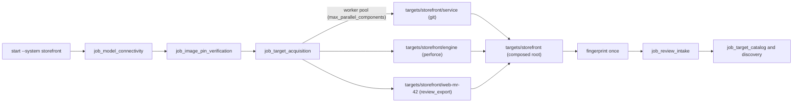

# Target acquisition

A review **system** is composed of one or more **components**, because one reviewed system can live
in more than one source-control system (a Git service plus a Perforce engine, or a Gerrit change
plus the Git library it builds against). Each component is acquired from a pinned source into
`targets/<system>/<component>/`, and the review reads the composed `targets/<system>/` root once.

| Kind | Source | Pinned identity |
|---|---|---|
| `git` (default) | Git repository (https, ssh) with submodules followed recursively | commit, tree, and every submodule's gitlink commit and tree |
| `perforce` | Perforce depot path, read with `p4 print` (no client workspace) | submitted changelist, effective change, per-file revision, MD5 check, and SHA-256 |
| `review_export` | GitLab merge request, Gerrit change, or Azure DevOps pull request | reviewed head revision plus Gerrit patch set or Azure DevOps iteration; Git checkout of that revision |

Acquisition only ever creates checkouts. A component whose checkout and record both exist is
re-verified read-only; a component directory without its record, or a `targets/<system>` directory
that acquisition did not create, is `REFUSED`. It never pulls, edits, or replaces an existing
checkout. To acquire a component again, delete `targets/<system>/<component>/` together with
`data/target-acquisitions/<system>/components/<component>/` yourself.

Two entry points share one engine (`acquire_system`):

- **In a review run:** `appsec-review start --system <id>` (or `APPSEC_REVIEW_SYSTEM=<id>` for
  Dagster and other drivers). The `job_target_acquisition` gate acquires the components before
  `job_review_intake`, and discovery runs once over the composed root. See
  [In a review run](#in-a-review-run).
- **Stand-alone:** `appsec-review acquire-target`. See [Run](#run).

Implementation: `src/appsec_review/target_acquisition/` and
`src/appsec_review/jobs/job_target_acquisition/`. Configuration:
`src/appsec_review/config/target_acquisition.py`. Tests: `tests/test_target_acquisition.py`. These
use local Git repositories with nested submodules, a fake `p4`, and loopback review-API servers. No
test uses the network.



## Configure

Systems live in the central `[target_acquisition]` table of `appsec-review.toml`. That table holds
the bounds, the executables, and `max_parallel_components` (how many components of one system are
acquired at once, 1 to 64, default 4). Every key is validated; unknown keys, duplicate system ids,
and duplicate component ids within a system are refused. `kind` defaults to `"git"`.

```toml
[[target_acquisition.systems]]
id = "storefront"

[[target_acquisition.systems.components]]
id = "service"                     # kind = "git" is the default
url = "https://git.example.com/team/service.git"
commit = "0123456789abcdef0123456789abcdef01234567"
submodules = "recursive"           # or "none": each gitlink is then a named gap
fetch_refs = []                    # extra refs/... to fetch when the commit is not on a branch or tag

[[target_acquisition.systems.components]]
id = "engine"
kind = "perforce"
port = "ssl:perforce.example.com:1666"
trust_fingerprint = "AB:CD:..."    # required for ssl ports; pinned with `p4 trust -i`
depot_path = "//depot/engine/main/..."
changelist = 123456                # must be a submitted change
user_env = "P4USER"
ticket_env = "P4_TICKET"           # optional; passed only as P4PASSWD in the p4 environment

[[target_acquisition.systems.components]]
id = "web-mr-42"
kind = "review_export"
provider = "gitlab"                # gitlab | gerrit (patchset) | azure_devops (repository, iteration)
source = "api"                     # or "bundle" with bundle_path and bundle_sha256
api_url = "https://gitlab.example.com"
project = "team/web"
change = 42
revision = "<reviewed head commit>"
clone_url = "https://gitlab.example.com/team/web.git"
token_env = "GITLAB_TOKEN"         # Gerrit also needs username_env (HTTP password auth)
```

A single-repository review is a system with one component.

Credentials never appear in the configuration, a manifest, a failure record, or a log:

- Git URLs with user information are refused. Use the operator's Git credential helper or ssh
  agent instead.
- Perforce tickets and review-API tokens are read from the environment variables a component names.
  A missing variable is `REFUSED`.
- Every record is checked for each secret value before it is published. Process output is scrubbed.

## In a review run

```bash
appsec-review start --system storefront
appsec-review plan-resume --run-id <run> --system storefront
appsec-review resume --run-id <run> --system storefront
```

`--system` and `--target` are mutually exclusive. With `--system`, the gates up to and including
`job_target_acquisition` run before the target exists. The gate acquires every component
concurrently, or re-verifies those already acquired, and writes the system manifest. Only then is
the composed `targets/<system>` root fingerprinted and the remaining jobs planned and run against
it, so intake, cataloging and discovery each run once over all components. The gate always runs
again on resume, so a resumed run re-verifies the components but never fetches into or edits them.
Downstream reuse also requires unchanged accepted inputs and source-history identities; an unchanged
composed tree alone does not establish that the Git metadata is unchanged.

There is no second source-history wiring step. After intake and cataloging, history discovers
eligible sources from the accepted system and component manifests, analyzes each available Git or
review-export checkout at its pinned acquired revision, and maps its paths back under the composed
root. The system root itself need not contain `.git`. Unsupported history sources, including
Perforce, remain named gaps; they do not prevent analysis of the available Git components.
See [source-history operations](source-history-analysis.md) for credentials, policy opt-outs,
revision binding, and coverage.

The gate records `target-acquisition-plan.json`, `target-acquisition-result.json` (per-component
status, action, acquisition id and manifest hash) and a hash-checked copy of the system manifest
(`system-manifest.json`) in its attempt directory. A failed component is a named gap and the run
completes with gaps; when no component is available, the gate fails the run. Without a requested
system (a `--target` run) the gate records `NOT_REQUESTED` and changes nothing.
`jobs.job_target_acquisition.settings.enabled = false` removes the gate from every graph, and
`--system` is then refused.

## Run

```bash
appsec-review acquire-target                                            # every configured system
appsec-review acquire-target --system storefront                        # one system, all components
appsec-review acquire-target --system storefront --component engine     # selected components
appsec-review acquire-target --system storefront --verify-only          # read-only re-check
```

These are acquisition selectors, not additional history-wiring options. `--system` repeats;
`--component` repeats and needs exactly one `--system`. `--verify-only` checks
every component and the composed tree against the system manifest and writes nothing; it cannot be
combined with `--component`. The command
prints one JSON result per system, with a `components` entry per component. Exit codes:

- `0`: every system is `COMPLETE` or `VERIFIED` with no gaps.
- `2`: at least one system is `PARTIAL`, and none failed.
- `1`: any system is `REFUSED`, `FAILED`, or `MISMATCH`.

## What is written

`targets/<system>/<component>/` holds the materialized source. For `git` and `review_export`
components it keeps the `.git` directory, which source-history and change-context analysis read.

`data/target-acquisitions/<system>/` (ignored by Git) holds:

| File | Content |
|---|---|
| `manifest.json` | `appsec-review/target-system-acquisition/1`: the system spec, each available component's acquisition id, manifest hash, tree hash and pinned identity, `identity_sha256`, the raw fingerprint of the composed `targets/<system>` tree (the same `sha256-bounded-tree-v1` value intake computes), `status` (`COMPLETE`/`PARTIAL`/`FAILED`), `gaps` prefixed with the component id, and per-component status, action and failure record. Rewritten atomically by every acquisition |
| `components/<component>/manifest.json` | `appsec-review/target-acquisition/1`: credential-free spec, pinned `identity` and `identity_sha256`, the component tree fingerprint, inspection counts, `status`, `gaps`, artifact hashes, tool versions, and the authority statement |
| `components/<component>/perforce-files.json` | per-file depot path, revision, change, type, size, SHA-256, and whether the server MD5 was verified |
| `components/<component>/review-export-bundle.json` | the exact provider responses, reusable offline as a `source = "bundle"` input |
| `components/<component>/review-records.json` | `appsec-review/review-records/1`, the change-context review export |
| `components/<component>/changed-paths.json`, `change.diff` | base-to-head paths and binary-safe patch for the reviewed revision |

A failed or refused component publishes nothing under `targets/`. Its staging directories are
removed, and a credential-free failure record is written to
`data/target-acquisitions/<system>/components/.failed/<component>-<time>.json`.

## Safety

Materialization goes through these checks:

- Content is staged in `targets/<system>/.staging-*` and inspected before an atomic rename. Inspection
  refuses symbolic links and special files, and enforces `max_files`, `max_total_bytes`,
  `max_file_bytes`, and `max_path_bytes`.
- Every source path is validated before anything is written for it. Absolute paths, `..`,
  backslashes, drive prefixes, control characters, and `.git` components are refused, and so are
  Perforce paths that collide when case-folded.
- Git runs with these settings:
  - No system configuration, and no repository hooks or templates.
  - `core.symlinks=false`: links are materialized as text, and each one is a
    `symlink_materialized_as_text` gap.
  - fsck on fetch, no LFS smudge, and no terminal prompt.
  - A protocol allow-list of https and ssh only. `ext::`, `fd::`, `git://`, and `http://` are
    refused, as are option-like URLs.
- Submodule URLs come from the pinned commit's `.gitmodules` and are checked again. Each submodule
  must check out exactly its gitlink commit. When one cannot, the result is a named gap rather than
  a failure of the whole component.
- Components are acquired in separate staging directories by a bounded thread pool; one component
  failing never removes or edits another.
- Perforce runs with these settings:
  - No `P4CONFIG` or `P4ENVIRO` file, a temporary trust and ticket file, and no client.
  - Reads only: `info`, `describe`, `changes`, `fstat`, and `print`.
- Review-API requests use https only. Redirects are refused. Responses are size-bounded
  (`max_http_response_bytes`) and the commit list is capped (`max_review_commits`). The reported
  head must equal the pinned revision, and for Gerrit the patch set must too; otherwise the request
  is `REFUSED`.
- Review titles, descriptions, comments, and names are never copied into review records. Only typed
  fields are kept: timestamps, identifiers, and approval facts.

## Gaps

Any gap makes the acquisition `PARTIAL`. In the system manifest each component gap's path is
prefixed with the component id. Intake carries the gaps forward. A gap is never evidence that a
target is clean.

| Gap | Meaning |
|---|---|
| `symlink_materialized_as_text` | a Git symbolic link was written as a text file |
| `submodule_not_materialized` | `submodules = "none"` |
| `submodule_url_refused`, `submodule_url_missing` | the gitlink's URL is unsafe or absent |
| `submodule_checkout_failed`, `submodule_commit_mismatch` | the gitlink commit could not be checked out |
| `submodule_depth_exceeded` | nesting is deeper than `max_submodule_depth` |
| `git_lfs_object_not_fetched` | an LFS pointer was left in place |
| `perforce_digest_unverified` | keyword-expanded or Unicode file whose printed bytes cannot match the server MD5 |
| `perforce_symlink_skipped`, `perforce_revision_unavailable` | symlink type, or purged/archived revision |
| `review_approvals_unavailable`, `review_approval_times_unavailable` | approvals, or their times, are not reported by the provider |
| `review_commits_truncated`, `review_commit_ids_rejected`, `review_head_not_in_commit_list` | incomplete commit coverage |
| `review_not_merged` | open or abandoned review; merge-time metrics are unavailable |
| `change_base_unavailable`, `change_diff_failed`, `change_diff_too_large` | no reviewed diff |
| `component_acquisition_failed` | a component was `REFUSED` or `FAILED`; the rest of the system is still reviewed |
| `component_verification_failed` | an existing component no longer matches its manifest |
| `component_not_acquired` | a configured component was not selected (`--component`) and is absent |
| `unconfigured_system_entry` | `targets/<system>` contains an entry that is not a configured component |
| `target_changed_since_acquisition` | the tree a run reviewed differs from the acquired tree (added by intake or `--verify-only`) |

## Use in a review

In `job_review_intake`, `fingerprint_target` finds the manifest whose `target_path` is the reviewed
target (the system manifest for `targets/<system>`, or a pre-system component manifest) and copies
it into the run as `target-acquisition.json`. It records the acquisition id, identity hash,
manifest hash, and whether the reviewed tree matches the acquired tree. The intake handoff lists
the acquisition gaps.

For a `review_export` component, its `change_context` result identifies the acquired review export
and its hash. History automatically verifies and retains those records with their component
identity; change-context's default review source consumes them. Do **not** copy each component's
export path and hash into the single change-context configuration to connect it. Explicit
`review.source = "none"` remains a deny, and `"export"` remains an operator-selected override for a
single source, not a way to assign one global export across a composed system's repositories.
See [change-context operations](change-context-analysis.md#review-records).

Source-history records retain the component's acquisition/repository identity, pinned revision,
source-relative path, and composed target path. Thus `service/src/auth.py` and
`web-mr-42/src/auth.py` remain separate evidence even when both source-relative paths are
`src/auth.py`. Discovery neither enables a new provider nor authorizes credentialed network access;
GitHub enrichment still obeys its configured endpoint, credentials, bounds, and explicit deny.

## Not covered

- Perforce history analysis, and following submodules as independent history sources, belong to
  source-history analysis (see [`../TODO.md`](../TODO.md)). Acquisition pins both identities so
  history analysis can bind to them later.
- Git LFS objects are not fetched.
- Perforce streams, shelved changes, and unsubmitted changelists are refused, not materialized.
- Components are composed under one root; per-component cataloging or build profiles are not
  inferred from the component boundary.
- Adapters were validated against recorded and fake responses, not against live GitLab, Gerrit,
  Azure DevOps, or Perforce servers.
