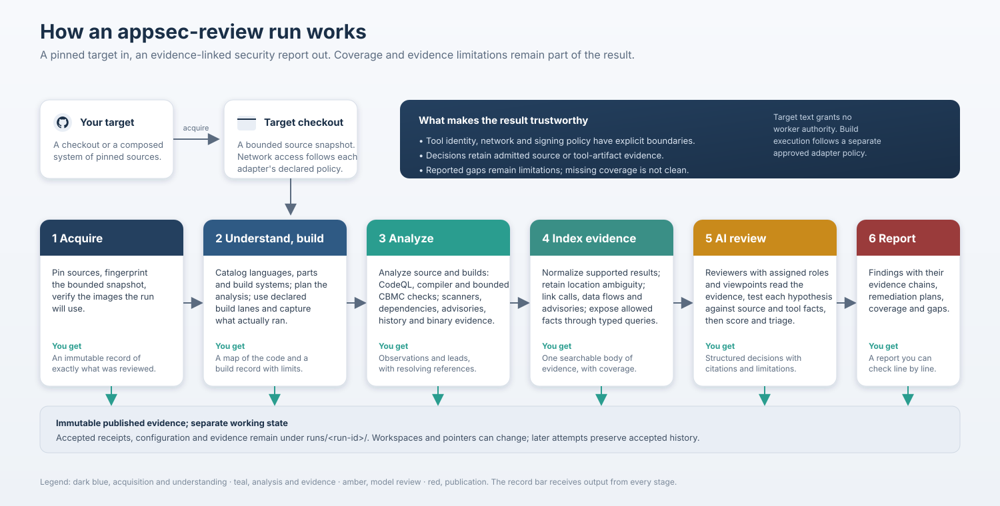
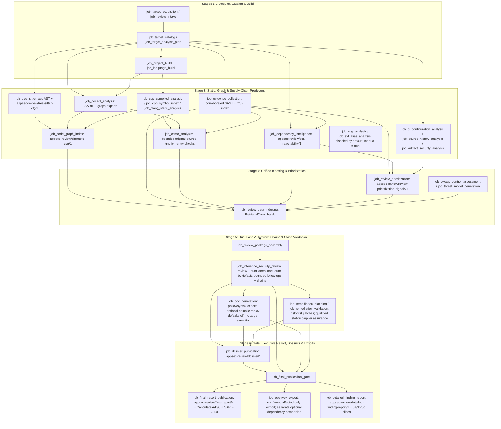

# How an appsec-review run works

appsec-review examines a pinned target, which can be a checkout or a composed system of source
components, and produces an application-security report linked to admitted source or tool-artifact
evidence. Jobs retain structured decisions, citations, gaps and receipts. These make the result
auditable; they do not prove every claim is correct or every relevant behavior was checked.

## The six stages

| Stage | What happens | What you get | Read more |
|---|---|---|---|
| 1 Acquire | A configured system's pinned components are acquired or existing components are re-verified. A supplied checkout can also be reviewed without acquisition. Intake records the bounded source snapshot; image readiness verifies declared identities. | Retained source/provenance identities and explicit acquisition limits. | [Target acquisition](operations/job_target_acquisition.md), [Image-pin verification](operations/job_image_pin_verification.md) |
| 2 Understand and build | The code is catalogued by language, component and build system. An analysis plan selects build/analysis work. Build lanes use their declared host/container and network policies; accepted capture records what was actually observed. | A code map, build/capture receipts and named unavailable or incomplete work; not an unconditional reproducibility guarantee. | [Target analysis planning](operations/job_target_analysis_plan.md), [Acquisition and build architecture](architecture/target-acquisition-and-build.md) |
| 3 Analyze | Declared producers analyze source, builds, dependencies, history, CI configuration and artifacts. Applicable CodeQL/compiler branches add graph and dataflow facts. | Observations and leads with source or artifact references where available. A scanner lead is not yet a finding. | [CodeQL analysis](operations/job_codeql_analysis.md), [Scanner architecture](architecture/scanners-and-evidence-collection.md), [Dependency intelligence](operations/job_dependency_intelligence.md) |
| 4 Index the evidence | Supported outputs are normalized and linked through typed, bounded queries. Locations can be absent or ambiguous. Protected raw artifacts are not made public merely by appearing in the inventory. | Accepted searchable evidence with producer and coverage identities, not every retained byte or complete language coverage. | [Review data indexing](operations/job_review_data_indexing.md), [Retrieval and MCP](operations/retrieval-mcp.md), [Code intelligence](architecture/code-intelligence.md) |
| 5 AI review | Bounded model roles investigate hypotheses against admitted evidence. Predicate-specific verification, scoring and triage preserve missing support and unconfirmed outcomes rather than treating every candidate as proved. | Structured decisions, citations, limitations and receipts. Full raw conversations are not retained by default. | [Inference security review](operations/job_inference_security_review.md), [Review architecture](architecture/review-inference-and-guidance.md) |
| 6 Report | The final gate binds findings, scoped evidence, available remediation outputs and recorded coverage limitations. Reports render that frozen input rather than discovering later evidence. | A report and dossier with explicit evidence and availability boundaries. | [Final report](operations/job_final_report_publication.md), [Dossier publication](operations/job_dossier_publication.md), [Reporting architecture](architecture/reporting-and-metrics.md) |

## End-to-end architecture dataflow

This is a conceptual evidence flow, not the complete scheduling graph or a grant to consume
every predecessor. Typed contracts and actual read receipts govern consumption. The checked-in
recipe registers 49 jobs: 47 review-graph declarations, of which 44 are enabled; maintenance
sync and internal build iteration have separate dispatch boundaries.

The report renders deterministic Markdown and HTML, a configured executive PDF, and streamlined
visual `Candidate A`, `Candidate B`, and `Candidate C` executive reports from the certified gate
snapshot and gate-bound dossiers, while `job_detailed_finding_report` pairs each confirmed defect
with deterministic `3a` (source taint flow), `3b` (call-fanout slice), and `3c` (function CFG)
diagrams and run-completion efficacy archival records target-grouped Run-over-Run and Smoke
Effectiveness reports. The accepted handoff's `pdf` outcome and renderer
receipt distinguish rendered, failed and disabled output; the initial JSON's pre-render
`not_rendered` declaration is not that outcome. Radar `/2` retains unknown measurements as
`null` with reasons (**N/A** in renderings), not measured zero. Protected dossier PDFs remain
separate. See [final report publication](operations/final-report.md#the-report).
Report-design mockups are proposals, not the output of this implementation or evidence of a
successful renderer run.

## What makes the result trustworthy

- **Explicit execution policy.** Tool identities, isolation, network and signing policy have
  distinct recorded boundaries. Acquisition and some build paths are not offline containers;
  see [images and deployment](architecture/images-and-deployment.md).
- **Evidence-linked decisions.** Source or tool-artifact citations support bounded predicates.
  Correct byte binding does not replace independent verification of the security claim.
- **Gaps remain limitations.** Inspect producer coverage and reported gaps together, including
  [known accounting limits](architecture/runtime-interchange.md#named-gaps). Missing coverage is
  not a clean result.
- **Inputs are data.** Target text does not grant model-worker authority. Approved build adapters
  can execute build commands under their separate policy; this is not an absolute prohibition on
  executing target-owned build code.
- **Immutable published evidence.** Accepted publications, frozen configuration and guidance are
  retained under `runs/<run-id>/`. Mutable workspaces, controller state and latest pointers are
  separate; later attempts do not rewrite previously accepted evidence.

## What it does not claim

A completed run is a milestone, not proof that the code is secure or that coverage accounting is
complete. Scanner output is a lead until the review verifies it. Generated PoCs and remediation
regressions are not executed. The pipeline performs build/compile checks and can ingest existing
execution evidence; these do not establish runtime reproduction.

## Where to go next

- [Architecture index](architecture/README.md) for the design of each subsystem.
- [Review startup](operations/review-startup.md) to run a review.
- [Agent navigation](agent-reader.md) for agents working on this repository.
