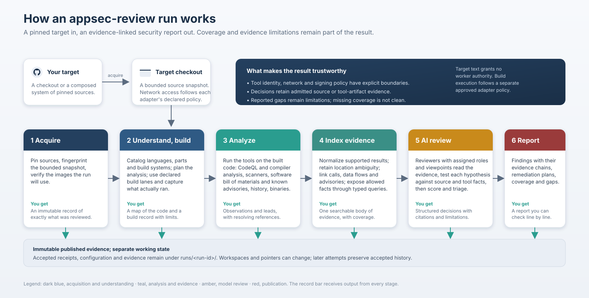

# How an appsec-review run works

appsec-review takes one Git repository at one exact commit and produces an application-security
report in which every finding is backed by the source lines and the tool results that support it.
The run is a fixed graph of jobs. Each job writes an immutable receipt, and anything the run could
not check is reported as a named gap rather than as a clean result.

## The six stages

| Stage | What happens | What you get | Read more |
|---|---|---|---|
| 1 Acquire | The repository is cloned at the requested commit into the target checkout. Every file is hashed, the commit is pinned, and the container images the run will use are verified against their recorded identities. | An immutable record of exactly what was reviewed, so the result can be reproduced and audited. | [Target acquisition](operations/target-acquisition.md), [Image-pin verification](operations/image-pin-verification.md) |
| 2 Understand and build | The code is catalogued by language, component and build system. An analysis plan decides what to build and analyze. Builds run in pinned containers with no network, and the compiler is traced as it runs so later analysis sees the code exactly as it was compiled. | A map of the code and a reproducible build, or a named gap naming what could not be built. | [Target analysis planning](operations/target-analysis-planning.md), [Project build](operations/project-build.md) |
| 3 Analyze | Tools run against the built code and the repository: CodeQL and compiler-level analysis for data flow and call graphs, source scanners, a software bill of materials matched against known advisories, source history, CI configuration and binary artifacts. | Raw facts and leads, each tied to a file and line. A scanner lead is not yet a finding. | [CodeQL analysis](operations/codeql-analysis.md), [Static analysis](operations/static-analysis.md), [Dependency intelligence](operations/dependency-intelligence.md), [Source history](operations/source-history-analysis.md) |
| 4 Index the evidence | Every result is normalized into evidence with exact source locations and linked: calls to callers, data flows to the sinks they reach, packages to advisories. The evidence is exposed through typed queries that the review can ask, with coverage recorded per language and per source. | One searchable body of evidence, with an explicit statement of what it covers. | [Review data indexing](operations/review-data-indexing.md), [Retrieval and MCP](operations/retrieval-mcp.md), [Code-graph index](operations/code-graph-index.md) |
| 5 AI review | Model reviewers with assigned roles and viewpoints read the evidence, form hypotheses, and test each one against source and tool facts. A claim without a resolving source line or tool artifact is not admitted. Findings are scored and triaged. | Findings that survived verification, ranked by severity and confidence, with the reasoning kept. | [Inference security review](operations/inference-security-review.md), [Review prioritization](operations/review-prioritization.md) |
| 6 Report | Findings are published with their evidence chains, remediation plans and validation, coverage, and every gap the run recorded. | A report that can be checked line by line, and a dossier for the record. | [Final report](operations/final-report.md), [Dossier publication](operations/dossier-publication.md), [Remediation](operations/remediation.md) |

## What makes the result trustworthy

- **Pinned, isolated tooling.** Every tool runs in a container whose identity is recorded and
  verified, with no network access during builds and scans.
- **Evidence or nothing.** A finding cites the exact source lines and the tool output that
  support it. The review does not assert what it cannot show.
- **Gaps are named.** A language with no analyzer, a build that failed, a tool that timed out:
  each is recorded as a gap in the report, never silently treated as clean.
- **Inputs are data.** The target's own scripts, documents and comments are never followed as
  instructions, so a repository cannot steer its own review.
- **One immutable record.** Everything a run produced lives under `runs/<run-id>/`, including
  the exact configuration and model guidance it used. Nothing is rewritten after the fact.

## What it does not claim

A completed run proves that the review ran and what it covered. It does not prove the code is
secure: the coverage section of the report says what was analyzed, and the gaps say what was
not. Scanner output is a lead until the review verifies it. Dynamic behaviour is not exercised.

## Where to go next

- [Architecture index](architecture/README.md) for the design of each subsystem.
- [Review startup](operations/review-startup.md) to run a review.
- [Agent navigation](agent-reader.md) for agents working on this repository.
