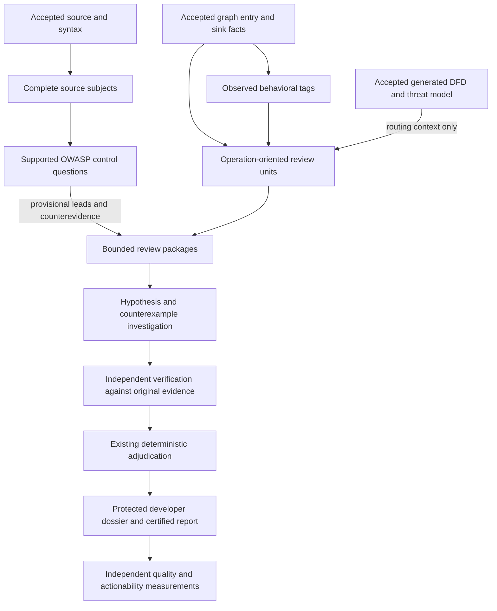

# Behavior-oriented review

T-146 implements the user's 2026-11-13 direction to improve finding quality through a
component/concept map, relevant evidence selection and a coherent bounded review process.
The user explicitly requests unit, integration and acceptance tests, and explicitly forbids
running integration and acceptance tests during this implementation.

## Outcome and boundaries

The product is an independently supported, developer-actionable finding, not a tag count,
control-matrix completion rate or number of agreeing models. OWASP controls supply review
questions and reporting classifications. They do not prove vulnerabilities or component safety.

This change reuses accepted source, syntax, code-graph and generated threat-model data. It does
not add a scanner, launch a container, change target checkouts, commission runtime evidence,
reload the deployment or grant workers new authority. Existing frozen runs are not rewritten.
No new control family is declared supported merely because a question can be generated for it.

## Numbered implementation decisions

1. **One evidence authority.** Original accepted source/producer records remain evidence.
   Generated diagrams, operation maps, security tags and control assessments remain routing
   context. Consumers retain exact source and publication identities and independently
   re-resolve final claims. A missing optional producer is a named gap; corrupt supplied
   evidence is an integrity failure.
2. **Subject-complete OWASP selection.** Select bounded, complete named source subjects instead
   of a prefix of each source file. Accepted syntax/graph locations prioritize discovery;
   bounded parsing of accepted Python source is the fallback for the four existing reviewed
   Python procedures. Complete function/module subjects preserve decorators, absolute lines
   and content identity. No substring/keyword match establishes control satisfaction.
3. **Finite discovery.** New typed optional settings bound candidate files and total source
   bytes per component. Discovery defaults are 512 files and 8 MiB per component. Existing
   `max_source_lines`, `max_evidence_per_component` and `max_subjects_per_control` still bound
   delivered work. Every cap, oversized subject, parse failure, unknown language, redaction
   and unresolved ownership is accounted. Smaller complete subjects may be assessed without
   claiming coverage of the omitted file or component.
4. **Separate omission from damaged evidence.** A complete, independently re-resolved subject
   may support a scoped assessment even when other subjects were omitted. A clipped subject,
   missing prerequisite, redacted security-relevant content or ambiguous ownership cannot.
   Scope is established by the application, not by a model asserting that an excerpt is complete.
5. **Behavioral tags.** Extend the existing tagging job with a bounded reader of accepted
   `graph-fact/1` entry and sink facts. Emit only vocabulary-backed capabilities supported by
   those facts, with exact source/site evidence. `invoked` means the operation is observed,
   never that a weakness exists. An unresolved/disagreeing fact cannot become a stronger tag.
   Remote input alone does not establish a public HTTP route or deployed exposure.
6. **Single vocabulary.** Correct component-role routing to the canonical `func:authn:*`,
   `func:crypto:*` and other existing capability families. Retain declared, invoked, reported
   and derived bases. Do not promote speculative CWE/CAPEC/ATT&CK crosswalk outputs.
7. **Operation-oriented review units.** Prefer accepted operation/function anchors and
   evidenced boundary context over arbitrary path batches. Keep deterministic bounded path
   batches for files without operation evidence, explicitly marked as fallback. Preserve
   every source file and lead in the scope accounting, including units below the hunt cutoff.
   Unsupported or absent operation evidence must not remove fallback coverage.
8. **Use the generated map, do not duplicate it.** Read the optional generated DFD/threat-model
   publication through typed admitted inputs. Validate its origin, snapshot, hashes and source
   reference membership. Attach bounded map context to matching review units/packages;
   generated boundary and threat identities never become direct evidence. Original source
   citations remain the route to verification.
9. **Rank opportunities, not labels.** Replace raw tag density with deduplicated evidenced
   security-operation opportunities. Language, gap, catalog and derived tags contribute no
   opportunity points. Multiple tags or producers describing the same site do not multiply
   the score. Retain independent prioritization/history/advisory signals and named unknowns.
   Version the ranking/assembly identities so prior package/cell results cannot be reused
   under changed semantics.
10. **Proof obligations remain authoritative.** Preserve deterministic adjudication and
    independent verification. Family-specific questions describe actor/resource/policy for
    authorization, input/interpreter/control for injection, size/lifetime/ownership for memory,
    interleaving for races, and attacker work/resource bounds for exhaustion. A question
    without a commissioned evidence path remains unresolved, never automatically confirmed.
11. **Do not remove reviewers without efficacy evidence.** The previous assessment recommended
    evaluating smaller panels and disagreement-only judging, not claiming they are better.
    Keep current role counts and judge/PoC dependencies in this implementation. The design
    records a controlled comparison rather than silently reducing coverage or PoC eligibility.
12. **Actionability is observed, not inferred from absence.** Derive path availability from
    counted reachability evidence, not from a missing-predicate list lacking the word
    reachability. Populate remediation presence/validation from exact certified attachments.
    Unknown owner, attacker position and runtime validation stay unknown unless supported.
13. **One developer projection.** Reuse protected dossiers for source locations, mechanism,
    preconditions, counterevidence, remediation and regression guidance. Public reports retain
    sanitized references. Do not create a second finding state, report authority or ticket store.
14. **No automatic live validation.** Unit tests exercise actual parsers, mappings, selection,
    validators, fingerprints, handler wiring and metric projections with canned boundaries.
    Integration tests cover real local index/publication joins; acceptance checks consume an
    explicitly supplied run and verify the outcome contract. Neither tier runs in this change.

## Data flow and the review job

Each operation map identifies the component/build scope, original source anchors, operation
kind, entry/input class when established, candidate boundary, applicable questions, and
unknowns. A package never states deployment exposure, ownership policy or asset sensitivity
that its sources did not establish.

The lifecycle is: establish scope and readiness; discover supported operations; construct a
bounded question; collect original evidence and seek counterevidence; request specific missing
evidence within the existing capability; verify independently; adjudicate; publish a useful
developer brief. An unanswered evidence request is a gap, not agreement.

The existing job contract, task receipts, execution limits, canonical gaps and publication gates
remain the execution protocol. Commissioning uses the walk charter's input, independent
comparison, gap-cause and baseline checks. This design does not change the walk's user-owned
stop/acceptance rules or authorize a routine unattended review.

## Implementation ownership and sequence

| Slice | Owned surfaces | Dependency |
| --- | --- | --- |
| A: subject evidence | `config/owasp.py`, `owasp_workbench/evidence.py`, `assessment.py`, `obligations.py`, focused new OWASP tests | this design |
| B: observed capabilities | security-tagging producers/job/taxonomy and pinned capability rules, component-role routing, focused new tagging tests | this design |
| C: operation planning | review units/ranking/packages/views, optional generated-map consumer and typed contracts, associated schemas and focused tests | A/B public contracts where used |
| D: quality feedback and integration | finding run adapter, central TOML/pins, registry entry, this document, cross-surface regressions | A/B/C |

The coordinator owns shared configuration and schemas. Agents do not independently change
central TOML, common test maps, registry entries or another slice's files. Isolated Linux
worktrees prevent edits to mounted main sources. Ready commits are handed to the designated
main owner for serialized integration; no push is authorized.

## Verification matrix

| Tier | Required behavior |
| --- | --- |
| Unit: OWASP | Sites after line 120; complete functions in large files; decorators/nesting; multiple controls/sites; deterministic caps; no recognized subject; unsupported language; malformed/truncated/redacted input; original reference re-resolution; unrelated/forged reference rejection; scoped omission never component-wide satisfaction |
| Unit: tags | Each supported graph mapping; unchanged declared package facts; exact evidence/basis; unresolved/disagreeing/unknown graph facts; component ambiguity; duplicate sites; missing graph and bounded reads; handler wiring |
| Unit: planning | Stable operation identity; different operations separated; bounded fallback; no lost files/leads; source ids below cutoff; zero score for gap/language/derived tags; no score multiplication; missing/tampered/generated foreign context; schema and fingerprint invalidation |
| Unit: quality | Counted path versus irrelevant/absent predicate; exact finding-to-attachment binding; unknown versus false; compile-only never runtime-validated; absent optional capabilities; unchanged finding state |
| Integration, authored only | Accepted source/graph/tag/OWASP/package joins through real local indices and publication custody; scoped evidence survives projection; stale/foreign/tampered inputs fail; no fabricated confirmed finding |
| Acceptance, authored only | Operator-supplied run exhibits operation coverage, complete subject accounting, original citations, exact output partitions, protected actionability and explicit gaps; execution success is not a correctness label |

All new unit tests belong under `tests/unit/`, remain independent and under ten seconds, and
do not use containers, external tools, models, network or Dagster. Test the actual logic; fake
only external interfaces. Coverage targets every added decision/failure branch rather than
inflating counts with import or constant checks. Full-repository unit coverage is not claimed
by a focused change.

Integration and acceptance tests are excluded from implicit unit collection and carry explicit
time budgets and named prerequisites. They are **NOT RUN** under this authorization. Independent
real-target finding precision/recall, developer acceptance and model-panel comparisons remain
manual efficacy work tracked by T-146 and the existing finding-metrics registry items.

## Implementation and verification record

Initial base: `750278483e86dd44a1be88a5039b7f58f194d59b`. Implementation and focused unit results
will be recorded here before handoff. Historical run observations motivated the design but are
not a baseline proving current-model efficacy.
