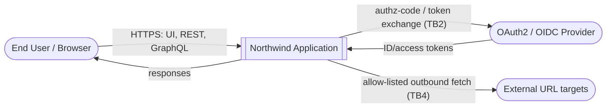
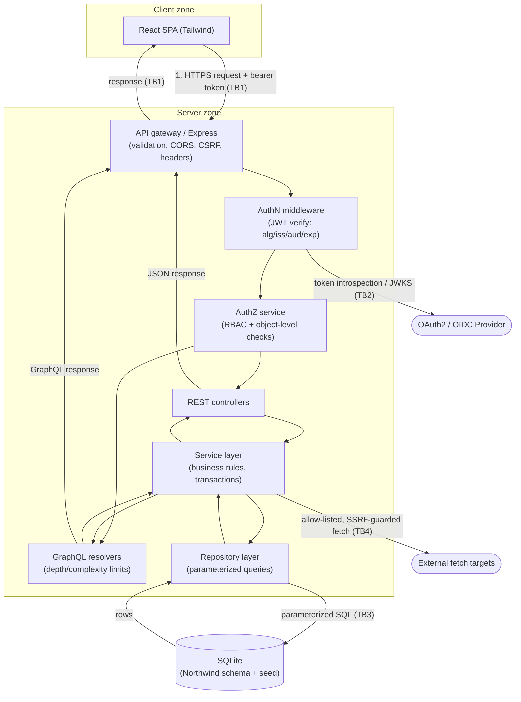

# Northwind Sample Application — Data Flow Diagram (DFD)

> Companion to `northwind-app-design.md` and `stride-threat-model.md`.
> Describes the target-state (secure) architecture.

This document presents the application's data flows at Level 0 (context) and
Level 1 (major processes), with the trust boundaries used by the STRIDE threat
model.

---

## Trust boundaries

- **TB1 — Browser ↔ API**: the public network edge between the user's browser
  and the backend. Everything beyond it is server-controlled.
- **TB2 — API ↔ Identity Provider**: the boundary with the OAuth2/OIDC
  authorization server.
- **TB3 — API ↔ Datastore**: the boundary between application code and the
  SQLite database.
- **TB4 — API ↔ External fetch targets**: the boundary crossed by any feature
  that retrieves a remote resource on the user's behalf.

---

## Level 0 — Context diagram

---

## Level 1 — Major processes and stores

---

## Data stores and classification

| Store              | Contents                                  | Sensitivity |
| ------------------ | ----------------------------------------- | ----------- |
| SQLite (Northwind) | Business records: customers, orders, etc. | Internal    |
| Session/token data | Access/refresh tokens, OAuth state/nonce  | Secret      |
| Config/secrets     | Signing keys, DB path, allow-lists        | Secret      |

---

## Notes

- Every request crosses TB1 and is authenticated (TB2 artifacts) and authorized
  before any service logic runs.
- The repository layer is the only component that crosses TB3; all access is
  parameterized.
- Only the service layer crosses TB4, and only through an allow-listed,
  SSRF-guarded fetch utility.
